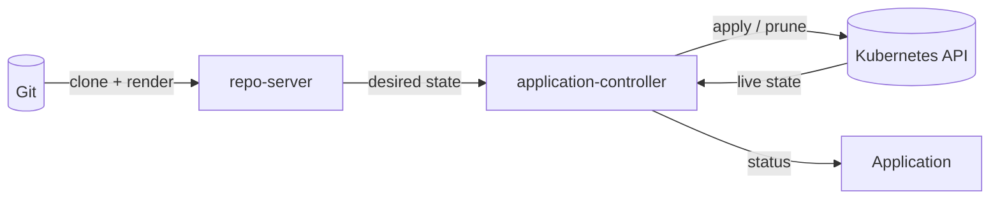
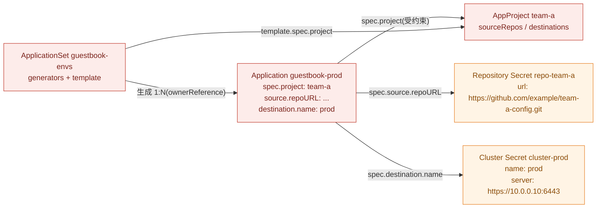
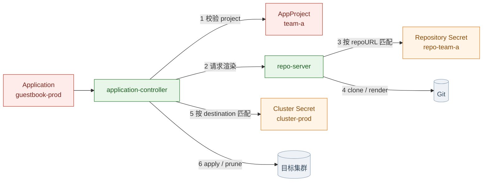
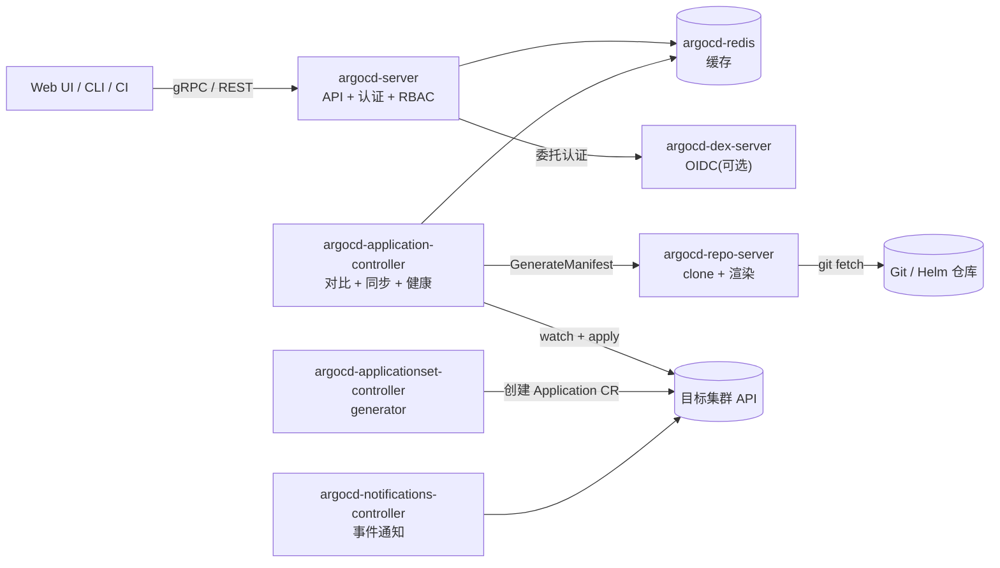
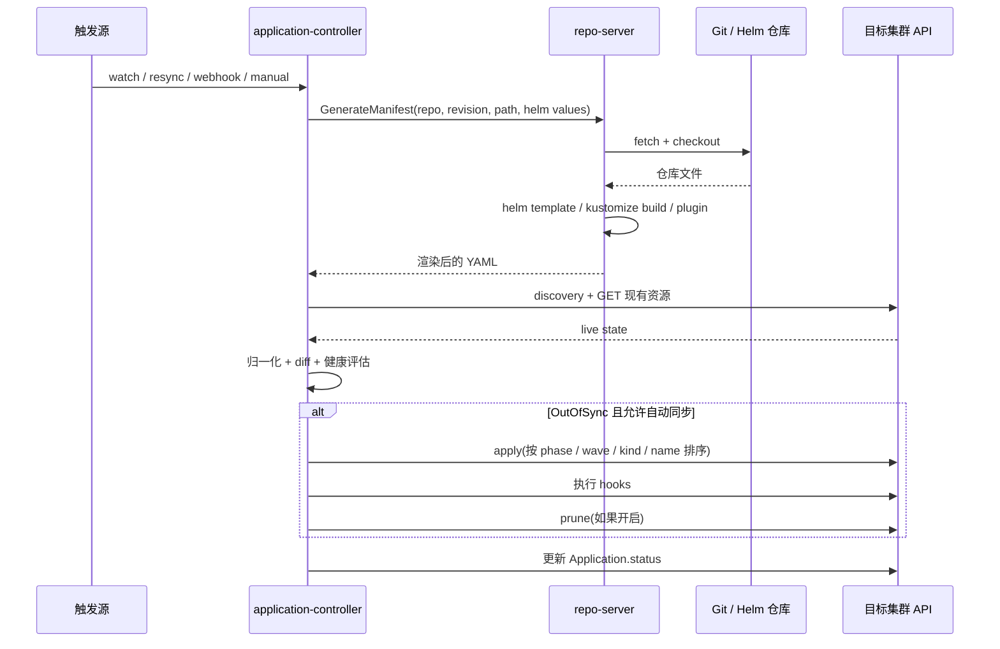

# 00-概念与架构

> 这是整套笔记的第一篇:先讲清"它是什么、由谁做、状态怎么变、对象怎么连"。
> 读完接 [01-环境搭建与首个应用](01-环境搭建与首个应用.md)。
> 版本基线 **v3.5.x**;和 v2 行为不同的地方单独标出。

## 一、先看结论:五个对象,一条链

| 对象 | 角色 | 回答什么问题 |
|------|------|-------------|
| `AppProject` | 规则 | 允许从哪些仓库拉、部署到哪些集群 / namespace、能建哪些资源 |
| `Repository Secret` | 凭据 | 怎么连 Git / Helm 仓库 |
| `Cluster Secret` | 凭据 | 怎么连目标集群 |
| `Application` | 声明 | 把哪个 source 同步到哪个 destination |
| `ApplicationSet` | 工厂 | 按什么规则批量生成 Application |

一句话:

**AppProject 管"能不能",Secret 管"怎么连",Application 管"要什么",ApplicationSet 管"批量生成 Application"。**
只有 Application 直接触发同步。

| 谁 | 创建什么 |
|----|---------|
| 你 | AppProject、Repository / Cluster Secret、Application 或 ApplicationSet |
| ApplicationSet controller | Application |
| Application controller | Deployment / Service / ConfigMap 等业务资源 |

## 二、心智模型:desired / live / reconcile

### 2.1 Argo CD 是"对比 + 纠偏"的循环

它不执行流水线,也不把"期望状态"存进自己的数据库。期望状态在 Git 里,
它每次做三件事:

```text
读 Git + 渲染  ──>  得到 desired state(想要的)
读集群 API     ──>  得到 live state(实际的)
两者对比       ──>  Synced / OutOfSync
OutOfSync 且允许同步 ──> apply / prune,把实际拉回想要
```



触发来源:watch 事件、每 3 分钟 resync、Git webhook、手动刷新。它是**控制器**,不是一次性部署工具。

### 2.2 三个词

| 词 | 是什么 | 从哪来 | 容易误解 |
|----|--------|--------|---------|
| desired state | 渲染后的 Kubernetes 清单 | Git + Helm / Kustomize | 不是 Git 里的原始文件,渲染之后才算 |
| live state | 集群里真实存在的对象 | Kubernetes API | 会被默认值、webhook、控制器改写 |
| reconcile | 对比 desired / live 并纠偏 | controller 循环 | 不是"跑一次流水线",而是持续进行 |

关键区别:**Git 里是 chart + values,Argo CD 渲染之后才得到 desired manifests。**
Helm 的 values 写错、Kustomize 的 overlay 没生效,都会让"想要的"本身就不对。

### 2.3 装修类比

| 概念 | 装修里的角色 | 技术上是什么 |
|------|-------------|-------------|
| Git | 设计图纸 | 唯一事实来源 |
| repo-server | 把图纸翻译成施工步骤 | clone + `helm template` / `kustomize build` |
| Application | 一张施工单 | "图纸哪一页 + 哪个房子" |
| ApplicationSet | 批量开施工单的模板 | generator + template,生成 Application |
| AppProject | 物业许可证 | 允许用哪些材料、在哪个小区施工 |
| Repository Secret | 材料仓库门禁卡 | Git / Helm 仓库凭据 |
| Cluster Secret | 小区门禁卡 | 目标集群凭据 |
| application-controller | 监理 | 不断巡检,发现和图纸不一样就改回来 |
| Sync status | 是否按图施工完成 | 清单有没有 apply 成功 |
| Health status | 房子是否真能住 | Pod / 探针 / 工作负载是否健康 |

## 三、五个对象怎么连

### 3.1 场景

`team-a` 团队有一个私有仓库 `https://github.com/example/team-a-config.git`,里面是 `apps/guestbook`;
要部署到 in-cluster 的 `team-a-dev` 和外部 `prod` 集群的 `team-a-prod`。
用 ApplicationSet 生成 dev / prod 两个 Application。

> 这里只讲关系;完整 YAML 和实际部署见 [01](01-环境搭建与首个应用.md)。

### 3.2 图 A:声明之间谁引用谁

红色是你写的声明,橙色是凭据:



> Application 的 YAML 里**没有** `secretName` 这种字段。它写的是 `repoURL` 和 `destination.name`,
> Argo CD 自己按这两个值去匹配对应的 Secret。

### 3.3 图 B:运行时谁用谁



### 3.4 字段级匹配表

| 关系 | Application 里写的 | 匹配谁 | 匹配字段 | 不匹配会怎样 |
|------|-------------------|--------|---------|-------------|
| Application → AppProject | `spec.project: team-a` | AppProject 的 `metadata.name` | 同名 | project 不存在 → `InvalidSpecError` |
| AppProject → source | `spec.source.repoURL` | AppProject 的 `sourceRepos` | 列表包含该 URL | 不在白名单 → `InvalidSpecError`,sync 被拒 |
| AppProject → destination | `spec.destination.name` + `namespace` | AppProject 的 `destinations` | name / server + namespace 匹配 | 不在白名单 → `InvalidSpecError` |
| Application → Repository Secret | `spec.source.repoURL` | Secret 的 `url` | 精确匹配;`repo-creds` 按前缀匹配 | 私有仓库没匹配到 → `ComparisonError`(认证失败) |
| Application → Cluster Secret | `spec.destination.name` 或 `server` | Secret 的 `name` / `server` | 同名 / 同 URL | 匹配不到 → `Unknown`(cluster not found) |
| ApplicationSet → Application | `spec.template` + `spec.generators` | 无 | 生成 1:N | template 不合法 → 子 Application `InvalidSpecError` |
| Application → 业务资源 | 渲染后的清单 | 目标集群 | apply / prune + tracking | 见 02 / 03 |

### 3.5 不匹配会怎样

| 你写错的地方 | 典型现象 | 先查 |
|-------------|---------|------|
| `spec.project` 写了一个不存在的 project | `InvalidSpecError` | `kubectl get appproject -n argocd` |
| `repoURL` 不在 `sourceRepos` | `InvalidSpecError`,sync 被拒 | AppProject 的 `sourceRepos` |
| `destination` 不在 `destinations` | `InvalidSpecError`,sync 被拒 | AppProject 的 `destinations` |
| `CreateNamespace=true` 但 project 不允许 Namespace | `resource :Namespace is not permitted in project ...` | `clusterResourceWhitelist` |
| 私有仓库没匹配到 Repository Secret | `ComparisonError`(authentication failed) | Secret 的 label、`url`、凭据 |
| `destination.name` 没匹配到 Cluster Secret | `Unknown`(cluster not found) | `argocd cluster list`,Secret 的 `name` |
| ApplicationSet 模板里的 project / source / destination 不合法 | 子 Application `InvalidSpecError` | AppSet 的 `template` 和 generator |
| 手工 Application 和 AppSet 生成同名 Application | 所有权冲突,状态来回变 | 改名字,或只保留一种方式 |

### 3.6 五个常见误解

| 误解 | 实际 |
|------|------|
| Application 直接引用 Secret 的名字 | 不;它写 `repoURL` / `destination`,Argo CD 按值匹配 |
| AppProject 会创建 Application | 不;它只做校验和权限边界 |
| ApplicationSet 会创建 Deployment | 不;它只创建 Application,Deployment 由 Application 创建 |
| AppSet 生成的 Application 不受 AppProject 约束 | 受;它和手工创建的 Application 一样要过 project 校验 |
| in-cluster 也要建 Cluster Secret | 不需要;内置目标名字是 `in-cluster` |

## 四、组件:谁负责什么

### 4.1 一张图



### 4.2 逐个说

| 组件 | 工作负载 | 职责 | 关键点 |
|------|---------|------|--------|
| `argocd-server` | Deployment | 对外 API / Web UI;认证、RBAC;接收 Git webhook;触发 sync / rollback | 无状态,可水平扩;不直接执行 sync |
| `argocd-repo-server` | Deployment | clone / fetch Git;执行 `helm template`、`kustomize build`、CMP 插件;返回渲染后的清单 | 唯一接触 Git 的组件;CPU / IO 密集,可水平扩;有本地缓存 |
| `argocd-application-controller` | StatefulSet | watch Application 和集群资源;对比 desired / live;执行 sync;计算健康状态 | 实际修改目标集群的组件;可按 Application 分片 |
| `argocd-applicationset-controller` | Deployment | 评估 generator,创建 / 更新 / 删除 Application CR | **只生成 Application,不碰业务资源** |
| `argocd-redis` | Deployment | 缓存 repo 状态、集群信息、部分 UI 查询 | 不是事实来源;丢了可以重建 |
| `argocd-dex-server` | Deployment | 内置 OIDC provider,Dex 模式下的身份来源 | 可选;用外部 IdP 时不需要 |
| `argocd-notifications-controller` | Deployment | 监听 Application 事件,按 trigger / template 发通知 | 可选 |

### 4.3 五条不变式

1. **Git 只由 repo-server 拉取。** application-controller 自己不 clone 仓库,它只调用 repo-server 的
   `GenerateManifest`。
2. **Application 的状态存在 Kubernetes CR 里。** Redis 只是缓存,不是事实来源;redis 挂了,
   状态会重建,只是短时间变慢。
3. **application-controller 是目标集群的实际写入者。** server 收到 sync 请求后,是 controller
   去 apply / prune。
4. **repo-server 是无状态的。** 本地 cache 可以丢;副本之间不共享内存,各自缓存。
5. **ApplicationSet controller 只生成 Application。** 业务资源仍然由 Application 去创建。

## 五、一次 reconcile 的完整时序

### 5.1 触发

| 触发 | 说明 |
|------|------|
| watch 事件 | Application CR 变化、目标资源变化 |
| 周期 resync | `timeout.reconciliation`,默认 **180 秒** |
| Git webhook | 仓库变更后,server 收到 webhook,通知 controller 刷新 |
| 手动刷新 | UI / CLI / API 触发 |

### 5.2 refresh 与 hard refresh

| 操作 | 做什么 | 什么时候用 |
|------|--------|-----------|
| refresh | 重新对比,但复用 repo-server 的清单缓存(如果 revision 没变) | 怀疑 live 状态变了 |
| hard refresh | 让 repo-server 丢弃缓存,重新 clone / 渲染 | 怀疑 Helm values、Kustomize、插件输出不对 |

### 5.3 时序图



### 5.4 每一步在干什么

**第一步:拿期望状态。**
controller 把 Application 的 `source` 发给 repo-server。repo-server 先看本地 cache 有没有这个 revision,
没有就 fetch / checkout,然后执行对应的渲染器,返回一组 YAML。产物是**渲染后的清单**,不是 Git 原始文件。

**第二步:拿实际状态。**
controller 通过 discovery 把清单里的 GVK 映射成 API 资源,再逐个 GET。CRD 没装、discovery 找不到,
就会报 `ComparisonError`。

**第三步:对比。**
不是文本 diff,而是把两边解析成对象后做结构化比较。比较前会归一化:去掉 `status`(v3 默认)、
应用 `ignoreDifferences`、处理默认值和 webhook 注入字段。

**第四步:健康评估。**
对每个资源跑健康检查:Deployment 看可用副本,Job 看完成状态,Pod 看 phase / conditions,
CRD 可以自定义 Lua 健康检查。聚合结果写进 `status.health.status`。

**第五步:同步。**
如果是手动模式,等人触发;如果自动模式且 `OutOfSync`,controller 构造 sync operation:

1. 按 **phase → wave → kind → name** 排序。
2. 执行 `PreSync` hooks。
3. 按顺序 apply 资源。
4. 执行 `PostSync` hooks(等资源健康之后)。
5. 如果开启 prune,按相反顺序删除。
6. 把结果写进 `status.operationState` 和 history。

## 六、对象细节

### 6.1 Application

Application 回答四个问题:

1. **从哪里读清单**? `spec.source.repoURL` + `targetRevision` + `path` / `chart`。
2. **部署到哪里**? `spec.destination.server` 或 `name` + `namespace`。
3. **归哪个项目管**? `spec.project`。
4. **怎么同步**? `spec.syncPolicy`。

| 字段 | 要点 |
|------|------|
| `spec.project` | 指向 AppProject 的 `metadata.name`;`default` 允许一切,生产别用 |
| `spec.source` | 单源;`spec.sources` 是多源,两者互斥 |
| `source.repoURL` | Git 地址或 Helm 仓库地址;用来匹配 Repository Secret |
| `source.targetRevision` | 分支 / tag / commit SHA;生产建议固定 tag 或 SHA |
| `source.path` / `chart` | Git 目录,或 Helm chart 名 |
| `spec.destination` | `server` / `name` + `namespace`;用来匹配 Cluster Secret |
| `spec.syncPolicy` | `automated` 块存在即启用;`prune` / `selfHeal` 默认 false |
| `spec.ignoreDifferences` | 忽略不想管的字段,比如 HPA 改的 replicas |
| `metadata.finalizers` | 控制删 Application 时是否级联删资源 |

一个 Application = 一个 source(或一组多源)+ 一个 destination。多环境 / 多集群就是多个 Application。

### 6.2 AppProject

| 字段 | 限制 |
|------|------|
| `sourceRepos` | Application 只能从哪些仓库拉清单 |
| `destinations` | 只能部署到哪些集群 / namespace;`server` / `name` + namespace |
| `clusterResourceWhitelist` | 能创建哪些 cluster-scoped 资源(如 Namespace) |
| `namespaceResourceWhitelist` | 能创建哪些 namespaced 资源 |
| `roles` | 项目内的 RBAC 角色 |
| `syncWindows` | 允许 / 禁止同步的时间窗 |
| `orphanedResources` | 检测集群里有、Git 里没有的资源 |

- `default` project 允许 `*`;生产不要用,一个团队一个 project。
- AppProject 不是 namespace;Application 默认放在 `argocd`,但可以部署到 `team-a`。
- 项目角色(`proj:team-a:developer`)和全局 RBAC(`argocd-rbac-cm`)是两套。

### 6.3 ApplicationSet

ApplicationSet 不直接创建业务资源:

1. `generators` 算出一组参数(环境、集群、目录、PR...)。
2. `template` 把参数填进 Application 模板,创建 / 更新 / 删除 Application CR。

| Generator | 从哪里取参数 | 典型用途 |
|-----------|-------------|---------|
| List | 手写列表 | 少量固定环境 |
| Cluster | 注册到 Argo CD 的集群 + label | 每个集群一套 |
| Git | 仓库目录 / values 文件 | 每个目录或文件一个环境 |
| SCMProvider | GitHub / GitLab 组织下的仓库 | 每个仓库一个应用 |
| PullRequest | PR 列表 | 每个 PR 一套预览环境 |
| Matrix / Merge | 组合多个 generator | cluster × env |
| Plugin | 自定义 | 内置不够 |

生命周期:

- 生成的 Application 带 ownerReference;删 ApplicationSet 会删子 Application。
- 子 Application 默认带 `resources-finalizer`,会继续删业务资源;`preserveResourcesOnDeletion: true` 可保留。
- 不要手工改 AppSet 生成的 Application —— 下一次生成会被覆盖。

### 6.4 资源归属与删除

Argo CD apply 资源时,会给它打一个归属标记。v3 默认用 annotation:

```yaml
metadata:
  annotations:
    argocd.argoproj.io/tracking-id: guestbook:apps/Deployment:guestbook/guestbook
```

格式是 `<application>:<group>/<kind>:<namespace>/<name>`。v2 默认用 label
`app.kubernetes.io/instance`,v3.0 起改成 annotation。配置项:

```yaml
data:
  application.resourceTrackingMethod: annotation   # annotation / label / annotation+label
```

它决定 prune 删谁、共享资源怎么检测、孤儿资源怎么找回。

Application 的 finalizer:

```yaml
metadata:
  finalizers:
    - resources-finalizer.argocd.argoproj.io
```

有它,删 Application 时会级联删除业务资源(默认 foreground);没有它,只删 Application CR。
声明式创建的 Application 默认没有这个 finalizer;`argocd app delete --cascade` 会自动加上;
ApplicationSet 生成的 Application 默认会加,除非 `preserveResourcesOnDeletion: true`。

### 6.5 多集群

```console
$ argocd cluster add kind-argocd-2 --name argocd-2
```

它会:在目标集群创建 `argocd-manager` ServiceAccount,绑定权限,在 Argo CD namespace 写一个
cluster Secret。也可以声明式写 Secret:

```yaml
apiVersion: v1
kind: Secret
metadata:
  name: cluster-argocd-2
  namespace: argocd
  labels:
    argocd.argoproj.io/secret-type: cluster
type: Opaque
stringData:
  name: argocd-2
  server: https://<api>:6443
  config: |
    {
      "bearerToken": "<token>",
      "tlsClientConfig": { "insecure": false, "caData": "<base64-ca>" }
    }
```

网络方向是 **Argo CD → 目标集群 API**;目标集群不需要能访问 Argo CD。in-cluster 目标是内置的,
不需要 Cluster Secret。

## 七、状态机:两套状态,别混着看

### 7.1 Sync status

| 值 | 含义 |
|----|------|
| `Synced` | 渲染后的清单和 live 状态一致 |
| `OutOfSync` | 有差异 |
| `Unknown` | 对比失败,拿不到结论 |

### 7.2 Health status

| 值 | 含义 |
|----|------|
| `Healthy` | 所有资源健康 |
| `Progressing` | 还在推进:Deployment 滚动、Job 在跑、Pod 没就绪 |
| `Degraded` | 至少一个资源明确失败 |
| `Suspended` | 资源被暂停(比如 CronJob suspended) |
| `Missing` | 资源还没创建 |
| `Unknown` | 健康检查无法判断 |

### 7.3 Operation phase

| 值 | 含义 |
|----|------|
| `Running` | 同步进行中 |
| `Succeeded` | 成功 |
| `Failed` | 失败 |
| `Error` | 执行出错 |
| `Terminating` | 正在终止 |

### 7.4 常见组合

| 组合 | 场景 | 排查方向 |
|------|------|---------|
| `Synced` + `Healthy` | 正常 | —— |
| `Synced` + `Degraded` | 清单 apply 了,但 Pod Crash / 镜像拉不到 / 探针失败 | `kubectl describe pod`,容器日志 |
| `Synced` + `Progressing` | 滚动更新还没完成 | 等,或看 Deployment 状态 |
| `OutOfSync` + `Healthy` | 副本数、label、HPA 字段漂移,不影响可用性 | `argocd app diff` |
| `OutOfSync` + `Missing` | 资源还没创建 | sync |
| `Unknown` + `Unknown` | repo 连不上、渲染失败、RBAC 不够、CRD 缺失 | `status.conditions` + repo-server 日志 |

### 7.5 状态存在哪

```yaml
status:
  sync:
    status: Synced
    revision: <git-sha>
    revisions: [<sha1>, <sha2>]     # 多源时
  health:
    status: Healthy
  operationState:
    phase: Succeeded
    message: successfully synced
  conditions:
    - type: ComparisonError
      message: ...
  reconciledAt: "..."
```

> **v3 变化**:每个资源的健康状态默认不再持久化到 Application CR,存在 controller 侧;
> `.status.resources[].health` 默认看不到。要恢复,在 `argocd-cm` 设
> `controller.resource.health.persist: "true"`。

## 八、v3 与 v2 的行为差异

| 变化 | 影响 | 应对 |
|------|------|------|
| 资源 tracking 默认从 label 改成 annotation | 依赖 `app.kubernetes.io/instance` 找资源的脚本会失效 | 用 `argocd.argoproj.io/tracking-id`,或设 `resourceTrackingMethod: label` |
| `status` 字段默认对所有资源忽略 | 以前只忽略 CRD 的 status | 需要比较 status 时设 `ignoreResourceStatusField: crd` |
| 每资源健康默认不持久化 | `.status.resources[].health` 看不到 | 用 CLI / API,或 `controller.resource.health.persist: "true"` |
| 细粒度 RBAC 不再继承 `update` / `delete` | 子资源操作可能被拒 | 显式加 `update/*` / `delete/*` |
| `ignoreDifferences` 也抑制资源更新事件 | 手改被忽略的字段不会触发 reconcile | 设 `ignoreDifferencesOnResourceUpdates: "false"` |
| 默认排除高 churn 资源 | Endpoints / Lease 等不再显示 | 需要时覆盖 `resource.exclusions` |
| 旧指标删除 | `argocd_app_sync_status` 等没了 | 用 `argocd_app_info` 的 label |
| `argocd-cm` 里的旧仓库配置移除 | 必须在 Secret 里配仓库 | 迁移到 Repository Secret |
| Helm 升级 | values 里的 `null` 行为变化 | 升级前检查 values |
| Dex 的 RBAC subject 改用 `federated_claims.user_id` | 旧 policy 可能匹配不上 | 更新 RBAC |
| Application / ApplicationSet 支持任意 namespace | 多租户部署更灵活 | 需要配置 `application.namespaces` 等 |
| v3.5:内部 mTLS / source integrity / Helm 4 | 安全能力增强,行为有变化 | 读 3.5 upgrade notes |

## 九、概念问答

| # | 问题 | 一句话答案 |
|---|------|-----------|
| 1 | Argo CD 是 CI 还是 CD? | CD / GitOps 控制器;CI 负责构建、测试、更新镜像 tag |
| 2 | 为什么 Git 是唯一事实来源? | 可审计、可回滚、能发现漂移;Argo CD 的状态只是结果 |
| 3 | Application 到底"执行"了什么? | 它本身不执行;application-controller 按它的 spec 去对比和同步 |
| 4 | 为什么 `Synced` 不等于 `Healthy`? | apply 成功不代表 Pod 能起来、探针能过 |
| 5 | AppProject 和 namespace 的区别? | project 是策略边界,namespace 是物理隔离 |
| 6 | ApplicationSet 为什么不直接建 Deployment? | 它只生成 Application;业务资源统一由 Application 同步,才能复用 project / secret 校验 |
| 7 | Secret 为什么不在 Application 里写名字? | Application 写 `repoURL` / `destination`,Argo CD 按值匹配 Secret,凭据和清单解耦 |
| 8 | auto-sync 和 selfHeal 的区别? | auto-sync 响应 Git 变化;selfHeal 响应集群里的 live 漂移 |
| 9 | prune 怎么知道资源归谁? | 资源上的 tracking annotation / label |
| 10 | Argo CD 会执行 `helm install` 吗? | 不会,只跑 `helm template`,没有 Helm release Secret |
| 11 | 为什么 Redis 不是事实来源? | 它只是缓存;Application 状态在 CR 里,期望状态在 Git |
| 12 | Application 删除时资源会不会删? | 看 finalizer;声明式默认没有,`--cascade` 会加,AppSet 默认加 |

## 十、还有哪些资源没在这张图里

Argo CD 核心的 CRD **只有三个**:

```console
$ kubectl api-resources | grep -i argoproj
applications        app,apps         argoproj.io/v1alpha1  true  Application
applicationsets     appset,appsets   argoproj.io/v1alpha1  true  ApplicationSet
appprojects         appproj,appprojs argoproj.io/v1alpha1  true  AppProject
```

图里没画、但集群里真实存在的,是下面几类。

### 10.1 Secret 类

| Secret | 作用 |
|--------|------|
| `argocd-secret` | 服务端签名密钥、admin 密码 hash、webhook secret 等 |
| `argocd-initial-admin-secret` | 首次安装的 admin 密码;改密码后可以删 |
| `argocd-notifications-secret` | 通知服务的 token / webhook secret |
| `argocd-redis` | Redis 密码 |
| `argocd-repo-server-mtls` | v3.5 内部 mTLS 证书(可选) |
| `secret-type: repository` | Git / Helm 仓库凭据 |
| `secret-type: repo-creds` | 仓库凭据模板,按 URL 前缀匹配多个仓库 |
| `secret-type: cluster` | 目标集群凭据 |

`repo-creds` 和 `repository` 的区别是"一组仓库共用一个凭据"。具体仓库的 `repository`
优先级高于 `repo-creds`。

### 10.2 ConfigMap 类

| ConfigMap | 作用 |
|-----------|------|
| `argocd-cm` | 全局行为:accounts、dex / oidc、resource customizations、health checks、exclusions 等 |
| `argocd-rbac-cm` | RBAC:policy.csv、policy.default、scopes |
| `argocd-cmd-params-cm` | 组件启动参数(例如 `server.insecure`) |
| `argocd-notifications-cm` | 通知 trigger / template |
| `argocd-ssh-known-hosts-cm` | SSH 仓库的 known_hosts;v3.5 默认会校验 |
| `argocd-tls-certs-cm` | 访问 Git / Helm 仓库时信任的 TLS 证书 |
| `argocd-gpg-keys-cm` | 旧版 GPG 校验公钥;v3.5 source integrity 取代 |

### 10.3 原生 K8s 对象

| 类型 | 例子 | 作用 |
|------|------|------|
| ServiceAccount | `argocd-server`、`argocd-repo-server`... | 每个组件一个 |
| Role / RoleBinding | `argocd-server`... | namespace 内权限 |
| ClusterRole / ClusterRoleBinding | `argocd-application-controller`... | 管理目标集群资源 |
| Deployment | server、repo-server、appset、dex、notifications、redis | 无状态组件 |
| StatefulSet | `argocd-application-controller` | controller,可分片 |
| Service | server、repo-server、redis、metrics... | 内部访问 |
| NetworkPolicy | 每个组件一个 | 限制组件间访问 |
| PodDisruptionBudget | HA 安装才有 | 滚动 / 驱逐时保可用 |

### 10.4 逻辑子对象

| 名字 | 存在哪 |
|------|--------|
| Account | `argocd-cm` 的 `accounts.<name>` + `argocd-secret` 里的密码 / token |
| Project Role | `AppProject.spec.roles` |
| Sync Window | `AppProject.spec.syncWindows` |
| Notification subscription | Application 上的 annotation `notifications.argoproj.io/subscribe...` |
| Operation / History | `Application.status.operationState` / `status.history` |
| Finalizer | `Application.metadata.finalizers` |
| Tracking 标记 | 被管理资源上的 `argocd.argoproj.io/tracking-id` |

### 10.5 相邻 Argo 项目的 CRD(不是 Argo CD)

| 项目 | 典型 CRD | 和 Argo CD 的关系 |
|------|----------|------------------|
| Argo Rollouts | Rollout、AnalysisTemplate、AnalysisRun、Experiment | 做 canary / blue-green,可被 Argo CD 管理 |
| Argo Workflows | Workflow、WorkflowTemplate、CronWorkflow | 工作流引擎,独立项目 |
| Argo Events | EventSource、Sensor、EventBus | 事件驱动,独立项目 |
| Argo CD Image Updater | ImageUpdater | 独立控制器,把新镜像写回 Git / 参数 |
| Argo CD Operator | ArgoCD、ArgoCDExport | 用 Operator 管理 Argo CD 自身 |

## 相关

- [01-环境搭建与首个应用](01-环境搭建与首个应用.md) —— 把这篇的概念落到一个真实集群
- [README](README.md) —— 七天路线与文件索引
- [Argo CD 官方 Architecture](https://argo-cd.readthedocs.io/en/stable/operator-manual/architecture/)
- [Application Specification](https://argo-cd.readthedocs.io/en/stable/user-guide/application-specification/)
- [ApplicationSet](https://argo-cd.readthedocs.io/en/stable/operator-manual/applicationset/)
- [Projects](https://argo-cd.readthedocs.io/en/stable/user-guide/projects/)
