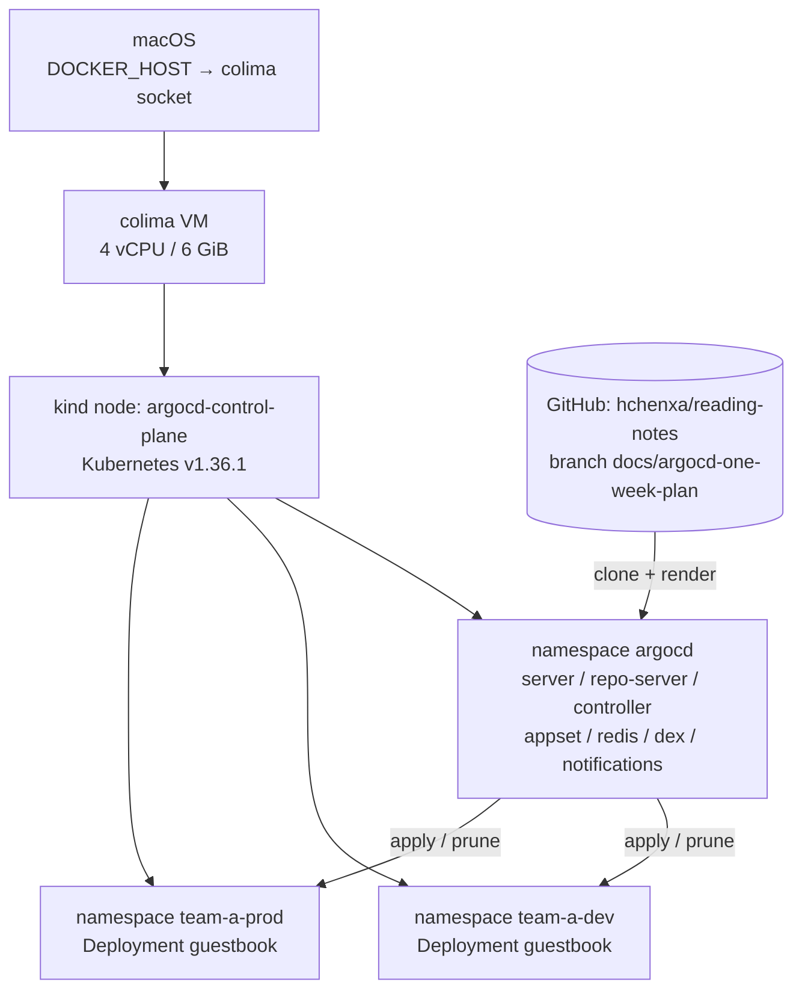

# 01-环境搭建与首个应用

> 这是第二篇:把 [00](00-概念与架构.md) 里的概念落到一个真实集群。
> 读完之后你应该有一台 `kind-argocd` 集群、一套 Argo CD v3.5.6、一个 `team-a` AppProject、
> 一个 ApplicationSet,以及 dev / prod 两个 `Synced + Healthy` 的 Application。
>
> 环境:macOS + colima(4 vCPU / 6 GiB)+ kind。实验时间:2026-10-29。

## 一、最终结果

```console
$ argocd app list
NAME                   CLUSTER     NAMESPACE    PROJECT  STATUS  HEALTH   ...
argocd/guestbook       ...         guestbook    default  Synced  Healthy  ...
argocd/guestbook-dev   in-cluster  team-a-dev   team-a   Synced  Healthy  ...
argocd/guestbook-prod  in-cluster  team-a-prod  team-a   Synced  Healthy  ...
```

- `guestbook` 是用官方 example 做的首次冒烟,project 是 `default`。
- `guestbook-dev` / `guestbook-prod` 是 ApplicationSet `guestbook-envs` 生成的,project 是 `team-a`。
- 两个 namespace 里各有一个 nginx Deployment、Service 和 Running 的 Pod。

## 二、环境架构



几个关键点:

- **kind 节点里跑着整个 Argo CD 控制面**,没有外部依赖;目标是同一个集群的 in-cluster。
- **repo-server 需要访问 GitHub**,所以 Pod 出网必须单独配代理(见第七节)。
- **team-a-dev / team-a-prod 是同一个集群的两个 namespace**,不是两个集群;真正的多集群和
  Cluster Secret 留到 04。

## 三、前置条件与资源约束

- colima 只有 4 vCPU / 6 GiB;**同时开两套 kind 集群会打满 VM 的 inotify 实例上限**(128),
  表现是 Istio / CNI 组件崩、Pod 里 DNS 不通。这次只保留 `argocd` 一套。
- 当前 shell 的 `DOCKER_HOST` 可能指向 podman,会覆盖 docker context;kind 命令前显式 export
  colima 的 socket:

  ```console
  $ export DOCKER_HOST=unix:///Users/hchenxa/.colima/default/docker.sock
  ```

- 建集群必须带 `kubernetes/kind/kind-config.yaml`,它会给节点内的 containerd / kubelet 注入代理;
  否则节点里拉不到镜像。

## 四、创建 kind 集群

先停掉正在跑的 Knative 节点(集群和镜像都还在):

```console
$ export DOCKER_HOST=unix:///Users/hchenxa/.colima/default/docker.sock
$ docker ps --format '{{.Names}}\t{{.Status}}'
$ docker stop knative-control-plane
```

建集群。**必须在 `kubernetes/kind/` 下执行**,`extraMounts` 是相对路径:

```console
$ cd kubernetes/kind
$ kind create cluster --name argocd --config kind-config.yaml
$ kubectl config use-context kind-argocd
```

结果:

```console
$ kubectl get nodes
NAME                   STATUS   ROLES           AGE   VERSION
argocd-control-plane   Ready    control-plane   ...   v1.36.1
```

## 五、安装 Argo CD v3.5.6

### 5.1 安装

```console
$ kubectl create namespace argocd
$ kubectl apply --server-side --force-conflicts -n argocd \
    -f https://raw.githubusercontent.com/argoproj/argo-cd/v3.5.6/manifests/install.yaml
$ kubectl -n argocd get pods -w
```

> **第一个坑**:直接用 client-side `kubectl apply` 会在 `applicationsets.argoproj.io`
> 这个 CRD 上报 `metadata.annotations: Too long: may not be more than 262144 bytes`。
> 原因是 CRD 的 annotation 超过了 256 KiB,client-side apply 把它塞进
> `last-applied-configuration` 就爆了。改用 `--server-side` 即可;如果之前已经
> client-side 创建了部分资源,server-side apply 可能报 field conflict,再加
> `--force-conflicts` 让 Argo CD 的清单接管这些字段。

非 HA 安装会起 7 个 Pod:

| Pod | 角色 |
|-----|------|
| `argocd-server` | API / Web UI,认证和 RBAC 的入口 |
| `argocd-repo-server` | clone Git,渲染 Helm / Kustomize,返回清单 |
| `argocd-application-controller` | 对比 desired / live,执行 sync,算健康状态 |
| `argocd-applicationset-controller` | 按 generator 生成 Application |
| `argocd-redis` | 缓存,不是事实来源 |
| `argocd-dex-server` | 内置 OIDC provider,可选 |
| `argocd-notifications-controller` | 通知,可选 |

### 5.2 CLI 与登录

```console
$ brew install argocd
$ argocd version --client

$ kubectl -n argocd get secret argocd-initial-admin-secret \
    -o jsonpath='{.data.password}' | base64 -d; echo
$ kubectl -n argocd port-forward svc/argocd-server 8080:443
```

另开一个终端登录。`--insecure` 只跳过自签证书校验,不是明文 HTTP:

```console
$ argocd login localhost:8080 --username admin --password '<密码>' --insecure
```

浏览器打开 `https://localhost:8080`,用 `admin` + 同一个密码也能进。

## 六、部署的资源

### 6.1 Argo CD 自身的资源

| 类别 | 资源 |
|------|------|
| CRD | `applications.argoproj.io`、`applicationsets.argoproj.io`、`appprojects.argoproj.io` |
| Deployment | server、repo-server、applicationset-controller、dex、notifications、redis |
| StatefulSet | application-controller |
| Service | server、repo-server、redis、dex、applicationset-controller、metrics |
| Secret | `argocd-secret`、`argocd-initial-admin-secret`、`argocd-notifications-secret`、`argocd-redis` |
| ConfigMap | `argocd-cm`、`argocd-rbac-cm`、`argocd-cmd-params-cm`、`argocd-notifications-cm`、`argocd-ssh-known-hosts-cm`、`argocd-tls-certs-cm`、`argocd-gpg-keys-cm` |
| RBAC | 7 个 ServiceAccount、namespace 内 Role / RoleBinding、cluster-scoped ClusterRole / ClusterRoleBinding |
| NetworkPolicy | 每个组件一条 |

### 6.2 业务对象

- AppProject `team-a`
- Repository Secret `repo-team-a`
- ApplicationSet `guestbook-envs`
- 由 AppSet 生成的 Application `guestbook-dev` / `guestbook-prod`
- 两个 namespace 里的 Deployment / Service / ConfigMap

## 七、部署对象的 YAML

### 7.1 AppProject `team-a`

```yaml
apiVersion: argoproj.io/v1alpha1
kind: AppProject
metadata:
  name: team-a
  namespace: argocd
spec:
  sourceRepos:
    - https://github.com/hchenxa/reading-notes.git
  destinations:
    - name: in-cluster
      namespace: team-a-dev
    - name: in-cluster
      namespace: team-a-prod
  clusterResourceWhitelist:
    - group: ""
      kind: Namespace
  namespaceResourceWhitelist:
    - group: "*"
      kind: "*"
```

- `sourceRepos` 只允许这个仓库,别的仓库的 Application 会 `InvalidSpecError`。
- `destinations` 只允许 in-cluster 的两个 namespace。
- `CreateNamespace=true` 会创建 Namespace 对象,所以 `clusterResourceWhitelist` 必须放行 `Namespace`。
  这是第二个坑,不加会报 `resource :Namespace is not permitted in project team-a`。

### 7.2 Repository Secret `repo-team-a`

```yaml
apiVersion: v1
kind: Secret
metadata:
  name: repo-team-a
  namespace: argocd
  labels:
    argocd.argoproj.io/secret-type: repository
type: Opaque
stringData:
  url: https://github.com/hchenxa/reading-notes.git
```

- 仓库是公开的,所以没有 `username` / `password`;这个 Secret 主要用来演示 `url` 匹配。
- 私有仓库要补 `username` / `password`,或者用 SSH key。
- 多仓库共用凭据时,把 label 换成 `secret-type: repo-creds`,`url` 写前缀。

### 7.3 ApplicationSet `guestbook-envs`

```yaml
apiVersion: argoproj.io/v1alpha1
kind: ApplicationSet
metadata:
  name: guestbook-envs
  namespace: argocd
spec:
  goTemplate: true
  generators:
    - list:
        elements:
          - env: dev
            cluster: in-cluster
            namespace: team-a-dev
          - env: prod
            cluster: in-cluster
            namespace: team-a-prod
  template:
    metadata:
      name: 'guestbook-{{.env}}'
    spec:
      project: team-a
      source:
        repoURL: https://github.com/hchenxa/reading-notes.git
        targetRevision: docs/argocd-one-week-plan
        path: ArgoCD/labs/guestbook
      destination:
        name: '{{.cluster}}'
        namespace: '{{.namespace}}'
      syncPolicy:
        automated:
          prune: true
          selfHeal: true
        syncOptions:
          - CreateNamespace=true
```

生成结果是两个普通 Application,带 ownerReference:

```yaml
apiVersion: argoproj.io/v1alpha1
kind: Application
metadata:
  name: guestbook-dev
  namespace: argocd
  ownerReferences:
    - apiVersion: argoproj.io/v1alpha1
      kind: ApplicationSet
      name: guestbook-envs
spec:
  project: team-a
  source:
    repoURL: https://github.com/hchenxa/reading-notes.git
    targetRevision: docs/argocd-one-week-plan
    path: ArgoCD/labs/guestbook
  destination:
    name: in-cluster
    namespace: team-a-dev
  syncPolicy:
    automated:
      prune: true
      selfHeal: true
    syncOptions:
      - CreateNamespace=true
```

> 上面是节选,省略了 `status`;完整对象用
> `kubectl -n argocd get application guestbook-dev -o yaml` 看。

### 7.4 被同步的业务清单

`ArgoCD/labs/guestbook/` 是一个最小 nginx 应用:

```yaml
# deployment.yaml
apiVersion: apps/v1
kind: Deployment
metadata:
  name: guestbook
  labels:
    app: guestbook
spec:
  replicas: 1
  selector:
    matchLabels:
      app: guestbook
  template:
    metadata:
      labels:
        app: guestbook
    spec:
      containers:
        - name: guestbook
          image: nginx:1.27-alpine
          ports:
            - name: http
              containerPort: 80
          readinessProbe:
            httpGet:
              path: /
              port: http
            initialDelaySeconds: 2
            periodSeconds: 5
          resources:
            requests:
              cpu: 10m
              memory: 16Mi
            limits:
              memory: 64Mi
---
# service.yaml
apiVersion: v1
kind: Service
metadata:
  name: guestbook
  labels:
    app: guestbook
spec:
  selector:
    app: guestbook
  ports:
    - name: http
      port: 80
      targetPort: http
---
# configmap.yaml
apiVersion: v1
kind: ConfigMap
metadata:
  name: guestbook-config
  labels:
    app: guestbook
data:
  greeting: "hello from git"
---
# kustomization.yaml
apiVersion: kustomize.config.k8s.io/v1beta1
kind: Kustomization
resources:
  - deployment.yaml
  - service.yaml
  - configmap.yaml
```

Argo CD 看到 `kustomization.yaml`,会用 Kustomize 渲染这三个文件,再 apply 到目标 namespace。

## 八、验证测试

### 8.1 Application 状态

```console
$ argocd app list
NAME                   CLUSTER     NAMESPACE    PROJECT  STATUS  HEALTH   SYNCPOLICY
argocd/guestbook       ...         guestbook    default  Synced  Healthy  Auto-Prune
argocd/guestbook-dev   in-cluster  team-a-dev   team-a   Synced  Healthy  Auto-Prune
argocd/guestbook-prod  in-cluster  team-a-prod  team-a   Synced  Healthy  Auto-Prune
```

### 8.2 生成的 Application 有 ownerReference

```console
$ kubectl -n argocd get application guestbook-prod \
    -o jsonpath='{.metadata.ownerReferences[0].kind}/{.metadata.ownerReferences[0].name}{"\n"}'
ApplicationSet/guestbook-envs
```

### 8.3 两个 namespace 真的有资源

```console
$ kubectl -n team-a-dev get deploy,svc,pod
NAME                        READY   UP-TO-DATE   AVAILABLE   AGE
deployment.apps/guestbook   1/1     1            1           ...

NAME                TYPE        CLUSTER-IP     EXTERNAL-IP   PORT(S)   AGE
service/guestbook   ClusterIP   10.96.72.155   <none>        80/TCP    ...

NAME                             READY   STATUS    RESTARTS   AGE
pod/guestbook-864f75649c-p8z5r   1/1     Running   0          ...

$ kubectl -n team-a-prod get deploy,svc,pod
# 同样的 Deployment / Service / Pod
```

### 8.4 这个测试验证了什么

| 验证点 | 证据 |
|--------|------|
| Argo CD 能装、7 个组件能跑 | 7 个 Pod 全 `Running` |
| ApplicationSet 能生成 Application | `guestbook-dev` / `guestbook-prod` 存在,ownerReference 指向 `guestbook-envs` |
| AppProject 能约束 | `team-a` 只允许指定仓库和 namespace;越界会 `InvalidSpecError` |
| Repository Secret 能匹配 | `repo-team-a` 的 `url` 和 Application 的 `repoURL` 一致 |
| Application 能同步业务资源 | 两个 namespace 里都有 Deployment / Service / Running Pod |
| Sync / Health 两套状态能读懂 | `Synced + Healthy`,而不是只看 `Synced` |

## 九、这次踩到的坑

### 9.1 client-side apply 的 CRD annotation 超限

见第五节。改用 `--server-side --force-conflicts`。

### 9.2 Pod 出网不自动走节点代理

`kind-proxy.conf` 只修了节点里的 containerd / kubelet。repo-server 在 Pod 里直接连 GitHub 会报
`context deadline exceeded`。解决:

```console
$ PROXY=http://host.docker.internal:7890
$ NO_PROXY='localhost,127.0.0.1,.svc,.svc.cluster.local,10.0.0.0/8,10.244.0.0/16,10.96.0.0/16,172.16.0.0/12,192.168.0.0/16'
$ kubectl -n argocd set env deployment/argocd-repo-server \
    HTTP_PROXY="$PROXY" HTTPS_PROXY="$PROXY" http_proxy="$PROXY" https_proxy="$PROXY" \
    NO_PROXY="$NO_PROXY" no_proxy="$NO_PROXY"
$ kubectl -n argocd rollout status deployment/argocd-repo-server
```

验证:在 Pod 里 `curl -I https://github.com` 直连会超时,带上 `HTTPS_PROXY` 就通。

### 9.3 首次 clone 大仓库会超时

本仓库 `.git` 约 50 MiB,第一次 clone 可能超过 repo-server 的 15 秒超时,报一次
`ComparisonError`。等 repo-server 缓存好后再 hard refresh 一次即可:

```console
$ argocd app get guestbook-dev --hard-refresh
```

`argocd repo list` 的 connectivity 检查偶尔还会因为 `ls-remote HEAD` 超时显示 `Failed`,
但 App 实际 clone 指定 revision 是成功的。

### 9.4 AppProject 不允许 Namespace

`CreateNamespace=true` 会创建 Namespace 对象,受限 project 必须在 `clusterResourceWhitelist`
放行 `group: "", kind: Namespace`。

## 十、停止与恢复

同一时间只开一个 kind 集群,避免 inotify 问题:

```console
$ export DOCKER_HOST=unix:///Users/hchenxa/.colima/default/docker.sock
$ docker stop argocd-control-plane
$ docker start knative-control-plane
```

要彻底删掉这个实验集群:

```console
$ kind delete cluster --name argocd
```

## 十一、下一步

- 概念和对象关系:[00-概念与架构](00-概念与架构.md)
- 同步机制、漂移、diff、waves / hooks:[02-同步机制](02-同步机制.md)
- 清单来源与 ApplicationSet:[03-清单来源与ApplicationSet](03-清单来源与ApplicationSet.md)
- 多集群与多租户:[04-多集群与多租户](04-多集群与多租户.md)
- 生产化与排障:[05-生产化与排障](05-生产化与排障.md)
