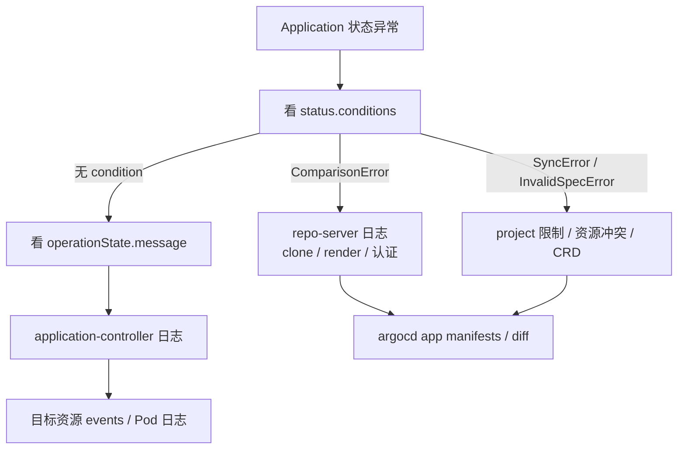

# 05-生产化与排障:HA、通知、监控、备份、升级与故障表

> 对应一周计划的 Day 6 - 7。前提是 01-04 已经跑过一轮。
> 这一篇偏"生产落地"和"出问题怎么查",不是入门必读。
>
> 状态:路线 + 检查清单,HA / 通知 / 备份尚未逐条实测。

## 一、HA 架构

HA 清单是 `manifests/ha/install.yaml`:

```
https://raw.githubusercontent.com/argoproj/argo-cd/v3.5.6/manifests/ha/install.yaml
```

和单机版的区别:

- `argocd-server` / `argocd-repo-server` 多副本。
- `argocd-application-controller` 是 StatefulSet,按 `ARGOCD_CONTROLLER_REPLICAS` 分片。
- Redis 用 `redis-ha`(Sentinel),不再是单 Pod。
- 需要 PodDisruptionBudget、反亲和、资源 request / limit。

> 6 GiB 的 kind 跑 HA 会很吃力。这一天**读清单 + 画拓扑**即可;真要在本地跑,至少给 colima
> 8 - 12 GiB。

## 二、通知

`argocd-notifications-cm` 里定义 trigger / template,Application 上用 annotation 订阅:

```yaml
metadata:
  annotations:
    notifications.argoproj.io/subscribe.on-sync-failed.slack: team-a
```

常见触发点:`on-sync-succeeded`、`on-sync-failed`、`on-health-degraded`、`on-deployed`。
实验可以用一个本地 HTTP 服务接 webhook,不必真接 Slack。

## 三、监控

关键指标:

- `argocd_app_info`(v3 用 label 带 `sync_status` / `health_status`;v3.0 删掉了旧的
  `argocd_app_sync_status` / `argocd_app_health_status` / `argocd_app_created_time`)
- `argocd_app_sync_total`、`argocd_app_reconcile`、`argocd_app_k8s_request_total`
- repo-server 的 Git / 渲染耗时和错误
- application-controller 的队列深度、reconcile 耗时

要设的告警:长时间 `OutOfSync`、`Degraded`、sync 连续失败、`ComparisonError`、
repo-server 错误率、controller 队列积压。

## 四、备份与灾难恢复

- Application / AppProject / ApplicationSet 本身就是 Kubernetes CR,应该用 Git 声明式管理
  (app-of-apps 或 bootstrap 仓库)。
- 仓库凭据、集群凭据、SSO 配置、`argocd-cm` / `argocd-rbac-cm` 也要有备份。
- `argocd admin export` / `import` 可以做整体导出导入,但**首选方案是"Git 重建 + Secret 备份"**。
- 定期演练:删掉 Argo CD namespace,从 Git + Secret 备份恢复,计时。

## 五、升级

升级前必读对应版本的 upgrade notes,尤其是 v2 → v3 的默认行为变化。流程:

1. 备份 CR、ConfigMap、Secret。
2. 读 upgrade notes,确认 breaking changes。
3. 先升 CRD,再 apply 新版本 manifest。
4. 观察 controller / repo-server 日志和指标。
5. 准备回滚方案(旧 manifest + 备份)。

v3.5 值得知道的变化:repo-server 内部 mTLS(可选,创建 `argocd-repo-server-mtls` Secret 开启)、
source integrity(取代旧的 GPG 校验)、ApplicationSet UI、Helm 4 支持、并发控制。

## 六、安全清单

- [ ] 禁用本地 admin 或至少改密码 + 限制访问。
- [ ] SSO + 组映射 RBAC,最小权限。
- [ ] 每个团队一个 AppProject,限制 sourceRepos / destinations。
- [ ] repo-server 不暴露到集群外,NetworkPolicy 限制。
- [ ] Git 里的 Secret 用 SOPS / Sealed Secrets / External Secrets,不存明文。
- [ ] 生产分支保护 + 签名提交(v3.5 source integrity 可以强制)。
- [ ] 镜像来源可信,配合准入控制。

## 七、排障顺序



## 八、故障速查表

| 现象 | 常见原因 | 先看什么 |
|------|---------|---------|
| `OutOfSync` 但 diff 为空 | 默认字段、status、webhook 注入、CRD schema | `argocd app diff`,考虑 `ignoreDifferences` |
| `ComparisonError` | repo 认证失败、路径不存在、Helm 渲染错误、CRD 未发现 | repo-server 日志,`argocd app manifests` |
| Sync 一直 `Progressing` | hook Job 不结束、CRD 未就绪、finalizer 卡住 | `kubectl get jobs,pods`,hook 日志 |
| `InvalidSpecError` | project 不允许 source / destination | `kubectl get appproject -n argocd -o yaml` |
| `Degraded` | 镜像拉不到、CrashLoop、探针失败 | `kubectl describe pod`,容器日志 |
| 集群 `Unknown` | token 过期、网络不通、API 地址错 | `argocd cluster get`,cluster Secret |
| prune 不删 | prune 没开、资源没被追踪、共享资源 | Application spec,tracking 标记 |
| 权限被拒 | RBAC 或 project role 不够 | `argocd account can-i`,policy.csv |
| CRD not found | CR 和 CRD 同批 apply,顺序不对 | `sync-wave`, `SkipDryRunOnMissingResource` |
| 删 Application 资源还在 | 没有 finalizer | 加 finalizer 或 `--cascade` |

## 九、Capstone:一周综合演练

在一个 Git 仓库里完成:

1. 一个 Helm chart + dev / prod 两套 values。
2. 一个 ApplicationSet 生成两个环境的 Application。
3. 一个 AppProject 限制团队只能部署到 `team-a-*`。
4. 一个 PreSync Job 做"迁移",一个 PostSync Job 做"冒烟检查"。
5. 对 HPA 管理的 `replicas` 做 `ignoreDifferences`。
6. 一条 sync 失败通知。
7. 一个 sync window,晚上禁止自动同步,但保留手动应急。

然后故意制造故障并恢复:

- 把镜像 tag 改成不存在的 → `Degraded`,从 Git 修回。
- 把 repo 地址改错 → `ComparisonError`,修回。
- 让 PreSync Job 失败 → sync 卡住,修好 Job 再继续。
- 删除 Application,分别验证有 / 无 finalizer 的行为。

最后写一页 runbook:**这个系统怎么部署、怎么回滚、出问题先看哪。**

## 十、自测 20 题

1. Argo CD 的七个核心组件分别负责什么?
2. 为什么 repo-server 要独立存在,而不是让 controller 直接 clone Git?
3. 一次 reconcile 的触发条件有哪些?
4. `refresh` 和 `hard refresh` 的区别?
5. `Synced` 和 `Healthy` 分别代表什么?
6. 举出 `Synced + Degraded` 和 `OutOfSync + Healthy` 各一个场景。
7. auto-sync、selfHeal、prune 分别响应什么?
8. prune 怎么判断一个资源属于哪个 Application?
9. 为什么删除 Git 里的文件不一定会删除集群资源?
10. Argo CD 执行 Helm chart 时,`helm list` 能看到 release 吗?为什么?
11. 多源 Application 解决什么问题?
12. ApplicationSet 和 app-of-apps 的差别?
13. 怎么把一个外部集群接进 Argo CD?网络方向是什么?
14. AppProject 能限制哪些东西?
15. project role 和全局 RBAC role 的区别?
16. sync wave 的排序规则?prune 时呢?
17. 哪些情况下 hook 不会执行?
18. CRD 和 CR 同一次 sync,怎么保证顺序?
19. 删掉 Application,资源会不会一起删?由什么决定?
20. Redis 挂了会怎样?为什么它不是事实来源?

## 十一、一周之后

- 学 Argo Rollouts,把 canary / blue-green 接进 GitOps。
- 学 Argo CD Image Updater 或 3.5 的 Source Hydrator,做镜像自动更新。
- 读 CMP 插件文档,接非 Helm / Kustomize 的渲染器。
- 研究大规模部署:controller 分片、repo-server 缓存、ApplicationSet 的 progressive sync。
- 把生产环境的 Argo CD 做成 bootstrap 仓库:Argo CD 管理自己。

## 相关

- [00-概念与架构](00-概念与架构.md)
- [01-环境搭建与首个应用](01-环境搭建与首个应用.md)
- [02-同步机制](02-同步机制.md)
- [03-清单来源与ApplicationSet](03-清单来源与ApplicationSet.md)
- [04-多集群与多租户](04-多集群与多租户.md)
