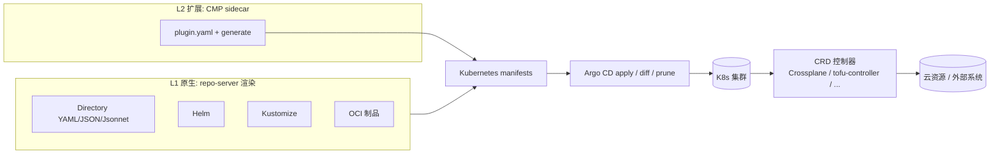
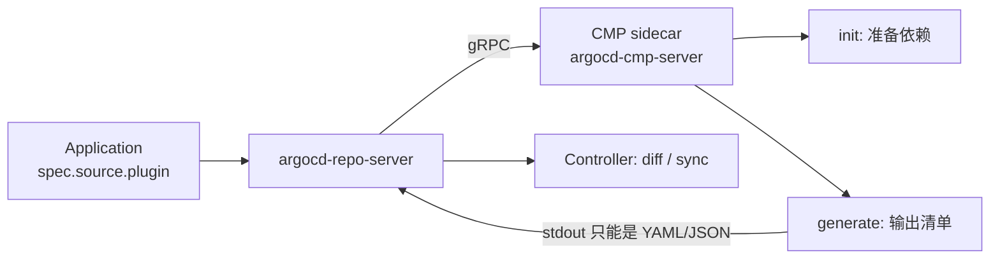
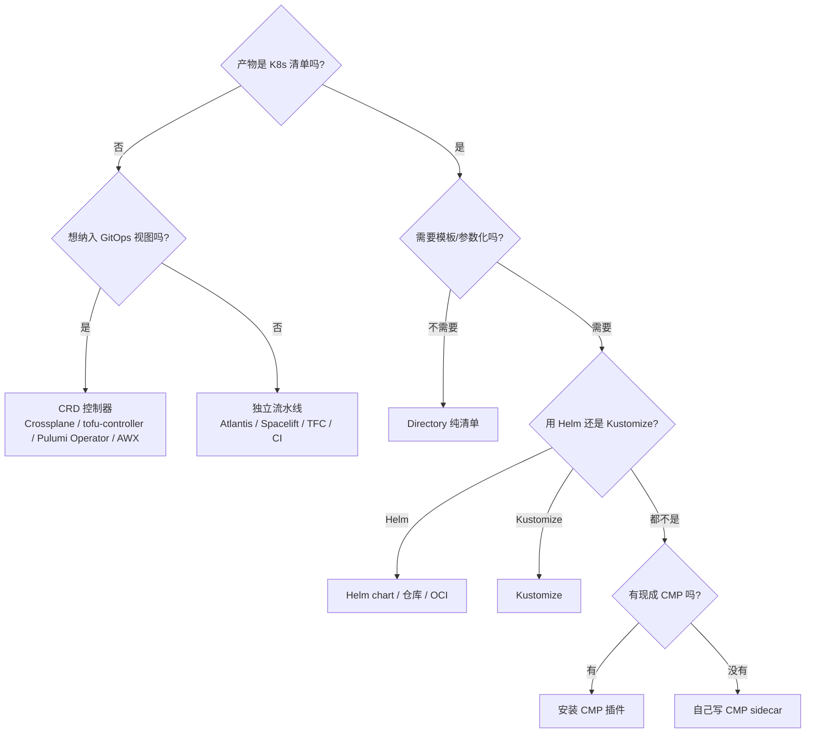

# 06-源类型全解:能部署什么、怎么扩展、Terraform 怎么办

> 03 的扩展篇。03 讲 Helm / Kustomize / 多源主线;这一篇把所有能作为 Application
> 源的东西一次列全:原生类型、OCI、CMP 插件、以及 Terraform / Pulumi / Ansible
> 这类非 Kubernetes 工具的接入方式,最后讲怎么自己写一种新类型。
>
> **类型**:Reference(参考)
> **状态**:未实测(2026-10-31;第十三节列了待做实验)
> **版本基线**:Argo CD v3.5.6
> **适用**:查 Argo CD 支持的源类型、OCI/CMP 扩展、Terraform 等 IaC 的接法
> **不覆盖**:具体连接器的完整配置(见 07)、生产化运维(见 05)
>
> 结论来源:v3.5.6 的 `pkg/apis/application/v1alpha1/types.go`、repo-server 源码 + 官方文档。

---

## 速查:三分钟版

1. **Argo CD 只会 apply Kubernetes 清单。** 任何源类型最终都必须产出 K8s YAML/JSON。
2. **原生类型只有 4 个**:Helm、Kustomize、Directory(纯 YAML/JSON/Jsonnet)、Plugin。
   外加一个"OCI 制品源"(2.13 起),它解包后仍按前四种之一渲染。
3. **扩展框架只有一个**:CMP(Config Management Plugin),以 repo-server sidecar 形式安装,
   不需要改 Argo CD 代码。
4. **Terraform / OpenTofu / Pulumi / Ansible 不是源类型。** 它们的产物不是 K8s 清单,
   只能通过"CRD 控制器"间接纳入 Argo CD,或者留在独立的基础设施流水线里。
5. **ApplicationSet 不是源类型**,它生成 Application;Source Hydrator 也不是源类型,
   它是"先渲染、再提交、后同步"的工作流(3.5 beta)。

---

## 一、铁律:Argo CD 的同步单位是 Kubernetes 资源

Argo CD 的核心循环只有一件事:

```text
desired(state) = 源渲染出的 K8s 清单
live(state)    = 集群里实际存在的 K8s 对象
reconcile      = diff(desired, live) + 按 syncPolicy 修正
```

它不认 Terraform state,不认云 API,不认 Pulumi 的 checkpoint,也不认 Ansible 的 inventory。
所以"支持某种源类型"的本质是:**这种格式能不能被可重复地渲染成 K8s 清单**。

按接入方式分三层:

| 层级 | 机制 | 谁在做事 | 例子 |
|------|------|---------|------|
| L1 原生 | repo-server 内置渲染器 | Argo CD | Helm、Kustomize、Directory、Jsonnet、OCI 制品 |
| L2 扩展 | CMP sidecar(`init` / `generate`) | 插件进程 | Helmfile、Tanka、CUE、KCL、ytt、kpt、自研模板 |
| L3 间接 | 部署 CRD,控制器负责集群外资源 | 另一个 operator | Crossplane、tofu-controller、Pulumi Operator、AWX Operator |
| L0 外部 | Argo CD 完全不参与 | CI / Terraform SaaS | Atlantis、Spacelift、TFC、普通 CI |

Terraform 属于 **L3 或 L0**,不属于 L1/L2。原因见第十节。



---

## 二、总览矩阵

| 工具 / 格式 | 接入方式 | 入口字段 | 成熟度 / 备注 |
|------------|---------|---------|--------------|
| 纯 YAML / JSON | 原生 Directory | `path` | 稳定;不递归、不模板化 |
| Jsonnet | 原生 Directory | `path` + `.jsonnet` | 内置但属遗留;可用 `jsonnet.enable: "false"` 关闭 |
| Helm chart(Git 里) | 原生 Helm | `path` + `helm` | 稳定 |
| Helm 仓库 / OCI chart | 原生 Helm | `repoURL` + `chart` | 稳定;3.5 起用 Helm v4 渲染 |
| Kustomize | 原生 Kustomize | `path` | 稳定 |
| 通用 OCI 制品 | 原生 OCI 源 | `repoURL: oci://...` + `path` | 2.13 起;单层、限定 media type |
| Helmfile | CMP | `plugin.name` | 社区插件或自写,命令 `helmfile template` |
| Tanka | CMP | `plugin.name` | 自写,命令 `tk show` |
| CUE | CMP | `plugin.name` | 自写,`cue export` |
| KCL | CMP | `plugin.name` | 自写,`kcl run` |
| ytt(Carvel) | CMP | `plugin.name` | 自写,`ytt -f .` |
| kpt | CMP | `plugin.name` | 自写,`kpt fn render` |
| Timoni | CMP | `plugin.name` | 自写,`timoni build` |
| cdk8s | 预渲染或 CMP | `directory` / `plugin` | `cdk8s synth` 产出 YAML |
| Docker Compose | 预渲染或 CMP | `directory` / `plugin` | `kompose convert` |
| **Terraform / OpenTofu** | **不直接支持** | — | 走 CRD 控制器或独立流水线,见第十节 |
| **Pulumi** | **不直接支持** | — | Pulumi Kubernetes Operator + `Stack` CR |
| **Ansible** | **不直接支持** | — | 用 AWX Operator 部署 AWX;作业由 AWX API / Ansible 触发 |
| AWS/GCP/Azure 资源(无 TF) | CRD 控制器 | `directory` 部署 CR | ACK / Config Connector / Crossplane |
| 历史格式 Ksonnet | 已移除 | — | 别再用 |

> 反向工具提醒:存在 `terraform-provider-argocd`,它让 **Terraform 管理 Argo CD**
> (用 HCL 声明 Application / Project),不是 Argo CD 管理 Terraform。方向别搞反。

---

## 三、通用模型与类型判定

### 3.1 最小 Application

```yaml
apiVersion: argoproj.io/v1alpha1
kind: Application
metadata:
  name: guestbook
  namespace: argocd
spec:
  project: default
  source:
    repoURL: https://github.com/org/repo.git
    targetRevision: main
    path: manifests
  destination:
    server: https://kubernetes.default.svc
    namespace: guestbook
  syncPolicy:
    automated: { prune: true, selfHeal: true }
    syncOptions: [CreateNamespace=true]
```

### 3.2 `source` 的公共字段

| 字段 | 含义 | 注意 |
|------|------|------|
| `repoURL` | Git 地址、Helm 仓库地址、OCI registry | 必须被 AppProject 的 `sourceRepos` 放行 |
| `path` | Git 仓库内的目录;OCI 制品内的相对路径 | 对"纯 Helm 仓库源"无意义;`chart` 与它互斥 |
| `targetRevision` | Git 分支/tag/SHA;Helm chart 版本;OCI tag/digest | 生产固定 tag / SHA |
| `chart` | Helm 仓库里的 chart 名 | 只在 Helm 仓库源使用,不要和 `path` 混用 |
| `ref` | 多源里的别名,供 `$ref/...` 引用 | 只在 `spec.sources[]` 里有意义 |
| `name` | 多源里给源起名,CLI 可按名指定 | 可选 |
| `helm` / `kustomize` / `directory` / `plugin` | 类型子配置 | 见下 |

### 3.3 类型是怎么判定的(v3.5.6 实际逻辑)

1. **显式类型优先**:`helm`、`kustomize`、`directory`、`plugin` 任一子对象存在,就按它来。
   同时写两个以上直接报错:

   ```text
   multiple application sources defined: kustomize,helm
   ```

2. **不写时自动探测**,顺序是:
   - CMP 插件的 `discover` 规则命中 → **Plugin**
   - 目录里有 `Chart.yaml` → **Helm**
   - 目录里有 `kustomization.yaml` / `kustomization.yml` / `Kustomization` → **Kustomize**
   - 都没有 → **Directory**

3. `chart:` 存在 = 从 Helm 仓库取 chart;`path:` + `Chart.yaml` = Git 里的 chart。

4. `.jsonnet` 不会把类型变成 Jsonnet,它属于 Directory,生成清单时被求值。

> 坑:目录里同时有 `Chart.yaml` 和 `kustomization.yaml`,或者装了 discovery 规则很宽的
> 插件,自动探测结果可能和你想的不一样。**要么只放一种标记文件,要么显式写类型**
> (例如只写 `kustomize: {}` 来强制 Kustomize)。

### 3.4 Application 层面的硬性要求

| 项 | 规则 |
|----|------|
| Application 所在 namespace | 默认只能是 `argocd`;其他 namespace 需在 `argocd-cm` 配 `application.namespaces` |
| `spec.project` | 必须存在;AppProject 的 `sourceRepos` / `destinations` 必须放行,否则 `InvalidSpecError` |
| 仓库凭据 | 公开仓库免配;私有仓库需要 `argocd.argoproj.io/secret-type: repository`(精确 URL)或 `repo-creds`(前缀) |
| `destination` | `server` 或 `name` 二选一;`namespace` 只补没写 namespace 的 namespaced 资源 |
| `CreateNamespace=true` | Namespace 是 cluster-scoped,AppProject 的 `clusterResourceWhitelist` 要放行 |
| `source` vs `sources` | 同时写不报错,但 `sources` 存在时忽略 `source` |

---

## 四、Directory:最简单也最容易被低估

```yaml
spec:
  source:
    repoURL: https://github.com/org/repo.git
    targetRevision: main
    path: manifests/
    directory:
      recurse: true
      include: "{*.yaml,*.yml}"
      exclude: "*-test.yaml"
```

规范:

| 项 | 说明 |
|----|------|
| 默认文件类型 | 根目录下的 `.yaml` / `.yml` / `.json` |
| 递归 | 默认 **不递归**;`recurse: true` 才进子目录 |
| include / exclude | glob;`exclude` 优先;一个文件可包含多个 `---` 文档 |
| 跳过文件 | 在文件任意位置加 `# +argocd:skip-file-rendering` |
| Jsonnet | `.jsonnet` 会被求值,`directory.jsonnet.extVars` / `tlas` / `libs` 可用 |
| 不做的事 | 不做变量替换、不做模板、不读环境变量 |

Directory 的定位: **"清单已经是最终形态"**。任何需要模板、循环、参数化的东西,
用 Helm / Kustomize / CMP,不要自己写 sed 脚本硬凑。

Jsonnet 说明:内置支持仍在(安全修复已在 3.5.x),但生态和可维护性都不如 Helm/
Kustomize/CMP。能用 CMP 就跑 CMP;小规模、已有 Jsonnet 资产时再直接放目录。

---

## 五、Helm:三种取 chart 的方式

### 5.1 Helm 仓库

```yaml
spec:
  source:
    repoURL: https://charts.bitnami.com/bitnami
    chart: nginx
    targetRevision: 15.9.0        # chart 版本
    helm:
      releaseName: nginx
      valuesObject:
        replicaCount: 2
      parameters:
        - name: image.tag
          value: "1.27"
          forceString: true
```

纯 Helm 仓库源没有 Git 工作区,`valueFiles` 指向的 Git 文件拿不到;所以 values 用
`values` / `valuesObject` / `parameters`,或者把 values 放 Git 走多源(第八节)。

### 5.2 Git 里的 chart

```yaml
spec:
  source:
    repoURL: https://github.com/org/charts.git
    targetRevision: main
    path: charts/myapp             # Chart.yaml 所在目录
    helm:
      valueFiles:
        - values-prod.yaml         # 相对 chart 目录
```

`targetRevision` 是 Git 版本,和 `Chart.yaml` 里的 `version:` 无关。

### 5.3 OCI chart

两种写法(注意 `oci://` 与 `chart` 的搭配):

```yaml
# 写法 A:Helm 仓库风格,repoURL 不带 scheme
source:
  repoURL: registry-1.docker.io/bitnamicharts
  chart: nginx
  targetRevision: 15.9.0
  helm:
    valuesObject: { replicaCount: 2 }

# 写法 B:通用 OCI 风格,repoURL 带 oci://,path 固定为 "."
source:
  repoURL: oci://registry-1.docker.io/bitnamicharts/nginx
  targetRevision: 15.9.0
  path: .
  helm:
    valuesObject: { replicaCount: 2 }
```

私有 OCI chart 的仓库凭据:

```bash
argocd repo add registry-1.docker.io/bitnamicharts/nginx \
  --type helm --name stable --username u --password p --enable-oci
```

### 5.4 Helm 字段速查

| 字段 | 作用 |
|------|------|
| `releaseName` | 默认 = Application 名 |
| `namespace` | 渲染用的 release namespace,默认 = destination.namespace |
| `valueFiles` / `ignoreMissingValueFiles` | values 文件;支持 glob |
| `values` / `valuesObject` | 内联 YAML 字符串 / 结构化对象 |
| `parameters` / `fileParameters` | 等价 `--set` / `--set-file` |
| `skipCrds` | 跳过 `crds/`,默认 false(会装) |
| `skipTests` | 跳过 Helm test manifest |
| `skipSchemaValidation` | 跳过 `values.schema.json` |
| `passCredentials` | 允许向其他域名发送仓库凭据 |
| `kubeVersion` / `apiVersions` | 渲染时的 Capabilities |
| `version` | **历史字段**,3.5 起只用 Helm v4 渲染,留着无效但不报错 |

values 优先级(低 → 高):

```text
chart values.yaml < valueFiles(后者覆盖前者)< values < valuesObject < parameters
```

### 5.5 渲染语义与限制

- 只执行 `helm template`,**没有 Helm release**;`helm list` 看不到,`helm rollback` 不可用。
- `lookup` 等需要连集群的函数拿不到数据;随机函数会让 Application 永久 `OutOfSync`。
- 依赖:repo-server 会执行 `helm dependency build`,依赖仓库要可达且凭据已配;
  也可以把依赖直接 vendor 进 `charts/`。
- Hook:`pre-*` / `post-*` 映射为 PreSync / PostSync,`hook-weight` 映射为 sync wave;
  但 Argo CD 分不清 install/upgrade,且只要 Application 里定义了 Argo CD hook,
  Helm hook 会被全部忽略。
- Helm 插件(helm-diff、helm-secrets 之类)默认不装;要么自定义 repo-server 镜像,
  要么走 CMP。

---

## 六、Kustomize

```yaml
spec:
  source:
    repoURL: https://github.com/hchenxa/reading-notes.git
    targetRevision: main
    path: ArgoCD/labs/guestbook
    kustomize:
      namePrefix: prod-
      images:
        - ghcr.io/example/guestbook:v1.2.3
      replicas:
        - name: guestbook
          count: 3
      commonLabels:
        env: prod
```

kustomization 文件名: `kustomization.yaml`、`kustomization.yml`、`Kustomization`。

Application 层可覆盖字段(v3.5.6):

| 字段 | 作用 |
|------|------|
| `namePrefix` / `nameSuffix` | 名称前后缀 |
| `images` / `replicas` | 镜像 / 副本覆盖 |
| `patches` | 内联 patch,与 kustomization 里的合并 |
| `components` / `ignoreMissingComponents` | 组件 |
| `commonLabels` / `commonAnnotations` | 公共标签/注解 |
| `forceCommonLabels` / `forceCommonAnnotations` | 冲突时强制替换 |
| `commonAnnotationsEnvsubst` | 注解值支持环境变量 |
| `labelWithoutSelector` / `labelIncludeTemplates` | 标签作用范围 |
| `namespace` | 补缺失的 namespace,优先级高于 destination.namespace |
| `version` | 选择 Argo CD 已注册的 kustomize 版本 |
| `kubeVersion` / `apiVersions` | 渲染 Capabilities |

坑:

- **`buildOptions` 不是 Application 字段**。`--load-restrictor LoadRestrictionsNone` 等
  只能配在 `argocd-cm` 的全局 `kustomize.buildOptions`(或 `kustomize.buildOptions.<ver>`),
  改完重启 repo-server。
- remote base 可以引,但只能复用**本 Application 仓库**的同一套凭据;不能借用其他仓库凭据。
- kustomization 里写 `helmCharts:` 需要全局 `--enable-helm`。
- `source.kustomize.namespace` 只补缺失值,不会覆盖资源里已写死的 namespace。

---

## 七、OCI 制品:把任何清单打成镜像

Argo CD 2.13 起支持通用 OCI 制品作为源,3.5 仍在。它不是独立的渲染类型:
**解包后按普通目录规则探测**(Kustomize / Chart.yaml / 纯清单 / CMP)。

```yaml
spec:
  source:
    repoURL: oci://registry-1.docker.io/some-user/my-manifests
    targetRevision: 1.16.1        # tag 或 digest
    path: .                       # 制品内相对路径,根用 "."
```

要求:

- registry 必须 OCI 兼容(Docker Hub、ECR、GHCR、GCR 等)。
- 制品必须是**单层**;默认接受的 media type:
  - `application/vnd.oci.image.layer.v1.tar+gzip`
  - `application/vnd.cncf.helm.chart.content.v1.tar+gzip`
  - 其他类型需在 repo-server 配 `ARGOCD_REPO_SERVER_OCI_LAYER_MEDIA_TYPES`。
- 打包工具推荐 ORAS:

```bash
# 目录直接打包
oras push registry.example.com/guestbook:v1 .

# tarball 需显式 media type
tar -czvf archive.tar.gz -C manifests .
oras push registry.example.com/guestbook:v1 \
  archive.tar.gz:application/vnd.oci.image.layer.v1.tar+gzip
```

- 私有仓库用 `--type oci` 添加凭据:

```bash
argocd repo add oci://registry.example.com/guestbook \
  --type oci --name guestbook-oci --username u --password p
```

适用场景:CI 产出不可变制品、air-gapped 环境、多集群分发同一份清单。
Helm OCI chart 与通用 OCI 制品的区别见 5.3。

---

## 八、多源:`spec.sources`

chart 在 Helm 仓库、values 在 Git 仓库,是最常见的多源场景:

```yaml
spec:
  sources:
    - repoURL: https://charts.example.com
      chart: myapp
      targetRevision: 1.2.3
      helm:
        valueFiles:
          - $values/envs/prod/values.yaml
    - repoURL: https://github.com/org/config.git
      targetRevision: main
      ref: values
```

规则(03 有实验设计,这里补全):

- `sources` 存在时忽略 `source`。
- `$ref` 只能出现在 `helm.valueFiles` 路径**开头**,后面相对该仓库根。
- 带 `ref` 的源不能写 `chart`;如果还写了 `path`,那个目录也会被渲染成资源
  (只要 values 就别写 path)。
- 多个源渲染出同名资源时,**后面的覆盖前面的**,会报 `RepeatedResourceWarning` 但仍同步。
- Helm chart 之间不能互相引用 values。
- 每个源有自己的 `targetRevision`;`status.sync.revisions` 是数组。
- 没有硬性数量上限,但超过 2~3 个基本是设计问题,改用 ApplicationSet / app-of-apps。

---

## 九、CMP:唯一受支持的扩展框架

### 9.1 它是什么

**Config Management Plugin (CMP)** 是 Argo CD 官方的"自定义源类型"机制:

- 一个 sidecar 容器跑在 `argocd-repo-server` 里,入口固定为 `argocd-cmp-server`;
- 配置写在 sidecar 内的 `/home/argocd/cmp-server/config/plugin.yaml`;
- 它**不是 CRD**,`ConfigManagementPlugin` 只是长得像 Kubernetes 对象的配置文件;
- `plugin.yaml` 里的 `init` / `generate` 命令在源码目录执行,stdout 必须是 K8s 清单;
- 老的 `argocd-cm` 内联插件在 v2.8 已彻底移除,**sidecar 是唯一受支持方式**。



### 9.2 `plugin.yaml` 字段

```yaml
apiVersion: argoproj.io/v1alpha1
kind: ConfigManagementPlugin
metadata:
  name: my-plugin                 # 全实例唯一
spec:
  version: v1.0                   # 可选;设了之后 Application 写 my-plugin-v1.0
  init:
    command: [sh]
    args: [-c, 'echo preparing']
  generate:
    command: [sh, -c]
    args: ['my-tool render .']    # stdout 必须是纯清单;日志写 stderr
  discover:                       # 省略则只能通过 plugin.name 显式调用
    fileName: "app.yaml"          # 或 find.glob / find.command
  parameters:
    static:                       # 只影响 UI,不会自动传给插件
      - name: image
        string: nginx:1.27
    dynamic:
      command: [sh, -c, 'echo "[]"']
  preserveFileMode: false         # true 有安全风险
  provideGitCreds: false          # 是否把 git 凭据提供给插件
```

`discover` 三种方式只取第一个匹配的:`fileName`(filepath glob)、`find.glob`
(支持 `**`)、`find.command`(在仓库根执行,退出码 0 且 stdout 非空才算命中)。

### 9.3 安装 sidecar

默认的 `argocd-repo-server` 已经由 initContainer 把 `argocd-cmp-server` 复制到
`/var/run/argocd/`,sidecar 直接复用即可。最小 patch:

```yaml
spec:
  template:
    spec:
      containers:
        - name: my-plugin
          image: alpine:3.20
          command: ["/var/run/argocd/argocd-cmp-server"]
          securityContext:
            runAsNonRoot: true
            runAsUser: 999
          volumeMounts:
            - { name: var-files, mountPath: /var/run/argocd }
            - { name: plugins, mountPath: /home/argocd/cmp-server/plugins }
            - { name: my-plugin-config, mountPath: /home/argocd/cmp-server/config/plugin.yaml, subPath: plugin.yaml }
            - { name: my-plugin-tmp, mountPath: /tmp }
      volumes:
        - name: my-plugin-config
          configMap: { name: my-plugin-config }
        - name: my-plugin-tmp
          emptyDir: {}
```

> 从 v2.4 起**不要**和 repo-server 共用同一个 `/tmp`;独立 emptyDir 用于缓解路径穿越。

用 Helm chart 安装的 Argo CD,对应 values 是 `repoServer.extraContainers` /
`repoServer.volumes`;用 argocd-operator 是 `spec.repo.sidecarContainers`。

### 9.4 Application 侧引用

```yaml
spec:
  source:
    repoURL: https://github.com/org/repo.git
    targetRevision: main
    path: apps/demo
    plugin:
      name: my-plugin-v1.0        # 不写 name 时按 discover 自动匹配
      env:
        - name: IMAGE
          value: nginx:1.27       # 插件里读 $ARGOCD_ENV_IMAGE
      parameters:
        - name: replicas
          string: "2"             # 汇总成 JSON 放进 $ARGOCD_APP_PARAMETERS
```

环境变量契约:

| 变量 | 内容 |
|------|------|
| `ARGOCD_ENV_<NAME>` | Application `plugin.env` 里的变量自动加前缀 |
| `ARGOCD_APP_PARAMETERS` | `plugin.parameters` 的 JSON 数组 |
| `ARGOCD_APP_NAME` / `ARGOCD_APP_NAMESPACE` | 应用名 / 目标 namespace |
| `ARGOCD_APP_REVISION` / `_SHORT` / `_SHORT_8` | 解析后的 commit |
| `ARGOCD_APP_SOURCE_PATH` / `_REPO_URL` / `_TARGET_REVISION` | 源信息 |
| `KUBE_VERSION` / `KUBE_API_VERSIONS` | 目标集群版本 |

### 9.5 最小可跑实验:替换镜像的插件

**plugin.yaml**:

```yaml
apiVersion: argoproj.io/v1alpha1
kind: ConfigManagementPlugin
metadata:
  name: simple-subst
spec:
  generate:
    command: [sh, -c, 'sed "s|__IMAGE__|${ARGOCD_ENV_IMAGE}|g" app.yaml']
  discover:
    fileName: "app.yaml"
```

**ConfigMap**:

```yaml
apiVersion: v1
kind: ConfigMap
metadata:
  name: simple-subst-config
  namespace: argocd
data:
  plugin.yaml: |
    apiVersion: argoproj.io/v1alpha1
    kind: ConfigManagementPlugin
    metadata:
      name: simple-subst
    spec:
      generate:
        command: [sh, -c, 'sed "s|__IMAGE__|${ARGOCD_ENV_IMAGE}|g" app.yaml']
      discover:
        fileName: "app.yaml"
```

**仓库里的 app.yaml**:

```yaml
apiVersion: apps/v1
kind: Deployment
metadata:
  name: demo
spec:
  replicas: 1
  selector:
    matchLabels: { app: demo }
  template:
    metadata:
      labels: { app: demo }
    spec:
      containers:
        - name: demo
          image: __IMAGE__
```

**Application**:

```yaml
spec:
  source:
    repoURL: https://github.com/you/plugin-demo.git
    targetRevision: main
    path: apps/demo
    plugin:
      name: simple-subst
      env:
        - name: IMAGE
          value: nginx:1.27
```

验证:

```bash
kubectl -n argocd patch deployment argocd-repo-server --patch-file cmp-patch.yaml
kubectl -n argocd rollout status deploy/argocd-repo-server
kubectl -n argocd logs deploy/argocd-repo-server -c my-plugin
kubectl apply -f application.yaml
argocd app get demo --hard-refresh
argocd app manifests demo               # 看渲染结果
```

把 `generate` 换成 `helmfile template` / `tk show` / `ytt -f .` / `kcl run` /
`kpt fn render` / `timoni build` / `cdk8s synth`,就是对应工具的支持方式。
命令以各工具版本为准,这里不逐条承诺参数。

### 9.6 CMP 的边界与安全

- **一次生成必须确定性**:同样的输入必须得到同样的输出,否则永久 OutOfSync。
- **不要在 generate 里做有副作用的事**(apply、push、发通知)。它会被反复调用。
- stdout 只能有清单;日志写 stderr,否则解析失败。
- sidecar 以 uid 999 运行;不要与 repo-server 共用 `/tmp`。
- `preserveFileMode: true` 与 `provideGitCreds: true` 都会扩大攻击面,除非确有需要。
- 插件版本升级要重启 repo-server;开发期用 Hard Refresh 绕开 Redis 缓存。
- 插件进程**没有集群访问权限**(它在 repo-server 里,不在目标集群)。

### 9.7 相邻的扩展点

| 扩展点 | 作用 | 和源类型的关系 |
|--------|------|---------------|
| CMP | 自定义渲染器 | 本文主角 |
| ApplicationSet Plugin generator | 用自定义程序生成 Application 列表 | 生成 Application,不是渲染清单 |
| Custom Health Checks(Lua) | 给 CRD / 非标准资源定义健康判断 | 配合 L3 的 Terraform/Pulumi CR 必用 |
| Resource Actions(Lua) | UI 上的自定义操作按钮 | 可选 |

---

## 十、Terraform / OpenTofu / Pulumi / Ansible 怎么办

### 10.1 为什么不能直接当源

| 维度 | Argo CD 假设 | Terraform 实际 |
|------|-------------|----------------|
| 期望状态 | K8s 清单 | state 文件 + provider 图 |
| 比对 | live K8s 对象 vs 清单 | plan 依赖 state、refresh、provider |
| 应用 | `kubectl apply` / server-side apply | `terraform apply`,有副作用 |
| 生命周期 | prune 删除清单里的资源 | destroy 依赖依赖图与 state |
| 并发 | 控制器可并发 reconcile | 需要 state lock |
| 回滚 | Git revert + sync | 回滚 state,可能不可逆 |
| 健康 | K8s readiness / 自定义 Lua | TF 没有 K8s 健康语义 |

所以把 `terraform apply` 塞进 CMP 的 `generate` 是**反模式**:

- generate 在每次 compare / refresh 时都可能执行,副作用会重复发生;
- repo-server 可能有多个副本,没有 state lock 协调;
- 无法做 plan 审批,也没有"只 diff 不应用"的能力;
- 凭据暴露在 repo-server;失败后无法用 Argo CD 语义回滚;
- Argo CD 仍然看不懂云资源,diff/health 全是假的。

### 10.2 路线 A(推荐):CRD 控制器,Argo CD 只部署 CR

思路:让专门的控制台以 Kubernetes CR 的形式表达 Terraform/Pulumi/Ansible,
Argo CD 负责把 CR apply 到集群;控制器负责真正调和云资源。

| 工具 | 控制器 | Argo CD 部署什么 |
|------|--------|-----------------|
| Terraform / OpenTofu | `flux-iac/tofu-controller` | `Terraform` CR |
| Terraform | Crossplane + `provider-terraform` / Upjet | `Workspace` / managed resource CR |
| Terraform(远程执行) | HashiCorp Terraform Cloud Operator | `Workspace` CR |
| Pulumi | Pulumi Kubernetes Operator | `Stack` CR |
| Ansible | AWX Operator | AWX 实例(作业通过 AWX API / Ansible 触发) |
| 云资源(不经 TF) | Crossplane / ACK / Config Connector | 各自的 managed CR |

示意(tofu-controller,字段以控制器版本为准):

```yaml
apiVersion: infra.contrib.fluxcd.io/v1alpha2
kind: Terraform
metadata:
  name: network
  namespace: flux-system
spec:
  interval: 10m
  approvePlan: auto
  path: ./
  sourceRef:
    kind: GitRepository
    name: infra
    namespace: flux-system
```

> 注意:tofu-controller 用 Flux 的 `GitRepository` / `OCIRepository` 等源对象取代码,
> 安装时需要同时有 Flux source-controller;不想引入 Flux 的话,用 Crossplane 的
> `provider-terraform`(Workspace)或 TFC Operator 更直接。

Argo CD 侧就是一个普通的 Directory / Helm Application,把这个 CR 放进清单。
好处:

- Argo CD 的 diff / prune / sync waves 仍然有效(对象是 CR);
- 控制器负责 state、plan、lock、重试;
- 基础设施和工作负载在同一个 GitOps 视图里。

代价:

- 多一层控制器要运维;
- CR 的健康状态默认是 `Unknown`,需要写 **custom health check**(Lua),例如:

```lua
hs = {}
if obj.status ~= nil and obj.status.conditions ~= nil then
  for _, c in ipairs(obj.status.conditions) do
    if c.type == "Ready" and c.status == "True" then
      hs.status = "Healthy"
      hs.message = c.message
      return hs
    end
  end
end
hs.status = "Progressing"
hs.message = "waiting for Ready"
return hs
```

写在 `argocd-cm` 的 `resource.customizations.health.<group>_<kind>` 下。

### 10.3 路线 B:基础设施走独立流水线

Terraform 继续留在 Atlantis / Spacelift / Env0 / Terraform Cloud / 普通 CI 里,
Argo CD 只管 Kubernetes 工作负载。

适用:

- 基础设施由平台团队独立拥有,变更需要 PR 审批、plan 评论、成本策略;
- 云账号凭据不愿意放进集群;
- 不想让 K8s 控制器拥有云 root 权限。

代价:两个控制面、两套权限、两套审计;跨层依赖(先建集群/网络,再部署应用)要靠
流水线编排,而不是 Argo CD 的 sync wave。

### 10.4 路线 C:预渲染 / Source Hydrator

只适用于**能产出 K8s 清单**的工具(cdk8s、`helm template`、`kustomize build`、
KCL、CUE、ytt 等):

- CI 里渲染,把结果提交到 Git,Argo CD 部署纯 YAML;
- 或使用 **Source Hydrator**(3.5 beta):Application 配 `drySource` / `syncSource` /
  `hydrateTo`,repo-server 负责把 dry source 渲染并推送到 sync 分支。

注意:Source Hydrator 仍然只处理 K8s 清单,**不能把 Terraform 的云资源状态
"hydration" 成 K8s 资源**。

### 10.5 路线选择表

| 你的情况 | 选择 |
|---------|------|
| 想用 GitOps 统一管 K8s + 云资源,K8s 团队主导 | Crossplane 或 tofu-controller,Argo CD 部署 CR |
| 已经在用 Terraform Cloud,要保留 plan/审批 | TFC Operator + Argo CD 部署 `Workspace` |
| 基础设施由平台/云团队独立管理 | 路线 B:独立流水线,Argo CD 只管 K8s |
| 用 Pulumi | Pulumi Kubernetes Operator |
| 用 Ansible | AWX Operator |
| 工具能产出 K8s 清单,只是模板复杂 | CMP 或 CI 预渲染 |
| 想让 Terraform 管 Argo CD 本身 | `terraform-provider-argocd`(方向相反) |
| 想直接让 Argo CD 跑 `terraform apply` | 不要做 |

### 10.6 一个常见混淆:谁管谁

| 工具 | 方向 |
|------|------|
| `terraform-provider-argocd` | Terraform → Argo CD(用 HCL 创建 Application/Project) |
| tofu-controller / Crossplane | Argo CD → CR → Terraform/云资源 |
| Argo CD + Terraform state | Argo CD 看不到 state,也不会 diff 云资源 |

---

## 十一、决策树



---

## 十二、坑速查

| # | 坑 | 正确做法 |
|---|----|---------|
| 1 | Helm 仓库源写了 `valueFiles` | 改用 `valuesObject` / `parameters`,或多源 |
| 2 | 私有仓库 Secret 的 URL 不匹配 | `repository` 精确匹配;`repo-creds` 前缀匹配 |
| 3 | 目录里同时有 `Chart.yaml` 和 `kustomization.yaml` | 只留一种,或显式写类型 |
| 4 | CMP 的 discover 规则太宽,抢走普通目录 | 收紧 `fileName` / `find.glob`,或显式 `plugin.name` |
| 5 | 把 `kustomize.buildOptions` 写进 Application | 配 `argocd-cm` 全局,重启 repo-server |
| 6 | Helm 模板里用随机函数 / `lookup` | 固定参数;不要依赖集群查询 |
| 7 | 多源里 `$ref` 写了 `path` | 只要 values 就别写 path,否则目录也会被渲染 |
| 8 | OCI 源用了多架构或多层制品 | 单层,media type 在允许列表内 |
| 9 | CMP 日志打到 stdout | 日志写 stderr,stdout 只放清单 |
| 10 | CMP sidecar 与 repo-server 共用 `/tmp` | 独立 emptyDir |
| 11 | 以为 Application 可以放任意 namespace | 默认只在 `argocd`;其他 namespace 需配置 |
| 12 | `CreateNamespace=true` 但 project 不放行 Namespace | 加 `clusterResourceWhitelist` |
| 13 | 在 CMP `generate` 里跑 `terraform apply` | 用 CRD 控制器或独立流水线 |
| 14 | Terraform 的 Kubernetes provider 和 Argo CD 管同一批对象 | 明确单一 owner,不要共管 |

---

## 十三、实验清单(待实测)

- [ ] 同一个 nginx 应用分别用 Directory、Helm、Kustomize 部署(对应 03 的验收)
- [ ] 用 ORAS 打一个 OCI 制品,用 `oci://` 源部署
- [ ] chart 在 Helm 仓库、values 在 Git 的多源组合
- [ ] 按 9.5 装一个 `simple-subst` CMP,验证 `argocd app manifests`
- [ ] 用 tofu-controller(需先装 Flux source-controller)部署一个最小 Terraform CR,并写 Lua health check
- [ ] 验证 Helm 3.5 用 Helm v4 渲染后的 diff 行为

跑完把真实输出补进对应小节,并把状态改成"已实测"。

---

## 十四、参考资料

- [Application Specification](https://argo-cd.readthedocs.io/en/stable/user-guide/application-specification/)
- [Helm](https://argo-cd.readthedocs.io/en/stable/user-guide/helm/)
- [Kustomize](https://argo-cd.readthedocs.io/en/stable/user-guide/kustomize/)
- [Directory](https://argo-cd.readthedocs.io/en/stable/user-guide/directory/)
- [Jsonnet](https://argo-cd.readthedocs.io/en/stable/user-guide/jsonnet/)
- [OCI](https://argo-cd.readthedocs.io/en/stable/user-guide/oci/)
- [Multiple Sources](https://argo-cd.readthedocs.io/en/stable/user-guide/multiple_sources/)
- [Config Management Plugins](https://argo-cd.readthedocs.io/en/stable/operator-manual/config-management-plugins/)
- [Build Environment](https://argo-cd.readthedocs.io/en/stable/user-guide/build-environment/)
- [Source Hydrator](https://argo-cd.readthedocs.io/en/stable/user-guide/source-hydrator/)
- [Custom Health Checks](https://argo-cd.readthedocs.io/en/stable/operator-manual/health/)
- [ApplicationSet](https://argo-cd.readthedocs.io/en/stable/operator-manual/applicationset/)
- [tofu-controller](https://github.com/flux-iac/tofu-controller)
- [Crossplane provider-terraform](https://github.com/crossplane-contrib/provider-terraform)
- [Pulumi Kubernetes Operator](https://github.com/pulumi/pulumi-kubernetes-operator)
- [AWX Operator](https://github.com/ansible/awx-operator)
- [terraform-provider-argocd](https://github.com/argoproj-labs/terraform-provider-argocd)
