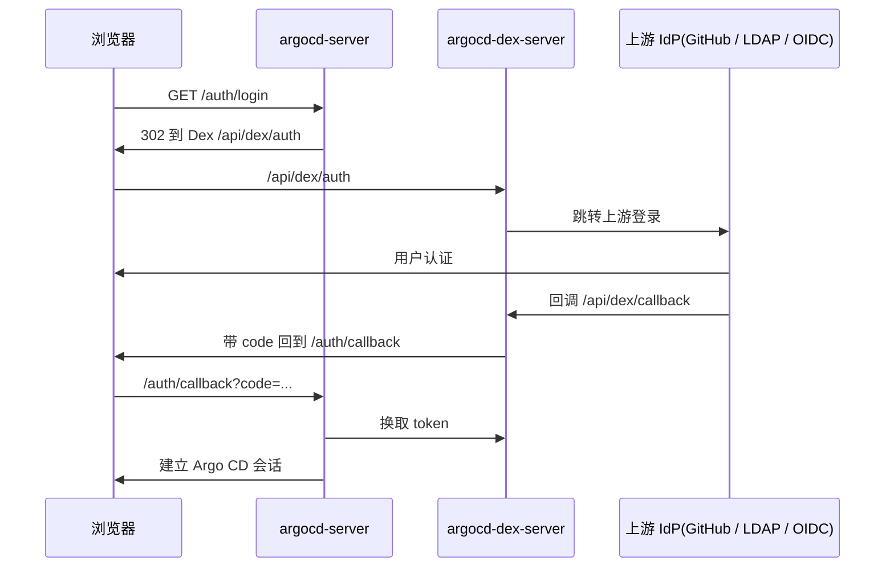

# 07-SSO 与 Dex:GitHub、LDAP 与 RBAC

> 04 只写了"SSO 有两条路";这一篇把内置 Dex 的配置讲透,重点覆盖最常用的
> GitHub 和 LDAP,以及本地 kind 怎么实测。
>
> **类型**:How-to(操作指南)
> **状态**:部分实测(2026-10-31;GitHub org/team 已实测,LDAP 未实测)
> **版本基线**:Argo CD v3.5.6,内置 Dex v2.45.1
> **适用**:给 Argo CD 配置 GitHub / LDAP SSO
> **不覆盖**:外部 OIDC 的完整配置、生产 Ingress TLS、RBAC 精细授权模型
>
> 起点说明:当前 `kind-argocd` 已按 6.4 配置 GitHub SSO;原始起点是
> `argocd-cm` 没有 `url` / `dex.config`,`argocd-rbac-cm` 为空,
> Dex 日志为 `dex is not configured`。

---

## 一、先理解链路

Dex 是 Argo CD 内置的 OIDC 代理,不是一个独立的认证系统。登录链路:



关键地址:

| 项 | 值 |
|---|---|
| Dex issuer | `${url}/api/dex` |
| 上游 IdP 回调 | `${url}/api/dex/callback` |
| Argo CD 自己的 OIDC 回调 | `${url}/auth/callback` |
| 启用条件 | `url` 非空 **且** `dex.config` 可解析 |

`argocd-dex-server` 不是普通 Deployment 里手写的 Dex 配置:它运行
`argocd-dex rundex`,从 `argocd-cm` 读取 `dex.config`,再自动补上 issuer、storage、
web、grpc、telemetry,并注入三个 static client:

- `argo-cd`(Web UI)
- `argo-cd-cli`(CLI)
- `argo-cd-pkce`(PKCE)

所以:

- **不要手写 `staticClients` 里的 `argo-cd`**,会重复。
- 只写 `connectors`,以及可选的 `oauth2` / 自定义 `staticClients`。
- 修改 `argocd-cm` 后,rundex 会重新生成配置并重启 Dex 子进程,通常不用手动重启 Pod。
- Dex 使用内存存储,重启后已有会话失效,需要重新登录。

### Dex 还是直连 OIDC

| 场景 | 选择 |
|------|------|
| GitHub / GitLab / LDAP / SAML | Dex |
| 企业 IdP 支持标准 OIDC(Keycloak / Okta / Entra / Auth0) | 可以直连 `oidc.config`,少一层 |
| 需要把 GitHub org/team 映射成 groups | Dex |
| 需要用户信息端点、federated token | Dex 的 OIDC connector |

直连 OIDC 的要点(本篇不展开):`oidc.config`、secret 用 `$oidc.<id>.clientSecret`、
上游回调是 `${url}/auth/callback`。同时配了 `oidc.config` 和 `dex.config` 时,**直连 OIDC 优先**。

---

## 二、共同前置

### 2.1 `url` 必须是浏览器地址

```yaml
data:
  url: https://argocd.example.com
```

- 不要带结尾斜杠。
- 必须和浏览器实际访问的 scheme/host/port 完全一致,否则回调一定 mismatch。
- 多个地址可以用 `additionalUrls`。
- 本地 kind 用 port-forward 时写 `https://localhost:8080`,不要在 `localhost` 和
  `127.0.0.1` 之间来回换。

### 2.2 Secret 的引用方式

`argocd-cm` 里写 `$secretName.keyName`,Argo CD 会去 Secret 里取:

```yaml
clientSecret: $dex.github.clientSecret
```

- 不写 Secret 名时,默认从 `argocd-secret` 取。
- 用自定义 Secret 时,写成 `$my-secret:dex.github.clientSecret`,
  并且 Secret 必须带 label:

```yaml
metadata:
  labels:
    app.kubernetes.io/part-of: argocd
```

- Secret 不要明文写进 ConfigMap。

### 2.3 RBAC 必须配

`argocd-rbac-cm` 为空时,SSO 用户能登录,但**没有任何权限**。
最小配置:

```yaml
apiVersion: v1
kind: ConfigMap
metadata:
  name: argocd-rbac-cm
  namespace: argocd
data:
  policy.default: role:readonly
  scopes: '[groups]'
  policy.csv: |
    g, admin, role:admin          # 保留本地 admin，避免把自己锁在外面
    g, <group>, role:admin
```

- `scopes` 默认就是 `[groups]`;还要按邮箱映射时写 `[groups, email]`。
- `policy.default` 给所有已认证用户兜底权限,且不能再用 deny 收回,所以给最小权限。
- 组名大小写敏感。
- Dex 的 groups 只在登录时刷新,改组成员后让用户重新登录。

---

## 三、GitHub 连接器

### 3.1 创建 OAuth App

GitHub → Settings → Developer settings → OAuth Apps → New OAuth App:

| 字段 | 值 |
|---|---|
| Homepage URL | `https://<argocd 地址>` |
| Authorization callback URL | `https://<argocd 地址>/api/dex/callback` |

拿到 Client ID / Client Secret。注意:

- **这个 OAuth App 只用于用户登录,不用于 repo clone**。仓库连接走 Repository Secret
  (PAT / SSH key / GitHub App),两者是独立凭据;公开仓库不需要凭据。
- 如果仓库连接用 GitHub App,你会同时有一个 **GitHub App(机器身份)** 和一个
  **OAuth App(用户身份)**。这是两个不同类型的集成对象,不是重复创建同一种 App。
- OAuth App 可以属于个人或组织;组织可能限制第三方 OAuth App,需要 owner 批准。
- 组织启用了 SAML SSO 时,用户首次登录还要给 OAuth token 做 SSO 授权。
- Dex 自动申请 `user:email` 和 `read:org` scope,不需要手填。
- 本地 kind 测试时 callback 可用 `https://localhost:8080/api/dex/callback`。

### 3.2 生产配置示例

```yaml
data:
  url: https://argocd.example.com

  dex.config: |
    connectors:
      - type: github
        id: github
        name: GitHub
        config:
          clientID: Iv1.xxxxxxxxxxxxxxxx
          clientSecret: $dex.github.clientSecret

          orgs:
            - name: your-github-org      # 组织 login（URL 里的名字）
              teams:
                - platform               # 可选；不写表示组织内所有成员可登录
                - sre

          # teamNameField: name         # name（默认）| slug | both
          # loadAllGroups: false        # 没配 orgs 时才生效
          # hostName: github.example.com # GitHub Enterprise Server
          # rootCA: /etc/dex/ghe-ca.crt  # GHE 私有 CA
          # useLoginAsID: false         # subject 用 login 而不是数字 ID
          # preferredEmailDomain: example.com
```

### 3.3 字段语义

| 字段 | 说明 |
|------|------|
| `orgs[].name` | GitHub 组织 login,不能和旧字段 `org` 同时用 |
| `orgs[].teams` | 用户必须属于其中至少一个 team;不写则组织内所有成员都可以登录 |
| `teamNameField` | team 在 groups claim 里用 `name`、`slug` 还是 `both`;默认 `name` |
| `loadAllGroups` | 仅在没配 `orgs`/`org` 时生效;true 会加载用户所有组织和团队 |
| `hostName` | GitHub Enterprise Server 域名,不带 scheme 和路径 |
| `rootCA` | GHE 私有 CA 在 Dex 容器里的路径,需要挂载 |
| `useLoginAsID` | subject 用 GitHub login;GitHub 改名后 subject 会变 |
| `preferredEmailDomain` | 多个邮箱时优先选哪个域名 |

### 3.4 groups claim 的规则

这是 GitHub 最容易配错的地方:

- 配了 `orgs` 时,group 是 **`org:team`**,例如 `your-github-org:platform`。
- **不会返回裸组织名**,所以 `g, your-github-org, role:admin` 匹配不上。
- 某个 org 不写 `teams` 时:该 org 的所有成员都能登录,所有 team 都会出现在 groups 里。
- 写了 `teams` 时:用户必须至少属于一个列出的 team;groups 里只包含命中的 team。
- 没配 `orgs` 且 `loadAllGroups: true` 时:返回组织名和 `org:team`。
- `teams` 列表的值要和 `teamNameField` 一致:默认用 team 显示名,`slug` 用 slug,
  `both` 则 name/slug 都会出现。

RBAC 示例:

```yaml
data:
  policy.default: role:readonly
  scopes: '[groups]'
  policy.csv: |
    g, your-github-org:platform, role:admin
    g, your-github-org:sre, role:readonly
```

### 3.5 写入 secret

放 `argocd-secret`:

```bash
kubectl -n argocd patch secret argocd-secret --type merge \
  -p '{"stringData":{"dex.github.clientSecret":"<Client Secret>"}}'
```

或者用独立 Secret(推荐,方便轮换):

```yaml
apiVersion: v1
kind: Secret
metadata:
  name: argocd-github-oauth
  namespace: argocd
  labels:
    app.kubernetes.io/part-of: argocd
type: Opaque
stringData:
  dex.github.clientSecret: <Client Secret>
```

然后 `dex.config` 里引用:

```yaml
clientSecret: $argocd-github-oauth:dex.github.clientSecret
```

### 3.6 验证

```bash
kubectl -n argocd logs deploy/argocd-dex-server --tail=100
kubectl -n argocd logs deploy/argocd-server --tail=50
```

UI 出现 **LOG IN VIA GITHUB**;CLI:

```bash
argocd login argocd.example.com --sso
```

### 3.7 GitHub 排错

| 现象 | 原因 |
|------|------|
| `user "xxx" not in required orgs or teams` | org 名写错;用户不在组织/team;OAuth App 未被组织批准;SAML SSO token 未授权 |
| Dex 日志有 `user not in org or application not authorized to read org data` | 新组织默认开启 OAuth App access restrictions;在组织 Settings → Third-party Access → OAuth app policy 里批准 OAuth App。PAT 能读组织成员不代表 OAuth App 能读 |
| `redirect_uri_mismatch` | callback 不是 `${url}/api/dex/callback`,或 `url` 和浏览器地址不一致 |
| `invalid client secret` | secret 不在 `argocd-secret`,或独立 Secret 少了 part-of label |
| 能登录但 groups 为空 | 配了 `teams` 但值不符合 `teamNameField`;或没配 `orgs` 且 `loadAllGroups` 为 false |
| 登录超时 | Dex Pod 出不了网;见 6.3 的代理配置 |

---

## 四、LDAP 连接器

LDAP 与 GitHub 的认证流程不同:Dex 先用服务账号搜索用户,再**用用户 DN + 密码 bind**
验证密码,最后查组。

### 4.1 前置检查

用 `ldapsearch` 先确认用户和组都能查到:

```bash
# 用户
ldapsearch -x -H ldaps://ldap.example.com:636 \
  -D 'cn=argocd,ou=services,dc=example,dc=com' -W \
  -b 'ou=people,dc=example,dc=com' \
  '(uid=alice)' uid mail cn displayName

# 用户所属组
ldapsearch -x -H ldaps://ldap.example.com:636 \
  -D 'cn=argocd,ou=services,dc=example,dc=com' -W \
  -b 'ou=groups,dc=example,dc=com' \
  '(&(objectClass=groupOfNames)(member=cn=alice,ou=people,dc=example,dc=com))' cn
```

服务账号只需要读权限,不要用域管理员。

### 4.2 OpenLDAP / 标准 LDAP

```yaml
data:
  url: https://argocd.example.com

  dex.config: |
    connectors:
      - type: ldap
        id: ldap
        name: LDAP
        config:
          host: ldap.example.com:636
          insecureNoSSL: false          # LDAPS
          # startTLS: true              # 389 + StartTLS 时打开
          # insecureSkipVerify: false   # 仅实验环境考虑 true

          bindDN: cn=argocd,ou=services,dc=example,dc=com
          bindPW: $dex.ldap.bindPW
          usernamePrompt: Username

          userSearch:
            baseDN: ou=people,dc=example,dc=com
            filter: "(objectClass=inetOrgPerson)"
            username: uid
            idAttr: uid
            emailAttr: mail
            nameAttr: cn
            # scope: sub
            # preferredUsernameAttr: uid

          groupSearch:
            baseDN: ou=groups,dc=example,dc=com
            filter: "(objectClass=groupOfNames)"
            userMatchers:
              - userAttr: DN
                groupAttr: member
            nameAttr: cn
```

### 4.3 Active Directory

```yaml
dex.config: |
  connectors:
    - type: ldap
      id: active-directory
      name: Active Directory
      config:
        host: dc01.corp.example.com:636
        insecureNoSSL: false
        bindDN: CN=argocd,OU=Services,DC=corp,DC=example,DC=com
        bindPW: $dex.ldap.bindPW

        userSearch:
          baseDN: OU=Users,DC=corp,DC=example,DC=com
          filter: "(objectClass=user)"
          username: sAMAccountName
          idAttr: sAMAccountName
          emailAttr: mail
          nameAttr: displayName
          preferredUsernameAttr: sAMAccountName

        groupSearch:
          baseDN: OU=Groups,DC=corp,DC=example,DC=com
          filter: "(objectClass=group)"
          userMatchers:
            - userAttr: DN
              groupAttr: member
              recursionGroupAttr: memberOf   # 支持嵌套组
          nameAttr: cn
```

AD 注意点:

- `sAMAccountName` 常见且唯一;`userPrincipalName` 也可以,要和用户输入一致。
- 不要用 `objectGUID` 做 `idAttr`,二进制转字符串不稳定。
- 组名取 `cn`,RBAC 写 `g, argocd-admins, role:admin`。
- `recursionGroupAttr: memberOf` 会沿父组递归;不配则只认直接成员组。
- AD 的 `member` 存用户 DN,所以 `userAttr: DN`、`groupAttr: member`。
- `posixGroup` 用 `userAttr: uid`、`groupAttr: memberUid`。

### 4.4 字段速查

| 字段 | 说明 |
|------|------|
| `host` | `host:port`;不写端口按 TLS 配置猜 389/636 |
| `insecureNoSSL` | 明文 LDAP 才设 true,仅测试 |
| `startTLS` | 389 端口升级 TLS |
| `insecureSkipVerify` | 跳过证书校验,生产别开 |
| `rootCA` | 私有 CA 证书路径(Dex 容器内),需要挂载 |
| `rootCAData` | 直接内联 base64 PEM |
| `bindDN` / `bindPW` | 搜索用服务账号;都为空则匿名 bind |
| `userSearch.username` | 登录名属性,Dex 拼成 `(username=输入值)` |
| `userSearch.idAttr` | OIDC subject,默认 `uid` |
| `userSearch.emailAttr` | 默认 `mail` |
| `userSearch.nameAttr` | 显示名,无默认值,建议显式配 |
| `groupSearch.nameAttr` | 组名属性,必填 |
| `userMatchers[].userAttr` | 用户属性,如 `DN`、`uid` |
| `userMatchers[].groupAttr` | 组上指向用户的属性,如 `member`、`memberUid` |
| `recursionGroupAttr` | 嵌套组递归,AD 常用 `memberOf` |
| `scope` | `sub`(默认)或 `one` |

### 4.5 TLS 选择

| 场景 | 配置 |
|------|------|
| LDAPS 636 | `insecureNoSSL: false`,不写 `startTLS` |
| LDAP 389 + StartTLS | `startTLS: true` |
| 明文 LDAP 389(仅测试) | `insecureNoSSL: true` |
| 私有 CA | `rootCA: /etc/dex/ca.crt`,并挂载证书 |
| 自签证书(仅测试) | `insecureSkipVerify: true` |

`rootCA` 是 Dex 容器里的路径,需要在 `argocd-dex-server` 上挂 Secret/ConfigMap。

### 4.6 写入 secret

```bash
kubectl -n argocd patch secret argocd-secret --type merge \
  -p '{"stringData":{"dex.ldap.bindPW":"<服务账号密码>"}}'
```

### 4.7 LDAP 排错

| 错误 | 原因 |
|------|------|
| `initial bind for user ... failed` | `bindDN` / `bindPW` 错,或服务账号无权搜索 |
| 一直提示密码错误 | 用户 DN 搜不到,或目录不允许用户 bind |
| `group entity ... missing required attribute "cn"` | `groupSearch.nameAttr` 没配或属性不存在 |
| groups 为空 | `baseDN` 为空、filter 不匹配、`groupAttr` 用错(`member` vs `memberUid`) |
| TLS 握手失败 | LDAPS/StartTLS 选错,或缺 `rootCA` |
| `no such host` / 超时 | Dex Pod 解析不到 LDAP 域名,或网络不通 |

---

## 五、验证与生效

```bash
kubectl -n argocd logs deploy/argocd-dex-server --tail=100
kubectl -n argocd logs deploy/argocd-server --tail=50
```

保存 `argocd-cm` 后,Dex 会自动重建配置。没生效就:

```bash
kubectl -n argocd rollout restart deploy/argocd-dex-server deploy/argocd-server
```

UI 登录;CLI:

```bash
argocd login localhost:8080 --sso --insecure
```

确认 SSO 可用后,再考虑关闭本地 admin:

```yaml
data:
  admin.enabled: "false"
```

---

## 六、本地 kind 实测

### 6.1 用 port-forward 的地址

```bash
kubectl -n argocd port-forward svc/argocd-server 8080:443
```

- `url` 写 `https://localhost:8080`
- GitHub OAuth App callback 写 `https://localhost:8080/api/dex/callback`
- 浏览器会提示自签证书,继续访问即可
- 不要在浏览器/CLI/配置里混用 `localhost` 和 `127.0.0.1`

如果 GitHub 不接受 localhost 回调,用 cloudflared / ngrok 暴露 HTTPS 域名,并把 `url`
换成那个域名。

### 6.2 实验清单

`labs/sso/github/` 下提供了可直接改的清单:

| 文件 | 用途 |
|------|------|
| `argocd-cm-patch.yaml` | 写入 `url` + GitHub connector(不含 org 限制,便于本地实验) |
| `secret.example.yaml` | OAuth App 的 Client Secret,复制到 /tmp 填写 |
| `argocd-rbac-cm-patch.yaml` | `policy.default: role:readonly` + 指定 GitHub login 为 admin |
| `README.md` | 步骤与清理命令 |

本地实验版 `dex.config` 的关键差异:

```yaml
config:
  clientID: REPLACE_WITH_CLIENT_ID
  clientSecret: $argocd-github-oauth:dex.github.clientSecret
  useLoginAsID: true
```

没有 `orgs`,任何 GitHub 用户都能登录;RBAC 默认只读,只把你自己的 login 映射成 admin。
生产环境一定要加 `orgs` / `teams` 限制。

### 6.3 Dex Pod 出网代理

`kubernetes/kind/kind-proxy.conf` 只修了节点里的 containerd / kubelet,Pod 不会自动继承。
Dex 访问 github.com 会超时:

```bash
PROXY=http://host.docker.internal:7890
NO_PROXY='localhost,127.0.0.1,.svc,.svc.cluster.local,10.0.0.0/8,10.244.0.0/16,10.96.0.0/16,172.16.0.0/12,192.168.0.0/16'

kubectl -n argocd set env deployment/argocd-dex-server \
  HTTP_PROXY="$PROXY" HTTPS_PROXY="$PROXY" http_proxy="$PROXY" https_proxy="$PROXY" \
  NO_PROXY="$NO_PROXY" no_proxy="$NO_PROXY"
```

LDAP 不经过外网;如果 LDAP 在 Mac 宿主上,Dex Pod 里的 `127.0.0.1` 是 Pod 自己,
要用 `host.docker.internal` 或 colima 网关地址。

### 6.4 实测结果(2026-10-31)

- GitHub OAuth App + Dex GitHub connector 登录成功。
- 当前限制:`orgs: hchenxa-org` + `teams: argo-admin`,`teamNameField: slug`。
- Dex 日志:`login successful`,`preferred_username=hchenxa`,`groups=["hchenxa-org:argo-admin"]`。
- `argocd-server` 日志:`Web login successful`,`username=hchenxa`,issuer `https://localhost:8080/api/dex`。
- RBAC 只保留 `g, hchenxa-org:argo-admin, role:admin`(另保留本地 admin);admin-only 的
  `ListAccounts` 调用返回 `OK`,证明 team 映射生效。
- **新组织默认开启 OAuth App access restrictions**。若 Dex 报
  `user not in org or application not authorized to read org data`,先在组织
  Settings → Third-party Access → OAuth app policy 里批准 OAuth App,再重新授权登录。
- 负向测试(把允许 team 换成 `argo-viewer`)未做;LDAP 未测。

---

## 七、排错汇总

| 现象 | 先检查 |
|------|--------|
| UI 没有 GitHub / LDAP 登录按钮 | `argocd-cm` 的 `url` / `dex.config`;`argocd-server` 日志 |
| `redirect_uri_mismatch` | OAuth App callback 与 `url` 是否完全一致 |
| `invalid client secret` | Secret 是否存在、label 和 key 是否正确 |
| `user ... not in required orgs or teams` | GitHub org/team、OAuth App 是否被组织批准、SAML SSO 授权 |
| LDAP `initial bind ... failed` | `bindDN` / `bindPW` 和服务账号读权限 |
| LDAP groups 为空 | `groupSearch.baseDN`、filter、`member` / `memberUid`、`nameAttr` |
| 登录成功但没有权限 | `argocd-rbac-cm` 的 `policy.default` / `policy.csv` |
| Dex 反复重启 | `kubectl logs deploy/argocd-dex-server` 里的 connector 解析错误 |

## 八、安全清单

- GitHub 尽量限制 `orgs` + `teams`,不要只靠 RBAC 兜底。
- LDAP 用只读服务账号;生产不要 `insecureNoSSL` / `insecureSkipVerify`。
- Secret 放 `argocd-secret` 或带 `app.kubernetes.io/part-of: argocd` label 的 Secret。
- 先确认 SSO 可用,再关闭本地 admin。
- `policy.default` 给最小权限;敏感权限按组/用户显式授予。
- Dex 是内存存储,重启后会话失效。
- groups 只在登录时刷新,权限变更后让用户重新登录。
- GitHub OAuth App 的 Client Secret 按凭据管理,定期轮换;轮换后重启 Dex。

---

## 九、验收

- [ ] `argocd-cm` 有 `url` 和 `dex.config`;Dex 日志不再出现 `dex is not configured`
- [ ] UI 出现对应的登录按钮
- [ ] `argocd login --sso` 能完成登录
- [ ] 未匹配用户只有 `policy.default` 的权限
- [ ] 组/用户映射到 `role:admin` 生效
- [ ] 关闭 `admin.enabled` 后仍能登录
- [ ] GitHub:把用户移出允许的 org/team 后重新登录被拒
- [ ] LDAP:改用户组后重新登录,权限变化正确

---

## 十、参考

- [User Management(Dex)](https://argo-cd.readthedocs.io/en/stable/operator-manual/user-management/)
- [RBAC Configuration](https://argo-cd.readthedocs.io/en/stable/operator-manual/rbac/)
- [Argo CD Dex 源码:config.go](https://github.com/argoproj/argo-cd/blob/v3.5.6/util/dex/config.go)
- [Dex GitHub Connector](https://dexidp.io/docs/connectors/github/)
- [Dex LDAP Connector](https://dexidp.io/docs/connectors/ldap/)
- [Dex Connectors 总览](https://dexidp.io/docs/connectors/)
