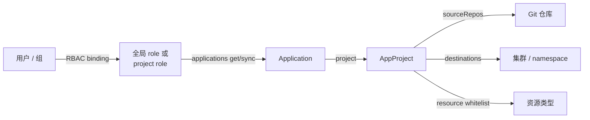

# 08-多租户 RBAC:项目隔离、全局角色与 project role

> 04 讲了 AppProject / RBAC 的概念;这一篇用两个租户做一次可复现实验:
> 同一套集群里,`team-a` 和 `team-b` 的用户只能看到、操作自己的项目。
>
> **类型**:How-to(操作指南)
> **状态**:部分实测(2026-10-31;本地用户 RBAC / 跨租户隔离已实测,SSO argo-viewer 登录未实测)
> **版本基线**:Argo CD v3.5.6
> **适用**:设计多团队共享 Argo CD 的隔离模型,或验证 RBAC 规则
> **不覆盖**:SSO 本身的配置(见 07)、大规模租户的自动化(ApplicationSet / 自建平台)

---

## 一、结论先行

- **AppProject 做硬隔离**:`sourceRepos`、`destinations`、资源白名单决定"能不能部署";
  越界的 Application 直接 `InvalidSpecError`,与用户权限无关。
- **RBAC 做可见性和操作**:`argocd-rbac-cm` 的全局角色 + `AppProject.spec.roles`
  的 project role 决定"谁能看到、能 sync 什么"。
- **`policy.default` 必须是 `role:no-access`**:如果保留 `role:readonly`,
  所有已登录用户都能看到所有项目,租户隔离就失效了。
- 本次用三个本地账号验证:
  - `tenant-a-viewer`:全局 RBAC,只能看 team-a;
  - `tenant-b-viewer`:project role,只能看 team-b;
  - `tenant-a-developer`:project role,可以 sync team-a。
- 跨租户 Application(project=team-a,destination=team-b-dev)被 AppProject 直接拒绝。

---

## 二、两层模型



### 2.1 AppProject:硬隔离

`team-a` 和 `team-b` 各自限制:

| 字段 | 作用 | 本次配置 |
|------|------|---------|
| `sourceRepos` | 只允许从哪些仓库拉清单 | 两个项目都只允许 reading-notes |
| `destinations` | 只允许部署到哪些集群/namespace | team-a: team-a-dev/prod;team-b: team-b-dev/prod |
| `clusterResourceWhitelist` | 允许创建哪些 cluster-scoped 资源 | 允许 Namespace(为了 `CreateNamespace=true`) |
| `namespaceResourceWhitelist` | 允许创建哪些 namespaced 资源 | 实验允许 `*/*`;生产应收窄 |

### 2.2 RBAC:可见性与操作

两种写法:

| 写法 | 定义位置 | 绑定方式 | 本次用途 |
|------|---------|---------|---------|
| 全局 role | `argocd-rbac-cm` 的 `policy.csv` | `g, <user/group>, role:<name>` | `tenant-a-viewer` |
| project role | `AppProject.spec.roles` | `g, <user/group>, proj:<project>:<role>` | `tenant-b-viewer`、`tenant-a-developer` |

project role 的 policy 前缀是 `proj:<project>:<role>`,例如:

```csv
p, proj:team-a:developer, applications, sync, team-a/*, allow
```

---

## 三、前置条件

- Argo CD v3.5.6,至少两个 AppProject(`team-a`、`team-b`)。
- 一个公开仓库 `https://github.com/hchenxa/reading-notes.git`。
- 如果要验证 SSO:
  - Dex 已配置 GitHub connector;
  - `team-a` / `team-b` 对应的团队或组织已在 `dex.config` 的 `orgs.teams` 中;
  - 用户重新登录,groups claim 才会刷新。

本实验用**本地账号**验证 RBAC,因此不需要第二个 GitHub 账号。

---

## 四、实验步骤

完整清单在 [`labs/multitenancy/`](labs/multitenancy/README.md),这里只列关键动作。

### 4.1 创建 team-b 项目和应用

```bash
cd ArgoCD/labs/multitenancy
kubectl -n argocd apply -f team-b-project.yaml
kubectl -n argocd apply -f guestbook-team-b-dev.yaml
```

`team-b-project.yaml` 的关键字段:

```yaml
destinations:
  - name: in-cluster
    namespace: team-b-dev
  - name: in-cluster
    namespace: team-b-prod
```

### 4.2 给 team-a 增加 project role

```bash
kubectl -n argocd patch appproject team-a \
  --type merge --patch-file team-a-roles-patch.yaml
```

`team-a` 增加:

```yaml
roles:
  - name: developer
    policies:
      - p, proj:team-a:developer, applications, get, team-a/*, allow
      - p, proj:team-a:developer, applications, sync, team-a/*, allow
```

### 4.3 配置全局 RBAC

```bash
kubectl -n argocd patch configmap argocd-rbac-cm \
  --type merge --patch-file rbac-multitenant-patch.yaml
```

核心规则:

```csv
g, admin, role:admin
g, hchenxa-org:argo-admin, role:admin

p, role:tenant-a-viewer, applications, get, team-a/*, allow
p, role:tenant-a-viewer, projects, get, team-a, allow
p, role:tenant-a-viewer, logs, get, team-a/*, allow
g, tenant-a-viewer, role:tenant-a-viewer
g, hchenxa-org:argo-viewer, role:tenant-a-viewer

g, tenant-b-viewer, proj:team-b:viewer
g, tenant-a-developer, proj:team-a:developer
```

`policy.default: role:no-access` 是必须的。否则 `role:readonly` 会让所有登录用户看到所有项目。

### 4.4 创建本地测试账号

```bash
kubectl -n argocd patch configmap argocd-cm \
  --type merge --patch-file local-accounts-cm-patch.yaml

cp local-accounts-secret.example.yaml /tmp/local-accounts-secret.yaml
argocd account bcrypt --password '<tenant-a-viewer-password>'
# 把输出的 bcrypt hash 填入 /tmp/local-accounts-secret.yaml

kubectl -n argocd patch secret argocd-secret \
  --type merge --patch-file /tmp/local-accounts-secret.yaml
```

本地账号的能力写在 `accounts.<name>` 的值里:

```yaml
data:
  accounts.tenant-a-viewer: "api, login"
```

不要写成 `accounts.<name>.capabilities`;这个键不会生效,登录会报
`Account ... does not have login capability`。

---

## 五、验证

### 5.1 权限矩阵

| 身份 | 全局/项目角色 | 可见应用 | 可 sync | 越权结果 |
|------|--------------|---------|--------|---------|
| `tenant-a-viewer` | 全局 `role:tenant-a-viewer` | team-a | 否 | team-b `PermissionDenied` |
| `tenant-b-viewer` | `proj:team-b:viewer` | team-b | 否 | team-a `PermissionDenied` |
| `tenant-a-developer` | `proj:team-a:developer` | team-a | 是 | team-b 无权限 |
| `hchenxa`(argo-admin) | `role:admin` | 全部 | 是 | — |

实际命令与结果:

```bash
argocd --config /tmp/a-viewer.yaml login localhost:8080 \
  --username tenant-a-viewer --password '<password>' --insecure
argocd --config /tmp/a-viewer.yaml app list
```

输出只有 team-a 的 `guestbook-dev` / `guestbook-prod`。

```bash
argocd --config /tmp/a-viewer.yaml app get guestbook-team-b-dev
# rpc error: code = PermissionDenied desc = permission denied

argocd --config /tmp/a-viewer.yaml app sync guestbook-dev --dry-run
# rpc error: code = PermissionDenied desc = permission denied:
# applications, sync, team-a/guestbook-dev, sub: tenant-a-viewer
```

`tenant-b-viewer` 的 `app list` 只显示 `guestbook-team-b-dev`;访问 team-a 应用被拒绝。

`tenant-a-developer` 对一个 team-a 应用执行 `app sync --dry-run`,成功生成 dry-run diff:

```text
ConfigMap   team-a-dev  guestbook-config  OutOfSync  configured (dry run)
Service     team-a-dev  guestbook         OutOfSync  configured (dry run)
Deployment  team-a-dev  guestbook         OutOfSync  configured (dry run)
```

### 5.2 跨租户硬隔离

```bash
kubectl -n argocd apply -f cross-tenant-app.yaml
kubectl -n argocd get application guestbook-cross-tenant \
  -o jsonpath='{range .status.conditions[*]}{.type}: {.message}{"\n"}{end}'
```

预期:

```text
InvalidSpecError: application destination server 'in-cluster' and namespace 'team-b-dev'
do not match any of the allowed destinations in project 'team-a'
```

即使给用户 `team-a` 的 sync 权限,AppProject 也不会允许它部署到 team-b。

### 5.3 SSO group 的策略校验

`argo-viewer` 组已加入 Dex 的允许 team 列表,并映射到 `role:tenant-a-viewer`。
因为没有第二个 GitHub 账号,只做了策略校验:

```bash
argocd admin settings rbac can hchenxa-org:argo-viewer get applications team-a/guestbook-dev --namespace argocd
# Yes
argocd admin settings rbac can hchenxa-org:argo-viewer get applications team-b/guestbook-team-b-dev --namespace argocd
# No
```

真实 SSO 登录未测;有第二个账号并加入 `argo-viewer` 后,重新登录即可验证。

---

## 六、排错

| 现象 | 原因 | 处理 |
|------|------|------|
| `Account ... does not have login capability` | 用了 `accounts.<name>.capabilities` | 改成 `accounts.<name>: "api, login"` |
| 登录成功但看不到任何应用 | `policy.default` 是 no-access,且用户没有匹配角色 | 检查 `g` 绑定和 group 名 |
| viewer 能看到所有项目 | `policy.default` 还是 `role:readonly` | 改成 `role:no-access` |
| project role 不生效 | 绑定写成了 `role:...`,或 project role 名不存在 | 写成 `proj:<project>:<role>` |
| SSO group 不生效 | Dex 的 `orgs.teams` 没包含该 team,或登录后没刷新 groups | 加 team,退出后重新登录 |
| 跨租户 Application 报 InvalidSpecError | project 的 destinations 不允许目标 namespace | 这是预期结果;不要扩大 project destinations |
| `ComparisonError: unable to resolve <branch>` | 目标分支已删除/不存在 | 改 `targetRevision` 为 `main` 或存在的分支 |

---

## 七、清理

```bash
kubectl -n argocd delete application guestbook-team-b-dev --wait=false
kubectl -n argocd delete application guestbook-cross-tenant --wait=false
kubectl -n argocd delete appproject team-b
kubectl -n argocd patch appproject team-a --type json \
  -p '[{"op":"remove","path":"/spec/roles"}]'
```

本地账号可从 `argocd-cm` 和 `argocd-secret` 删除;恢复原来的 RBAC 配置。

---

## 八、下一步

- 给 `argo-viewer` 加第二个 GitHub 账号,验证真实 SSO group 登录;
- 把 `team-a` / `team-b` 的 `namespaceResourceWhitelist` 收窄到实际需要的资源类型;
- 用 ApplicationSet 批量生成"每租户一套 Application";
- 阅读 [04-多集群与多租户](04-多集群与多租户.md) 的 AppProject / Cluster Secret 部分。

## 九、参考

- [Argo CD RBAC Configuration](https://argo-cd.readthedocs.io/en/stable/operator-manual/rbac/)
- [Argo CD Projects](https://argo-cd.readthedocs.io/en/stable/user-guide/projects/)
- [Argo CD User Management(Dex)](https://argo-cd.readthedocs.io/en/stable/operator-manual/user-management/)
- [07-SSO与Dex](07-SSO与Dex.md)
- [多租户 lab 清单](labs/multitenancy/README.md)
