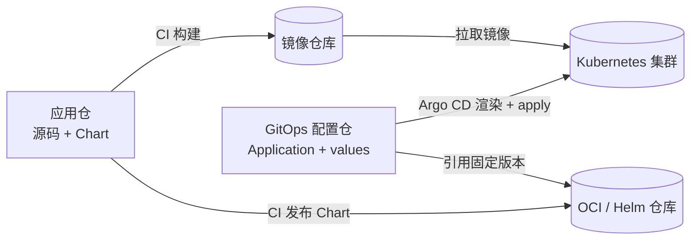

# 10-仓库组织与生产布局:应用仓、配置仓与 values 怎么放

> **类型**:How-to(操作指南)
> **状态**:未实测(2026-10-31;基于 Argo CD 官方 best practices 与多源文档整理,未在真实多团队环境演练)
> **版本基线**:Argo CD v3.5.6 / Helm 3.8+
> **适用**:设计 Argo CD 生产环境的 Git 仓库拆分、values 存放和晋级流程
> **不覆盖**:ApplicationSet 生成器语法(见 [03](03-清单来源与ApplicationSet.md))、AppProject/RBAC 细节(见 [04](04-多集群与多租户.md))、Secret 后端选型

03 讲清单从哪里来,04 讲谁能部署;这一篇讲这些清单、values 和 Application 定义在生产上分别放在哪个仓库,以及怎么晋级和回滚。

## 一、结论先行

1. **生产至少两个仓库**:应用仓放源码和 chart;GitOps 配置仓放 Application/ApplicationSet 和每个环境的 values。
2. **Application 定义和 values 放同一个配置仓**。一次 PR 同时改 chart 版本和参数,评审、回滚都是一个 commit。
3. **chart 作为版本化制品发布**,Application 用 `targetRevision` 固定精确版本;不要让多个环境直接跟应用仓的 `main`。
4. **环境用目录区分**,例如 `envs/dev`、`envs/staging`、`envs/prod`;不要用长期环境分支,晋级靠 PR。
5. **规模上来再拆**:配置仓按团队或环境拆,生产配置可以单独一个仓库;一开始不要拆成十几个仓库。

- **适用**:多环境、多人协作、需要区分研发与运维权限的 Argo CD 生产部署。
- **不适用**:个人单环境、只有一个 Git 仓库且不需要隔离的场景;单仓也能工作,权衡见第八节。

## 二、前置条件

- 已理解 Application、AppProject 和多源来源:`sources` 可以有多个仓库,其中一个用 `ref: values` 命名。
- Argo CD ≥ 2.6;跨仓库引用 values 依赖多源,本文按 v3.5.6 写。
- 有 Git 仓库的分支保护和评审权限,能配置 CODEOWNERS 或等价规则。
- 已确定 chart 的发布方式:OCI 仓库或 Helm chart 仓库。
- 需要先读 [00-概念与架构](00-概念与架构.md)、[03-清单来源与ApplicationSet](03-清单来源与ApplicationSet.md)、[04-多集群与多租户](04-多集群与多租户.md)。

## 三、仓库拓扑与目录结构

### 3.1 两仓起步



| 仓库 | 放什么 | 谁维护 | 变更频率 |
|------|--------|--------|---------|
| 应用仓 | 源码、Dockerfile、chart 源码 | 研发 | 跟应用版本走 |
| GitOps 配置仓 | Application/ApplicationSet、AppProject、各环境 values | 平台或 SRE,研发提 PR | 跟发布和参数调整走 |

Argo CD 官方 best practices 把"配置文件与源码分离"列为 highly recommended,理由包括审计日志干净、访问权限分离,以及避免应用仓 CI 反过来修改部署配置形成循环触发。原文链接见第十节。

### 3.2 应用仓:chart 作为制品

```text
myapp/
  src/
  Dockerfile
  charts/myapp/
    Chart.yaml
    values.yaml          # chart 默认值
    templates/
```

CI 在应用发布时打包并推送 chart:

```bash
helm lint charts/myapp
helm package charts/myapp --version 1.2.3 --app-version 1.2.3
helm push myapp-1.2.3.tgz oci://registry.example.com/charts
```

如果 chart 被多个应用复用,放独立的 charts 仓库,不要复制到每个应用仓。Argo CD 接入 OCI chart 的两种写法和仓库凭据见 [06](06-源类型全解与扩展.md) 第 5.3 节。

> **注意**:`targetRevision` 写精确版本,不要写 `latest` 或版本范围;否则生产环境可能在配置没有变化时被新 chart 改变。

### 3.3 配置仓:Application 与 values

```text
gitops-config/
  bootstrap/
    root-app.yaml          # app-of-apps 根 Application
  projects/
    team-a.yaml            # AppProject
  apps/
    myapp/
      appset.yaml          # 按环境生成 Application
  envs/
    dev/myapp/values.yaml
    staging/myapp/values.yaml
    prod/myapp/values.yaml
  clusters/
    ...                    # 集群注册与标签(如果使用 cluster generator)
```

配置仓的入口是一个 root Application,由它管理 `apps/` 下的 Application 和 ApplicationSet。`envs/` 只放覆盖项,不复制 chart 的完整 `values.yaml`;否则 chart 默认值更新后,配置仓里的旧值会覆盖新默认值,形成漂移。

### 3.4 引用关系

ApplicationSet 把 chart 版本写死,把 values 指向配置仓:

```yaml
apiVersion: argoproj.io/v1alpha1
kind: ApplicationSet
metadata:
  name: myapp
  namespace: argocd
spec:
  goTemplate: true
  generators:
    - list:
        elements:
          - env: dev
          - env: staging
          - env: prod
  template:
    metadata:
      name: 'myapp-{{.env}}'
    spec:
      project: team-a
      sources:
        - repoURL: registry.example.com/charts
          chart: myapp
          targetRevision: 1.2.3
          helm:
            valueFiles:
              - $values/envs/{{.env}}/myapp/values.yaml
        - repoURL: https://github.com/hchenxa/gitops-config.git
          targetRevision: main
          ref: values
      destination:
        server: https://kubernetes.default.svc
        namespace: 'myapp-{{.env}}'
```

`$values` 从第二个源的仓库根目录解析;chart 用精确版本。AppProject 的 `sourceRepos` 必须同时包含 chart 仓库和配置仓库,否则多源 Application 会被 project 拒绝。多源和 values 优先级的完整规则见 [03](03-清单来源与ApplicationSet.md)。

## 四、操作步骤

### 4.1 拆分现有单仓

1. 应用仓保留源码和 chart,CI 增加 `helm package` 和 `helm push`。
2. 新建配置仓,按 `envs/<env>/<app>/values.yaml` 建立目录。
3. 在配置仓放 root Application 和 AppProject,先让它们能同步 `apps/` 目录。
4. 把现有 Application 改成多源:chart 来自制品仓库,values 来自 `$values/...`。
5. 用 `argocd app diff` 对比新旧渲染结果,确认只包含预期的 values 变化,再合并切换。

> **安全**:切换 source 前先备份现有 Application YAML;如果新旧渲染结果不一致,先不要开启 `automated.prune`,避免切换过程中误删资源。

### 4.2 发布 chart 版本

每次应用发布执行 `helm package` 和 `helm push`,然后只在配置仓改一个字段:

```yaml
# apps/myapp/appset.yaml
helm:
  valueFiles:
    - $values/envs/{{.env}}/myapp/values.yaml
# 只改 chart 版本
targetRevision: 1.2.4
```

chart 版本和 values 改动放在同一个 PR 里,回滚时一个 revert 就能同时恢复 chart 和参数。

### 4.3 更新环境 values

values 文件只写要覆盖的字段:

```yaml
# envs/prod/myapp/values.yaml
replicaCount: 3
image:
  tag: "1.2.4"
ingress:
  host: myapp.example.com
```

晋级流程是 dev → staging → prod,每个 PR 只改目标环境的目录和 chart 版本。不要为每个环境维护长期分支;分支之间 cherry-pick 会产生漂移,目录加 PR 更容易审计。

### 4.4 CI 渲染校验

配置仓的 PR 在合并前渲染一遍,提前发现 values 路径和字段错误。Helm 3.8+ 支持直接用 OCI chart 渲染:

```bash
helm template myapp oci://registry.example.com/charts/myapp \
  --version 1.2.4 \
  -f envs/prod/myapp/values.yaml \
  --namespace myapp > /tmp/myapp-rendered.yaml
kubeconform -strict -summary /tmp/myapp-rendered.yaml
```

> **未实测**:上面两条命令按 Helm 3.8+ 的 OCI 语法编写,本仓库尚未接入 CI,输出未验证;执行前先确认 Helm 版本支持 `oci://`,并确认 CI 有 OCI 仓库的只读凭据。

### 4.5 晋级与回滚

- 晋级:从 `envs/dev/myapp/values.yaml` 复制变更到 `envs/staging` 和 `envs/prod`,同时更新 chart 版本,走 PR。
- 回滚:对配置仓执行 `git revert <commit>`,合并后由 Argo CD 自动 sync;或者把 `targetRevision` 改回上一个版本,同样走 PR。
- 不要用 `kubectl edit` 或 `argocd app set` 改生产 values;Application 由 Git 管理且开启 selfHeal 时,这些改动会被下一次 sync 覆盖。

## 五、验证

- [ ] `argocd app get <app>` 的 `status.sync.revisions` 里,chart 源是目标版本,values 源是配置仓的目标 commit。
- [ ] `argocd app manifests <app>` 渲染出的 `image.tag`、`replicaCount` 与 `envs/<env>/<app>/values.yaml` 一致。
- [ ] `argocd app diff <app>` 在同步后为空;不为空时先确认差异来源。
- [ ] 用 AppProject 不允许的仓库创建 Application,会被拒绝,证明 `sourceRepos` 生效。
- [ ] 配置仓 CI 的 `helm template` 和 schema 校验通过。

```bash
argocd app get <app>
argocd app manifests <app>
argocd app diff <app>
```

多源 Application 的 `status.sync.revisions` 是数组,每个源一个 revision;只看第一个会漏掉 values 仓库的版本。

## 六、回滚与清理

- 配置回滚:`git revert <commit>`,合并后等待 Argo CD sync,再用 `argocd app diff <app>` 确认差异为空。
- chart 回滚:把 Application 或 ApplicationSet 的 `targetRevision` 改回上一个版本,走同一个 PR 流程。
- 删除环境:先移除 Application,或在 Application 上设置 `Prune=false` 的 sync option,确认资源是保留还是删除;不要直接删除配置目录。

> **安全**:开启 `automated.prune` 时,删除配置目录会触发资源删除。删除前先用 `argocd app diff <app>` 查看影响面,或者临时关闭 automated sync。

## 七、排错

| 现象 | 原因 | 解决 |
|------|------|------|
| `values file ... not found` 或 `$values` 路径解析失败 | `ref` 名称拼错、文件不在配置仓、或路径写成了相对 chart 目录 | 核对 `ref: values`、从配置仓根目录写 `$values/envs/...` |
| `application repo ... is not permitted in project` | chart 仓库或配置仓库不在 AppProject 的 `sourceRepos` | 两个来源都加入 project 的白名单 |
| 配置仓已合并,应用没有变化 | repo-server 缓存、`$values` 指向了错误环境、或 ApplicationSet 仍固定旧版本 | `argocd app get <app> --hard-refresh`,再检查渲染结果 |
| 手工 `argocd app set` 后又被改回 | Application 由 Git 管理且开启 selfHeal | 改配置仓,不要改 live Application |
| 应用仓 CI 改配置导致循环触发 | 配置和源码没有分离 | 拆仓,或在 CI 里用 path filter 限制触发范围 |
| 研发能直接改生产 values | 同一仓库,权限没有按环境隔离 | 生产配置独立仓库,或分支保护加 CODEOWNERS 和必需评审 |
| repo-server 渲染变慢 | 配置仓过大,clone 和 fetch 成本高 | 按团队或环境拆分配置仓,减少无关大文件 |

## 八、边界与取舍

| 拓扑 | 适合 | 代价 |
|------|------|------|
| 单仓(源码 + chart + values + Application) | 个人项目、单环境、1-2 人 | 权限无法按环境隔离;chart 与配置耦合;CI 容易互相触发 |
| 应用仓 + 配置仓(推荐) | 大多数生产,单团队到中等规模 | 跨仓 PR 需要协调;Argo CD 要配置两个仓库凭据 |
| 配置仓再按团队或环境拆多个 | 多团队、强合规、生产需要独立审批 | 全局视图和批量变更成本高;需要 ApplicationSet 跨仓聚合 |

单仓不是错误。如果只有一个人维护、只有一个环境,单仓加 path filter 也能工作。触发拆仓的条件通常是这两个:研发能直接改生产 values,或者应用仓 CI 会修改部署配置。仓库数量本身不是目标。

## 九、下一步

- [03-清单来源与ApplicationSet](03-清单来源与ApplicationSet.md):Helm values 优先级、多源和 ApplicationSet 生成器。
- [04-多集群与多租户](04-多集群与多租户.md):用 AppProject 限制配置仓和集群边界。
- [06-源类型全解与扩展](06-源类型全解与扩展.md):OCI chart、CMP 等源类型的接入方式。
- [05-生产化与排障](05-生产化与排障.md):HA、通知、监控、备份和升级。

## 十、参考

- [Argo CD Best Practices](https://argo-cd.readthedocs.io/en/stable/user-guide/best_practices/)(stable,2026-10-31):配置文件与源码分离、审计和访问控制建议。
- [Argo CD Helm](https://argo-cd.readthedocs.io/en/stable/user-guide/helm/)(stable,2026-10-31):`valueFiles`、values 优先级和跨仓库 values。
- [Argo CD Multiple Sources](https://argo-cd.readthedocs.io/en/stable/user-guide/multiple_sources/)(stable,2026-10-31):`ref` 和 `$values` 的解析方式。
- [GitHub CODEOWNERS](https://docs.github.com/en/repositories/managing-your-repositorys-settings-and-features/customizing-your-repository/about-code-owners)(2026-10-31):按路径指定评审人。
