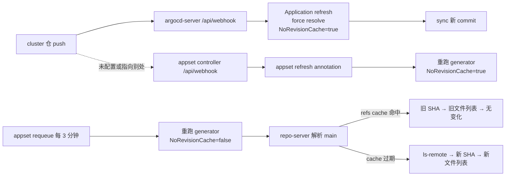

# 11-ApplicationSet 跨仓库删除排障:删 values.yaml 后 Application 不消失

> **类型**:Case study(排障记录)
> **状态**:部分实测(2026-11-11;现象、requeue 日志、refresh annotation 的效果已确认,修复选项 A/B 尚未在目标环境逐项验证)
> **版本基线**:Argo CD v3.x(目标环境具体版本待补;机制依据 v3 stable 文档与 master 源码,笔记基线为 v3.5.6)
> **适用**:ApplicationSet 用 matrix + 多仓库 generator(bootstrap 集群清单仓 + 每集群配置仓)生成 Application 的场景
> **不覆盖**:ApplicationSet 基础语法(见 [03](03-清单来源与ApplicationSet.md))、仓库拆分设计(见 [10](10-仓库组织与生产布局.md))、Argo CD HA 与规模调优(见 [05](05-生产化与排障.md))

## 一、结论先行

1. ApplicationSet 的 reconcile 与 Git diff 无关。默认每 3 分钟无条件重跑 generator;bootstrap 仓库没有新 commit,也会重新读取每个 cluster 仓库。
2. 本案例中"没有重新生成"是假象。generator 确实重跑了,但 repo-server 的 refs/revision cache 把 `cluster-<name>` 的 `main` 固定在旧 SHA 上,删/加 `values.yaml` 不会被看到。
3. refs cache 的 TTL 来自 `argocd-cm` 的 `timeout.reconciliation`;设为 `0` 时回落到 `--default-cache-expiration`(默认 24h),3 分钟 requeue 会一直读到旧内容。
4. Case 1(改 `values.yaml` 能同步)走的是 Application 自身 webhook 的 force-resolve 路径,绕过了 refs cache。它和 ApplicationSet controller 无关,不能证明 appset 已感知变化。
5. 修复有两条主线:给 ApplicationSet 配独立 webhook(立即生效),或把 repo-server 的 revision cache TTL 降到与 appset requeue 可比的量级(轮询兜底)。两者不互斥。

## 二、现象

### 2.1 仓库与 generator 结构

- `bootstrap` 仓:放集群清单和 AppProject,目录 `clusters/<cluster>/...`。
- `cluster-<cluster>` 仓:放每个集群的应用配置,文件 `clusters/<app>/istio/values.yaml`。
- ApplicationSet 用 matrix 组合两个 Git generator:
  - 第一个按 bootstrap 的 `clusters/*` 目录生成 cluster 维度;
  - 第二个用 `cluster-{{.project.path.basename}}` 动态拼出集群仓库地址,再按 `clusters/*/istio/values.yaml` 生成应用维度。

```yaml
generators:
  - matrix:
      generators:
        - git:
            repoURL: https://github.com/hchenxa/bootstrap.git
            revision: main
            pathParamPrefix: project
            directories:
              - path: clusters/*
        - git:
            repoURL: 'https://github.com/hchenxa/cluster-{{.project.path.basename}}.git'
            revision: main
            pathParamPrefix: cluster
            files:
              - path: clusters/*/istio/values.yaml
```

生成关系:

```text
bootstrap.git 的 clusters/*  →  cluster-a, cluster-b, ...
        │
        └─ cluster-<name>.git 的 clusters/*/istio/values.yaml
                 │
                 └─ 每个文件生成一个 Application
```

matrix 里第二个 generator 会按第一个 generator 的每个元素分别求值,所以每个 cluster 会去读自己的 `cluster-<name>` 仓库。`pathParamPrefix` 把路径参数拆成 `project.path.*` 和 `cluster.path.*`,避免同名参数互相覆盖。

### 2.2 三个测试用例

| 用例 | 操作 | 预期 | 实际 |
|------|------|------|------|
| Case 1 | 修改 cluster 仓的 `values.yaml` | push 后 Application 更新并同步 | 符合预期 |
| Case 2 | 删除 cluster 仓的 `values.yaml`(或 `istio/` 目录) | appset 重新生成,删除对应 Application | Application 仍存在 |
| Case 3 | 重新加回 `values.yaml` | appset 重新生成,创建对应 Application | Application 未创建 |

> **已确认**:删/加都只发生在 cluster 仓,bootstrap 仓没有新 commit;ApplicationSet controller 日志里能看到每 3 分钟一次的 requeue,但 Application 不变。清理 repo-server 的 refs cache 或给 appset 打 refresh annotation 后,删除和创建都恢复。

### 2.3 影响面

- 无法通过 cluster 仓的 PR 关闭或重新启用某个集群的应用,只能改 bootstrap 仓或手工删 Application。
- 旧状态可能持续到 refs cache 过期;在本案例的配置下接近 24 小时。
- Case 1 的"正常"会掩盖问题:Application 能同步,不代表 ApplicationSet 重新生成了。

## 三、时间线

| 步骤 | 动作 | 观察 |
|------|------|------|
| T+0 | 修改 `cluster-<name>` 的 `values.yaml` 并 push | Application 刷新并同步 |
| T+1 | 删除 `clusters/<app>/istio/values.yaml`,PR 合并 | cluster 仓有 push,bootstrap 仓无 commit;Application 不删 |
| T+2 | 等过多个 appset requeue 周期 | 日志每 3 分钟 requeue,ApplicationSet 无变化 |
| T+3 | 重新加回 `values.yaml` 并合并 | 不创建 Application |
| T+4 | 清理 refs cache 或打 refresh annotation | 删除和创建都按预期发生 |

> **未实测**:T+4 的具体操作由用户侧完成,本文没有保留命令输出;它用于确认根因,不作为标准修复步骤。

## 四、根因

### 4.1 ApplicationSet 是 level-triggered 的

ApplicationSet controller 不 watch Git 仓库,也不计算 diff。它的 reconcile 逻辑是:

```text
每次 reconcile:
  1. 执行所有 generator,得到参数集合
  2. 用 template 渲染出"期望存在的 Application 列表"
  3. 和集群里由本 appset 管理的 Application 对比
  4. create / update / prune
```

触发一次 reconcile 的来源只有三类:

- ApplicationSet 对象本身发生变化;
- 默认 3 分钟的 requeue(`DefaultRequeueAfter`,matrix 取子 generator 的最小值);
- ApplicationSet 自己的 webhook,或手动加 refresh annotation。

所以 bootstrap 仓库有没有 diff,和 appset 是否重新生成没有关系。真正要回答的问题是:第 2 步渲染时,第二个 generator 读到的 cluster 仓库内容是不是新的。

### 4.2 两条链路不要混

Case 1 和 Case 2/3 走的是两条不同的链路:



Case 1 里,argocd-server 的 webhook 触发 Application refresh。refresh 请求走 force-resolve(`CompareWithLatestForceResolve`),repo-server 收到 `NoRevisionCache=true`,会重新执行 `git ls-remote`,所以能看到新 commit。这条链路不经过 ApplicationSet controller。

Case 2/3 需要 ApplicationSet controller 重新执行 generator。它的默认 requeue 确实在跑,但请求带的是 `NoRevisionCache=false`,于是 repo-server 先用 refs cache 解析 `cluster-<name>` 的 `main`;缓存未过期时返回旧 SHA,后续读到的就是旧 commit 下的文件列表。

### 4.3 缓存层次

| 缓存 | 键 | TTL 参数 | 默认 |
|------|----|----------|------|
| refs / revision cache | repoURL | `--revision-cache-expiration`(默认值来自 `ARGOCD_RECONCILIATION_TIMEOUT`) | 3m;`timeout.reconciliation: 0` 时回落 24h |
| git files / directories | repoURL + resolved SHA + pattern | `--repo-cache-expiration` | 24h,键含 SHA,refs 更新后自然是新 key |

具体流程:

```text
appset requeue
  → generator 2 调 repo-server GetFiles(cluster-X, main)
      → 解析 main → SHA
          ├─ refs cache 命中 → 旧 SHA
          │    → gitfiles|cluster-X|<旧SHA>|pattern 命中 → 旧文件列表
          └─ refs cache 过期,或 noRevisionCache=true
               → git ls-remote → 新 SHA
               → gitfiles|cluster-X|<新SHA>|pattern 是新 key → 新文件列表
```

`--repo-cache-expiration` 不是这里的瓶颈。它默认 24h,但 git files 缓存的 key 里包含 resolved SHA;只要 refs 是新的,SHA 变了,缓存自然会 miss。需要动的是 refs cache,不是 repo cache。

### 4.4 为什么 TTL 会变成 24h

`argocd-cm` 的 `timeout.reconciliation` 同时被 application-controller 和 repo-server 使用:

- application-controller 用它作为 `--app-resync` 的默认值;
- repo-server 用它作为 `--revision-cache-expiration` 的默认值。

当 `timeout.reconciliation: 0` 时,revision cache 的过期时间为 0,Redis 缓存客户端会回落到 `--default-cache-expiration`,默认 24 小时。官方 `argocd-cm.yaml` 的注释写得很明确:

> Application reconciliation timeout is the amount of time spent before Argo tries to discover if a new manifests version got published to the repository. Reconciliation by timeout is disabled if timeout is set to 0. For the argocd-repo-server this setting defines the expiration value for cached git revisions. When set to 0, the cache expiration value will be taken from the --default-cache-expiration parameter, which is 24 hours by default.

先确认实际值:

```bash
kubectl -n argocd get cm argocd-cm -o jsonpath='{.data.timeout\.reconciliation}{"\n"}'
kubectl -n argocd exec deploy/argocd-repo-server -- env | grep -E "ARGOCD_RECONCILIATION_TIMEOUT|ARGOCD_DEFAULT_CACHE_EXPIRATION"
kubectl -n argocd exec deploy/argocd-repo-server -- argocd-repo-server --help | grep -E "revision-cache|repo-cache|default-cache"
```

> **注意**:`timeout.reconciliation` 是通过 `argocd-cm` → Deployment 的 `configMapKeyRef` 在 Pod 启动时注入的。改完 ConfigMap 必须重启 repo-server(以及 application-controller),否则运行中的进程仍然使用旧值。

### 4.5 证据

- ApplicationSet controller 日志每 3 分钟出现一次 requeue,但期望的 Application 没有变化。
- bootstrap 仓库没有 commit,排除"generator 1 没发现新目录"。
- 清理 refs cache 或打 `argocd.argoproj.io/application-set-refresh` annotation 后行为恢复;annotation 会让本次 reconcile 使用 `noRevisionCache=true`。
- 源码位置:
  - `applicationset/generators/git.go` 的 `GetRequeueAfter` 返回 3 分钟默认值;
  - `applicationset/generators/repo_path_utils.go` 里 `noRevisionCache := appSet.RefreshRequired()`;
  - `applicationset/controllers/applicationset_controller.go` 的 `deleteInCluster` / `getCurrentApplications` 负责 prune 和 ownerReference 过滤;
  - `reposerver/cache/cache.go` 的 `SetGitReferences` 使用 revision cache TTL,`SetGitFiles` 使用 repo cache TTL;
  - `applicationset/webhook/webhook.go` 的 `shouldRefreshMatrixGenerator` 会用第一个 generator 的参数插值第二个 generator,匹配成功后给 appset 打 refresh annotation。

> **版本**:以上代码基于 2026-11 的 master 分支。v3.x 各小版本的实现细节可能不同,升级前以目标版本源码为准。

## 五、修复选项

### 5.1 选项 A:配置 ApplicationSet webhook(推荐,立即生效)

这是两条链路里缺失的那一条。ApplicationSet 的 webhook 和 argocd-server 的 webhook 是两个不同的服务:

- Application webhook:`https://argocd.example.com/api/webhook`,由 argocd-server 处理;
- ApplicationSet webhook:`argocd-applicationset-controller` Service 的 7000 端口,路径也是 `/api/webhook`,Service 是 ClusterIP,需要单独建 Ingress。

需要做的事:

1. 给 appset controller 的 webhook 建 Ingress,例如 `appset-webhook.example.com` → `argocd-applicationset-controller:7000`。
2. 在 GitHub 上配置 webhook:
   - Payload URL:`https://<appset-webhook-host>/api/webhook`;
   - Content type:`application/json`(GitHub 默认的 form 编码不被支持);
   - Secret:可选但建议,值放在 `argocd-secret` 的 `stringData.webhook.github.secret`,GitHub 侧填同一个值;
   - Events:勾选 Push 即可(删文件、删目录、merge 都是 push)。
3. 加完 secret 后重启 appset controller。
4. 覆盖范围:
   - cluster 仓是动态创建的,推荐用 **org-level webhook**(仓库都在同一个 GitHub Organization 时);
   - 个人账号没有 org-level webhook,需要在创建 cluster 仓时用 Terraform、`gh api` 或初始化脚本自动加;
   - 也可以用一个已安装到所有 cluster 仓的 GitHub App 的 webhook URL 指向 appset controller,但一个 App 只有一个 webhook URL,只能服务一个端点。

匹配逻辑:

```text
cluster-X 仓 push
  → appset webhook 收到 push
  → 执行 generator 1(bootstrap 的 clusters/*),得到每个 cluster 的参数
  → 用参数插值 generator 2 的 repoURL: cluster-{{.project.path.basename}} → cluster-X
  → 和 payload 里的仓库 URL 匹配
  → 给 appset 打 argocd.argoproj.io/application-set-refresh
  → 下一次 reconcile 的 generator 使用 noRevisionCache=true
  → 重新解析 main,看到新的文件列表,prune / create
```

验证:

```bash
kubectl -n argocd get svc argocd-applicationset-controller -o wide
kubectl -n argocd logs deploy/argocd-applicationset-controller --tail=200 | grep -iE "refresh|deleted|error"
```

GitHub 的 Recent Deliveries 应该指向 appset controller 的 Ingress,并返回 200。如果投递到的是 argocd-server,Case 1 能工作、Case 2/3 不工作就是预期结果。

> **注意**:webhook 的 Push 事件需要和 generator 的 `revision: main` 匹配;推到非 main 分支不会触发这次 refresh。

### 5.2 选项 B:调小 revision cache TTL(轮询兜底)

如果暂时不配 webhook,可以让 appset 的 3 分钟 requeue 真正看到新 commit。有两种改法:

**B1:把 `timeout.reconciliation` 设为非 0**

```bash
kubectl -n argocd patch cm argocd-cm --type merge \
  -p '{"data":{"timeout.reconciliation":"120s"}}'
kubectl -n argocd rollout restart deploy/argocd-repo-server
kubectl -n argocd rollout restart statefulset/argocd-application-controller
```

它同时会重新开启 Application 的周期 reconcile。如果 `timeout.reconciliation: 0` 是为了让 Application 完全靠 webhook 驱动,不要用 B1,改用 B2。

**B2:保留 `timeout.reconciliation: 0`,单独设置 revision cache TTL**

`argocd-cmd-params-cm` 里没有 revision cache expiration 这个 key(只有 `reposerver.revision.cache.lock.timeout`),需要通过 repo-server 的启动参数设置。Helm 安装:

```yaml
repoServer:
  extraArgs:
    - --revision-cache-expiration=3m
```

非 Helm 安装就 patch repo-server Deployment 的 `args`。改完同样要滚动重启 repo-server。

预期延迟:TTL + appset requeue,最坏约 3 分钟 + 3 分钟 = 6 分钟。想更快可以同时调小 `requeueAfterSeconds` 和 TTL,但会增加 `git ls-remote` 的调用量。

> **注意**:不要用调低 `--repo-cache-expiration` 来解决这个问题。它默认 24h,但 git files 缓存按 resolved SHA 键控,不是这次问题的瓶颈;调低只会增加 repo-server 的负载和重新渲染次数。

### 5.3 选项 C:手动或 CI 触发 refresh(临时)

手动:

```bash
kubectl -n argocd annotate applicationset <appset-name> \
  argocd.argoproj.io/application-set-refresh="$(date +%s)" --overwrite
```

annotation 会让本次 reconcile 走 `noRevisionCache=true`,绕过 refs cache。它适合验证"generator 和删除策略是否正常",也可以作为应急手段。

CI 方式:在 cluster 仓的 push workflow 里调用 appset webhook,或者用有集群权限的凭据执行上面的 annotate。不要把它当成长期方案,长期方案还是 A 或 B。

### 5.4 选项 D:调整仓库依赖结构(长期,可选)

如果希望"cluster 仓的变化"天然成为 appset 的 generator 输入,可以考虑:

- 把"是否启用某个应用"的标记移到 bootstrap 仓,例如 `clusters/<cluster>/apps.yaml`。这样 generator 1 能看到变化,不需要 cluster 仓的 webhook;代价是配置源从 cluster 仓挪回了 bootstrap 仓。
- 或者为每个 cluster 生成一个独立的 ApplicationSet,让它的 generator 只读该 cluster 仓。这样职责更清晰,但 ApplicationSet 数量会随集群增长,依然需要 webhook 或可接受的 TTL。
- 不推荐让 cluster 仓的 CI 去改 bootstrap 仓里的 marker 文件来触发刷新;它会让两个仓库产生隐式耦合,排障更难。

### 5.5 选项对比

| 选项 | 生效延迟 | 改动面 | 适用条件 | 风险 |
|------|----------|--------|----------|------|
| A appset webhook | 秒级 | Ingress + GitHub webhook + secret | 仓库可配 webhook,Argo CD 可被 GitHub 访问 | 动态仓库要自动化;个人账号无 org webhook |
| B1 timeout.reconciliation | TTL + requeue,约数分钟 | argocd-cm + 重启两个组件 | 可以接受 Application 周期 reconcile | 重新开启周期 resync,负载上升 |
| B2 revision cache flag | 同上 | repo-server extraArgs + 重启 | 想保留 timeout.reconciliation=0 | 全局 refs cache 变短,ls-remote 增加 |
| C annotation / CI | 立即 | 无 | 临时验证或应急 | 需要人工或 CI 触发,不是长期方案 |
| D 调整仓库结构 | 视设计 | generator 和仓库布局变更 | 想从根上改变触发源 | 改动大,可能破坏现有职责边界 |

## 六、验证清单

- [ ] 删除 `values.yaml` 后打 refresh annotation,Application 被删除:证明 generator 和删除策略正常,问题只在触发器或缓存。
- [ ] `applicationsSync` 为 `sync`(默认)或 `create-delete`;`create-update` / `create-only` 会阻止删除。
- [ ] Application 的 `ownerReferences` 指向该 ApplicationSet,且 `controller: true`。
- [ ] Application 名称对每个 `values.yaml` 唯一。`cluster.path.basename` 永远是 `values.yaml`,不要直接用它命名;应使用 `cluster.path.segments.1`(应用目录名)或文件里的唯一字段。
- [ ] Webhook 的 Recent Deliveries 指向 appset controller,返回 200;appset 日志出现 refresh / deleted。
- [ ] refs cache TTL 不再是 24h:`timeout.reconciliation` 非 0,或 repo-server 的 `--revision-cache-expiration` 生效。
- [ ] 加回 `values.yaml` 后 Application 被创建;如果期望自动部署,确认 template 里有 `syncPolicy.automated`。

```bash
kubectl -n argocd get applicationset <appset-name> -o jsonpath='{.spec.syncPolicy}{"\n"}'
kubectl -n argocd get application <app-name> -o jsonpath='{.metadata.ownerReferences}{"\n"}'
kubectl -n argocd annotate applicationset <appset-name> \
  argocd.argoproj.io/application-set-refresh="$(date +%s)" --overwrite
```

> **安全**:默认情况下,ApplicationSet 删除 Application 时会级联删除它管理的资源。如果只想删 Application、保留资源,设置 `spec.syncPolicy.preserveResourcesOnDeletion: true`。

## 七、经验

- "没有 diff"不是问题。ApplicationSet 是 level-triggered,定时重跑 generator;"触发"和"读到新数据"是两件独立的事。
- 两个 webhook 端点要分清:argocd-server 刷 Application,appset controller 刷 ApplicationSet。Case 1 正常不代表 appset 正常。
- `timeout.reconciliation: 0` 有隐藏副作用:repo-server 的 revision cache 回落到 24h。设 0 时最好显式设置 `--revision-cache-expiration`。
- 诊断顺序:先 annotation 强制 refresh(绕过 cache),再查 webhook,再查 TTL。这样能快速区分"生成逻辑"和"触发器/缓存"。
- 缓存只动 revision cache,不要动 `--repo-cache-expiration`;后者按 resolved SHA 键控,默认 24h 是合理的。
- matrix 里第二个 generator 会按每个 cluster 分别读仓库,appset 每次 reconcile 的 repo-server 调用量约为 cluster 数 + 1。集群数量上来后,可以考虑按集群拆分 ApplicationSet。

## 八、下一步

- [03-清单来源与ApplicationSet](03-清单来源与ApplicationSet.md):generator 语法、matrix、生成对象的生命周期。
- [10-仓库组织与生产布局](10-仓库组织与生产布局.md):bootstrap 仓与 cluster 仓的职责划分。
- [05-生产化与排障](05-生产化与排障.md):HA、监控与通用排障表。

## 九、参考

- [ApplicationSet Git Generator](https://argo-cd.readthedocs.io/en/stable/operator-manual/applicationset/Generators-Git/)(stable,2026-11-11):Git generator、requeue、revision cache NOTE、webhook 和 refresh annotation。
- [argocd-cm.yaml](https://github.com/argoproj/argo-cd/blob/master/docs/operator-manual/argocd-cm.yaml)(master,2026-11-11):`timeout.reconciliation` 的注释与 0 值回落 24h 的说明。
- [argocd-repo-server 命令参考](https://argo-cd.readthedocs.io/en/stable/operator-manual/server-commands/argocd-repo-server/)(stable,2026-11-11):`--revision-cache-expiration`、`--repo-cache-expiration`、`--default-cache-expiration` 的默认值。
- [High Availability](https://argo-cd.readthedocs.io/en/stable/operator-manual/high_availability/)(stable,2026-11-11):repo cache 的调优建议。
- [Issue #23986](https://github.com/argoproj/argo-cd/issues/23986):revision cache 与 ApplicationSet Git generator 的文档请求。
- [PR #17980](https://github.com/argoproj/argo-cd/pull/17980):Git generator repo cache 文档补充。
- [applicationset_controller.go](https://github.com/argoproj/argo-cd/blob/master/applicationset/controllers/applicationset_controller.go)(master,2026-11-11):requeue、prune、ownerReference 过滤。
- [applicationset/generators/git.go](https://github.com/argoproj/argo-cd/blob/master/applicationset/generators/git.go)(master,2026-11-11):Git generator 的 requeue 和参数生成。
- [applicationset/generators/repo_path_utils.go](https://github.com/argoproj/argo-cd/blob/master/applicationset/generators/repo_path_utils.go)(master,2026-11-11):`noRevisionCache := appSet.RefreshRequired()`。
- [applicationset/webhook/webhook.go](https://github.com/argoproj/argo-cd/blob/master/applicationset/webhook/webhook.go)(master,2026-11-11):matrix generator 的 webhook 插值和 refresh annotation。
- [reposerver/cache/cache.go](https://github.com/argoproj/argo-cd/blob/master/reposerver/cache/cache.go)(master,2026-11-11):git refs / git files 缓存的 TTL。
- [Argo CD Webhook Configuration](https://argo-cd.readthedocs.io/en/stable/operator-manual/webhook/)(stable,2026-11-11):argocd-server 的 webhook 端点与 secret。
- [GitHub Docs: Creating webhooks](https://docs.github.com/en/webhooks/using-webhooks/creating-webhooks)(2026-11-11):repo / org webhook 的配置方式。
- [GitHub Docs: Using webhooks with GitHub Apps](https://docs.github.com/en/webhooks/using-webhooks/using-webhooks-with-github-apps)(2026-11-11):GitHub App webhook 与 repo webhook 的区别。
