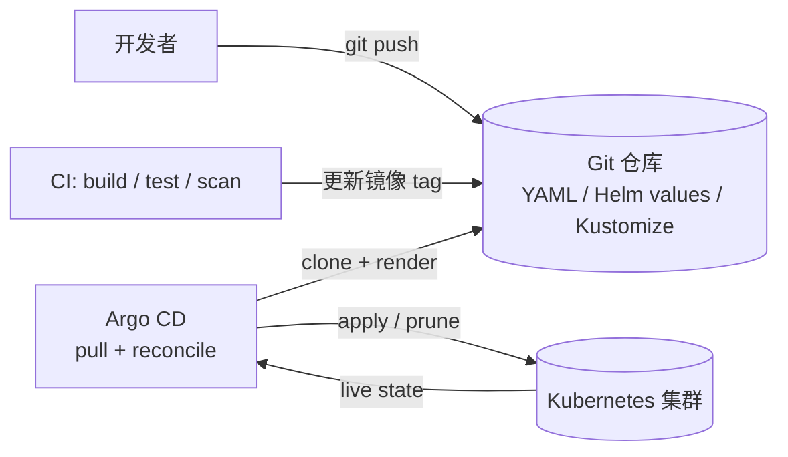
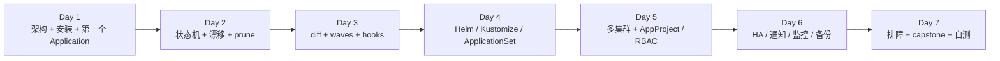
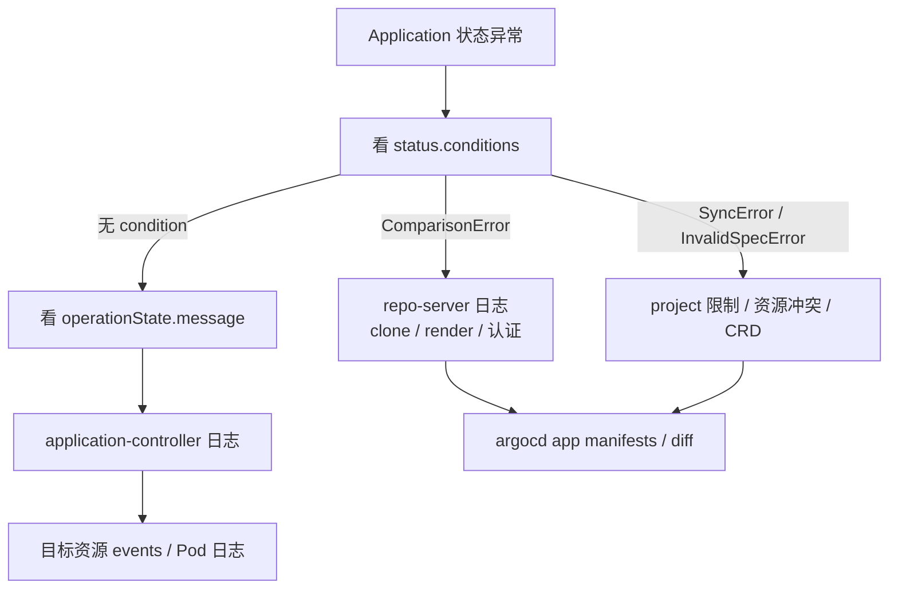

# Argo CD 学习笔记

> 这不是一篇"Argo CD 是什么"的百科,而是一份 **7 天学习 + 实操路线**:第 7 天结束时,
> 你应该能独立在 kind 上装一套 Argo CD,用 Git 管住一个应用,配好自动同步 / 回滚 / 多环境,
> 把它接到第二个集群、按团队隔离权限,并且在遇到 `OutOfSync` / `ComparisonError` / 卡住的 sync 时
> 能按自己的排障路径定位。
>
> - 版本基线:**Argo CD v3.5.6**(2026-10 当前 stable;v3.6 还在 RC,这周不跟)
> - 环境基线:macOS + colima(4 vCPU / 6 GiB)+ kind
> - 前置阅读:[资源关系入门](资源关系入门.md) —— 10 分钟弄清 Application / ApplicationSet / AppProject
> - 配套深读:[核心概念与架构](核心概念与架构.md) —— 讲清"一次同步背后发生了什么"
> - 说明:本文是路线图,不是实验记录。每天跑完把真实输出和踩到的坑补回对应章节,
>   再按本仓库其他笔记的习惯写成"实测"。

## 一、先把"掌握"定义清楚

一周时间足够建立**能独立交付和排障**的完整框架,但不够把每个角落都挖穿。目标如下:

| # | 能力 | 验收方式 |
|---|------|---------|
| 1 | 解释 GitOps 的 pull 模型,以及 Argo CD 主要组件的分工 | 不看笔记画出一张架构图 |
| 2 | 从零安装、登录、卸载一套 Argo CD | 在 kind 上 20 分钟内完成 |
| 3 | 手写 Application / AppProject / ApplicationSet | 不查文档写出能用的 YAML |
| 4 | 设计同步策略 | 能说清 auto-sync、selfHeal、prune、hooks、waves 各解决什么问题 |
| 5 | 用 Helm / Kustomize / 多源仓库交付 | 渲染报错能自己定位 |
| 6 | 接第二个集群,按 project 做多租户 | 能演示"团队 A 碰不到团队 B" |
| 7 | 生产化 | 拿出一份 HA / 通知 / 监控 / 备份 / 升级 checklist |
| 8 | 排障 | 给出 10 种故障现象,能说出先看哪里 |

**这周不深入**以下内容,知道边界即可:

- Argo Rollouts(渐进式发布)、Argo Workflows / Events —— 是相邻项目,不是 Argo CD 的一部分。
- 自定义 CMP 插件开发、Source Hydrator / Impersonation(3.5 的 beta 特性)。
- 上万 Application 的规模调优、Argo CD Agent 的拉模式。

## 二、心智模型:它到底在循环什么

### 2.1 它站在 CI 和集群之间



一句话:**CI 负责把"想要的版本"写进 Git,Argo CD 负责让集群持续收敛到 Git。**
它不构建镜像、不跑测试、不做发布编排 —— 那些仍然是 CI / 流水线的事。

### 2.2 五个必须纠正的直觉

| 直觉 | 实际 |
|------|------|
| Argo CD 会执行 `helm install` | 不会。repo-server 只跑 `helm template` / `kustomize build`,把渲染结果 apply 到集群;**不会产生 Helm release Secret** |
| `Synced` 就是部署成功 | `Synced` 只说明清单已 apply;Pod 起没起来看 `Health` |
| 开了 auto-sync 就会自动纠偏 | auto-sync 响应 **Git 变化**;集群里手改的资源要 `selfHeal: true` 才会被拉回 |
| 从 Git 删掉文件,集群里就会删 | 还要开 `prune: true`,且资源确实被这个 Application 追踪 |
| Application 只能放 `argocd` 命名空间 | v3 支持放到其他 namespace(要显式配置);默认仍在 `argocd` |

### 2.3 和相邻项目的边界

| 项目 | 一句话 | 这周要不要学 |
|------|--------|-------------|
| Argo Rollouts | 用 canary / blue-green 替代普通 Deployment 做渐进式发布 | 不学;知道它能和 Argo CD 配合 |
| Argo Workflows | 容器化工作流引擎 | 不学 |
| Argo Events | 事件驱动触发器 | 不学 |
| Argo CD Image Updater | 独立控制器,把新镜像 tag 写回 Git 或 Application 参数 | 知道即可 |
| Flux | 另一套 GitOps 实现,更 composable | 不学;面试能对比即可 |

## 三、七天路线总表



| Day | 主题 | 要回答的核心问题 | 动手产出 |
|-----|------|-----------------|---------|
| 1 | 心智模型 + 安装 + 第一个 Application | pull 和 push 差在哪?七个 Pod 各干什么?最小 Application 长什么样? | 装好 v3.5.6,跑通一个 nginx 应用 |
| 2 | Application 生命周期与状态机 | Synced / Healthy 怎么组合?auto-sync、selfHeal、prune 各管什么? | 制造漂移、自动纠偏、prune、回滚 |
| 3 | 同步引擎:diff / waves / hooks | 为什么"没差异却 OutOfSync"?wave 和 hook 谁先谁后? | 三波次部署 + PreSync 迁移 Job + 忽略 HPA 副本数 |
| 4 | 清单来源:Helm / Kustomize / 多源 + ApplicationSet | Helm 在 Argo CD 里到底怎么执行?AppSet 和 app-of-apps 怎么选? | 同一应用三种渲染方式,AppSet 生成 dev/prod |
| 5 | 多集群 + AppProject / RBAC / SSO | 怎么让 Argo CD 管理另一个集群?多租户边界划在哪? | 接第二个集群,团队 A 无法越界 |
| 6 | 生产化:HA / 通知 / 监控 / 备份 / 升级 | 哪些组件能水平扩?升级前要备份什么? | 一份生产 checklist + 一条真实通知 |
| 7 | 排障 + 综合演练 | 从哪个 status 字段开始查? | 故障表 + capstone + 20 题自测 |

### 时间预算

| 时间 | 建议投入 | 说明 |
|------|---------|------|
| Day 1-2 | 每天 1.5 - 2 小时 | 安装 + 状态机,先把主线跑通 |
| Day 3-4 | 每天 3 - 4 小时 | 周末重头戏,实验最多 |
| Day 5-6 | 每天 1.5 小时 | 读 + 小实验,理解边界 |
| Day 7 | 2 - 3 小时 | 排障表 + capstone 复盘 |
| 合计 | **14 - 18 小时** | 如果只有 8 小时:Day 1-4 必做,Day 5-6 只读,Day 7 只看排障表 |

> 每天结束前做一件事:**用自己的话回答"今天要回答的核心问题"**,答不出来就回到对应章节。
> 一周计划的产出不是"看过",而是"能复述 + 能动手"。

## 四、Day 1:装起来,跑通第一个 Application

### 4.1 要回答的问题

- pull 模式和 CI 直接 `kubectl apply` 的 push 模式,差别到底在哪?
- 装完之后那 7 个 Pod 分别是谁?少一个会怎样?
- 一个 Application 的最小 spec 是什么?
- `OutOfSync → Synced` 之间,Argo CD 做了哪几步?

先读 [资源关系入门](资源关系入门.md),再读 [核心概念与架构](核心概念与架构.md) 第一至四节。

### 4.2 环境:这周只留一个 kind 集群

这台 colima 只有 4 vCPU / 6 GiB,而且**同时开两套 kind 集群会打满 VM 的 inotify 实例上限**,
表现是 Istio / CNI 组件崩、Pod 里 DNS 都不通。学 Argo CD 这周只留一个集群:

```console
$ export DOCKER_HOST=unix:///Users/hchenxa/.colima/default/docker.sock
$ kind get clusters
$ docker ps --format '{{.Names}}\t{{.Status}}'
```

如果 `knative` 或 `knative-istio` 的节点容器正在跑,先临时停掉(集群和镜像都还在):

```console
$ docker stop knative-control-plane
```

学完再恢复:

```console
$ docker start knative-control-plane
```

建一个专用的单节点集群。**必须在 `kubernetes/kind/` 下执行** —— `kind-config.yaml` 里的
`extraMounts` 是相对路径,而且那份配置会给节点内的 containerd / kubelet 注入代理,
不挂它的话节点里拉不到镜像:

```console
$ cd kubernetes/kind
$ kind create cluster --name argocd --config kind-config.yaml
$ kubectl config use-context kind-argocd
```

> 不想再建集群,也可以直接把 Argo CD 装进现有的 `kind-knative`。但它会和 Knative 抢那 6 GiB,
> 而且 Argo CD 的组件不少,专用集群更干净。

### 4.3 安装 Argo CD v3.5.6

```console
$ kubectl create namespace argocd
$ kubectl apply --server-side --force-conflicts -n argocd \
    -f https://raw.githubusercontent.com/argoproj/argo-cd/v3.5.6/manifests/install.yaml
$ kubectl -n argocd get pods -w
```

> **实测坑**:直接用 client-side `kubectl apply` 会在 `applicationsets.argoproj.io`
> 这个 CRD 上报 `metadata.annotations: Too long: may not be more than 262144 bytes`。
> 原因是 CRD 的 annotation 超过了 256 KiB,client-side apply 把它塞进
> `last-applied-configuration` 就爆了。改用 `--server-side` 即可;如果之前已经
> client-side 创建了部分资源,server-side apply 可能报 field conflict,再加
> `--force-conflicts` 让 Argo CD 的清单接管这些字段。

非 HA 安装会起 7 个 Pod:

| Pod | 角色 |
|-----|------|
| `argocd-server` | API / Web UI,认证和 RBAC 的入口 |
| `argocd-repo-server` | clone Git,渲染 Helm / Kustomize,返回清单 |
| `argocd-application-controller` | 对比 desired / live,执行 sync,算健康状态 |
| `argocd-applicationset-controller` | 按 generator 生成 Application |
| `argocd-redis` | 缓存,**不是事实来源** |
| `argocd-dex-server` | 内置 OIDC provider,可选 |
| `argocd-notifications-controller` | 通知,可选 |

### 4.4 CLI 与登录

```console
$ brew install argocd
$ argocd version --client

$ kubectl -n argocd get secret argocd-initial-admin-secret \
    -o jsonpath='{.data.password}' | base64 -d; echo
$ kubectl -n argocd port-forward svc/argocd-server 8080:443
```

另开一个终端登录。`--insecure` 只跳过自签证书校验,不是明文 HTTP:

```console
$ argocd login localhost:8080 --username admin --password '<上一步输出的密码>' --insecure
```

浏览器打开 `https://localhost:8080`,用 `admin` + 同一个密码也能进。

### 4.5 第一个 Application:用本仓库的 lab 清单

`ArgoCD/labs/guestbook/` 里是一个最小的 nginx 应用(Deployment + Service + ConfigMap),
镜像走 Docker Hub,避开了 gcr.io 在这台机器上慢到病态的问题。**先把新增的 `ArgoCD/` 目录
提交并推到 GitHub 的 `main`**(或者把下面的 `--revision` 改成你实际的分支),然后:

```console
$ argocd app create guestbook \
    --repo https://github.com/hchenxa/reading-notes.git \
    --revision main \
    --path ArgoCD/labs/guestbook \
    --dest-server https://kubernetes.default.svc \
    --dest-namespace guestbook \
    --sync-option CreateNamespace=true
```

如果暂时不想推仓库,可以先用官方示例(注意它的镜像是 gcr.io,拉取可能很慢):

```console
$ argocd app create guestbook \
    --repo https://github.com/argoproj/argocd-example-apps.git \
    --path guestbook \
    --dest-server https://kubernetes.default.svc \
    --dest-namespace guestbook \
    --sync-option CreateNamespace=true
```

观察状态,然后同步:

```console
$ argocd app get guestbook
$ argocd app sync guestbook
$ argocd app wait guestbook --health
$ kubectl get all -n guestbook
$ argocd app resources guestbook
```

应该看到的状态变化:

| 阶段 | Sync | Health | 说明 |
|------|------|--------|------|
| 刚创建 | `OutOfSync` | `Missing` | 清单还没 apply |
| 同步中 | `OutOfSync` | `Progressing` | 资源在创建,健康检查还没过 |
| 完成后 | `Synced` | `Healthy` | Operation 的 phase 是 `Succeeded` |

### 4.6 验收

- [ ] `kubectl -n argocd get pods` 全部 `Running`。
- [ ] 能不看笔记说出 7 个 Pod 的分工,尤其是 **repo-server 和 application-controller 的区别**。
- [ ] 能解释为什么刚创建时是 `OutOfSync` + `Missing`。
- [ ] 在 UI 里找到这个 Application 的资源树,点开 Deployment 看它和 Pod 的关系。
- [ ] 把 `argocd app get guestbook` 的输出贴进当天的笔记。

### 4.7 首次实测记录(2026-10-29)

环境:kind 单节点(`kindest/node:v1.36.1`)+ Argo CD v3.5.6。

安装第一次用 client-side apply,在 `applicationsets.argoproj.io` CRD 上报
`metadata.annotations: Too long: may not be more than 262144 bytes`;改成
`--server-side --force-conflicts` 后成功,7 个 Pod 全部 `Running`。

首次冒烟用官方 `argocd-example-apps/helm-guestbook`,把镜像覆盖成 `nginx:1.27-alpine`
(避开 gcr.io)。Application 先用声明式创建;CLI 装好后 `argocd login` 和 `argocd app list`
也都验证过:

```console
$ argocd app list
NAME              CLUSTER                         NAMESPACE  PROJECT  STATUS  HEALTH   SYNCPOLICY  REPO                                                 PATH            TARGET
argocd/guestbook  https://kubernetes.default.svc  guestbook  default  Synced  Healthy  Auto-Prune  https://github.com/argoproj/argocd-example-apps.git  helm-guestbook  master

$ kubectl -n argocd get application guestbook -o wide
NAME        SYNC STATUS   HEALTH STATUS   REVISION                                   PROJECT
guestbook   Synced        Healthy        8088f4c0d970abb09e250248cc97e35623447cb5   default

$ kubectl get all -n guestbook
NAME                                            READY   STATUS    RESTARTS   AGE
pod/guestbook-helm-guestbook-6bf9d79647-f5lhh   1/1     Running   0          31s

NAME                               TYPE        CLUSTER-IP    EXTERNAL-IP   PORT(S)   AGE
service/guestbook-helm-guestbook   ClusterIP   10.96.15.47   <none>        80/TCP    31s

NAME                                       READY   UP-TO-DATE   AVAILABLE   AGE
deployment.apps/guestbook-helm-guestbook   1/1     1            1           31s
```

> 这次冒烟用的是官方 chart,所以 Deployment 名字是 `guestbook-helm-guestbook`;
> 本仓库 `ArgoCD/labs/guestbook` 的清单推到 GitHub 后,把 Application 的 source
> 换过去,Day 2 的 `kubectl scale deployment guestbook` 才对应 lab 里的名字。

## 五、Day 2:Application 生命周期与状态机

### 5.1 要回答的问题

- desired state 和 live state 分别从哪来?
- `Synced` / `OutOfSync` 与 `Healthy` / `Degraded` 为什么是两套状态?
- auto-sync、selfHeal、prune 三个开关各自响应什么?
- 删掉一个 Application,它管的资源会不会一起删?

### 5.2 实验 A:制造漂移,看清 auto-sync 和 selfHeal

先不自动同步。手动改集群里的副本数:

```console
$ kubectl scale deployment guestbook -n guestbook --replicas=3
$ argocd app get guestbook
```

预期:**`OutOfSync` + `Healthy`**。清单里写的是 1 个副本,集群里是 3 个;但 3 个都 Ready,
所以健康状态不受影响。手动 sync 一次就拉回 1 个。

现在打开自动同步,但**不**开 selfHeal:

```console
$ argocd app set guestbook --sync-policy automated
$ kubectl scale deployment guestbook -n guestbook --replicas=3
```

等过一个 reconciliation 周期(默认 3 分钟),状态仍然是 `OutOfSync` —— 因为
auto-sync 只响应 **Git 变化**,集群里的手改不算。再打开 selfHeal:

```console
$ argocd app set guestbook --self-heal
```

再等一个周期,副本数会被拉回 Git 里的值。

| 开关 | 响应什么 | 一句话 |
|------|---------|--------|
| `automated` | Git 里的清单变化 | Git → 集群 |
| `automated.selfHeal` | 集群里的 live 漂移 | 集群漂移 → Git |
| `automated.prune` | Git 里被删掉的资源 | 多出来的资源要不要删 |
| `syncPolicy.retry` | 同步失败 | 失败后按 backoff 重试 |

### 5.3 实验 B:prune 到底删什么

1. Day 1 的清单里已经有一个 `guestbook-config` ConfigMap,先确认它在集群里。
2. 把 `configmap.yaml` 从 `kustomization.yaml` 的 `resources` 里去掉,再删掉这个文件,push。
   没有 `prune` 时,sync 不会删集群里的 ConfigMap,Application 可能显示 `OutOfSync`。
3. 打开 prune 再 sync → 资源被删除。

关键点:**prune 只删"被这个 Application 追踪"的资源**。Argo CD 通过资源上的 tracking 标记
判断归属(v3 默认用 annotation `argocd.argoproj.io/tracking-id`,v2 默认是 label
`app.kubernetes.io/instance`)。两个 Application 管同一个资源时,后 sync 的会覆盖前一个,
`FailOnSharedResource` 可以让这种冲突直接失败。

### 5.4 状态机:四种常见组合

| Sync | Health | 典型含义 | 先看哪里 |
|------|--------|---------|---------|
| `Synced` | `Healthy` | 正常 | 不用看 |
| `Synced` | `Degraded` | 清单 apply 成功,但 Pod Crash / 探针失败 / 镜像拉不到 | `kubectl describe pod`,容器日志 |
| `OutOfSync` | `Healthy` | 字段漂移,但不影响可用性(副本数、label、HPA 改的字段) | `argocd app diff` |
| `OutOfSync` | `Missing` | 资源还没创建 | `argocd app sync` |
| `Unknown` | `Unknown` | 对比失败:repo 连不上、渲染报错、RBAC 不够 | `status.conditions`,repo-server 日志 |

几个状态字段分别在哪:

```console
$ kubectl get application guestbook -n argocd \
    -o jsonpath='{.status.sync.status}{"  "}{.status.health.status}{"  "}{.status.operationState.phase}{"\n"}'
$ kubectl get application guestbook -n argocd -o yaml | yq '.status.conditions'
```

- `status.sync.status` —— `Synced` / `OutOfSync` / `Unknown`
- `status.health.status` —— `Healthy` / `Progressing` / `Degraded` / `Suspended` / `Missing` / `Unknown`
- `status.operationState.phase` —— `Running` / `Succeeded` / `Failed` / `Error` / `Terminating`
- `status.conditions[]` —— `ComparisonError`、`SyncError`、`InvalidSpecError` 等

> **v3 的一个变化**:每个资源的健康状态默认不再写进 Application CR(存在 controller 侧),
> `kubectl get application` 里看不到 `status.resources[].health`,要用 CLI / API 查。
> 需要恢复旧行为,在 `argocd-cm` 里设 `controller.resource.health.persist: "true"`。

### 5.5 回滚与删除

```console
$ argocd app history guestbook
$ argocd app rollback guestbook <history-id>
```

回滚是把历史 revision 重新同步一次,**不会**修改 Git。GitOps 的纯正做法是 `git revert`,
让 Git 继续当唯一事实来源;`argocd app rollback` 更适合应急。

删除 Application 时是否级联删除资源,取决于 finalizer:

- 声明式创建的 Application **默认没有** finalizer,`kubectl delete application` 只删 CR,
  资源会留在集群里。
- `argocd app delete --cascade` 会自动加 finalizer,并级联删除资源。
- ApplicationSet 生成的 Application 默认会加 finalizer,除非
  `syncPolicy.preserveResourcesOnDeletion: true`。

### 5.6 验收

- [ ] 能解释为什么 `kubectl scale` 之后是 `OutOfSync + Healthy`。
- [ ] 亲手复现"auto-sync 不纠偏,selfHeal 才纠偏"。
- [ ] 能说出 prune 判断资源归属的依据。
- [ ] 能解释 `Synced + Degraded` 和 `OutOfSync + Healthy` 分别该查什么。
- [ ] 演示删除 Application 时,加不加 finalizer 的区别。

## 六、Day 3:同步引擎:diff、waves、hooks、sync options

### 6.1 要回答的问题

- diff 到底在比什么?为什么"看起来没差异"却一直 `OutOfSync`?
- sync wave 和 hook 的排序规则是什么?
- 哪些 sync option 是生产必知?
- 为什么 selective sync 不执行 hook?

### 6.2 diff 与 `ignoreDifferences`

最常见的"幽灵 OutOfSync"是 HPA 改副本数:Deployment 的 `replicas` 写在 Git 里,
HPA 又在改它,于是永远不一致。两种处理:

1. 从 Git 的 Deployment 里删掉 `replicas`,让 HPA 独占这个字段(推荐)。
2. 在 Application 里忽略这个字段:

```yaml
spec:
  ignoreDifferences:
    - group: apps
      kind: Deployment
      jsonPointers:
        - /spec/replicas
```

排查 diff:

```console
$ argocd app diff guestbook
$ argocd app manifests guestbook        # 看渲染后的清单
$ argocd app sync guestbook --dry-run   # 只算差异,不 apply
```

还要知道 v3 的两个默认行为:

- `status` 字段对所有资源默认忽略(v2 只忽略 CRD 的 status)。
- `ignoreDifferences` 默认也会抑制资源更新事件;要恢复 v2 行为,设
  `ignoreDifferencesOnResourceUpdates: "false"`。

其他常见的"假差异":CRD schema 的默认值、webhook 注入的字段、Controller 写回的字段。
处理思路都是先 `argocd app diff` 看清楚,再决定是改清单、改 webhook,还是 `ignoreDifferences`。

### 6.3 waves 与 hooks

给资源加 `argocd.argoproj.io/sync-wave`,数字小的先应用;hook 用
`argocd.argoproj.io/hook` 标记。下面是示意片段(不是可直接 apply 的完整清单),省略了部分 spec:

```yaml
# wave -1:迁移 Job,在业务资源之前跑
apiVersion: batch/v1
kind: Job
metadata:
  name: guestbook-migrate
  annotations:
    argocd.argoproj.io/hook: PreSync
    argocd.argoproj.io/hook-delete-policy: HookSucceeded
    argocd.argoproj.io/sync-wave: "-1"
spec:
  template:
    spec:
      restartPolicy: Never
      containers:
        - name: migrate
          image: busybox:1.36
          command: ["sh", "-c", "echo migrate; sleep 2"]
---
# wave 0:配置
apiVersion: v1
kind: ConfigMap
metadata:
  name: guestbook-config
  annotations:
    argocd.argoproj.io/sync-wave: "0"
data:
  greeting: "hello from git"
---
# wave 1:业务负载
apiVersion: apps/v1
kind: Deployment
metadata:
  name: guestbook
  annotations:
    argocd.argoproj.io/sync-wave: "1"
# ... spec 省略
```

排序规则:**phase → wave(从小到大)→ 资源 kind → 资源 name**。wave 之间默认停 2 秒
(`ARGOCD_SYNC_WAVE_DELAY` 可调),给控制器一点反应时间。prune 时顺序反过来,
wave 大的先删。

Hook 类型:

| Hook | 时机 | 失败会怎样 |
|------|------|-----------|
| `PreSync` | apply 之前 | 停止整个 sync |
| `Sync` | apply 过程中 | 停止 sync |
| `PostSync` | 所有资源 apply 且健康之后 | 标记 sync 失败 |
| `SyncFail` | sync 失败时 | 只记录,不再改变结果 |
| `Skip` | 不 apply 这个资源 | —— |
| `PreDelete` / `PostDelete` | 删除整个 Application 前后 | 阻止删除 / 留下 `DeletionError` |

`hook-delete-policy` 默认是 `BeforeHookCreation`;常见组合是 `HookSucceeded`,让 Job 成功后被清掉。
**selective sync 不会执行 hook** —— 只同步部分资源时,PreSync / PostSync 都不会跑。

### 6.4 生产必知的 sync options

| Option | 作用 | 什么时候用 |
|--------|------|-----------|
| `CreateNamespace=true` | 目标 namespace 不存在时自动创建 | 新环境第一次部署 |
| `PruneLast=true` | 先 apply 新资源,最后再 prune | 避免滚动更新期间服务中断 |
| `ApplyOutOfSyncOnly=true` | 只 apply 有差异的资源 | 大应用、减少 API 压力 |
| `RespectIgnoreDifferences=true` | apply 时也尊重 `ignoreDifferences` | 忽略字段不希望被 sync 改回 |
| `ServerSideApply=true` | 用 server-side apply | 大 CRD、字段冲突、需要 field manager |
| `Replace=true` | 用 replace 代替 apply | 资源太大超过 annotation 限制 |
| `FailOnSharedResource=true` | 多个 Application 管同一资源时失败 | 多租户、防止互相覆盖 |
| `PrunePropagationPolicy=foreground` | 控制级联删除策略 | 有 ownerReference 的资源 |
| `SkipDryRunOnMissingResource=true` | CRD 还没装时跳过 dry-run | CR 和 CRD 同一次 sync |

### 6.5 验收

- [ ] 搭一个 3 个 wave 的应用,故意让 PreSync Job 失败,观察 sync 停在哪。
- [ ] 修好 Job 再 sync,确认后面的 wave 才继续。
- [ ] 用 HPA + `ignoreDifferences` 复现并消除"幽灵 OutOfSync"。
- [ ] 解释为什么 selective sync 不跑 hook。
- [ ] 能说出 `PruneLast` 和 `ApplyOutOfSyncOnly` 分别解决什么问题。

## 七、Day 4:清单来源:Helm、Kustomize、多源、ApplicationSet

### 7.1 Helm:Argo CD 只渲染,不安装

Argo CD 调 repo-server 执行 `helm template`,把输出当普通 YAML apply。所以:

- 集群里**没有 Helm release Secret**,`helm list` 看不到它。
- `helm rollback` 用不了,回滚靠 Argo CD 的 history 或 Git revert。
- Helm 的 hook 会被映射成 Argo CD 的 phase,但生命周期语义按 Argo CD 的规则走。

一个 Helm 类型的 Application:

```yaml
spec:
  source:
    repoURL: https://charts.example.com
    chart: myapp
    targetRevision: 1.2.3
    helm:
      releaseName: myapp
      valueFiles:
        - values-prod.yaml
      parameters:
        - name: image.tag
          value: "1.2.3"
      valuesObject:
        replicaCount: 2
```

values 的优先级从低到高是:

| 优先级 | 来源 |
|--------|------|
| 1(最低) | chart 自带的 `values.yaml` |
| 2 | `valueFiles` 列表,后面的文件覆盖前面的 |
| 3 | `values`(内联 YAML 字符串) |
| 4 | `valuesObject`(内联结构化对象) |
| 5(最高) | `parameters`(`--set`) |

**不要同时用多种方式覆盖同一个字段**,否则排查会很痛苦。拿不准时看
`argocd app manifests` 的渲染结果。

### 7.2 多源:chart 和 values 分开放

chart 在 Helm 仓库、values 在自己的 Git 仓库,是常见做法:

```yaml
spec:
  sources:
    - repoURL: https://charts.example.com
      chart: myapp
      targetRevision: 1.2.3
      helm:
        valueFiles:
          - $values/envs/prod/values.yaml
    - repoURL: https://github.com/hchenxa/config.git
      targetRevision: main
      ref: values
```

`ref: values` 给第二个源起了个名字,第一个源用 `$values/...` 引用它。多源 Application 的
`status.sync.revisions` 会是一个数组,每个源一个 revision。

### 7.3 Kustomize

Kustomize 类型支持 `path`、`images`、`replicas`、`commonAnnotations` 等覆盖,
以及 `kustomize.buildOptions`(比如 `--load-restrictor LoadRestrictionsNone`)。
版本要固定,避免本地 `kustomize build` 和 repo-server 渲染结果不一致。

### 7.4 ApplicationSet:把重复的 Application 模板化

ApplicationSet 不直接创建业务资源,它**生成 Application**,再由 Application 去创建资源。
最常用的 List generator:

```yaml
apiVersion: argoproj.io/v1alpha1
kind: ApplicationSet
metadata:
  name: guestbook
  namespace: argocd
spec:
  goTemplate: true
  generators:
    - list:
        elements:
          - env: dev
            namespace: guestbook-dev
          - env: prod
            namespace: guestbook-prod
  template:
    metadata:
      name: 'guestbook-{{.env}}'
    spec:
      project: default
      source:
        repoURL: https://github.com/hchenxa/reading-notes.git
        targetRevision: main
        path: ArgoCD/labs/guestbook
      destination:
        server: https://kubernetes.default.svc
        namespace: '{{.namespace}}'
      syncPolicy:
        automated:
          prune: true
          selfHeal: true
        syncOptions:
          - CreateNamespace=true
```

生成器一览:

| Generator | 输入 | 典型场景 |
|-----------|------|---------|
| List | 手写的元素列表 | 少量固定环境 |
| Cluster | 注册到 Argo CD 的集群及其 label | 每个集群一套 |
| Git(directories / files) | Git 仓库里的目录或 values 文件 | 每个目录 / 文件一个环境 |
| SCMProvider | GitHub / GitLab 等组织的仓库列表 | 每个仓库一个应用 |
| PullRequest | PR 列表 | 每个 PR 一套预览环境 |
| Matrix / Merge | 组合多个 generator | cluster × env 的笛卡尔积 |
| ClusterDecisionResource | 外部决策资源 | 高级调度场景 |
| Plugin | 自定义插件 | 内置 generator 不够时 |

ApplicationSet 生成的 Application 带 ownerReference,删 AppSet 会删子 Application;
子 Application 默认带 finalizer,会继续删业务资源。想保留资源,设
`syncPolicy.preserveResourcesOnDeletion: true`。

`app-of-apps` 和 ApplicationSet 怎么选:

| 维度 | app-of-apps | ApplicationSet |
|------|-------------|----------------|
| 定义方式 | 一个 Application 管一组 Application YAML | 控制器按 generator 生成 |
| 动态发现 | 要自己维护清单 | 内置 cluster / git generator |
| 删除行为 | 取决于每个子 Application 的 finalizer | ownerReference + preserve 开关 |
| 适合 | 少量、结构稳定 | 多环境、多集群、大量重复 |

### 7.5 验收

- [ ] 同一个 nginx 应用分别用 directory、Helm、Kustomize 三种方式部署。
- [ ] 用 List generator 生成 dev / prod 两个 Application,改 generator 能增删。
- [ ] 解释为什么 `helm list` 看不到 Argo CD 部署的 chart。
- [ ] 用 `argocd app manifests` 定位一次 Helm 渲染错误。
- [ ] 能说出 app-of-apps 和 ApplicationSet 各自适合什么场景。

## 八、Day 5:多集群、AppProject、RBAC、SSO

### 8.1 把第二个集群接进来

> 6 GiB 内存的 colima 同时跑两个 kind 集群会触发 inotify 问题。做这个实验时先停掉第一个,
> 或者接受"两个单节点集群可能很卡"。也可以先只读配置,把多集群留到有更多内存的环境。

```console
$ cd kubernetes/kind
$ kind create cluster --name argocd-2 --config kind-config.yaml
$ kubectl config use-context kind-argocd
$ argocd cluster add kind-argocd-2 --name argocd-2
```

`argocd cluster add` 会在目标集群的 `kube-system` 里创建 `argocd-manager` ServiceAccount,
绑定较高权限,并在 Argo CD 的 namespace 里写一个 Secret:

```console
$ kubectl -n argocd get secret -l argocd.argoproj.io/secret-type=cluster
```

也可以声明式管理(适合 GitOps 自己的基础设施):

```yaml
apiVersion: v1
kind: Secret
metadata:
  name: cluster-argocd-2
  namespace: argocd
  labels:
    argocd.argoproj.io/secret-type: cluster
type: Opaque
stringData:
  name: argocd-2
  server: https://<目标集群 API 地址>:6443
  config: |
    {
      "bearerToken": "<token>",
      "tlsClientConfig": { "insecure": false, "caData": "<base64-ca>" }
    }
```

关键点:

- **网络方向是 Argo CD → 目标集群 API**,目标集群不需要能访问 Argo CD。
- `destination.name` 比 `server` 更好读,集群改名时不用改所有 Application。
- 给集群打 label,ApplicationSet 的 Cluster generator 可以按 label 选集群。

### 8.2 AppProject:多租户的边界

`default` project 允许 `*`,生产不要用它。一个团队一个 project:

```yaml
apiVersion: argoproj.io/v1alpha1
kind: AppProject
metadata:
  name: team-a
  namespace: argocd
spec:
  sourceRepos:
    - https://github.com/hchenxa/reading-notes.git
  destinations:
    - server: https://kubernetes.default.svc
      namespace: team-a-*
  clusterResourceWhitelist:
    - group: ""
      kind: Namespace
  namespaceResourceWhitelist:
    - group: "*"
      kind: "*"
  roles:
    - name: developer
      policies:
        - p, proj:team-a:developer, applications, get, team-a/*, allow
        - p, proj:team-a:developer, applications, sync, team-a/*, allow
  syncWindows:
    - kind: deny
      schedule: "0 22 * * *"
      duration: 8h
      applications: ["*"]
      manualSync: true   # 窗口内仍允许手动应急;要连手动一起禁,去掉这行
```

验证越界会被拒绝:用 `team-a` project 创建指向 `kube-system` 的 Application,应该得到
`InvalidSpecError` 或 sync 被拒绝。

### 8.3 RBAC 与 SSO

全局 RBAC 在 `argocd-rbac-cm`:

```csv
p, role:readonly, applications, get, */*, allow
p, role:ci, applications, sync, team-a/*, allow
g, alice@example.com, role:admin
```

`policy.default` 可以设成 `role:readonly`,让没匹配到的用户只读。项目角色用
`proj:team-a:developer` 这种命名,和全局角色分开。

v3 注意:**`update` / `delete` 权限不再自动继承到 Application 管理的子资源**,
需要显式加 `update/*` / `delete/*`。另外日志权限默认被 RBAC 管,没权限看不了 Pod 日志。

SSO 两条路:

- 内置 Dex:改 `argocd-cm` 的 `dex.config`,可以接 GitHub / LDAP / 静态用户。
- 外部 OIDC:直接用企业 IdP,配 `oidc.config`,CLI 用 `argocd login --sso`。

生产至少做到:禁用本地 admin、接 SSO、按组映射 RBAC、project 隔离、仓库凭据按 project 限定。

### 8.4 验收

- [ ] 接第二个集群,用 `destination.name` 部署一个应用。
- [ ] 用 Cluster generator 把同一个 AppSet 发到两个集群。
- [ ] 演示 team-a 无法在 `kube-system` 创建资源。
- [ ] 能解释 project 角色和全局角色的区别。
- [ ] 画一张"用户 → SSO → RBAC → project → Application"的链路图。

## 九、Day 6:生产化:HA、通知、监控、备份、升级

### 9.1 HA 架构

HA 清单是 `manifests/ha/install.yaml`(完整地址:
`https://raw.githubusercontent.com/argoproj/argo-cd/v3.5.6/manifests/ha/install.yaml`),
和单机版的区别:

- `argocd-server` / `argocd-repo-server` 多副本。
- `argocd-application-controller` 是 StatefulSet,按 `ARGOCD_CONTROLLER_REPLICAS` 分片。
- Redis 用 `redis-ha`(Sentinel),不再是单 Pod。
- 需要 PodDisruptionBudget、反亲和、资源 request/limit。

> 6 GiB 的 kind 跑 HA 会很吃力。这一天**读清单 + 画拓扑**即可,真要在本地跑,至少给 colima
> 8 - 12 GiB。

### 9.2 通知

`argocd-notifications-cm` 里定义 trigger / template,Application 上用 annotation 订阅:

```yaml
metadata:
  annotations:
    notifications.argoproj.io/subscribe.on-sync-failed.slack: team-a
```

常见触发点:`on-sync-succeeded`、`on-sync-failed`、`on-health-degraded`、`on-deployed`。
实验可以用一个本地 HTTP 服务接 webhook,不必真接 Slack。

### 9.3 监控

关键指标:

- `argocd_app_info`(v3 用 label 带 `sync_status` / `health_status`;v3.0 删掉了旧的
  `argocd_app_sync_status` / `argocd_app_health_status` / `argocd_app_created_time`)
- `argocd_app_sync_total`、`argocd_app_reconcile`、`argocd_app_k8s_request_total`
- repo-server 的 Git / 渲染耗时和错误
- application-controller 的队列深度、reconcile 耗时

要设的告警:长时间 `OutOfSync`、`Degraded`、sync 连续失败、`ComparisonError`、
repo-server 错误率、controller 队列积压。

### 9.4 备份与灾难恢复

- Application / AppProject / ApplicationSet 本身就是 Kubernetes CR,应该用 Git 声明式管理
  (app-of-apps 或 bootstrap 仓库)。
- 仓库凭据、集群凭据、SSO 配置、`argocd-cm` / `argocd-rbac-cm` 也要有备份。
- `argocd admin export` / `import` 可以做整体导出导入,但**首选方案是"Git 重建 + Secret 备份"**。
- 定期演练:删掉 Argo CD namespace,从 Git + Secret 备份恢复,计时。

### 9.5 升级

升级前必读对应版本的 upgrade notes,尤其是 v2 → v3 的默认行为变化。流程:

1. 备份 CR、ConfigMap、Secret。
2. 读 upgrade notes,确认 breaking changes。
3. 先升 CRD,再 apply 新版本 manifest。
4. 观察 controller / repo-server 日志和指标。
5. 准备回滚方案(旧 manifest + 备份)。

v3.5 值得知道的变化:repo-server 内部 mTLS(可选,创建 `argocd-repo-server-mtls` Secret 开启)、
source integrity(取代旧的 GPG 校验)、ApplicationSet UI、Helm 4 支持、并发控制。

### 9.6 安全清单

- [ ] 禁用本地 admin 或至少改密码 + 限制访问。
- [ ] SSO + 组映射 RBAC,最小权限。
- [ ] 每个团队一个 AppProject,限制 sourceRepos / destinations。
- [ ] repo-server 不暴露到集群外,NetworkPolicy 限制。
- [ ] Git 里的 Secret 用 SOPS / Sealed Secrets / External Secrets,不存明文。
- [ ] 生产分支保护 + 签名提交(v3.5 source integrity 可以强制)。
- [ ] 镜像来源可信,配合准入控制。

### 9.7 验收

- [ ] 画出 HA 拓扑,标出哪些组件可以水平扩、哪些要分片。
- [ ] 配一条 sync 失败通知,实际收到。
- [ ] 说出 5 个必须告警的指标。
- [ ] 写一份升级 runbook(备份、CRD、manifest、验证、回滚)。
- [ ] 能解释 `argocd admin export` 和"Git 重建"各自的适用场景。

## 十、Day 7:排障手册 + 综合演练

### 10.1 排查顺序



### 10.2 故障速查表

| 现象 | 常见原因 | 先看什么 |
|------|---------|---------|
| `OutOfSync` 但 diff 为空 | 默认字段、status、webhook 注入、CRD schema | `argocd app diff`,考虑 `ignoreDifferences` |
| `ComparisonError` | repo 认证失败、路径不存在、Helm 渲染错误、CRD 未发现 | repo-server 日志,`argocd app manifests` |
| Sync 一直 `Progressing` | hook Job 不结束、CRD 未就绪、finalizer 卡住 | `kubectl get jobs,pods`,hook 日志 |
| `InvalidSpecError` | project 不允许 source / destination | `kubectl get appproject -n argocd -o yaml` |
| `Degraded` | 镜像拉不到、CrashLoop、探针失败 | `kubectl describe pod`,容器日志 |
| 集群 `Unknown` | token 过期、网络不通、API 地址错 | `argocd cluster get`,cluster Secret |
| prune 不删 | prune 没开、资源没被追踪、共享资源 | Application spec,tracking 标记 |
| 权限被拒 | RBAC 或 project role 不够 | `argocd account can-i`,policy.csv |
| CRD not found | CR 和 CRD 同批 apply,顺序不对 | `sync-wave`, `SkipDryRunOnMissingResource` |
| 删 Application 资源还在 | 没有 finalizer | 加 finalizer 或 `--cascade` |

### 10.3 Capstone:一周综合演练

在一个 Git 仓库里完成:

1. 一个 Helm chart + dev / prod 两套 values。
2. 一个 ApplicationSet 生成两个环境的 Application。
3. 一个 AppProject 限制团队只能部署到 `team-a-*`。
4. 一个 PreSync Job 做"迁移",一个 PostSync Job 做"冒烟检查"。
5. 对 HPA 管理的 `replicas` 做 `ignoreDifferences`。
6. 一条 sync 失败通知。
7. 一个 sync window,晚上禁止自动同步,但保留手动应急。

然后故意制造故障并恢复:

- 把镜像 tag 改成不存在的 → `Degraded`,从 Git 修回。
- 把 repo 地址改错 → `ComparisonError`,修回。
- 让 PreSync Job 失败 → sync 卡住,修好 Job 再继续。
- 删除 Application,分别验证有 / 无 finalizer 的行为。

最后写一页 runbook:**这个系统怎么部署、怎么回滚、出问题先看哪。**

### 10.4 自测 20 题

1. Argo CD 的七个核心组件分别负责什么?
2. 为什么 repo-server 要独立存在,而不是让 controller 直接 clone Git?
3. 一次 reconcile 的触发条件有哪些?
4. `refresh` 和 `hard refresh` 的区别?
5. `Synced` 和 `Healthy` 分别代表什么?
6. 举出 `Synced + Degraded` 和 `OutOfSync + Healthy` 各一个场景。
7. auto-sync、selfHeal、prune 分别响应什么?
8. prune 怎么判断一个资源属于哪个 Application?
9. 为什么删除 Git 里的文件不一定会删除集群资源?
10. Argo CD 执行 Helm chart 时,`helm list` 能看到 release 吗?为什么?
11. 多源 Application 解决什么问题?
12. ApplicationSet 和 app-of-apps 的差别?
13. 怎么把一个外部集群接进 Argo CD?网络方向是什么?
14. AppProject 能限制哪些东西?
15. project role 和全局 RBAC role 的区别?
16. sync wave 的排序规则?prune 时呢?
17. 哪些情况下 hook 不会执行?
18. CRD 和 CR 同一次 sync,怎么保证顺序?
19. 删掉 Application,资源会不会一起删?由什么决定?
20. Redis 挂了会怎样?为什么它不是事实来源?

### 10.5 一周之后

- 学 Argo Rollouts,把 canary / blue-green 接进 GitOps。
- 学 Argo CD Image Updater 或 3.5 的 Source Hydrator,做镜像自动更新。
- 读 CMP 插件文档,接非 Helm / Kustomize 的渲染器。
- 研究大规模部署:controller 分片、repo-server 缓存、ApplicationSet 的 progressive sync。
- 把生产环境的 Argo CD 做成 bootstrap 仓库:Argo CD 管理自己。

## 十一、本机环境:kind + colima 的四个坑

1. **两个集群会打满 inotify**。colima VM 的 `fs.inotify.max_user_instances` 是 128,
   两套 kind 集群 + Istio / Knative 的 watcher 很容易占满,表现是组件崩、Pod 里 DNS 不通。
   学 Argo CD 只留一个集群。
2. **节点内拉镜像要走代理**。macOS 的 `127.0.0.1:7890` 在 kind 节点里指向节点自己,
   必须用 `kubernetes/kind/kind-proxy.conf` 把代理指到 `host.docker.internal`,并配好 `NO_PROXY`。
   `kind create cluster` 时要在 `kubernetes/kind/` 下带 `--config kind-config.yaml`。
3. **`DOCKER_HOST` 可能指向 podman**。这个 shell 里固定指向 podman,会覆盖 docker context;
   kind 相关命令前先 `export DOCKER_HOST=unix:///Users/hchenxa/.colima/default/docker.sock`。
4. **gcr.io 经代理慢到病态**。Argo CD 自己的镜像主要在 quay.io,相对好一些;lab 应用用
   Docker Hub 的 `nginx:1.27-alpine`,避开 gcr.io。

资源不够时的清理:

```console
$ kind delete cluster --name argocd
$ kind delete cluster --name argocd-2
$ docker start knative-control-plane
```

## 十二、官方文档地图

| 主题 | 链接 | 什么时候看 |
|------|------|-----------|
| Getting Started | [getting_started](https://argo-cd.readthedocs.io/en/stable/getting_started/) | Day 1 |
| Architecture | [architecture](https://argo-cd.readthedocs.io/en/stable/operator-manual/architecture/) | Day 1 |
| Application Specification | [application-specification](https://argo-cd.readthedocs.io/en/stable/user-guide/application-specification/) | Day 2 |
| Auto Sync | [auto_sync](https://argo-cd.readthedocs.io/en/stable/user-guide/auto_sync/) | Day 2 |
| Sync Waves | [sync-waves](https://argo-cd.readthedocs.io/en/stable/user-guide/sync-waves/) | Day 3 |
| Diffing | [diffing](https://argo-cd.readthedocs.io/en/stable/user-guide/diffing/) | Day 3 |
| Helm | [helm](https://argo-cd.readthedocs.io/en/stable/user-guide/helm/) | Day 4 |
| Kustomize | [kustomize](https://argo-cd.readthedocs.io/en/stable/user-guide/kustomize/) | Day 4 |
| Multiple Sources | [multiple_sources](https://argo-cd.readthedocs.io/en/stable/user-guide/multiple_sources/) | Day 4 |
| ApplicationSet | [applicationset](https://argo-cd.readthedocs.io/en/stable/operator-manual/applicationset/) | Day 4 |
| Cluster Management | [cluster-management](https://argo-cd.readthedocs.io/en/stable/operator-manual/cluster-management/) | Day 5 |
| Projects | [project](https://argo-cd.readthedocs.io/en/stable/operator-manual/project/) | Day 5 |
| RBAC | [rbac](https://argo-cd.readthedocs.io/en/stable/operator-manual/rbac/) | Day 5 |
| SSO / User Management | [user-management](https://argo-cd.readthedocs.io/en/stable/operator-manual/user-management/) | Day 5 |
| High Availability | [high_availability](https://argo-cd.readthedocs.io/en/stable/operator-manual/high_availability/) | Day 6 |
| Notifications | [notifications](https://argo-cd.readthedocs.io/en/stable/operator-manual/notifications/) | Day 6 |
| Metrics | [metrics](https://argo-cd.readthedocs.io/en/stable/operator-manual/metrics/) | Day 6 |
| Disaster Recovery | [disaster_recovery](https://argo-cd.readthedocs.io/en/stable/operator-manual/disaster_recovery/) | Day 6 |
| Upgrade Notes | [upgrading](https://argo-cd.readthedocs.io/en/stable/operator-manual/upgrading/) | Day 6 |
| FAQ | [faq](https://argo-cd.readthedocs.io/en/stable/faq/) | Day 7 |

> 文档左上角有版本选择器。看 `stable` 就是当前 3.5.x,不要拿 2.x 的博客当准。

## 十三、相关

- [核心概念与架构:一次同步背后发生了什么](核心概念与架构.md)
- [kubernetes/kind](../kubernetes/kind/) —— kind 集群配置与节点代理修复
- [Knative](../Knative/) —— 同样在本机 kind 上踩过资源 / 代理 / inotify 的坑,可对照
- [Istio](../Istio/) —— 多集群、Gateway 相关笔记
