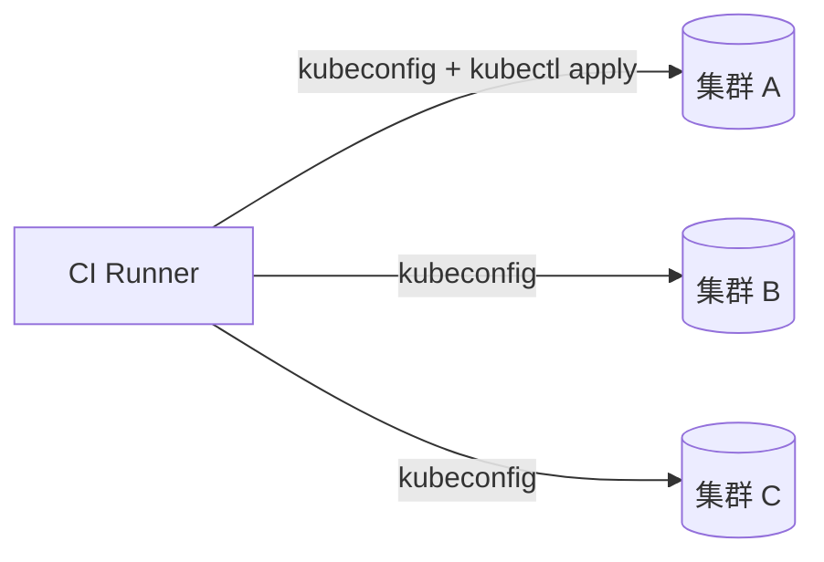
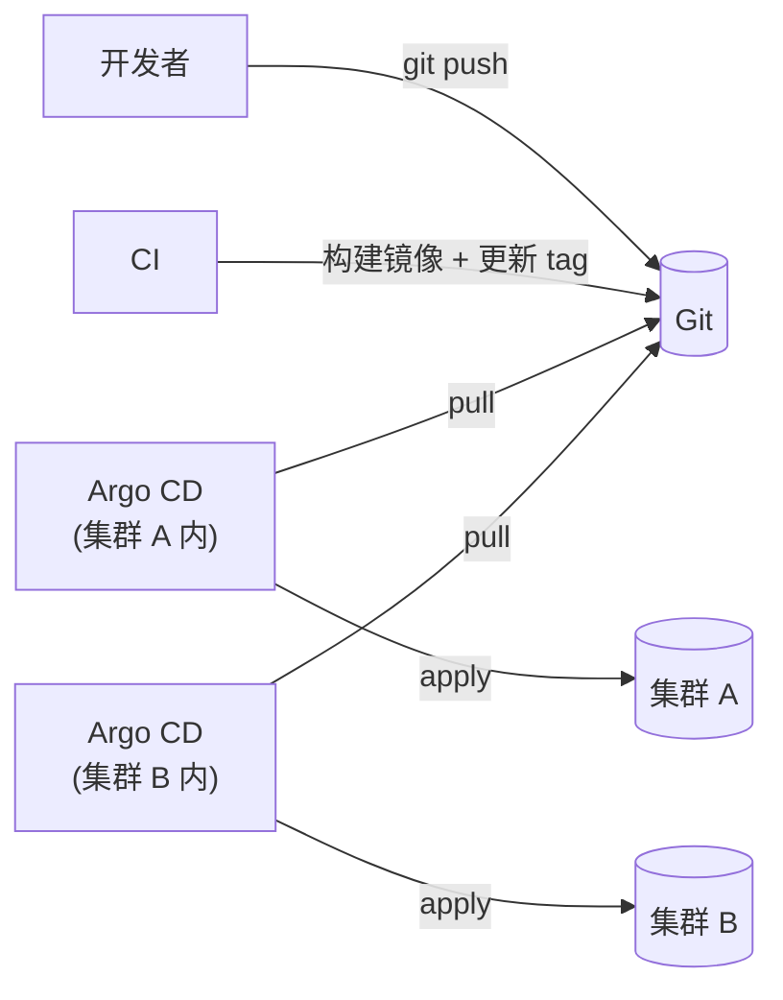
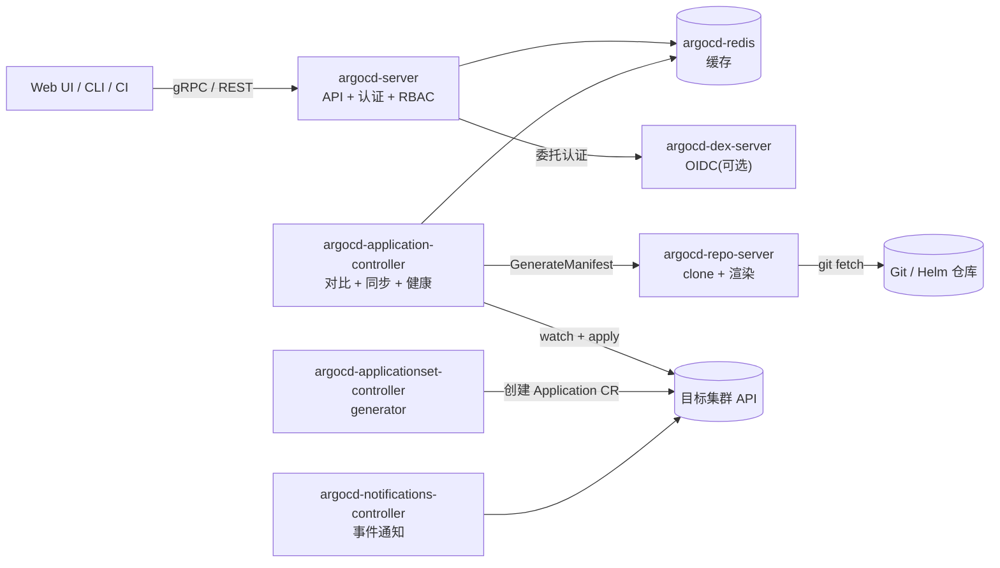
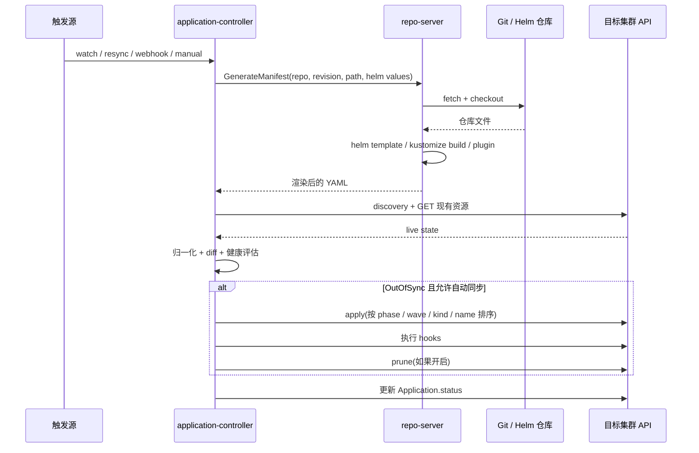
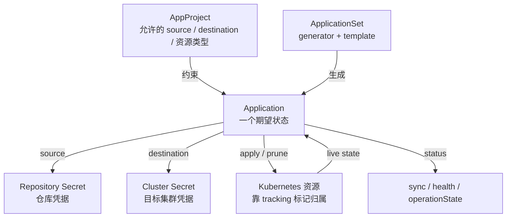

# Argo CD 核心概念与架构:一次同步背后发生了什么

> 对应[一周计划](README.md)的 Day 1 - 2 理论部分。版本基线 **v3.5.x**;
> 和 v2 行为不同的地方单独标出。想要更轻的版本,先看 [概念速览](概念速览.md)。
>
> 这篇不教命令,只回答三个问题:**谁在干活、状态从哪来、一次同步按什么顺序发生。**
> 把这三件事想清楚,后面 Helm / ApplicationSet / 多集群都只是"换个输入"。

## 一、问题定义:为什么是 pull

### 1.1 push 模式的三个痛点

传统 CD 是 CI 直接 `kubectl apply`:



- **凭据扩散**:CI 要持有每个集群的 kubeconfig,权限通常还很大。
- **没有持续状态**:apply 完就结束了。有人手改集群、资源被删,CI 不知道。
- **审计困难**:这次部署到底改了哪些对象?只能翻 CI 日志,和 Git 历史对不上。

### 1.2 pull 模式



集群里的 agent 主动拉 Git,持续对比、持续收敛。CI 不需要集群凭据,只需要写 Git 的权限。
多集群时,每个集群自己拉,天然并行。

### 1.3 GitOps 的四条原则

OpenGitOps 的定义可以压成四句:

1. **声明式**:期望状态用声明式配置描述,不是一串命令。
2. **版本化且不可变**:期望状态存在 Git 里,每次变更有 commit 记录。
3. **自动拉取**:agent 主动从 Git 拉,不需要外部推。
4. **持续收敛**:agent 不断对比实际状态和期望状态,有偏差就修。

Argo CD 是这四条的一个实现。**它不是唯一的实现**,Flux 也走同一套模型。

### 1.4 Argo CD 的边界

| 它做 | 它不做 |
|------|--------|
| 从 Git 拉清单、渲染、apply / prune | 构建镜像、跑测试、扫描漏洞 |
| 持续对比 live / desired,报告漂移 | 编排发布流程(审批、人工卡点) |
| 提供 UI / CLI / API、RBAC、多租户 | 替代 Helm 的 release 管理 |
| 多集群、ApplicationSet、通知 | 渐进式发布(那是 Argo Rollouts) |

## 二、组件:谁负责什么

### 2.1 一张图



### 2.2 逐个说

| 组件 | 工作负载 | 职责 | 关键点 |
|------|---------|------|--------|
| `argocd-server` | Deployment | 对外 API / Web UI;认证、RBAC;接收 Git webhook;触发 sync / rollback | 无状态,可水平扩;不直接执行 sync |
| `argocd-repo-server` | Deployment | clone / fetch Git;执行 `helm template`、`kustomize build`、CMP 插件;返回渲染后的清单 | 唯一接触 Git 的组件;CPU / IO 密集,可水平扩;有本地缓存 |
| `argocd-application-controller` | StatefulSet | watch Application 和集群资源;对比 desired / live;执行 sync;计算健康状态 | 实际修改目标集群的组件;可按 Application 分片 |
| `argocd-applicationset-controller` | Deployment | 评估 generator,创建 / 更新 / 删除 Application CR | **只生成 Application,不碰业务资源** |
| `argocd-redis` | Deployment | 缓存 repo 状态、集群信息、部分 UI 查询 | 不是事实来源;丢了可以重建 |
| `argocd-dex-server` | Deployment | 内置 OIDC provider,Dex 模式下的身份来源 | 可选;用外部 IdP 时不需要 |
| `argocd-notifications-controller` | Deployment | 监听 Application 事件,按 trigger / template 发通知 | 可选 |

### 2.3 五条不变式

1. **Git 只由 repo-server 拉取。** application-controller 自己不 clone 仓库,它只调用 repo-server 的
   `GenerateManifest`。
2. **Application 的状态存在 Kubernetes CR 里。** Redis 只是缓存,不是事实来源;redis 挂了,
   状态会重建,只是短时间变慢。
3. **application-controller 是目标集群的实际写入者。** server 收到 sync 请求后,是 controller
   去 apply / prune。
4. **repo-server 是无状态的。** 本地 cache 可以丢;副本之间不共享内存,各自缓存。
5. **ApplicationSet controller 只生成 Application。** 业务资源仍然由 Application 去创建。

## 三、一次 reconcile 的完整时序

### 3.1 触发

application-controller 对每个 Application 做对比,触发来源有四类:

| 触发 | 说明 |
|------|------|
| watch 事件 | Application CR 变化、目标资源变化 |
| 周期 resync | `timeout.reconciliation`,默认 **180 秒** |
| Git webhook | 仓库变更后,server 收到 webhook,通知 controller 刷新 |
| 手动刷新 | UI / CLI / API 触发 |

### 3.2 refresh 与 hard refresh

| 操作 | 做什么 | 什么时候用 |
|------|--------|-----------|
| refresh | 重新对比,但复用 repo-server 的清单缓存(如果 revision 没变) | 怀疑 live 状态变了 |
| hard refresh | 让 repo-server 丢弃缓存,重新 clone / 渲染 | 怀疑 Helm values、Kustomize、插件输出不对 |

UI 上的 Refresh / Hard Refresh 对应这两个动作;CLI 可以用 `argocd app get --refresh`、
`argocd app get --hard-refresh`。

### 3.3 时序图



### 3.4 每一步在干什么

**第一步:拿期望状态。**
controller 把 Application 的 `source`(repoURL、targetRevision、path、helm / kustomize 参数)
发给 repo-server。repo-server 先看本地 cache 有没有这个 revision,没有就 fetch / checkout,
然后执行对应的渲染器,返回一组 YAML。

这一步的产物是**渲染后的清单**,不是 Git 里的原始文件。Helm 的 values、Kustomize 的 overlay、
CMP 插件的输出,都在这一步生效。

**第二步:拿实际状态。**
controller 通过 discovery 把清单里的 GVK 映射成 API 资源,再逐个 GET。如果 CRD 没装,
discovery 找不到这个 kind,就会报 `ComparisonError`。

**第三步:对比。**
不是文本 diff,而是把两边解析成对象后做结构化比较。比较前会做归一化:

- 去掉 `status`(v3 默认对所有资源忽略)。
- 应用 `ignoreDifferences`。
- 处理默认值、空字段、webhook 注入的字段。

结果写进 `status.sync.status`:`Synced` / `OutOfSync` / `Unknown`。

**第四步:健康评估。**
对每个资源跑健康检查:Deployment 看可用副本,Job 看完成状态,Pod 看 phase /
conditions,CRD 可以自定义 Lua 健康检查。聚合结果写进 `status.health.status`。

**第五步:同步。**
如果是手动模式,等人触发;如果是自动模式且 `OutOfSync`,controller 构造一个 sync operation:

1. 按 **phase → wave → kind → name** 排序。
2. 执行 `PreSync` hooks。
3. 按顺序 apply 资源。
4. 执行 `PostSync` hooks(等资源健康之后)。
5. 如果开启 prune,按相反顺序删除。
6. 把结果写进 `status.operationState` 和 history。

### 3.5 为什么"同步"不等于"健康"

| 阶段 | 成功意味着 |
|------|-----------|
| apply 成功 | API server 接受了这个对象,`Synced` |
| 资源健康 | Deployment 的 Pod 真的起来了、探针过了,`Healthy` |
| 业务可用 | 还要看你的 smoke test、监控、流量 |

Argo CD 只能保证前两层。第三层要靠 PostSync hook、探针、外部监控。

## 四、对象模型:五类对象,谁管谁

> 第一次接触这些对象,先看 [资源关系入门](资源关系入门.md);本节偏参考。

### 4.1 关系图



### 4.2 对象一览

| 对象 | 作用域 | 作用 |
|------|--------|------|
| `Application` | namespaced,默认 `argocd` | 一个期望状态单元:source + destination + syncPolicy |
| `AppProject` | namespaced,通常在 `argocd` | 多租户边界:允许哪些仓库、哪些集群 / namespace、哪些资源类型、谁能操作 |
| `ApplicationSet` | namespaced | 用 generator 批量生成 Application |
| Repository Secret | `argocd` namespace | 仓库地址、认证方式;label `argocd.argoproj.io/secret-type: repository` |
| Cluster Secret | `argocd` namespace | 目标集群地址、凭据;label `argocd.argoproj.io/secret-type: cluster` |
| ConfigMap | `argocd` namespace | `argocd-cm`、`argocd-rbac-cm`、`argocd-cmd-params-cm`、`argocd-notifications-cm` 等 |

### 4.3 资源归属:tracking 标记

Argo CD apply 资源时,会给它打一个归属标记。v3 默认用 annotation:

```yaml
metadata:
  annotations:
    argocd.argoproj.io/tracking-id: guestbook:apps/Deployment:guestbook/guestbook
```

格式是 `<application>:<group>/<kind>:<namespace>/<name>`。v2 默认用 label
`app.kubernetes.io/instance`,v3.0 起改成 annotation。配置项在 `argocd-cm`:

```yaml
data:
  application.resourceTrackingMethod: annotation   # annotation / label / annotation+label
```

这个标记决定了:

- **prune 删谁**:只删属于这个 Application 的资源。
- **共享资源检测**:两个 Application 都声明同一个资源时,后 sync 的覆盖前一个;
  `FailOnSharedResource=true` 直接失败。
- **孤儿资源**:Application 删了但资源没清掉时,靠它找回来。

### 4.4 Application finalizer

```yaml
metadata:
  finalizers:
    - resources-finalizer.argocd.argoproj.io
```

有它,删 Application 时会级联删除业务资源(默认 foreground);没有它,只删 Application CR,
资源留在集群。`resources-finalizer.argocd.argoproj.io/background` 是 background 版本。

注意默认行为:

- **声明式创建的 Application 默认没有这个 finalizer。**
- `argocd app delete --cascade` 会自动加上。
- ApplicationSet 生成的 Application 默认会加,除非 `preserveResourcesOnDeletion: true`。

## 五、状态机:两套状态,别混着看

### 5.1 Sync status

| 值 | 含义 |
|----|------|
| `Synced` | 渲染后的清单和 live 状态一致 |
| `OutOfSync` | 有差异 |
| `Unknown` | 对比失败,拿不到结论 |

### 5.2 Health status

| 值 | 含义 |
|----|------|
| `Healthy` | 所有资源健康 |
| `Progressing` | 还在推进:Deployment 滚动、Job 在跑、Pod 没就绪 |
| `Degraded` | 至少一个资源明确失败 |
| `Suspended` | 资源被暂停(比如 CronJob suspended) |
| `Missing` | 资源还没创建 |
| `Unknown` | 健康检查无法判断 |

### 5.3 Operation phase

| 值 | 含义 |
|----|------|
| `Running` | 同步进行中 |
| `Succeeded` | 成功 |
| `Failed` | 失败 |
| `Error` | 执行出错 |
| `Terminating` | 正在终止 |

### 5.4 常见组合

| 组合 | 场景 | 排查方向 |
|------|------|---------|
| `Synced` + `Healthy` | 正常 | —— |
| `Synced` + `Degraded` | 清单 apply 了,但 Pod Crash / 镜像拉不到 / 探针失败 | `kubectl describe pod`,容器日志 |
| `Synced` + `Progressing` | 滚动更新还没完成 | 等,或看 Deployment 状态 |
| `OutOfSync` + `Healthy` | 副本数、label、HPA 字段漂移,不影响可用性 | `argocd app diff` |
| `OutOfSync` + `Missing` | 资源还没创建 | sync |
| `Unknown` + `Unknown` | repo 连不上、渲染失败、RBAC 不够、CRD 缺失 | `status.conditions` + repo-server 日志 |

### 5.5 状态存在哪

```yaml
status:
  sync:
    status: Synced
    revision: <git-sha>
    revisions: [<sha1>, <sha2>]     # 多源时
  health:
    status: Healthy
  operationState:
    phase: Succeeded
    message: successfully synced
    syncResult:
      revision: <git-sha>
  conditions:
    - type: ComparisonError
      message: ...
  reconciledAt: "..."
```

> **v3 变化**:每个资源的健康状态默认不再持久化到 Application CR,存在 controller 侧;
> `.status.resources[].health` 默认看不到。要恢复,在 `argocd-cm` 设
> `controller.resource.health.persist: "true"`。

## 六、Application spec 逐字段

```yaml
apiVersion: argoproj.io/v1alpha1
kind: Application
metadata:
  name: guestbook
  namespace: argocd
  finalizers:
    - resources-finalizer.argocd.argoproj.io   # 可选:删 Application 时级联删资源
spec:
  project: default
  source:
    repoURL: https://github.com/hchenxa/reading-notes.git
    targetRevision: main
    path: ArgoCD/labs/guestbook
  destination:
    server: https://kubernetes.default.svc
    namespace: guestbook
  syncPolicy:
    automated:
      prune: true
      selfHeal: true
    syncOptions:
      - CreateNamespace=true
    retry:
      limit: 5
      backoff:
        duration: 5s
        factor: 2
        maxDuration: 3m
  ignoreDifferences:
    - group: apps
      kind: Deployment
      jsonPointers:
        - /spec/replicas
  revisionHistoryLimit: 10
```

| 字段 | 要点 |
|------|------|
| `spec.project` | 用哪个 AppProject;`default` 允许一切,生产别用 |
| `spec.source` | 单源;`sources` 是多源,两者互斥 |
| `source.repoURL` | Git 地址或 Helm 仓库地址 |
| `source.targetRevision` | 分支 / tag / commit SHA;生产建议固定 tag 或 SHA |
| `source.path` | 仓库内的相对路径;Helm 用 `chart`,不用 `path` |
| `source.helm` | `releaseName`、`valueFiles`、`parameters`、`valuesObject`、`version` |
| `source.kustomize` | `images`、`replicas`、`commonAnnotations`、`buildOptions` |
| `destination.server` | 目标集群 API;in-cluster 是 `https://kubernetes.default.svc` |
| `destination.name` | 用注册的集群名,比 server 好读 |
| `destination.namespace` | 目标 namespace;cluster-scoped 资源可留空 |
| `syncPolicy.automated` | **只要这个块存在就启用**,没有 `enabled: true` |
| `automated.prune` | 默认 `false`;删 Git 里的资源需要它 |
| `automated.selfHeal` | 默认 `false`;集群漂移自动拉回 |
| `automated.allowEmpty` | 默认 `false`;Git 里删空时是否允许 prune 全部 |
| `syncPolicy.retry` | 失败重试:limit、duration、factor、maxDuration |
| `ignoreDifferences` | JSON pointer / jq 表达式 / managedFieldsManagers |
| `revisionHistoryLimit` | 历史保留条数,默认 10 |
| `metadata.finalizers` | 控制删除时是否级联 |

## 七、AppProject:真正的多租户边界

```yaml
spec:
  sourceRepos:
    - https://github.com/hchenxa/reading-notes.git
  destinations:
    - server: https://kubernetes.default.svc
      namespace: team-a-*
  clusterResourceWhitelist:
    - group: ""
      kind: Namespace
  namespaceResourceWhitelist:
    - group: "*"
      kind: "*"
  roles:
    - name: developer
      policies:
        - p, proj:team-a:developer, applications, get, team-a/*, allow
        - p, proj:team-a:developer, applications, sync, team-a/*, allow
  syncWindows:
    - kind: deny
      schedule: "0 22 * * *"
      duration: 8h
      applications: ["*"]
      manualSync: true
```

| 字段 | 限制什么 |
|------|---------|
| `sourceRepos` | Application 只能从这个列表里的仓库拉清单 |
| `destinations` | 只能部署到这些集群 / namespace;支持 `*` 通配 |
| `clusterResourceWhitelist` | 允许创建哪些 cluster-scoped 资源(Namespace、CRD、ClusterRole) |
| `namespaceResourceWhitelist` | 允许创建哪些 namespaced 资源 |
| `roles` | 项目内的 RBAC 角色,只能操作本项目 |
| `syncWindows` | 允许 / 禁止同步的时间窗;`manualSync: true` 表示窗口内仍允许手动同步 |
| `orphanedResources` | 检测并告警"集群里有、Git 里没有"的资源 |
| `sourceNamespaces` | 允许哪些 namespace 放 Application(any-namespace 模式) |

两个容易混的点:

- **AppProject 不是 namespace。** Application 放在 `argocd` namespace,也可以部署到别的
  namespace;project 是一组策略,不是资源隔离的物理边界。
- **project role 不是全局 role。** 全局 RBAC 在 `argocd-rbac-cm`,project role 只在本项目内生效;
  可以把全局角色映射到 project role,但不能反过来。

## 八、ApplicationSet:批量生成的控制器

### 8.1 Generator

| Generator | 输入 | 典型场景 |
|-----------|------|---------|
| List | 手写元素列表 | 少量固定环境 |
| Cluster | 注册集群 + label | 每集群一套 |
| Git(directories / files) | 仓库目录 / values 文件 | 每目录 / 每文件一个环境 |
| SCMProvider | 组织下的仓库列表 | 每仓库一个应用 |
| PullRequest | PR 列表 | 每 PR 一套预览环境 |
| Matrix | 多个 generator 的笛卡尔积 | cluster × env |
| Merge | 多个 generator 的合并 | 基础配置 + 覆盖 |
| ClusterDecisionResource | 外部决策 CR | 高级调度 |
| Plugin | 自定义插件 | 内置不够 |

### 8.2 生命周期

- ApplicationSet controller watch ApplicationSet,评估 generator,生成 Application CR。
- 生成的 Application 带 ownerReference;删 ApplicationSet 会级联删子 Application。
- 子 Application 默认带 `resources-finalizer`,会继续删业务资源;
  `preserveResourcesOnDeletion: true` 可以保留。
- generator 的输出变了,AppSet 会增 / 删 / 改对应的 Application;不会直接改业务资源。

### 8.3 ApplicationSet 和 app-of-apps

app-of-apps 是"用一个 Application 管理一组 Application 的 YAML";ApplicationSet 是
"用一个控制器按 generator 生成 Application"。前者靠 Git 里的静态清单,后者靠动态发现。
少量稳定结构用 app-of-apps,多环境 / 多集群 / 大量重复用 ApplicationSet。

## 九、多集群:Argo CD 怎么"看到"另一个集群

### 9.1 注册方式

```console
$ argocd cluster add kind-argocd-2 --name argocd-2
```

它会:

1. 在目标集群创建 `argocd-manager` ServiceAccount(通常在 `kube-system`)。
2. 绑定一个高权限的 ClusterRole(`cluster-admin` 或自定义)。
3. 在 Argo CD 的 namespace 写一个 cluster Secret。

也可以声明式写 Secret:

```yaml
apiVersion: v1
kind: Secret
metadata:
  name: cluster-argocd-2
  namespace: argocd
  labels:
    argocd.argoproj.io/secret-type: cluster
type: Opaque
stringData:
  name: argocd-2
  server: https://<api>:6443
  config: |
    {
      "bearerToken": "<token>",
      "tlsClientConfig": { "insecure": false, "caData": "<base64-ca>" }
    }
```

### 9.2 网络方向

**Argo CD → 目标集群 API。** 目标集群不需要访问 Argo CD,也不需要安装 Argo CD。
如果目标集群 API 不能从 Argo CD 所在网络直达,需要反向代理、VPN 或专用的拉模式方案。

### 9.3 选集群

- `destination.server` 用 API 地址,最直接。
- `destination.name` 用注册名,集群迁移 / 改地址时不用改 Application。
- ApplicationSet 的 Cluster generator 按 label 选,比硬编码名字灵活。

## 十、v3 与 v2 的行为差异

这一节是"踩坑预防针"。v3.0 改了一批默认行为,很多 2.x 的博客 / 经验不再成立。

| 变化 | 影响 | 应对 |
|------|------|------|
| 资源 tracking 默认从 label 改成 annotation | 依赖 `app.kubernetes.io/instance` 找资源的脚本会失效 | 用 `argocd.argoproj.io/tracking-id`,或设 `resourceTrackingMethod: label` |
| `status` 字段默认对所有资源忽略 | 以前只忽略 CRD 的 status | 需要比较 status 时设 `ignoreResourceStatusField: crd` |
| 每资源健康默认不持久化 | `.status.resources[].health` 看不到 | 用 CLI / API,或 `controller.resource.health.persist: "true"` |
| 细粒度 RBAC 不再继承 `update` / `delete` | 子资源操作可能被拒 | 显式加 `update/*` / `delete/*` |
| `ignoreDifferences` 也抑制资源更新事件 | 手改被忽略的字段不会触发 reconcile | 设 `ignoreDifferencesOnResourceUpdates: "false"` |
| 默认排除高 churn 资源 | Endpoints / Lease 等不再显示 | 需要时覆盖 `resource.exclusions` |
| 旧指标删除 | `argocd_app_sync_status` 等没了 | 用 `argocd_app_info` 的 label |
| `argocd-cm` 里的旧仓库配置移除 | 必须在 Secret 里配仓库 | 迁移到 Repository Secret |
| Helm 升级 | values 里的 `null` 行为变化 | 升级前检查 values |
| Dex 的 RBAC subject 改用 `federated_claims.user_id` | 旧 policy 可能匹配不上 | 更新 RBAC |
| Application / ApplicationSet 支持任意 namespace | 多租户部署更灵活 | 需要配置 `application.namespaces` 等 |
| v3.5:内部 mTLS / source integrity / Helm 4 | 安全能力增强,行为有变化 | 读 3.5 upgrade notes |

> 升级前一定读对应版本的 upgrade notes。v3.5 的原文在
> `https://argo-cd.readthedocs.io/en/stable/operator-manual/upgrading/`。

## 十一、自测:12 个问题

先自己回答,再对照右列。

| # | 问题 | 一句话答案 |
|---|------|-----------|
| 1 | 为什么 pull 比 push 更适合多集群? | CI 不用持有集群凭据;每个集群自己拉;持续 reconcile 能发现漂移 |
| 2 | 七个组件各干什么? | server 对外 API;repo-server 拉取渲染;controller 对比同步;AppSet 生成 Application;redis 缓存;dex 认证;notifications 发通知 |
| 3 | repo-server 为什么要独立? | clone / 渲染是 CPU / IO 密集且需要工具链;独立可扩容、隔离故障和权限 |
| 4 | 一次 reconcile 的步骤? | 触发 → 渲染 → 取 live → diff → 健康 → sync → 写 status |
| 5 | refresh 和 hard refresh 差在哪? | 前者复用清单缓存,后者让 repo-server 重新 clone / 渲染 |
| 6 | `Synced` 和 `Healthy` 分别是什么? | 前者是清单一致,后者是运行时健康 |
| 7 | 为什么会出现 `OutOfSync + Healthy`? | 漂移发生在不影响健康的字段,比如副本数、label、HPA 字段 |
| 8 | prune 怎么知道资源归谁? | 资源上的 tracking annotation / label |
| 9 | 为什么 `helm list` 看不到 Argo CD 部署的 chart? | 只执行 `helm template`,没有 Helm release Secret |
| 10 | 删 Application 会删资源吗? | 看 finalizer;声明式默认没有,`--cascade` 会加,AppSet 默认加 |
| 11 | AppProject 和 namespace 的区别? | project 是策略边界,namespace 只是部署目标 |
| 12 | redis 挂了会怎样? | 缓存重建,变慢但状态不丢;事实来源是 CR 和 Git |

## 相关

- [一周学习计划](README.md)
- [概念速览](概念速览.md)
- [资源关系入门](资源关系入门.md)
- [Argo CD 官方 Architecture](https://argo-cd.readthedocs.io/en/stable/operator-manual/architecture/)
- [Application Specification](https://argo-cd.readthedocs.io/en/stable/user-guide/application-specification/)
- [Auto Sync](https://argo-cd.readthedocs.io/en/stable/user-guide/auto_sync/)
- [Sync Waves and Hooks](https://argo-cd.readthedocs.io/en/stable/user-guide/sync-waves/)
- [v3.0 升级说明](https://argo-cd.readthedocs.io/en/stable/operator-manual/upgrading/2.14-3.0/)
