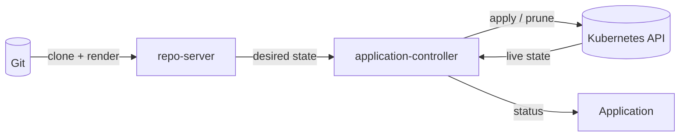

# Argo CD 概念速览:先把"它在干什么"想清楚

> 对应[一周计划](README.md)的 Day 1 前置阅读。
> 这篇比 [核心概念与架构](核心概念与架构.md) 轻,比 [资源关系入门](资源关系入门.md) 更靠前:
> 先建立 desired / live / reconcile 的心智模型,再看对象关系。
> 不跑实验,只回答概念问题。

## 一、一句话:Argo CD 是"对比 + 纠偏"的循环

Argo CD 不执行流水线,也不把"期望状态"存进自己的数据库。期望状态在 Git 里,
它每次做三件事:

```text
读 Git + 渲染  ──>  得到 desired state(想要的)
读集群 API     ──>  得到 live state(实际的)
两者对比       ──>  Synced / OutOfSync
OutOfSync 且允许同步 ──> apply / prune,把实际拉回想要
```

这个循环会一直跑:watch 事件、每 3 分钟 resync、Git webhook、手动刷新,都会触发一次。
所以它是**控制器**(controller),不是"一次性部署工具"。



## 二、三个词:desired / live / reconcile

| 词 | 是什么 | 从哪来 | 容易误解 |
|----|--------|--------|---------|
| desired state | 渲染后的 Kubernetes 清单 | Git + Helm / Kustomize | 不是 Git 里的原始文件,渲染之后才算 |
| live state | 集群里真实存在的对象 | Kubernetes API | 会被默认值、webhook、控制器改写 |
| reconcile | 对比 desired / live 并纠偏 | controller 循环 | 不是"跑一次流水线",而是持续进行 |

一个关键区别:**Git 里是 chart + values,Argo CD 渲染之后才得到 desired manifests。**
所以 Helm 的 values 写错、Kustomize 的 overlay 没生效,都会让"想要的"本身就不对。

## 三、用装修打个比方

| 概念 | 装修里的角色 | 技术上是什么 |
|------|-------------|-------------|
| Git | 设计图纸 | 唯一事实来源 |
| repo-server | 把图纸翻译成施工步骤 | clone + `helm template` / `kustomize build` |
| Application | 一张施工单 | "图纸哪一页 + 哪个房子" |
| ApplicationSet | 批量开施工单的模板 | generator + template,生成 Application |
| AppProject | 物业许可证 | 允许用哪些材料、在哪个小区施工 |
| Repository Secret | 材料仓库门禁卡 | Git / Helm 仓库凭据 |
| Cluster Secret | 小区门禁卡 | 目标集群凭据 |
| application-controller | 监理 | 不断巡检,发现和图纸不一样就改回来 |
| Sync status | 是否按图施工完成 | 清单有没有 apply 成功 |
| Health status | 房子是否真能住 | Pod / 探针 / 工作负载是否健康 |

> 类比只用来记关系,真实边界以技术定义为准。

## 四、一条链:从 Git 到 Pod

```text
Git(图纸)
  │  repo-server clone + 渲染
  ▼
Application(施工单:source + destination)
  │  application-controller 对比 desired / live
  ├── 先过 AppProject 的许可证:repo 允许吗?destination 允许吗?
  ├── 用 Repository Secret 拉代码
  ├── 用 Cluster Secret 连目标集群
  ▼
Deployment / Service / Pod(工地)
```

所以五个对象的关系是:

- **AppProject** 管"能不能";
- **Repository / Cluster Secret** 管"怎么连";
- **Application** 管"要什么",是唯一直接触发同步的对象;
- **ApplicationSet** 管"批量生成 Application",它自己不施工。

## 五、六个最容易混的概念

| 概念 | 一句话 |
|------|--------|
| desired vs live | Git 渲染出来的是"想要的",集群里的是"实际的" |
| 同步 vs 健康 | `Synced` 只代表清单 apply 了;`Healthy` 才代表 Pod 真的可用 |
| Application vs ApplicationSet | 一张施工单 vs 批量开单的模板 |
| AppProject vs namespace | 策略边界 vs 物理隔离;Application 可以放在 `argocd`,部署到 `team-a` |
| Repository Secret vs Cluster Secret | 拉代码的钥匙 vs 进集群的钥匙,按 `url` / `name` 匹配 |
| pull vs push | 集群里的 agent 主动拉 Git vs CI 拿着 kubeconfig 往里推 |

另外三个常见误解:

- **Argo CD 不会执行 `helm install`。** 它只跑 `helm template`,不会产生 Helm release Secret。
- **删掉 Git 里的文件,不一定会删集群资源。** 要开 `prune`,而且资源确实被这个 Application 追踪。
- **`Synced` 不等于部署成功。** 清单 apply 成功只是第一层,业务是否可用还要看 Health 和你的监控。

## 六、用当前集群对象对照

| 概念 | 当前集群里的对象 |
|------|-----------------|
| 期望状态 | `docs/argocd-one-week-plan` 分支里的 `ArgoCD/labs/guestbook` |
| 施工单 | `guestbook-dev`、`guestbook-prod` |
| 批量开单 | `guestbook-envs`(ApplicationSet) |
| 许可证 | `team-a`(AppProject) |
| 仓库门禁 | `repo-team-a`(Repository Secret) |
| 小区门禁 | 内置 `in-cluster`(还没建 Cluster Secret) |
| 监理 | `argocd-application-controller` |
| 施工结果 | `team-a-dev` / `team-a-prod` 里的 Deployment、Service、Pod |

> `guestbook` 是最早用官方 example 做的冒烟,project 是 `default`;
> `guestbook-dev` / `guestbook-prod` 才是 `team-a` + ApplicationSet 的产物。

## 七、十个概念问答

| # | 问题 | 一句话答案 |
|---|------|-----------|
| 1 | Argo CD 是 CI 还是 CD? | CD / GitOps 控制器;CI 负责构建、测试、更新镜像 tag |
| 2 | 为什么 Git 是唯一事实来源? | 可审计、可回滚、能发现漂移;Argo CD 的状态只是结果 |
| 3 | Application 到底"执行"了什么? | 它本身不执行;application-controller 按它的 spec 去对比和同步 |
| 4 | 为什么 `Synced` 不等于 `Healthy`? | apply 成功不代表 Pod 能起来、探针能过 |
| 5 | AppProject 和 namespace 的区别? | project 是策略边界,namespace 是物理隔离 |
| 6 | ApplicationSet 为什么不直接建 Deployment? | 它只生成 Application;业务资源统一由 Application 同步,才能复用 project / secret 校验 |
| 7 | Secret 为什么不在 Application 里写名字? | Application 写 `repoURL` / `destination`,Argo CD 按值匹配 Secret,凭据和清单解耦 |
| 8 | auto-sync 和 selfHeal 的区别? | auto-sync 响应 Git 变化;selfHeal 响应集群里的 live 漂移 |
| 9 | prune 怎么知道资源归谁? | 资源上的 tracking annotation / label |
| 10 | Argo CD 会执行 `helm install` 吗? | 不会,只跑 `helm template`,没有 Helm release Secret |

## 八、接下来按这个顺序深入

| 顺序 | 主题 | 去哪看 |
|------|------|--------|
| 1 | desired / live 与 reconcile 循环 | [核心概念与架构](核心概念与架构.md) 第三节 |
| 2 | Sync / Health 状态机 | [核心概念与架构](核心概念与架构.md) 第五节 |
| 3 | AppProject 与 RBAC | [资源关系入门](资源关系入门.md) 第五节、[核心概念与架构](核心概念与架构.md) 第七节 |
| 4 | ApplicationSet 的 generator | [资源关系入门](资源关系入门.md) 第四节、[核心概念与架构](核心概念与架构.md) 第八节 |
| 5 | 多集群与 Cluster Secret | [核心概念与架构](核心概念与架构.md) 第九节 |
| 6 | 生产化 | [一周计划](README.md) Day 6 |

> 概念没弄明白之前,不用急着做 Day 2 的漂移实验;先把"它在循环什么"想清楚,
> 后面的 `Synced / OutOfSync`、`Healthy / Degraded`、`prune / selfHeal` 都只是这条链上的状态。

## 相关

- [一周学习计划](README.md)
- [资源关系入门](资源关系入门.md)
- [核心概念与架构](核心概念与架构.md)
- [Argo CD 官方 Architecture](https://argo-cd.readthedocs.io/en/stable/operator-manual/architecture/)
