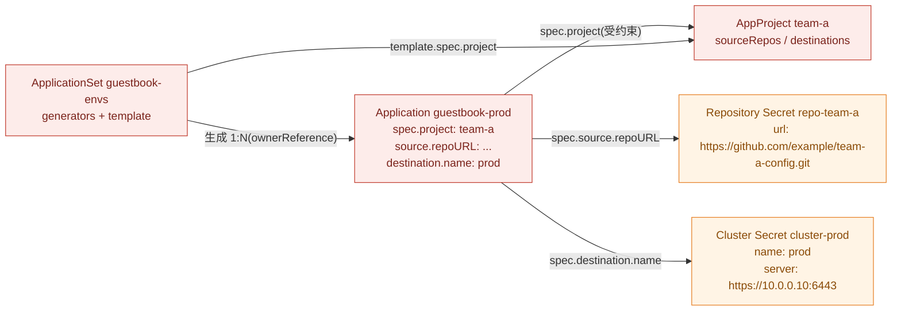
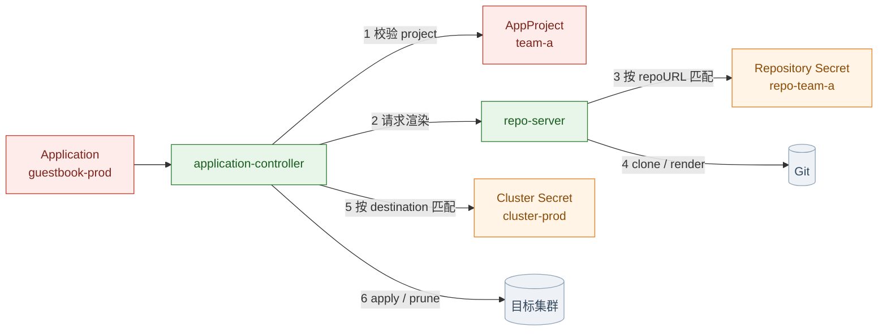

# Argo CD 资源关系入门:五个对象,一条链

> 对应[一周计划](README.md)的 Day 1 前置阅读。
> 目标:看完能回答三个问题:
> 1. Application 的 `project` 字段指向谁?
> 2. `repoURL` 怎么找到对应的凭据?
> 3. ApplicationSet 生成的东西到底是什么?
>
> 例子用一套统一的命名:`team-a` 项目、私有仓库 `team-a-config`、`prod` 集群。
> 当前 kind 集群里只有一个 `guestbook` Application,文末会对照真实对象。

## 一、先看结论:五个对象,一条链

| 对象 | 角色 | 回答什么问题 |
|------|------|-------------|
| `AppProject` | 规则 | 允许从哪些仓库拉、部署到哪些集群 / namespace、能建哪些资源 |
| `Repository Secret` | 凭据 | 怎么连 Git / Helm 仓库 |
| `Cluster Secret` | 凭据 | 怎么连目标集群 |
| `Application` | 声明 | 把哪个 source 同步到哪个 destination |
| `ApplicationSet` | 工厂 | 按什么规则批量生成 Application |

一句话:

**AppProject 管"能不能",Secret 管"怎么连",Application 管"要什么",ApplicationSet 管"批量生成 Application"。**
只有 Application 直接触发同步。

| 谁 | 创建什么 |
|----|---------|
| 你 | AppProject、Repository / Cluster Secret、Application 或 ApplicationSet |
| ApplicationSet controller | Application |
| Application controller | Deployment / Service / ConfigMap 等业务资源 |

## 二、五张 YAML 串起整条链

### 2.1 场景

- 团队 `team-a` 有一个私有仓库 `https://github.com/example/team-a-config.git`,里面是 `apps/guestbook`。
- 两个目标:in-cluster 的 `team-a-dev` namespace,和外部 `prod` 集群的 `team-a-prod` namespace。
- 用 ApplicationSet 生成 dev / prod 两个 Application;如果只有一个环境,也可以只写一个 Application。
- 所有名字在五份 YAML 里保持一致,方便对照。

### 2.2 图 A:声明之间谁引用谁

红色是你写的声明,橙色是凭据;图 B 里绿色是 Argo CD 控制面:



> 注意箭头的方向:
> - ApplicationSet **生成** Application。
> - Application **引用** AppProject、Repository Secret、Cluster Secret。
> - AppProject **约束** Application(图里用 `template.spec.project` 和 `spec.project` 两条边表示)。
>
> Application 的 YAML 里**没有** `secretName` 这种字段。它写的是 `repoURL` 和 `destination.name`,
> Argo CD 自己按这两个值去匹配对应的 Secret。

### 2.3 图 B:运行时谁用谁



六个动作对应六条关系:

1. Application 的 `spec.project` 指向 AppProject。
2. controller 用 AppProject 的 `sourceRepos` / `destinations` 校验这个 Application。
3. repo-server 按 `spec.source.repoURL` 匹配 Repository Secret。
4. repo-server 用凭据 clone 仓库,执行 `helm template` / `kustomize build`。
5. controller 按 `spec.destination.name`(或 `server`)匹配 Cluster Secret。
6. controller 把渲染结果 apply 到目标集群,并给资源打 tracking 标记。

### 2.4 字段级匹配表

| 关系 | Application 里写的 | 匹配谁 | 匹配字段 | 不匹配会怎样 |
|------|-------------------|--------|---------|-------------|
| Application → AppProject | `spec.project: team-a` | AppProject 的 `metadata.name` | 同名 | project 不存在 → `InvalidSpecError` |
| AppProject → source | `spec.source.repoURL` | AppProject 的 `sourceRepos` | 列表包含该 URL | 不在白名单 → `InvalidSpecError`,sync 被拒 |
| AppProject → destination | `spec.destination.name` + `namespace` | AppProject 的 `destinations` | name / server + namespace 匹配 | 不在白名单 → `InvalidSpecError` |
| Application → Repository Secret | `spec.source.repoURL` | Secret 的 `url` | 精确匹配;`repo-creds` 按前缀匹配 | 私有仓库没匹配到 → `ComparisonError`(认证失败) |
| Application → Cluster Secret | `spec.destination.name` 或 `server` | Secret 的 `name` / `server` | 同名 / 同 URL | 匹配不到 → `Unknown`(cluster not found) |
| ApplicationSet → Application | `spec.template` + `spec.generators` | 无 | 生成 1:N | template 不合法 → 子 Application `InvalidSpecError` |
| Application → 业务资源 | 渲染后的清单 | 目标集群 | apply / prune + tracking | 见 Day 2 / Day 3 |

### 2.5 五张 YAML

#### 00:AppProject

```yaml
apiVersion: argoproj.io/v1alpha1
kind: AppProject
metadata:
  name: team-a
  namespace: argocd
spec:
  sourceRepos:
    - https://github.com/example/team-a-config.git
  destinations:
    - name: in-cluster
      namespace: team-a-dev
    - name: prod
      namespace: team-a-prod
  clusterResourceWhitelist:
    - group: ""
      kind: Namespace
  namespaceResourceWhitelist:
    - group: "*"
      kind: "*"
```

关键点:

- `sourceRepos` 必须包含 Application 的 `repoURL`,否则 `InvalidSpecError`。
- `destinations` 同时限制集群和 namespace;`name` 匹配 Cluster Secret 的 `name`,`server` 也可以。
- `CreateNamespace=true` 会创建一个 Namespace 对象,所以 `clusterResourceWhitelist` 要放行
  `Namespace`;否则会看到 `resource :Namespace is not permitted in project team-a`。
- `namespaceResourceWhitelist` 用 `*` 放行所有 namespaced 资源;生产可以收窄到 Deployment / Service 等。

#### 01:Repository Secret(私有仓库才需要)

```yaml
apiVersion: v1
kind: Secret
metadata:
  name: repo-team-a
  namespace: argocd
  labels:
    argocd.argoproj.io/secret-type: repository
type: Opaque
stringData:
  url: https://github.com/example/team-a-config.git
  username: git
  password: <PAT>
```

- `url` 必须和 Application 的 `repoURL` 完全一致。
- 公开仓库可以完全不要这个 Secret;Argo CD 会匿名 clone。
- 多个仓库共用凭据时,用 `secret-type: repo-creds`,`url` 写前缀(如 `https://github.com/example/`)。
  具体仓库的 `repository` Secret 优先级高于 `repo-creds`。

#### 02:Cluster Secret(外部集群才需要)

```yaml
apiVersion: v1
kind: Secret
metadata:
  name: cluster-prod
  namespace: argocd
  labels:
    argocd.argoproj.io/secret-type: cluster
type: Opaque
stringData:
  name: prod
  server: https://10.0.0.10:6443
  config: |
    {
      "bearerToken": "<token>",
      "tlsClientConfig": { "insecure": false, "caData": "<base64-ca>" }
    }
```

- `name: prod` 对应 Application 的 `destination.name: prod`。
- `server` 对应 `destination.server`;两种写法二选一即可。
- 实际更推荐用 `argocd cluster add <context> --name prod` 生成,它会创建 ServiceAccount、绑定权限并写这个 Secret。
- in-cluster 目标是内置的,名字就是 `in-cluster`,不需要 Cluster Secret。

#### 03:Application(单环境写法)

```yaml
apiVersion: argoproj.io/v1alpha1
kind: Application
metadata:
  name: guestbook-prod
  namespace: argocd
spec:
  project: team-a                       # 指向 AppProject team-a
  source:
    repoURL: https://github.com/example/team-a-config.git   # 匹配 Repository Secret 的 url
    targetRevision: main
    path: apps/guestbook
  destination:
    name: prod                          # 匹配 Cluster Secret 的 name
    namespace: team-a-prod              # 必须在 AppProject destinations 里
  syncPolicy:
    automated:
      prune: true
      selfHeal: true
    syncOptions:
      - CreateNamespace=true
```

#### 04:ApplicationSet(多环境写法)

```yaml
apiVersion: argoproj.io/v1alpha1
kind: ApplicationSet
metadata:
  name: guestbook-envs
  namespace: argocd
spec:
  goTemplate: true
  generators:
    - list:
        elements:
          - env: dev
            cluster: in-cluster
            namespace: team-a-dev
          - env: prod
            cluster: prod
            namespace: team-a-prod
  template:
    metadata:
      name: 'guestbook-{{.env}}'
    spec:
      project: team-a                   # 生成的 Application 也属于 team-a
      source:
        repoURL: https://github.com/example/team-a-config.git
        targetRevision: main
        path: apps/guestbook
      destination:
        name: '{{.cluster}}'            # dev -> in-cluster,prod -> prod
        namespace: '{{.namespace}}'
      syncPolicy:
        automated:
          prune: true
          selfHeal: true
        syncOptions:
          - CreateNamespace=true
```

> **03 和 04 二选一。** 两者都会创建一个叫 `guestbook-prod` 的 Application;同时 apply 会撞名字。
> 单环境用 03,多环境用 04。

### 2.6 生成结果

应用 04 之后:

```console
$ kubectl -n argocd get applications
NAME             PROJECT   ...
guestbook-dev    team-a
guestbook-prod   team-a

$ kubectl -n argocd get application guestbook-prod \
    -o jsonpath='{.metadata.ownerReferences[0].kind}/{.metadata.ownerReferences[0].name}'
ApplicationSet/guestbook-envs
```

`guestbook-dev` 和 `guestbook-prod` 是两个**普通的 Application**,和手工创建的没有区别:
它们同样受 `team-a` 项目约束,同样要匹配 Repository / Cluster Secret,只是多了 ownerReference。

### 2.7 不匹配会怎样

| 你写错的地方 | 典型现象 | 先查 |
|-------------|---------|------|
| `spec.project` 写了一个不存在的 project | `InvalidSpecError` | `kubectl get appproject -n argocd` |
| `repoURL` 不在 `sourceRepos` | `InvalidSpecError`,sync 被拒 | AppProject 的 `sourceRepos` |
| `destination` 不在 `destinations` | `InvalidSpecError`,sync 被拒 | AppProject 的 `destinations` |
| `CreateNamespace=true` 但 project 不允许 Namespace | `resource :Namespace is not permitted in project ...` | `clusterResourceWhitelist` |
| 私有仓库没匹配到 Repository Secret | `ComparisonError`(authentication failed) | Secret 的 label、`url`、凭据 |
| `destination.name` 没匹配到 Cluster Secret | `Unknown`(cluster not found) | `argocd cluster list`,Secret 的 `name` |
| ApplicationSet 模板里的 project / source / destination 不合法 | 子 Application `InvalidSpecError` | AppSet 的 `template` 和 generator |
| 手工 Application 和 AppSet 生成同名 Application | 所有权冲突,状态来回变 | 改名字,或只保留一种方式 |

### 2.8 五个常见误解

| 误解 | 实际 |
|------|------|
| Application 直接引用 Secret 的名字 | 不;它写 `repoURL` / `destination`,Argo CD 按值匹配 |
| AppProject 会创建 Application | 不;它只做校验和权限边界 |
| ApplicationSet 会创建 Deployment | 不;它只创建 Application,Deployment 由 Application 创建 |
| AppSet 生成的 Application 不受 AppProject 约束 | 受;它和手工创建的 Application 一样要过 project 校验 |
| in-cluster 也要建 Cluster Secret | 不需要;内置目标名字是 `in-cluster` |

## 三、逐个看:Application

Application 回答四个问题:

1. **从哪里读清单**? `spec.source.repoURL` + `targetRevision` + `path` / `chart`。
2. **部署到哪里**? `spec.destination.server` 或 `name` + `namespace`。
3. **归哪个项目管**? `spec.project`。
4. **怎么同步**? `spec.syncPolicy`。

| 字段 | 要点 |
|------|------|
| `spec.project` | 指向 AppProject 的 `metadata.name`;`default` 允许一切,生产别用 |
| `spec.source` | 单源;`spec.sources` 是多源,两者互斥 |
| `source.repoURL` | Git 地址或 Helm 仓库地址;用来匹配 Repository Secret |
| `source.targetRevision` | 分支 / tag / commit SHA;生产建议固定 tag 或 SHA |
| `source.path` / `chart` | Git 目录,或 Helm chart 名 |
| `spec.destination` | `server` / `name` + `namespace`;用来匹配 Cluster Secret |
| `spec.syncPolicy` | `automated` 块存在即启用;`prune` / `selfHeal` 默认 false |
| `spec.ignoreDifferences` | 忽略不想管的字段,比如 HPA 改的 replicas |
| `metadata.finalizers` | 控制删 Application 时是否级联删资源 |

状态:

| 字段 | 含义 |
|------|------|
| `status.sync.status` | `Synced` / `OutOfSync` / `Unknown` |
| `status.health.status` | `Healthy` / `Progressing` / `Degraded` / ... |
| `status.operationState.phase` | 最近一次 sync 的结果 |
| `status.sync.revision` | 当前同步的 Git SHA |

一个 Application = 一个 source(或一组多源)+ 一个 destination。多环境 / 多集群就是多个 Application,
这正是 ApplicationSet 要解决的重复问题。

## 四、逐个看:ApplicationSet

ApplicationSet 不直接创建业务资源。它做两件事:

1. `generators` 算出一组参数(环境、集群、目录、PR...)。
2. `template` 把参数填进 Application 模板,创建 / 更新 / 删除 Application CR。

| Generator | 从哪里取参数 | 典型用途 |
|-----------|-------------|---------|
| List | 手写列表 | 少量固定环境 |
| Cluster | 注册到 Argo CD 的集群 + label | 每个集群一套 |
| Git | 仓库目录 / values 文件 | 每个目录或文件一个环境 |
| SCMProvider | GitHub / GitLab 组织下的仓库 | 每个仓库一个应用 |
| PullRequest | PR 列表 | 每个 PR 一套预览环境 |
| Matrix / Merge | 组合多个 generator | cluster × env |
| Plugin | 自定义 | 内置不够 |

生命周期:

- 生成的 Application 带 ownerReference;删 ApplicationSet 会删子 Application。
- 子 Application 默认带 `resources-finalizer`,会继续删业务资源;`preserveResourcesOnDeletion: true` 可保留。
- 不要手工改 AppSet 生成的 Application —— 下一次生成会被覆盖。
- ApplicationSet 和 app-of-apps 的区别:前者按 generator 动态生成,后者是一个 Application 管理一组
  Application YAML。少量静态结构用 app-of-apps,多环境 / 多集群 / 动态发现用 ApplicationSet。

## 五、逐个看:AppProject

AppProject 不是 namespace,而是一组策略:

| 字段 | 限制 |
|------|------|
| `sourceRepos` | Application 只能从哪些仓库拉清单 |
| `destinations` | 只能部署到哪些集群 / namespace;`server` / `name` + namespace |
| `clusterResourceWhitelist` | 能创建哪些 cluster-scoped 资源(如 Namespace) |
| `namespaceResourceWhitelist` | 能创建哪些 namespaced 资源 |
| `roles` | 项目内的 RBAC 角色 |
| `syncWindows` | 允许 / 禁止同步的时间窗 |
| `orphanedResources` | 检测集群里有、Git 里没有的资源 |

安装后自带一个 `default` project,它允许 `*`。**生产不要用 default**,一个团队一个 project。

容易混的点:

- Application 对象本身默认放在 `argocd` namespace,但它可以部署到 `team-a` namespace;project 管的是
  "能部署到哪",不是"Application 存在哪"。
- AppProject 只约束 Application,不直接创建资源。
- `sourceRepos` 是仓库地址白名单;如果仓库地址写错一个字符,Application 会 `InvalidSpecError`。
- 项目角色(`proj:team-a:developer`)和全局 RBAC(`argocd-rbac-cm`)是两套,前者只在本项目内生效。

## 六、逐个看:Repository Secret 和 Cluster Secret

它们不是 CRD,只是带 label 的普通 Secret:

| 类型 | label | 内容 | 匹配方式 |
|------|-------|------|---------|
| Repository Secret | `argocd.argoproj.io/secret-type: repository` | repoURL、用户名 / 密码、SSH key、TLS 证书 | `url` 精确匹配 |
| Repository Credentials | `argocd.argoproj.io/secret-type: repo-creds` | 同上 | `url` 前缀匹配多个仓库 |
| Cluster Secret | `argocd.argoproj.io/secret-type: cluster` | name、server、bearerToken / kubeconfig | `name` 或 `server` 匹配 |

Application 里写 `repoURL` 和 `destination.server/name`,Argo CD 按地址匹配 Secret。in-cluster 是内置的:

```console
$ argocd cluster list
SERVER                          NAME        VERSION  STATUS      MESSAGE  PROJECT
https://kubernetes.default.svc  in-cluster  v1.36.1  Successful
```

本机目前没有 Repository / Cluster Secret,因为:

- 用的是公开 GitHub 仓库,不需要认证;
- 目标是 in-cluster,不需要单独注册。

## 七、全局 ConfigMap(知道即可)

| ConfigMap | 管什么 |
|-----------|--------|
| `argocd-cm` | 全局行为:accounts、dex / oidc、resource customizations、health checks、exclusions、`application.namespaces` 等 |
| `argocd-rbac-cm` | 全局 RBAC:policy.csv、policy.default |
| `argocd-cmd-params-cm` | 组件启动参数(例如 `server.insecure`) |
| `argocd-notifications-cm` | 通知 trigger / template |

这些是 Argo CD 自己的配置,不是 Application 级别的。

## 八、在当前集群里验证

```console
$ kubectl -n argocd get applications.argoproj.io
NAME        SYNC STATUS   HEALTH STATUS
guestbook   Synced        Healthy

$ kubectl -n argocd get applicationsets.argoproj.io
No resources found in argocd namespace.

$ kubectl -n argocd get appprojects.argoproj.io
NAME      AGE
default   15m

$ argocd cluster list
SERVER                          NAME        VERSION  STATUS      MESSAGE  PROJECT
https://kubernetes.default.svc  in-cluster  v1.36.1  Successful
```

现在集群里只有一个 Application(`guestbook`),没有 ApplicationSet,用的是 `default` project 和内置
in-cluster 目标。Day 4 会加 ApplicationSet,Day 5 会加 AppProject 和第二个集群,到时候图里的
五类对象就齐了。

看一个 Application 的完整 spec / status:

```console
$ kubectl -n argocd get application guestbook -o yaml
```

重点看 `spec.source`、`spec.destination`、`spec.syncPolicy`,以及 `status.sync`、`status.health`。

## 九、一页总结

| 对象 | 一句话 | 谁创建 | 直接创建业务资源? |
|------|--------|--------|------------------|
| Application | 一条期望状态声明 | 你 / ApplicationSet | 是 |
| ApplicationSet | Application 的模板 + 生成器 | 你 | 否,只生成 Application |
| AppProject | 多租户策略边界 | 你 | 否 |
| Repository Secret | Git / Helm 凭据 | 你 / CLI | 否 |
| Cluster Secret | 目标集群凭据 | 你 / CLI | 否 |
| ConfigMap | Argo CD 全局配置 | 你 / 安装清单 | 否 |

记住这条链:**AppProject 约束 Application,Application 同步业务资源;ApplicationSet 批量生成 Application;
Secret 提供凭据。**

## 十、还有哪些资源没在这张图里

先把"CRD"和"资源"两个词分开。Argo CD 核心的 CRD **只有三个**:

```console
$ kubectl api-resources | grep -i argoproj
applications        app,apps         argoproj.io/v1alpha1  true  Application
applicationsets     appset,appsets   argoproj.io/v1alpha1  true  ApplicationSet
appprojects         appproj,appprojs argoproj.io/v1alpha1  true  AppProject
```

图里没画、但集群里真实存在的,是下面几类。它们不是 Argo CD 的 CRD,但排障 / 生产化时都会遇到。

### 10.1 Secret 类

| Secret | 作用 | 这周 |
|--------|------|------|
| `argocd-secret` | 服务端签名密钥、admin 密码 hash、webhook secret 等 | 知道;别手改 |
| `argocd-initial-admin-secret` | 首次安装的 admin 密码;改密码后可以删 | 知道 |
| `argocd-notifications-secret` | 通知服务的 token / webhook secret | 配通知时学 |
| `argocd-redis` | Redis 密码 | 知道 |
| `argocd-repo-server-mtls` | v3.5 内部 mTLS 证书(可选) | 知道 |
| `secret-type: repository` | Git / Helm 仓库凭据 | 必须 |
| `secret-type: repo-creds` | 仓库凭据模板,按 URL 前缀匹配多个仓库 | Day 4-5 |
| `secret-type: cluster` | 目标集群凭据 | Day 5 |

`repo-creds` 是前面没展开的:它和 `repository` 的区别是"一组仓库共用一个凭据"。比如
`https://github.com/my-org/` 下所有仓库都用同一个 token,就配一条 `repo-creds`,不用每个仓库建一条。

### 10.2 ConfigMap 类

| ConfigMap | 作用 |
|-----------|------|
| `argocd-cm` | 全局行为:accounts、dex / oidc、resource customizations、health checks、exclusions、`application.namespaces` 等 |
| `argocd-rbac-cm` | RBAC:policy.csv、policy.default、scopes |
| `argocd-cmd-params-cm` | 组件启动参数(例如 `server.insecure`) |
| `argocd-notifications-cm` | 通知 trigger / template |
| `argocd-ssh-known-hosts-cm` | SSH 仓库的 known_hosts;v3.5 默认会校验 |
| `argocd-tls-certs-cm` | 访问 Git / Helm 仓库时信任的 TLS 证书 |
| `argocd-gpg-keys-cm` | 旧版 GPG 校验公钥;v3.5 source integrity 取代,逐步废弃 |

### 10.3 Argo CD 自己跑在 K8s 上的对象

| 类型 | 例子 | 作用 |
|------|------|------|
| ServiceAccount | `argocd-server`、`argocd-repo-server`... | 每个组件一个 |
| Role / RoleBinding | `argocd-server`... | namespace 内权限 |
| ClusterRole / ClusterRoleBinding | `argocd-application-controller`... | 管理目标集群资源 |
| Deployment | server、repo-server、appset、dex、notifications、redis | 无状态组件 |
| StatefulSet | `argocd-application-controller` | controller,可分片 |
| Service | server、repo-server、redis、metrics... | 内部访问 |
| NetworkPolicy | 每个组件一个 | 限制组件间访问 |
| PodDisruptionBudget | HA 安装才有 | 滚动 / 驱逐时保可用 |

这些不是"Argo CD 的资源模型",但排障时经常要看:比如 repo-server 连不上 Git、controller 权限不够。

### 10.4 逻辑子对象(不是独立资源)

| 名字 | 存在哪 |
|------|--------|
| Account | `argocd-cm` 的 `accounts.<name>` + `argocd-secret` 里的密码 / token |
| Project Role | `AppProject.spec.roles` |
| Sync Window | `AppProject.spec.syncWindows` |
| Notification subscription | Application 上的 annotation `notifications.argoproj.io/subscribe...` |
| Operation / History | `Application.status.operationState` / `status.history` |
| Finalizer | `Application.metadata.finalizers` |
| Tracking 标记 | 被管理资源上的 `argocd.argoproj.io/tracking-id` |
| Resource customization / health check | `argocd-cm` 里的对应 key |

### 10.5 相邻 Argo 项目的 CRD(不是 Argo CD)

| 项目 | 典型 CRD | 和 Argo CD 的关系 |
|------|----------|------------------|
| Argo Rollouts | Rollout、AnalysisTemplate、AnalysisRun、Experiment | 做 canary / blue-green,可被 Argo CD 管理 |
| Argo Workflows | Workflow、WorkflowTemplate、CronWorkflow | 工作流引擎,独立项目 |
| Argo Events | EventSource、Sensor、EventBus | 事件驱动,独立项目 |
| Argo CD Image Updater | ImageUpdater | 独立控制器,把新镜像写回 Git / 参数 |
| Argo CD Operator | ArgoCD、ArgoCDExport | 用 Operator 管理 Argo CD 自身 |

这周只需要知道"它们不在 Argo CD 核心里",不要把它们当成 Argo CD 的资源。

### 10.6 一张"要不要现在学"的表

| 资源 | 这周 |
|------|------|
| Application / ApplicationSet / AppProject | 必须 |
| repository / repo-creds / cluster Secret | 必须 |
| `argocd-cm` / `argocd-rbac-cm` / `argocd-notifications-cm` | 必须 |
| `argocd-secret` / `argocd-initial-admin-secret` / `argocd-notifications-secret` | 知道 |
| ssh-known-hosts / tls-certs / gpg-keys | 知道,排障时查 |
| SA / Role / ClusterRole / NetworkPolicy / PDB | 排障时查 |
| Rollouts / Workflows / Events / Image Updater / Operator | 下周再说 |

## 相关

- [一周学习计划](README.md)
- [核心概念与架构](核心概念与架构.md) 第四节、第七节、第八节
- [Application Specification](https://argo-cd.readthedocs.io/en/stable/user-guide/application-specification/)
- [ApplicationSet](https://argo-cd.readthedocs.io/en/stable/operator-manual/applicationset/)
- [Projects](https://argo-cd.readthedocs.io/en/stable/user-guide/projects/)
