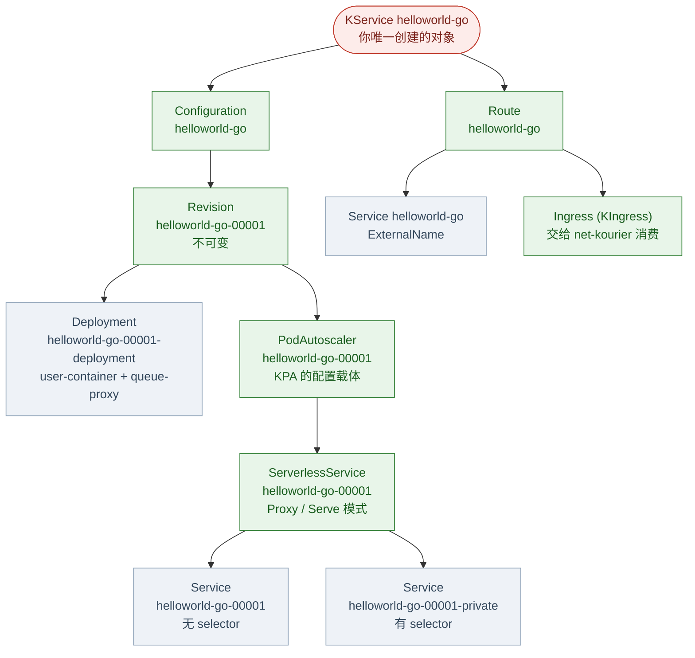
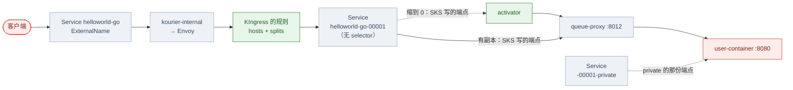

# Knative 对象模型:一个 KService 派生出什么

> 实操环境:kind 上的 Knative Serving v1.23.0 + net-kourier
> **本文所有对象名、ownerReferences 和配置都是从运行中的集群里读出来的**,不是照文档抄的。
>
> 承接 [Kourier 篇](Kourier.md)。那篇讲怎么装、怎么观测 scale-to-zero;
> 这篇拆开看"**我创建了一个 KService 之后,集群里到底多了什么**"。
> 想把现有 Deployment 改成 KService 的,看 [迁移篇](从Deployment迁移到KService.md)。

## 一、全景图

红色是你写的,绿色是 Knative 控制面对象,蓝色是它生成的原生 K8s 对象:



> 这张图是**一个 Revision** 的画法。`Configuration → Revision` 那条边其实是 **1:N** ——
> 改一次配置就多长出完整的一棵,基数见第五节。

## 二、谁创建谁(ownerReferences 实测)

```console
$ for o in ksvc/helloworld-go configuration/helloworld-go revision/helloworld-go-00001 \
           route/helloworld-go serverlessservice/helloworld-go-00001 podautoscaler/helloworld-go-00001 \
           ingress/helloworld-go deploy/helloworld-go-00001-deployment \
           svc/helloworld-go-00001 svc/helloworld-go-00001-private svc/helloworld-go; do
    printf '%-46s ← %s\n' "$o" "$(kubectl get $o -n demo -o jsonpath='{range .metadata.ownerReferences[*]}{.kind}/{.name} {end}')"
  done
```

| 对象 | 归属 |
|---|---|
| KService `helloworld-go` | **你**(没有 owner) |
| Configuration `helloworld-go` | KService |
| Route `helloworld-go` | KService |
| Revision `helloworld-go-00001` | Configuration |
| Deployment `helloworld-go-00001-deployment` | Revision |
| PodAutoscaler `helloworld-go-00001` | Revision |
| **ServerlessService** `helloworld-go-00001` | **PodAutoscaler** ← 见第七节 |
| Service `helloworld-go-00001` | ServerlessService |
| Service `helloworld-go-00001-private` | ServerlessService |
| Service `helloworld-go` | Route |
| Ingress(KIngress)`helloworld-go` | Route |

**除了 KService,全是 ownerReference 挂出来的。** 所以你删掉 KService,这 10 个对象会被 GC 一起收走——这也是迁移时"删旧对象"能立刻生效的原因。

> 注意 KIngress 的 `ownerReferences` 用 `kubectl get ingress` 查不到——那会命中**原生**
> `ingresses.networking.k8s.io`。要写全名 `ingresses.networking.internal.knative.dev`。

## 三、你只写了 12 行,集群里多出 10 个对象

```yaml
apiVersion: serving.knative.dev/v1
kind: Service
metadata:
  name: helloworld-go
  namespace: demo
spec:
  template:
    metadata:
      annotations:
        autoscaling.knative.dev/window: "20s"
    spec:
      containers:
        - image: ghcr.io/knative/helloworld-go:latest
          env:
            - name: TARGET
              value: "Knative on kind"
```

```console
$ kubectl get ksvc,configuration,revision,route,serverlessservice,podautoscaler \
    ingresses.networking.internal.knative.dev,deploy,svc -n demo
NAME                                     URL                                           LATESTCREATED         LATESTREADY           READY
service.serving.knative.dev/helloworld-go  http://helloworld-go.demo.svc.cluster.local  helloworld-go-00001  helloworld-go-00001   True

NAME                                    LATESTCREATED         LATESTREADY           READY
configuration.serving.knative.dev/helloworld-go  helloworld-go-00001  helloworld-go-00001  True

NAME                                    CONFIG NAME     GENERATION   READY   ACTUAL REPLICAS   DESIRED REPLICAS
revision.serving.knative.dev/helloworld-go-00001  helloworld-go  1   True    1                 1

NAME                        URL                                           READY
route.serving.knative.dev/helloworld-go  http://helloworld-go.demo.svc.cluster.local  True

NAME                                                       MODE    ACTIVATORS   SERVICENAME           PRIVATESERVICENAME            READY
serverlessservice.networking.internal.knative.dev/helloworld-go-00001  Proxy  4  helloworld-go-00001  helloworld-go-00001-private  True

NAME                                                              DESIREDSCALE   ACTUALSCALE   READY
podautoscaler.autoscaling.internal.knative.dev/helloworld-go-00001  1             1             True

NAME                                    READY
deployment.apps/helloworld-go-00001-deployment  1/1

NAME                        TYPE           CLUSTER-IP      EXTERNAL-IP
service/helloworld-go       ExternalName   <none>          kourier-internal.kourier-system.svc.cluster.local
service/helloworld-go-00001 ClusterIP      10.96.162.162   <none>
service/helloworld-go-00001-private ClusterIP  10.96.58.63  <none>
```

## 四、逐个看真实配置

### 4.1 Configuration 和 Revision

`Configuration` 是"模板 + 最新版本指针",几乎没有任何配置——它只记两件事:

```console
$ kubectl get configuration helloworld-go -n demo -o jsonpath='{.status.latestCreatedRevisionName}{" / "}{.status.latestReadyRevisionName}'
helloworld-go-00001 / helloworld-go-00001
```

真正定义"这一版是什么"的是 **Revision,而且它不可变**:

```console
$ kubectl get revision helloworld-go-00001 -n demo -o json \
    | jq '{image: .spec.containers[0].image, timeout: .spec.timeoutSeconds, concurrency: .spec.containerConcurrency}'
{
  "image": "ghcr.io/knative/helloworld-go:latest",
  "timeout": 300,
  "concurrency": 0
}
```

`timeout` 是单请求超时(秒,默认 300);`concurrency` 为 `0` 表示**不限**,
也就是这个 Revision 想接多少并发就接多少(要不要限,见 4.3)。

**改 KService 不会改这个 Revision**,而是生成 `helloworld-go-00002`——这就是 Knative 能做
灰度/回滚的机制基础(`Route` 可以把流量按百分比分给多个 Revision)。

### 4.2 Deployment:queue-proxy 是怎么被塞进来的

这是整套机制里最值得看的一个对象——**你的容器被原样搬进 Deployment,同时多了一个 sidecar**:

```console
$ kubectl get deploy helloworld-go-00001-deployment -n demo \
    -o jsonpath='{range .spec.template.spec.containers[*]}── {.name}
     image={.image}
     ports={.ports}
     resources={.resources}
{end}'
── user-container
     image=ghcr.io/knative/helloworld-go@sha256:a97656c57f547d668318eb45c4c44c4cb0667892c055b40355b37859918c5c18
     ports=[{"containerPort":8080,"name":"user-port","protocol":"TCP"}]
     resources={}
── queue-proxy
     image=gcr.io/knative-releases/knative.dev/serving/cmd/queue@sha256:a3cc71ce80dbc6df8781f15eac2cf3531a4c9815271799afd8776bef9e6aeaf2
     ports=[{"containerPort":9090,"name":"http-autometric"},{"containerPort":9091,"name":"http-usermetric"},{"containerPort":8012,"name":"queue-port"},{"containerPort":8112,"name":"https-port"}]
     resources={"requests":{"cpu":"25m"}}
```

三个要点:

- **镜像被换成了 digest**。你写 `:latest`,Revision 里记的是你写的那个 tag,
  但 Deployment 里落地的是控制器解析出来的 `@sha256:...`——**同一个 tag 重新推送不会
  影响已发布的 Revision**,这是"不可变"在底层怎么实现的。
- **user-container 上没有 readinessProbe**。就绪探针在 **queue-proxy** 上,它用一个专用
  请求头探自己的 8012 端口:
  `httpGet: {path: /, port: 8012, httpHeaders: [{name: K-Network-Probe, value: queue}]}`
  所以你在 KService 里写 `readinessProbe` 是**无效的**(见 [迁移篇](从Deployment迁移到KService.md))。
- **queue-proxy 有 25m CPU 的 request,你的容器没有**。你写的 `resources` 原样透传,
  没写就是空——上面这个例子里什么都没写,所以 `resources={}`。

#### queue-proxy 到底干什么

它的职责基本都写在它自己的环境变量里:

```console
$ kubectl get pod <revision-pod> -n demo -o json \
    | jq -r '.spec.containers[] | select(.name=="queue-proxy") | .env[] \
             | select(.name|test("USER_PORT|CONCURRENCY|READINESS_PROBE")) | "\(.name)=\(.value)"'
USER_PORT=8080
CONTAINER_CONCURRENCY=0
SERVING_READINESS_PROBE={"tcpSocket":{"port":8080,"host":"127.0.0.1"},"successThreshold":1}
```

- **它是流量的入口。** K8s Service 的 `targetPort` 是 **8012**,而 queue-proxy 启动时会自己打一行
  `Starting http server main:8012`。请求打到它,再由它转发给 `USER_PORT=8080` 的用户容器 ——
  用户容器从头到尾没被直接访问过。上面那个 `SERVING_READINESS_PROBE` 就是被从用户容器上摘下来的
  探针(见本节第一个要点),queue-proxy 拿着这个 spec 去探 `127.0.0.1:8080`。
- **它是指标的来源。** `:9090`(`http-autometric`)/ `:9091`(`http-usermetric`)把并发数报给
  autoscaler,所以 Knative **不需要 metrics-server**(对比 [迁移篇](从Deployment迁移到KService.md) 3.1)。
- **它按 `CONTAINER_CONCURRENCY` 做排队和背压** —— 这就是 "queue" proxy 这个名字的来历。

#### 它是怎么进去的:不是 webhook

容易以为是 sidecar 注入那种玩法,其实不是。集群里唯一的 mutating webhook
(`webhook.serving.knative.dev`)只拦 `metrics` 资源,不碰 pod —— **queue-proxy 是 Revision
控制器在生成 Deployment 时加上的**:

```console
$ kubectl get revision helloworld-go-00002 -n demo -o jsonpath='{.spec.containers[*].name}'
user-container                         ← Revision 里只有你的容器
$ kubectl get deploy helloworld-go-00002-deployment -n demo -o jsonpath='{.spec.template.spec.containers[*].name}'
user-container queue-proxy             ← Deployment 里多了一个
```

这个区别有实际意义:**它不会和网格的 sidecar 注入打架**(人家在 pod 层改,它在更早的
"生成 Deployment"那步就已经写好了)。

#### 去不掉,但可以调

没有任何开关能移除它。能调的只有 `config-deployment` 里这几个键(默认值在示例块里写着):

```console
$ kubectl get configmap config-deployment -n knative-serving -o jsonpath='{.data}'
{"queue-sidecar-image": "gcr.io/knative-releases/knative.dev/serving/cmd/queue@sha256:a3cc71ce…", …}
```

| 键 | 默认 | 说明 |
|---|---|---|
| `queue-sidecar-image` | 上面那个 digest | **唯一实际写在 `data` 里的**,其余都是文档化的默认值 |
| `queue-sidecar-cpu-request` | `25m` | |
| `queue-sidecar-cpu-limit` | `1000m` | |
| `queue-sidecar-memory-request` | `400Mi` | |
| `queue-sidecar-memory-limit` | `800Mi` | |
| `queue-sidecar-ephemeral-storage-request` | `512Mi` | |
| `queue-sidecar-ephemeral-storage-limit` | `1024Mi` | |

要改就得自己往 ConfigMap 的 `data` 里加键。这也解释了每个 revision pod 为什么都白交
25m CPU 的 request —— 它是内置默认,不写在 ConfigMap 里。

### 4.3 PodAutoscaler:自动伸缩的真正载体

它自己的 spec 很小,真正的内容在**注解**上——你在 KService 里写的伸缩配置都落在这里:

```console
$ kubectl get pa helloworld-go-00001 -n demo -o jsonpath='{.spec}'
{"protocolType":"http1","reachability":"Reachable","scaleTargetRef":{"apiVersion":"apps/v1","kind":"Deployment","name":"helloworld-go-00001-deployment"}}

$ kubectl get pa helloworld-go-00001 -n demo -o json \
    | jq -r '.metadata.annotations | to_entries[]
             | select(.key|startswith("autoscaling")) | "\(.key) = \(.value)"'
autoscaling.knative.dev/class = kpa.autoscaling.knative.dev
autoscaling.knative.dev/metric = concurrency
autoscaling.knative.dev/window = 20s
```

**`metric=concurrency` 是迁移时最需要留意的差异**:传统 HPA 大多按 CPU 扩缩,
KPA 默认按**并发请求数**。`containerConcurrency` 那个 `0` 的含义就是"不限"。

### 4.4 ServerlessService 和它的两个 Service

SKS 是"要不要把 activator 插进数据路径"的决策载体,`MODE` 只有 `Proxy` / `Serve` 两种:

```console
$ kubectl get sks helloworld-go-00001 -n demo -o jsonpath='{.spec}'
{"mode":"Proxy","numActivators":4,"objectRef":{"apiVersion":"apps/v1","kind":"Deployment","name":"helloworld-go-00001-deployment"},"protocolType":"http1"}
```

它管着**两个** Service,差别就在 selector:

```console
$ kubectl get svc helloworld-go-00001 -n demo -o jsonpath='  selector={.spec.selector}{"\n"}  ports={range .spec.ports[*]}{.name}:{.port}->{.targetPort} {end}'
  selector=                                          ← 没有 selector
  ports=http:80->8012 https:443->8112
$ kubectl get svc helloworld-go-00001-private -n demo -o jsonpath='  selector={.spec.selector}{"\n"}'
  selector={"serving.knative.dev/revisionUID":"e44bee2d-22bc-4a13-b27e-60e3861d6eda"}
```

- `-private` 有 selector,直指 revision 的 pod(端口 8012 是 queue-proxy 的 queue-port)。
- `helloworld-go-00001`(不带 private)**没有 selector**——它的 EndpointSlice 由 SKS 写:
  revision 缩到 0 时指向 activator,有副本时指向 pod。这就是 [Kourier 篇 7.2 节](Kourier.md)
  里观察到的那个"切换"。

### 4.5 Route、ExternalName Service 和 KIngress

```console
$ kubectl get route helloworld-go -n demo -o jsonpath='{.spec.traffic}{"\n"}{.status.url}{"\n"}'
[{"configurationName":"helloworld-go","latestRevision":true,"percent":100}]
http://helloworld-go.demo.svc.cluster.local

$ kubectl get svc helloworld-go -n demo -o jsonpath='{.spec.type} → {.spec.externalName}'
ExternalName → kourier-internal.kourier-system.svc.cluster.local
```

Route 做两件事:**决定流量给哪个 Revision**(这里是"永远给最新的"),以及**暴露一个入口**。
它创建的 `helloworld-go` Service 只是个 CNAME,真正的路由在 KIngress 里:

```console
$ kubectl get ingresses.networking.internal.knative.dev helloworld-go -n demo -o jsonpath='{.spec.rules[0].hosts}{"\n"}{.spec.rules[0].http.paths[0].splits[0].serviceName}{"\n"}'
["helloworld-go.demo","helloworld-go.demo.svc","helloworld-go.demo.svc.cluster.local"]
helloworld-go-00001
```

**`splits.serviceName` 指向的是 4.4 里那个不带 selector 的 K8s Service**——链条到这里闭合了。
KIngress 是 Knative 定义的抽象(`networking.internal.knative.dev/v1alpha1`),
由 net-kourier 消费并翻译成它自己的 Envoy 配置。换网络层(比如 net-gateway-api),
变的是这个消费者,上面这一整棵树都不变。

### 4.6 这些 Service 的字段是谁定的:跟你的配置无关

一个容易困惑的点:你在 KService 里**根本没写任何 Service 配置**,那几个 Service 是怎么配出来的?
答案是分三类,而且**端口完全不由你决定**:

| 字段 | 来源 |
|---|---|
| `name` / `namespace` | 对象身份:入口那个 = KService 名,另外两个 = Revision 名 |
| `type` | **控制器里写死的**:入口 = `ExternalName`,SKS 那两个 = `ClusterIP` |
| `ports` | **控制器里写死的常量**:`80→8012`、`443→8112`,private 那个多 `9090`/`9091` 给 autoscaler 抓 |
| `selector` | 公开那个**故意没有**(端点由 SKS 写);private 那个 = `serving.knative.dev/revisionUID` |
| `externalName` | 网络层决定:Kourier 下是 `kourier-internal…`,[Istio 篇](Istio-GatewayAPI与Ambient.md) 里是 `knative-local-gateway…` |
| `labels` / `annotations` | 对象自身的身份标签 + 你写在 template 上的那些(见第八节) |

**那你的容器端口去哪了?** 它只告诉 queue-proxy 往哪转发,在 Service 上**看不到**。
实测把容器端口改成 `9000`,生成的 Service 仍然指向 `8012`/`8112`:

```console
$ # 容器 ports 里写的是 9000
$ kubectl get svc t-port-00001 -n migrate -o jsonpath='{range .spec.ports[*]}{.name}:{.port}->{.targetPort} {end}'
http:80->8012 https:443->8112                    ← 没跟着变

$ kubectl get deploy t-port-00001-deployment -n migrate -o json \
    | jq -r '.spec.template.spec.containers[]|select(.name=="queue-proxy")|.env[]|select(.name|test("PORT"))|"\(.name)=\(.value)"'
QUEUE_SERVING_PORT=8012                          ← 它自己的端口,常量
USER_PORT=9000                                   ← 你的端口,只用来决定转发目标
```

换一个 KService 看,端口一模一样(`hello` 的也是 `http:80->8012 https:443->8112`)——它们是**代码里的
常量**:翻过 `config-network` / `config-deployment` / `config-autoscaler`,没有任何端口相关的键。

**为什么会这样**:那三个 Service 不是"你的服务的 Service",而是 **Knative 自己组件之间的契约**
(网关 ↔ activator ↔ queue-proxy)。你和 queue-proxy 之间是"同一个 pod 里走 localhost"的私事,
所以你的端口不会出现在任何 Service 上 —— 这也是[迁移篇](从Deployment迁移到KService.md)里
"自定义 Service 形状"走不通的根因。

## 五、基数与 Revision

第二节那张图是"一个 Revision"的画法。把基数写全:

| 关系 | 基数 | 说明 |
|---|---|---|
| KService → Configuration | **1:1** | KService 只拥有一个 Configuration |
| KService → Route | **1:1** | |
| **Configuration → Revision** | **1:N** | ← 唯一会长出多份的那条边 |
| Revision → Deployment | 1:1 | |
| Revision → PodAutoscaler | 1:1 | |
| PodAutoscaler → ServerlessService | 1:1 | |
| ServerlessService → Service | **1:2** | 公开的 + `-private` 的 |
| Route → Service(ExternalName) | 1:1 | |
| Route → KIngress | 1:1 | |

所以准确的讲法不是"**每个 KService 一棵树**",而是"**每个 Revision 一棵树**"。
`spec.template` 改一次就多长出完整的一棵,而且**旧的那棵不会被删掉**——这正是回滚能秒回的原因。

### 实测:改一个字段,长出第二棵树

```console
$ # 只把 TARGET 的值改掉
$ kubectl apply -f helloworld-go.yaml
service.serving.knative.dev/helloworld-go configured

$ kubectl get revision -n demo
NAME                  CONFIG NAME     GENERATION   READY   ACTUAL REPLICAS
helloworld-go-00001   helloworld-go   1            True    0
helloworld-go-00002   helloworld-go   2            True    1        ← 新的

$ kubectl get configuration helloworld-go -n demo -o jsonpath='{.status.latestCreatedRevisionName}'
helloworld-go-00002

$ kubectl get deploy,pa,sks,svc -n demo
deployment.apps/helloworld-go-00001-deployment                  0/0
deployment.apps/helloworld-go-00002-deployment                  1/1
podautoscaler.autoscaling.internal.knative.dev/helloworld-go-00001   0
podautoscaler.autoscaling.internal.knative.dev/helloworld-go-00002   1
serverlessservice.networking.internal.knative.dev/helloworld-go-00001  Proxy
serverlessservice.networking.internal.knative.dev/helloworld-go-00002  Proxy
service/helloworld-go                                           ExternalName
service/helloworld-go-00001         /  -00001-private            ClusterIP
service/helloworld-go-00002         /  -00002-private            ClusterIP
```

**两套 Deployment / PodAutoscaler / ServerlessService / Service 并存。** 旧的那套一直留着
(`-00001` 缩到 0 副本,但对象都在)——所以任何一次改动都不会把上一版弄丢。

### Route 是唯一会"分叉"的那条边

`Route` 能把流量按百分比分给多个 Revision,这就是 1:N 在数据面上的体现:

```console
$ kubectl patch ksvc helloworld-go -n demo --type merge -p '{"spec":{"traffic":[
    {"revisionName":"helloworld-go-00001","percent":50},
    {"revisionName":"helloworld-go-00002","percent":50}]}}'

$ kubectl get route helloworld-go -n demo -o json | jq -c '{spec: .spec.traffic, status: .status.traffic}'
{"spec":[{"latestRevision":false,"percent":50,"revisionName":"helloworld-go-00001"},
         {"latestRevision":false,"percent":50,"revisionName":"helloworld-go-00002"}],
 "status":[{"latestRevision":false,"percent":50,"revisionName":"helloworld-go-00001"},
           {"latestRevision":false,"percent":50,"revisionName":"helloworld-go-00002"}]}

$ kubectl get ingresses.networking.internal.knative.dev helloworld-go -n demo -o json \
    | jq -c '.spec.rules[0].http.paths[0].splits[] | {percent, serviceName, revision: .appendHeaders["Knative-Serving-Revision"]}'
{"percent":50,"serviceName":"helloworld-go-00001","revision":"helloworld-go-00001"}
{"percent":50,"serviceName":"helloworld-go-00002","revision":"helloworld-go-00002"}
```

原本只有一条 split 的 KIngress 现在有**两条**,各指向对应 Revision 的那个 Service,
并各自带上自己的 `Knative-Serving-Revision` 头。

功能上直接看得见——连打 8 次,两个版本的 TARGET 都出现了:

```console
$ for i in $(seq 1 8); do
    kubectl exec -n demo http-client -- curl -s http://helloworld-go.demo.svc.cluster.local
  done
Hello Knative on kind!
Hello 第二版!
Hello Knative on kind!
Hello 第二版!
Hello 第二版!
Hello 第二版!
Hello 第二版!
Hello 第二版!
```

> 分流是**按请求概率**的,不是严格轮流——小样本下比例会有偏差(上面 8 次是 2:6),
> 样本大了才收敛到 50:50。灰度和 A/B 测试就是靠它做的。

改回"全部给最新"只要把 `spec.traffic` 清掉:

```sh
kubectl patch ksvc helloworld-go -n demo --type merge -p '{"spec":{"traffic":null}}'
```

### Revision 到底是什么

一个 Revision 是**"你的服务某一个版本"的不可变快照**。它的 `spec` 只记这些:

```console
$ kubectl get revision helloworld-go-00002 -n demo -o json | jq -S '.spec'
{
  "annotations": null,
  "containerConcurrency": 0,
  "timeoutSeconds": 300,
  "containers": [ { "image": "ghcr.io/knative/helloworld-go:latest", "env": [ … ], "resources": {} } ]
}
```

它承担四个角色:

1. **它才是真正的部署单元。** "每 Revision 一棵树"就是这个意思——你看到的 Deployment /
   PodAutoscaler / ServerlessService / 两个 Service 全是它的子对象。所谓"部署一次",
   在 Knative 里就是"创建一个 Revision"。
2. **回滚和灰度的锚点。** 不可变 + 对象保留,所以把流量切回去是瞬间的事;
   `Route` 就是按 Revision 名字指过去的。
3. **扩缩容的边界。** 每个 Revision 有自己的 PodAutoscaler,"缩到 0"也是以 Revision 为单位的。
4. **可以被直接寻址。** 给 `spec.traffic` 里某项加 `tag`,就得到一条专用 URL:

   ```console
   $ kubectl patch ksvc myapp -n migrate --type merge \
       -p '{"spec":{"traffic":[{"latestRevision":true,"percent":100,"tag":"stable"}]}}'
   $ kubectl get route myapp -n migrate -o jsonpath='{.status.traffic}'
   [{"latestRevision":true,"percent":100,"revisionName":"myapp-00003","tag":"stable",
     "url":"http://stable-myapp.migrate.svc.cluster.local"}]
   ```

   这就是"stable / latest 两个地址"那套玩法的底层。

### 什么改动会新建 Revision

规则很简单:**`spec.template` 里的东西改了,就新建一个;`spec.template` 之外的不新建。**
连着改三次的实测:

| 改的东西 | 新 Revision? | 实测 |
|---|---|---|
| `spec.template.spec.containers`(镜像 / env / resources …) | ✅ | `-00001` → `-00002` |
| `spec.template.metadata.annotations`——**包括所有 `autoscaling.knative.dev/*`** | ✅ | 改 `window` → `-00002`;改 `min-scale` → `-00003` |
| `spec.template.metadata.labels` | ✅ | 同理,属于 template |
| `spec.traffic`(流量切分 / tag) | ❌ | 2 个 → 还是 2 个 |

**第二行最容易踩**:改一个伸缩参数(`min-scale` / `window` / `target`…)也会产生新 Revision。
这不是 bug——那些注解本来就会被复制到 Revision 上(所以每个 Revision 记得住自己当初的伸缩策略),
但意味着"只是想把副本数调一下"也会让版本号往前走一格。

### 具体两个 Revision 差在哪:直接 diff

```console
$ diff <(kubectl get revision helloworld-go-00001 -n demo -o json | jq -S .spec) \
       <(kubectl get revision helloworld-go-00002 -n demo -o json | jq -S .spec)
8c8
<           "value": "Knative on kind"
---
>           "value": "第二版"
```

**只有这一行。** 两个 Revision 之间可以有任意大的差异,也可以只差一个环境变量——
它们就是"两个版本",没有别的含义。

## 六、这些对象怎么串成一条请求路径



一句话:**Route 决定"给谁",SKS 决定"经不经过 activator",queue-proxy 决定"能不能进来"。**

## 七、三个反直觉的点

1. **ServerlessService 归 PodAutoscaler 管,不归 Revision。** 一开始容易以为是 Revision 的子对象。
   想想也合理:activator 要不要插进数据路径,本质是**自动伸缩的决策**(能不能缩到 0、
   当前是不是 0 副本),所以它挂在意 autoscaler 下面。
2. **Revision 不可变。** 任何 `spec.template` 的改动都会生成一个新 Revision;旧的一直在,
   直到你删掉或它被 GC。这是灰度和回滚的基础,也意味着**反复改 KService 会攒下一堆 Revision**。
3. **KService 的名字会占用同名的 K8s Service。** Route 要创建一个 `<名字>` 的 Service 作入口,
   所以如果你的命名空间里**已经有一个同名 Service,迁移会失败**——实测报错是
   `NotOwned: There is an existing placeholder Service "..." that we do not own`。
   详见 [迁移篇](从Deployment迁移到KService.md)。

## 八、label / annotation 会传到哪一层

两处 metadata 的传播路径**完全不同** —— 这是迁移时最容易搞错的地方:

| 你写在哪 | 传到 | 到不了 |
|---|---|---|
| **KService 自身的 `metadata.labels` / `annotations`** | Configuration、Route | Revision / Deployment / Pod —— **到不了** |
| **`spec.template.metadata` 的 labels / annotations** | Revision、Deployment(自身 + pod 模板)、**Pod**、两个 Service 的 metadata | Configuration / Route |

实测:在 KService 自身放 `team=platform` / `owner=alice`,在 template 上放 `app=myapp` /
`cost-center=eng-42` / `owner=bob` / `myco.io/note=hello`:

```console
$ kubectl get configuration myapp -n migrate -o json | jq -c '{labels:.metadata.labels, annotations:.metadata.annotations}'
{"labels":{"serving.knative.dev/service":"myapp","team":"platform"},"annotations":{"owner":"alice"}}
                ↑ 只有 KService 自身那两个

$ kubectl get revision myapp-00004 -n migrate -o json | jq -c '{labels:.metadata.labels, annotations:.metadata.annotations}'
{"labels":{"app":"myapp","cost-center":"eng-42","serving.knative.dev/configuration":"myapp",…},
 "annotations":{"myco.io/note":"hello","owner":"bob"}}
                ↑ 只有 template 上的那两个,反过来没有

$ kubectl get pod myapp-00004-deployment-… -n migrate -o json \
    | jq -c '{labels:(.metadata.labels|with_entries(select(.key|test("^(app|cost-center)$")))),
              annotations:(.metadata.annotations|with_entries(select(.key|test("owner|myco"))))}'
{"labels":{"app":"myapp","cost-center":"eng-42"},"annotations":{"myco.io/note":"hello","owner":"bob"}}
```

**结论:想让标记跟着 Pod 走,就必须放在 `spec.template.metadata` 里。** 放在 KService 自身的
metadata 上只会停在 Configuration / Route —— 这也解释了为什么从 Deployment 迁过来时,
`app`、`prometheus.io/scrape` 这类标记如果照原样贴到 KService 的 metadata 上会"消失"。

两个附带结论:

- **不会污染 selector。** `-00004-private` 那个 Service 的 `selector` 始终只是
  `serving.knative.dev/revisionUID=<uid>`;你加的 label 只进它的 `metadata.labels`。
- **`sidecar.istio.io/inject: "true"` 是透传的**(实测落在了 Deployment 的 pod 模板上)——
  可以用 template 注解给**单个 revision** 单独开 sidecar 注入。
  另外 Knative 会自己加一个 `kubectl.kubernetes.io/default-container: user-container`,
  所以 `kubectl exec` / `kubectl logs` 默认落在**你的**容器上,而不是 queue-proxy。

### 保留前缀:我采样到的只有 `networking.knative.dev/` 被拦

Knative 会校验 **template 上的注解 key**:

```console
$ # 都放在 spec.template.metadata.annotations 里
serving.knative.dev/foo                ✅ 接受
networking.knative.dev/foo             ❌ validation failed: invalid key name "networking.knative.dev/foo"
networking.internal.knative.dev/foo    ✅ 接受
autoscaling.knative.dev/foo            ✅ 接受
autoscaling.internal.knative.dev/foo   ✅ 接受
caching.internal.knative.dev/foo       ✅ 接受
```

同一个 key 放在 **KService 自身**的 metadata 上是**接受**的 —— 这个校验只作用于 template。
(上面只是我采样的几个,不是完整的前缀黑名单。)

## 相关

- [Kourier 篇](Kourier.md) —— 怎么装、怎么观测 scale-to-zero,以及本机 kind 的环境坑
- [从 Deployment(+HPA) 迁移到 Knative Service](从Deployment迁移到KService.md) —— 拿现有应用动手
- [Istio 篇](Istio-GatewayAPI与Ambient.md) —— 换掉网络层与数据面之后,这棵树里哪些变了、哪些没变
