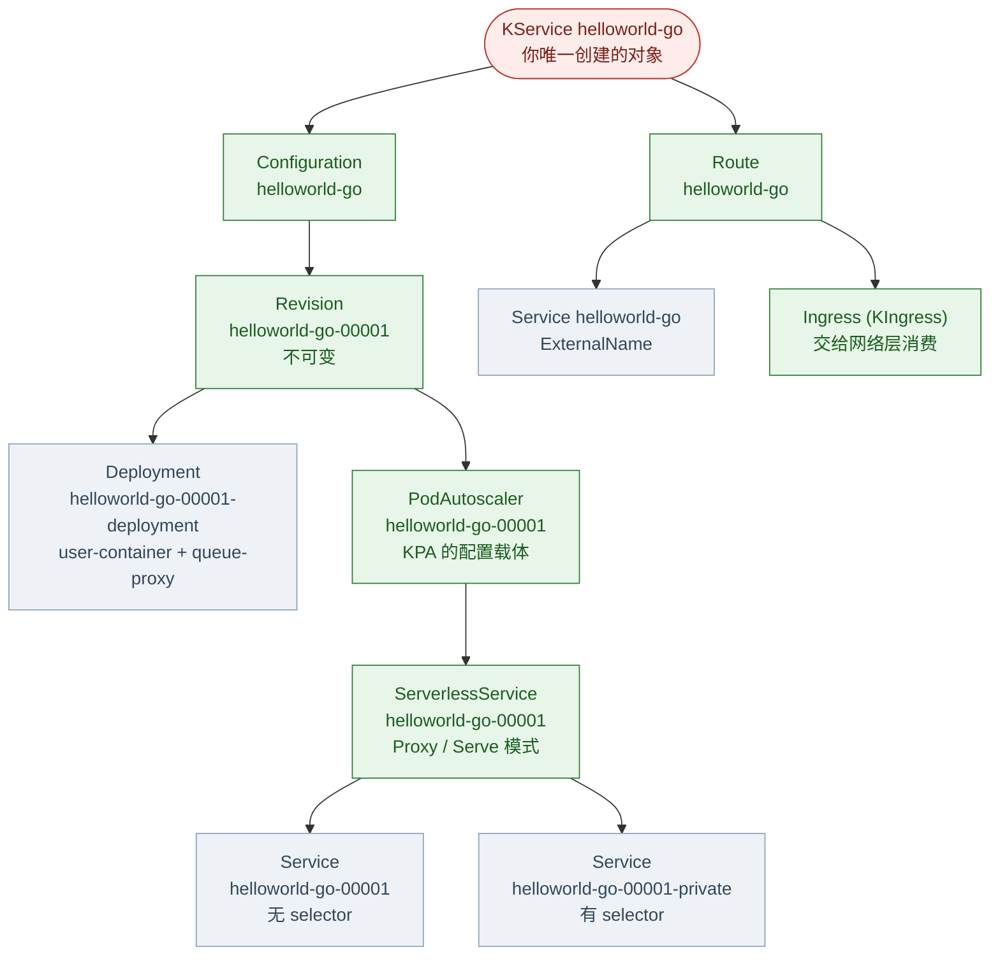
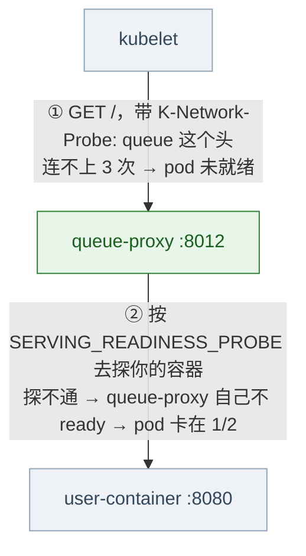
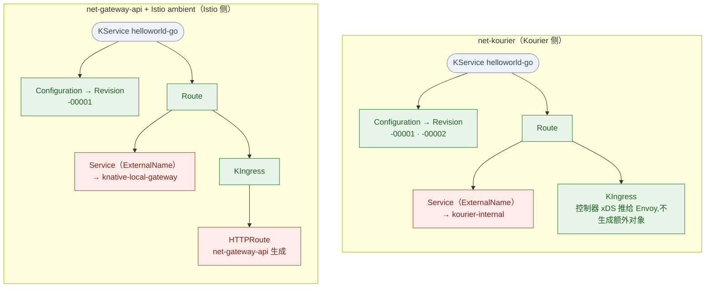
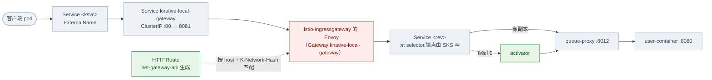

# Knative 对象模型:一个 KService 派生出什么

> 实操环境:kind 上的 Knative Serving v1.23.0 + net-kourier
> **本文所有对象名、ownerReferences 和配置都是从运行中的集群里读出来的**,不是照文档抄的。
>
> 承接 [Kourier 篇](Kourier.md)。那篇讲怎么装、怎么观测 scale-to-zero;
> 这篇拆开看"**我创建了一个 KService 之后,集群里到底多了什么**"。
> 想把现有 Deployment 改成 KService 的,看 [迁移篇](从Deployment迁移到KService.md)。

## 一、全景图

红色是你写的,绿色是 Knative 控制面对象,蓝色是它生成的原生 K8s 对象:



> 这张图是**一个 Revision** 的画法。`Configuration → Revision` 那条边其实是 **1:N** ——
> 改一次配置就多长出完整的一棵,基数见第五节。
>
> 另外,**这张图的形状跟网络层选型无关** —— 换 net-kourier 还是 net-gateway-api(+ Istio
> ambient),10 个对象、10 条边都长这样。只有两处带网络层信息:上面 `Ingress` 那个节点
> **由谁消费**(以及它会不会再派生出 HTTPRoute)、以及入口 Service **指向哪个网关**。
> 逐项对照见第十节。

## 二、谁创建谁(ownerReferences 实测)

```console
$ for o in ksvc/helloworld-go configuration/helloworld-go revision/helloworld-go-00001 \
           route/helloworld-go serverlessservice/helloworld-go-00001 podautoscaler/helloworld-go-00001 \
           ingress/helloworld-go deploy/helloworld-go-00001-deployment \
           svc/helloworld-go-00001 svc/helloworld-go-00001-private svc/helloworld-go; do
    printf '%-46s ← %s\n' "$o" "$(kubectl get $o -n demo -o jsonpath='{range .metadata.ownerReferences[*]}{.kind}/{.name} {end}')"
  done
```

| 对象 | 归属 |
|---|---|
| KService `helloworld-go` | **你**(没有 owner) |
| Configuration `helloworld-go` | KService |
| Route `helloworld-go` | KService |
| Revision `helloworld-go-00001` | Configuration |
| Deployment `helloworld-go-00001-deployment` | Revision |
| PodAutoscaler `helloworld-go-00001` | Revision |
| **ServerlessService** `helloworld-go-00001` | **PodAutoscaler** ← 见第七节 |
| Service `helloworld-go-00001` | ServerlessService |
| Service `helloworld-go-00001-private` | ServerlessService |
| Service `helloworld-go` | Route |
| Ingress(KIngress)`helloworld-go` | Route |

**除了 KService,全是 ownerReference 挂出来的。** 所以你删掉 KService,这 10 个对象会被 GC 一起收走——这也是迁移时"删旧对象"能立刻生效的原因。

> 注意 KIngress 的 `ownerReferences` 用 `kubectl get ingress` 查不到——那会命中**原生**
> `ingresses.networking.k8s.io`。要写全名 `ingresses.networking.internal.knative.dev`。

## 三、你只写了 12 行,集群里多出 10 个对象

```yaml
apiVersion: serving.knative.dev/v1
kind: Service
metadata:
  name: helloworld-go
  namespace: demo
spec:
  template:
    metadata:
      annotations:
        autoscaling.knative.dev/window: "20s"
    spec:
      containers:
        - image: ghcr.io/knative/helloworld-go:latest
          env:
            - name: TARGET
              value: "Knative on kind"
```

```console
$ kubectl get ksvc,configuration,revision,route,serverlessservice,podautoscaler \
    ingresses.networking.internal.knative.dev,deploy,svc -n demo
NAME                                     URL                                           LATESTCREATED         LATESTREADY           READY
service.serving.knative.dev/helloworld-go  http://helloworld-go.demo.svc.cluster.local  helloworld-go-00001  helloworld-go-00001   True

NAME                                    LATESTCREATED         LATESTREADY           READY
configuration.serving.knative.dev/helloworld-go  helloworld-go-00001  helloworld-go-00001  True

NAME                                    CONFIG NAME     GENERATION   READY   ACTUAL REPLICAS   DESIRED REPLICAS
revision.serving.knative.dev/helloworld-go-00001  helloworld-go  1   True    1                 1

NAME                        URL                                           READY
route.serving.knative.dev/helloworld-go  http://helloworld-go.demo.svc.cluster.local  True

NAME                                                       MODE    ACTIVATORS   SERVICENAME           PRIVATESERVICENAME            READY
serverlessservice.networking.internal.knative.dev/helloworld-go-00001  Proxy  4  helloworld-go-00001  helloworld-go-00001-private  True

NAME                                                              DESIREDSCALE   ACTUALSCALE   READY
podautoscaler.autoscaling.internal.knative.dev/helloworld-go-00001  1             1             True

NAME                                    READY
deployment.apps/helloworld-go-00001-deployment  1/1

NAME                        TYPE           CLUSTER-IP      EXTERNAL-IP
service/helloworld-go       ExternalName   <none>          kourier-internal.kourier-system.svc.cluster.local
service/helloworld-go-00001 ClusterIP      10.96.162.162   <none>
service/helloworld-go-00001-private ClusterIP  10.96.58.63  <none>
```

## 四、逐个看真实配置

### 4.1 Configuration 和 Revision

`Configuration` 是"模板 + 最新版本指针",几乎没有任何配置——它只记两件事:

```console
$ kubectl get configuration helloworld-go -n demo -o jsonpath='{.status.latestCreatedRevisionName}{" / "}{.status.latestReadyRevisionName}'
helloworld-go-00001 / helloworld-go-00001
```

真正定义"这一版是什么"的是 **Revision,而且它不可变**:

```console
$ kubectl get revision helloworld-go-00001 -n demo -o json \
    | jq '{image: .spec.containers[0].image, timeout: .spec.timeoutSeconds, concurrency: .spec.containerConcurrency}'
{
  "image": "ghcr.io/knative/helloworld-go:latest",
  "timeout": 300,
  "concurrency": 0
}
```

`timeout` 是单请求超时(秒,默认 300);`concurrency` 为 `0` 表示**不限**,
也就是这个 Revision 想接多少并发就接多少(要不要限,见 4.3)。

**改 KService 不会改这个 Revision**,而是生成 `helloworld-go-00002`——这就是 Knative 能做
灰度/回滚的机制基础(`Route` 可以把流量按百分比分给多个 Revision)。

### 4.2 Deployment:queue-proxy 是怎么被塞进来的

这是整套机制里最值得看的一个对象——**你的容器被原样搬进 Deployment,同时多了一个 sidecar**:

```console
$ kubectl get deploy helloworld-go-00001-deployment -n demo -o json \
    | jq '.spec.template.spec.containers[] | {name, image, ports, resources}'
{
  "name": "user-container",
  "image": "ghcr.io/knative/helloworld-go@sha256:a97656c5…",
  "ports": [
    {
      "containerPort": 8080,
      "name": "user-port",
      "protocol": "TCP"
    }
  ],
  "resources": {}
}
{
  "name": "queue-proxy",
  "image": "gcr.io/knative-releases/knative.dev/serving/cmd/queue@sha256:a3cc71ce…",
  "ports": [
    {
      "containerPort": 9090,
      "name": "http-autometric",
      "protocol": "TCP"
    },
    {
      "containerPort": 9091,
      "name": "http-usermetric",
      "protocol": "TCP"
    },
    {
      "containerPort": 8012,
      "name": "queue-port",
      "protocol": "TCP"
    },
    {
      "containerPort": 8112,
      "name": "https-port",
      "protocol": "TCP"
    }
  ],
  "resources": {
    "requests": {
      "cpu": "25m"
    }
  }
}
```

> 上面的 digest 我自己截短了(原样是 `sha256:` + 64 位十六进制),其余是原样输出。

三个要点:

- **镜像被换成了 digest**。你写 `:latest`,Revision 里记的是你写的那个 tag,
  但 Deployment 里落地的是控制器解析出来的 `@sha256:...`——**同一个 tag 重新推送不会
  影响已发布的 Revision**,这是"不可变"在底层怎么实现的。
- **user-container 上没有 readinessProbe** —— 但那不是"你写的探针被丢掉了",而是**换了执行者**,
  而且是两层的。展开见下一小节。
- **queue-proxy 有 25m CPU 的 request,你的容器没有**。你写的 `resources` 原样透传,
  没写就是空——上面这个例子里什么都没写,所以 `resources={}`。

#### queue-proxy 到底干什么

它的职责基本都写在它自己的环境变量里:

```console
$ kubectl get pod <revision-pod> -n demo -o json \
    | jq -r '.spec.containers[] | select(.name=="queue-proxy") | .env[] \
             | select(.name|test("USER_PORT|CONCURRENCY|READINESS_PROBE")) | "\(.name)=\(.value)"'
USER_PORT=8080
CONTAINER_CONCURRENCY=0
SERVING_READINESS_PROBE={"tcpSocket":{"port":8080,"host":"127.0.0.1"},"successThreshold":1}
```

- **它是流量的入口。** K8s Service 的 `targetPort` 是 **8012**,而 queue-proxy 启动时会自己打一行
  `Starting http server main:8012`。请求打到它,再由它转发给 `USER_PORT=8080` 的用户容器 ——
  用户容器从头到尾没被直接访问过。上面那个 `SERVING_READINESS_PROBE` 就是被从用户容器上摘下来的
  探针(见本节第一个要点),queue-proxy 拿着这个 spec 去探 `127.0.0.1:8080`。
- **它是指标的来源。** `:9090`(`http-autometric`)/ `:9091`(`http-usermetric`)把并发数报给
  autoscaler,所以 Knative **不需要 metrics-server**(对比 [迁移篇](从Deployment迁移到KService.md) 3.1)。
- **它按 `CONTAINER_CONCURRENCY` 做排队和背压** —— 这就是 "queue" proxy 这个名字的来历。

#### 它是怎么进去的:不是 webhook

容易以为是 sidecar 注入那种玩法,其实不是。集群里唯一的 mutating webhook
(`webhook.serving.knative.dev`)只拦 `metrics` 资源,不碰 pod —— **queue-proxy 是 Revision
控制器在生成 Deployment 时加上的**:

```console
$ kubectl get revision helloworld-go-00002 -n demo -o jsonpath='{.spec.containers[*].name}'
user-container                         ← Revision 里只有你的容器
$ kubectl get deploy helloworld-go-00002-deployment -n demo -o jsonpath='{.spec.template.spec.containers[*].name}'
user-container queue-proxy             ← Deployment 里多了一个
```

这个区别有实际意义:**它不会和网格的 sidecar 注入打架**(人家在 pod 层改,它在更早的
"生成 Deployment"那步就已经写好了)。

#### 去不掉,但可以调

没有任何开关能移除它。能调的只有 `config-deployment` 里这几个键(默认值在示例块里写着):

```console
$ kubectl get configmap config-deployment -n knative-serving -o jsonpath='{.data}'
{"queue-sidecar-image": "gcr.io/knative-releases/knative.dev/serving/cmd/queue@sha256:a3cc71ce…", …}
```

| 键 | 默认 | 说明 |
|---|---|---|
| `queue-sidecar-image` | 上面那个 digest | **唯一实际写在 `data` 里的**,其余都是文档化的默认值 |
| `queue-sidecar-cpu-request` | `25m` | |
| `queue-sidecar-cpu-limit` | `1000m` | |
| `queue-sidecar-memory-request` | `400Mi` | |
| `queue-sidecar-memory-limit` | `800Mi` | |
| `queue-sidecar-ephemeral-storage-request` | `512Mi` | |
| `queue-sidecar-ephemeral-storage-limit` | `1024Mi` | |

要改就得自己往 ConfigMap 的 `data` 里加键。这也解释了每个 revision pod 为什么都白交
25m CPU 的 request —— 它是内置默认,不写在 ConfigMap 里。

#### readiness 是怎么判的:两层探针

上面那条"user-container 上没有 readinessProbe"很容易被读成"我写的探针白写了"。**不是** ——
探针只是换了个执行者,而且是**两层**的:



**第 ① 层**(kubelet → queue-proxy)写死在 Deployment 上,不随你的配置变:

```console
$ kubectl get deploy helloworld-go-00002-deployment -n demo -o json \
    | jq '.spec.template.spec.containers[] | select(.name=="queue-proxy") | .readinessProbe'
{
  "failureThreshold": 3,
  "httpGet": {
    "httpHeaders": [
      {
        "name": "K-Network-Probe",
        "value": "queue"
      }
    ],
    "path": "/",
    "port": 8012,
    "scheme": "HTTP"
  },
  "periodSeconds": 10,
  "successThreshold": 1,
  "timeoutSeconds": 1
}
```

**第 ② 层**(queue-proxy → 你的容器)由环境变量 `SERVING_READINESS_PROBE` 描述。**你没写探针时,
它只有一次 TCP 连接检查**:

```console
$ kubectl get deploy helloworld-go-00002-deployment -n demo -o json \
    | jq '.spec.template.spec.containers[]|select(.name=="queue-proxy")|.env[]
          |select(.name=="SERVING_READINESS_PROBE")|.value|fromjson'
{
  "tcpSocket": {
    "port": 8080,
    "host": "127.0.0.1"
  },
  "successThreshold": 1
}
```

**也就是说:默认"端口开着"就等于"ready"。** 应用还在等数据库、还在加载模型,只要监听已经起来,
流量就会进来 —— 这是比"探针被忽略"更值得注意的默认行为。

**你在 KService 里写的探针会被整体搬到这里**,不是丢弃。实测:写一个指向没人监听的端口的探针
(`readinessProbe: {httpGet: {path: /healthz, port: 9999}}`):

```console
$ kubectl get deploy probeport-00001-deployment -n demo -o json \
    | jq '.spec.template.spec.containers[]|select(.name=="queue-proxy")|.env[]
          |select(.name=="SERVING_READINESS_PROBE")|.value|fromjson'
{
  "httpGet": {
    "path": "/healthz",
    "port": 9999,
    "host": "127.0.0.1",
    "scheme": "HTTP"
  },
  "timeoutSeconds": 1,
  "periodSeconds": 3,
  "successThreshold": 1,
  "failureThreshold": 3
}

$ kubectl get revision probeport-00001 -n demo
ContainerHealthy=Unknown (Deploying)   Ready=Unknown (Deploying)     ← 永远 ready 不了
$ kubectl get pod -l serving.knative.dev/revision=probeport-00001
probeport-00001-deployment-…-z7r88   1/2   Running   ← user-container 起来了,queue-proxy 不就绪
```

**卡住时去哪儿看原因** —— queue-proxy 的日志会把你探针的失败原样打出来,这条线索最容易漏:

```console
$ kubectl logs -l serving.knative.dev/revision=probeport-00001 -c queue-proxy --tail=4
Get "http://127.0.0.1:9999/healthz": dial tcp 127.0.0.1:9999: connect: connection refused
```

把它换成能探通的规格(`/healthz:8080`)后立刻恢复正常:四条 condition 全 True、pod `2/2`。

**所以结论是反过来的**:如果你的应用有"端口先开、依赖后好"的启动顺序,**恰恰应该自己写探针**。
一直不 ready 的话,revision 会被 `spec.progressDeadlineSeconds`(默认 600s,本文没等到它触发)
兜住并标记超时。

### 4.3 PodAutoscaler:自动伸缩的真正载体

它自己的 spec 很小,真正的内容在**注解**上——你在 KService 里写的伸缩配置都落在这里:

```console
$ kubectl get pa helloworld-go-00001 -n demo -o json | jq '.spec'
{
  "protocolType": "http1",
  "reachability": "Reachable",
  "scaleTargetRef": {
    "apiVersion": "apps/v1",
    "kind": "Deployment",
    "name": "helloworld-go-00001-deployment"
  }
}

$ kubectl get pa helloworld-go-00001 -n demo -o json \
    | jq -r '.metadata.annotations | to_entries[]
             | select(.key|startswith("autoscaling")) | "\(.key) = \(.value)"'
autoscaling.knative.dev/class = kpa.autoscaling.knative.dev
autoscaling.knative.dev/metric = concurrency
autoscaling.knative.dev/window = 20s
```

**`metric=concurrency` 是迁移时最需要留意的差异**:传统 HPA 大多按 CPU 扩缩,
KPA 默认按**并发请求数**。`containerConcurrency` 那个 `0` 的含义就是"不限"。

### 4.4 ServerlessService 和它的两个 Service

SKS 是"要不要把 activator 插进数据路径"的决策载体,`MODE` 只有 `Proxy` / `Serve` 两种:

```console
$ kubectl get sks helloworld-go-00001 -n demo -o json | jq '.spec'
{
  "mode": "Proxy",
  "numActivators": 4,
  "objectRef": {
    "apiVersion": "apps/v1",
    "kind": "Deployment",
    "name": "helloworld-go-00001-deployment"
  },
  "protocolType": "http1"
}
```

它管着**两个** Service,差别就在 selector:

```console
$ kubectl get svc helloworld-go-00001 -n demo -o jsonpath='  selector={.spec.selector}{"\n"}  ports={range .spec.ports[*]}{.name}:{.port}->{.targetPort} {end}'
  selector=                                          ← 没有 selector
  ports=http:80->8012 https:443->8112
$ kubectl get svc helloworld-go-00001-private -n demo -o jsonpath='  selector={.spec.selector}{"\n"}'
  selector={"serving.knative.dev/revisionUID":"e44bee2d-22bc-4a13-b27e-60e3861d6eda"}
```

- `-private` 有 selector,直指 revision 的 pod(端口 8012 是 queue-proxy 的 queue-port)。
- `helloworld-go-00001`(不带 private)**没有 selector** —— 它的 EndpointSlice 由 SKS 写。

**为什么要两个,而不是一个?** 因为公开那个是**间接层**:后端可以换,而**地址不变**。
路由(KIngress)永远只指向它,"activator 要不要插进数据路径"最终落地成"改写它的
EndpointSlice"这一个动作 —— 不需要动任何路由配置,也不需要通知任何客户端。

指向谁由 SKS 的 `MODE` 决定,判据是 "**服务当前的空闲容量有没有盖住** `target-burst-capacity`"。
`config-autoscaler` 里这个键自带的说明原文是:

> The target burst capacity specifies the size of burst in concurrent requests that the system
> operator expects the system will receive. Autoscaler will try to protect the system from
> queueing by **introducing Activator in the request path if the current spare capacity of the
> service is less than this setting**.
> - 值为 `0`:activator 只在 revision 缩到 0 时进路径
> - 值为 `>0` 且 `container-concurrency-target-percentage` 是 100%:永远在路径里
> - 值为 `-1`:无限突发容量,永远在路径里

"容量" = `副本数 × 每个 pod 的并发目标`(每 pod 的默认目标是
`container-concurrency-target-default: "100"`)。**副本数是通过"容量"参与判定的** ——
固定 burst=211、只改副本数,实测:

| min-scale | 空闲容量 | SKS.MODE | 公开 Service 的端点 |
|---|---|---|---|
| 1 | ~100 **< 211** | `Proxy` | **activator** |
| 2 | ~200 **< 211** | `Proxy` | **activator** |
| 3 | ~300 **≥ 211** | `Serve` | **3 个 pod** |

边界正好卡在 2 和 3 之间,因为 `2 × 100 = 200 < 211`。也就是说**默认值 211 意味着:少于 3 个 pod
时 activator 会待在路径里** —— 这正是"明明有副本,请求上却还带着 `K-Proxy-Request: activator`"
的原因。

> **211 是哪来的?** 我们装的 v1.23.0 里它就是出厂默认(`config-autoscaler` 的 `data` 区一个键
> 都没设,用的就是 `_example` 那份);而**上游文档至今还写着 200**,只有源码里是 211。
> 来历查到了 —— 改它的那次提交是
> [PR #12774](https://github.com/knative/serving/pull/12774)(2022-03-24, "Change default
> target burst capacity"),作者原话:
>
> > With the current TBC defaults (200), setting min-scale=2 causes activator to **flip in/out of
> > path on each request**. This PR sets the default TBC to 210 so as to **not be a direct multiple
> > of the container concurrency target default**, and thus make it harder to trigger activator
> > flipageddon.
>
> 也就是说:200 正好是 `container-concurrency-target-default`(100)的**整数倍**,
> `min-scale=2` 时容量正好 200、卡在阈值上,单个请求都能让它来回穿越(作者管这叫
> "activator flipageddon");换成非整数倍的数就绕开了。讨论过程在
> [#11926](https://github.com/knative/serving/issues/11926) 和
> [#12241](https://github.com/knative/serving/pull/12241)(那里考虑过直接改成 `-1`,
> 最后"lazy consensus"决定只是把默认值抬一点)。
>
> 小注:那条 PR 的**说明文字里写的是 210**,实际提交进代码和 ConfigMap 的是 **211** ——
> 以代码为准。同一提交还留下了源码里那句 `TODO(#11926): Consider changing to -1`。

把 burst 改成 0(per-revision 注解 `autoscaling.knative.dev/target-burst-capacity: "0"`),
就退化成"只在缩到 0 时进路径",端点会自己翻面:

```console
$ kubectl get endpointslice -n demo -l kubernetes.io/service-name=bursttest-00002 -o json \
    | jq -r '[.items[]?.endpoints[]?|select(.conditions.ready!=false)|.addresses[]]|join(",")'
10.244.0.96        # 有副本 → MODE=Serve,端点直接是 pod
$ # …空闲 20s 缩到 0…
10.244.0.5         # 缩到 0 → MODE=Proxy,端点翻成 activator
$ kubectl exec -n demo http-client -- curl -s http://bursttest.demo.svc.cluster.local/
$ # …新 pod 起来后…
10.244.0.97        # MODE 自己翻回 Serve,端点变成新 pod
```

**那 private 那个能不能省?** 不能,两个理由:

1. **activator 需要一个"永远直达 pod"的地址。** SKS 的 `status.privateServiceName` 就是给它
   用的转发目标(实测有值);而公开那个在 `Proxy` 模式下端点就是 activator 自己 ——
   activator 拿它转发等于自己转给自己。
2. **指标端口只挂在 private 上。** 对比两边:公开的只有 `http:80` / `https:443`,private 多出
   `http-autometric:9090`、`http-usermetric:9091` —— 抓 queue-proxy 指标走这条路,
   而它不该受"当前端点指向谁"的影响。

缩到 0 时公开端点翻成 activator 这一幕,在 [Kourier 篇 7.2](Kourier.md) 里有当时的原始输出。

#### `numActivators` 是干嘛的

CRD 里 Knative 自己的定义是:

> NumActivators contains number of Activators that this revision **should be assigned**.
> 0 means — assign all.

它在 SKS 往公开 Service 写端点时起作用 —— 实测**端点数量被它卡住**:

| activator pod 数 | SKS.numActivators | 公开 Service 的端点 |
|---|---|---|
| 1 | 3 | 1 |
| 2 | 3 | 2 |
| 4 | 3 | **3**(卡住) |
| 6 | 3 | **3**(还是卡住) |

也就是 `min(numActivators, 就绪的 activator 数)`。两个要点:

- **它不是"当前 activator 副本数"** —— 我把 activator 从 1 扩到 6 的整个过程里,这个字段一直是 3。
- **它由控制器掌管,不是你配的** —— 手工 `patch` 成 1 或 6,几秒内就被改回(它是 PodAutoscaler
  写的)。所以"改小一点让它少用几个 activator"这条路走不通。

> **别把它和"集群里有几个 activator"搞混** —— 后者看这三处:
>
> ```console
> $ kubectl get deploy activator -n knative-serving
> NAME        READY   UP-TO-DATE   AVAILABLE
> activator   1/1     1            1
> $ kubectl get pods -n knative-serving -l app=activator -o wide
> activator-56d698c974-w7564   1/1   Running   10.244.0.5
> $ kubectl get endpoints activator-service -n knative-serving
> NAME                ENDPOINTS
> activator-service   10.244.0.5:8012
> ```
>
> 这才是"现在有几个 activator 能接流量"。而 `numActivators` 是"这个 revision **被分配**了几个" ——
> 实测两者**不相等**:activator 只有 1 个 pod 时,它照样写着 3 或 4。

那它到底是**需求**还是**计数**?**需求。** 公式里根本不出现"activator 实际有几个副本"这一项 ——
它只跟**这个 revision 自己的容量**和你声明的突发有关:

```
numActivators = max(2, ⌈(revision 就绪副本数 × 每副本容量 + target-burst-capacity) / 每个 activator 的容量⌉)
                    ↑ 这三项都是 revision / 配置侧的              ↑ 只有这一项跟 activator 有关,还是个常量
```

`每个 activator 的容量` 就是 `config-autoscaler` 里的 `activator-capacity`,官方说明写得很清楚:

> The capacity of a single activator task. The **unit is one concurrent request proxied by the
> activator**... This value is used for computation of the **Activator subset size**.

即"1 个 activator 假定能同时代理 100 个并发请求"。所以这个公式的含义是
**"要几个 activator 才够覆盖这个 revision 的容量 + 你声明的突发"** —— 一个申请量。

需求和供给在最后一步才对上:SKS 写公开端点时取两者中小的那个(`subsetEndpoints` 里
"可用的比需求少就全用")。本机实测:

| 供给(activator pod) | 需求(numActivators) | 公开 Service 端点 |
|---|---|---|
| 1 | 3 | **1** |
| 2 | 3 | **2** |
| 4 | 3 | **3** |
| 6 | 3 | **3** |

**只有 1 个 activator 时,需求 3、实际 1** —— 不矛盾:相当于 K8s 里的 `resources.requests`,
你声明 2 核、节点只给得起 0.5 核。实际后果是"这个 revision 的缓冲能力只有 100 并发,而不是 300"。

> 极端情况实测:**把 activator 缩到 0 个**,公开 Service 的端点直接变**空** —— 那个 revision 的
> 流量就断了;而且缩到 0 的 revision 再也没人能唤醒。所以 activator 是"缩到 0 还能用"的**前提**,
> 不是可选项。

#### activator 是什么

先说清它是什么,免得跟"算力 / 并发"混起来:**它是一个反向代理 + 队列,不做任何业务计算。**

- 它是 `knative-serving` 里一个普通 Deployment,跑 Knative 自己的 Go 二进制(`cmd/activator`),
  `requests = 300m CPU / 60Mi 内存` —— 就这么点。
- **全局共享**:一套 activator 服务集群里所有 revision,不是每个服务一份。
- 它的活儿只有三件:缩到 0 时**接住**请求 → **触发扩容** → 把请求**排队**等 pod 就绪
  (Kourier 篇 7.4 有它的 throttler 日志:容量是 0 时请求被挂住,后端就绪后放开到无上限);
  另外在突发超过后端容量时充当缓冲区(判据见上面 `target-burst-capacity`)。
- 所以"activator 副本数"说的是**几个这样的代理进程**,和并行计算无关。它内部当然用 goroutine
  处理并发请求,但那是实现细节。

#### activator 的副本数是谁在管

Knative 的安装清单里**自带一个 HPA**:

```console
$ kubectl get hpa activator -n knative-serving
NAME        REFERENCE              TARGETS              MINPODS   MAXPODS   REPLICAS
activator   Deployment/activator   cpu: <unknown>/100%  1         20        1
```

`min=1 / max=20 / 目标 CPU 利用率 100%`,和 `webhook`、`3scale-kourier-gateway` 一样是安装自带的
(创建于安装那一刻,label 是 `app.kubernetes.io/name=knative-serving` / `component=activator`)。
也就是说在正经集群里,activator 会**跟着负载自动扩缩**(最多 20 个);想手工看效果也可以
`kubectl scale deploy activator -n knative-serving --replicas=N`。

但在本机 kind 里它**永远停在 1 个** —— HPA 读不到指标:

```console
$ kubectl get hpa activator -n knative-serving -o json \
    | jq -r '.status.conditions[]|"\(.type)=\(.status) \(.reason)"'
AbleToScale=True SucceededGetScale
ScalingActive=False FailedGetResourceMetric     ← kind 默认没有 metrics-server
```

> 顺带解释了另一个现象:我手工把 activator 扩到 2/4/6 时没有被 HPA 改回去 ——
> `ScalingActive=False` 的 HPA 不会去动 replicas。

**它是算出来的,不是数出来的。** `knative/serving` 的 KPA reconciler 里就写着公式
(`pkg/reconciler/autoscaling/kpa/kpa.go`):

```go
func computeNumActivators(readyPods int, decider *scaling.Decider) int32 {
	if decider.Spec.TargetBurstCapacity == 0 {
		return int32(minActivators)      // minActivators = 2
	}
	capacityToCover := float64(readyPods) * decider.Spec.TotalValue
	if decider.Spec.TargetBurstCapacity > 0 {
		capacityToCover += decider.Spec.TargetBurstCapacity
	}
	return int32(math.Max(minActivators, math.Ceil(capacityToCover/decider.Spec.ActivatorCapacity)))
}
```

翻译过来:

```
numActivators = max(2, ⌈(就绪副本数 × 每副本容量 + target-burst-capacity) / 每个 activator 的容量⌉)
```

两个容量常量都在 `config-autoscaler` 里:每副本容量 = `container-concurrency-target-default`(100),
每个 activator 的容量 = `activator-capacity`(100)。也就是说,它是**要几个 activator 才够覆盖这个 revision 的容量 + 你声明的突发**。实测(默认 burst=211)与公式逐项吻合:

| 就绪副本 | 实测 numActivators | 公式 |
|---|---|---|
| 0 | 3 | ⌈(0×100 + 211)/100⌉ = 3 |
| 1 | 4 | ⌈(100 + 211)/100⌉ = 4 |
| 缩回 0 | 3 | 3 |

> 我上一版猜它是"建 SKS 时的快照" —— **错了**:它是跟着副本数**实时算**的(0 个 pod 时 3,
> 拉起 1 个 pod 变 4,缩回去又变 3)。

**它怎么被用** —— SKS reconciler 在 `Proxy` 模式下把它当作"从 activator 端点里取几个":

```go
// pkg/reconciler/serverlessservice/serverlessservice.go
case netv1alpha1.SKSOperationModeProxy:
	srcEps = subsetEndpoints(activatorEps, sks.Name, int(sks.Spec.NumActivators))
```

`subsetEndpoints` 是**按 SKS 名字哈希挑一个稳定的子集**(`hash.ChooseSubset`),端点比它少就全用。
所以:4 个 activator 时公开端点是 3 个、6 个时还是 3 个 —— 卡点就在这;而且**每个 revision
固定用同一批 activator**(名字哈希),不是随机轮换。

**为什么要这么设计** —— 官方文档 [Request Flow](https://knative.dev/v1.20-docs/serving/request-flow/)
给了三个理由,第一个正是"每个 revision 只分一小撮 activator":

> Per-Revision subsetting funnels incoming requests to a **small number of activators**, which can
> more efficiently make ready/not-ready capacity decisions; this isn't a scaling problem because
> activators are removed from the request path once the Revision scales up.

另两个理由是"有的 ingress 实现不允许跨 namespace 引用 Service(activator 在 knative-serving 里)"
和"有的 ingress 实现不擅长中途换后端 Service" —— 这两条正好解释了公开 Service 为什么无 selector、
由 SKS 写端点。上游类型定义里那句 `See: https://knative.page.link/naxz` 已经失效(404),
上面那篇 Request Flow 就是它本来想指的设计说明。

### 4.5 Route、ExternalName Service 和 KIngress

```console
$ kubectl get route helloworld-go -n demo -o jsonpath='{.spec.traffic}{"\n"}{.status.url}{"\n"}'
[{"configurationName":"helloworld-go","latestRevision":true,"percent":100}]
http://helloworld-go.demo.svc.cluster.local

$ kubectl get svc helloworld-go -n demo -o jsonpath='{.spec.type} → {.spec.externalName}'
ExternalName → kourier-internal.kourier-system.svc.cluster.local
```

Route 做两件事:**决定流量给哪个 Revision**(这里是"永远给最新的"),以及**暴露一个入口**。
它创建的 `helloworld-go` Service 只是个 CNAME,真正的路由在 KIngress 里:

```console
$ kubectl get ingresses.networking.internal.knative.dev helloworld-go -n demo -o jsonpath='{.spec.rules[0].hosts}{"\n"}{.spec.rules[0].http.paths[0].splits[0].serviceName}{"\n"}'
["helloworld-go.demo","helloworld-go.demo.svc","helloworld-go.demo.svc.cluster.local"]
helloworld-go-00001
```

**`splits.serviceName` 指向的是 4.4 里那个不带 selector 的 K8s Service**——链条到这里闭合了。
KIngress 是 Knative 定义的抽象(`networking.internal.knative.dev/v1alpha1`),
由 net-kourier 消费并翻译成它自己的 Envoy 配置。换网络层(比如 net-gateway-api),
变的是这个消费者,上面这一整棵树都不变。

### 4.6 这些 Service 的字段是谁定的:跟你的配置无关

一个容易困惑的点:你在 KService 里**根本没写任何 Service 配置**,那几个 Service 是怎么配出来的?
答案是分三类,而且**端口完全不由你决定**:

| 字段 | 来源 |
|---|---|
| `name` / `namespace` | 对象身份:入口那个 = KService 名,另外两个 = Revision 名 |
| `type` | **控制器里写死的**:入口 = `ExternalName`,SKS 那两个 = `ClusterIP` |
| `ports` | **控制器里写死的常量**:`80→8012`、`443→8112`,private 那个多 `9090`/`9091` 给 autoscaler 抓 |
| `selector` | 公开那个**故意没有**(端点由 SKS 写);private 那个 = `serving.knative.dev/revisionUID` |
| `externalName` | 网络层决定:Kourier 下是 `kourier-internal…`,[Istio 篇](Istio-GatewayAPI与Ambient.md) 里是 `knative-local-gateway…` |
| `labels` / `annotations` | 对象自身的身份标签 + 你写在 template 上的那些(见第八节) |

**那你的容器端口去哪了?** 它只告诉 queue-proxy 往哪转发,在 Service 上**看不到**。
实测把容器端口改成 `9000`,生成的 Service 仍然指向 `8012`/`8112`:

```console
$ # 容器 ports 里写的是 9000
$ kubectl get svc t-port-00001 -n migrate -o jsonpath='{range .spec.ports[*]}{.name}:{.port}->{.targetPort} {end}'
http:80->8012 https:443->8112                    ← 没跟着变

$ kubectl get deploy t-port-00001-deployment -n migrate -o json \
    | jq -r '.spec.template.spec.containers[]|select(.name=="queue-proxy")|.env[]|select(.name|test("PORT"))|"\(.name)=\(.value)"'
QUEUE_SERVING_PORT=8012                          ← 它自己的端口,常量
USER_PORT=9000                                   ← 你的端口,只用来决定转发目标
```

换一个 KService 看,端口一模一样(`hello` 的也是 `http:80->8012 https:443->8112`)——它们是**代码里的
常量**:翻过 `config-network` / `config-deployment` / `config-autoscaler`,没有任何端口相关的键。

**为什么会这样**:那三个 Service 不是"你的服务的 Service",而是 **Knative 自己组件之间的契约**
(网关 ↔ activator ↔ queue-proxy)。你和 queue-proxy 之间是"同一个 pod 里走 localhost"的私事,
所以你的端口不会出现在任何 Service 上 —— 这也是[迁移篇](从Deployment迁移到KService.md)里
"自定义 Service 形状"走不通的根因。

## 五、基数与 Revision

第二节那张图是"一个 Revision"的画法。把基数写全:

| 关系 | 基数 | 说明 |
|---|---|---|
| KService → Configuration | **1:1** | KService 只拥有一个 Configuration |
| KService → Route | **1:1** | |
| **Configuration → Revision** | **1:N** | ← 唯一会长出多份的那条边 |
| Revision → Deployment | 1:1 | |
| Revision → PodAutoscaler | 1:1 | |
| PodAutoscaler → ServerlessService | 1:1 | |
| ServerlessService → Service | **1:2** | 公开的 + `-private` 的 |
| Route → Service(ExternalName) | 1:1 | |
| Route → KIngress | 1:1 | |

所以准确的讲法不是"**每个 KService 一棵树**",而是"**每个 Revision 一棵树**"。
`spec.template` 改一次就多长出完整的一棵,而且**旧的那棵不会被删掉**——这正是回滚能秒回的原因。

### 实测:改一个字段,长出第二棵树

```console
$ # 只把 TARGET 的值改掉
$ kubectl apply -f helloworld-go.yaml
service.serving.knative.dev/helloworld-go configured

$ kubectl get revision -n demo
NAME                  CONFIG NAME     GENERATION   READY   ACTUAL REPLICAS
helloworld-go-00001   helloworld-go   1            True    0
helloworld-go-00002   helloworld-go   2            True    1        ← 新的

$ kubectl get configuration helloworld-go -n demo -o jsonpath='{.status.latestCreatedRevisionName}'
helloworld-go-00002

$ kubectl get deploy,pa,sks,svc -n demo
deployment.apps/helloworld-go-00001-deployment                  0/0
deployment.apps/helloworld-go-00002-deployment                  1/1
podautoscaler.autoscaling.internal.knative.dev/helloworld-go-00001   0
podautoscaler.autoscaling.internal.knative.dev/helloworld-go-00002   1
serverlessservice.networking.internal.knative.dev/helloworld-go-00001  Proxy
serverlessservice.networking.internal.knative.dev/helloworld-go-00002  Proxy
service/helloworld-go                                           ExternalName
service/helloworld-go-00001         /  -00001-private            ClusterIP
service/helloworld-go-00002         /  -00002-private            ClusterIP
```

**两套 Deployment / PodAutoscaler / ServerlessService / Service 并存。** 旧的那套一直留着
(`-00001` 缩到 0 副本,但对象都在)——所以任何一次改动都不会把上一版弄丢。

### Route 是唯一会"分叉"的那条边

`Route` 能把流量按百分比分给多个 Revision,这就是 1:N 在数据面上的体现:

```console
$ kubectl patch ksvc helloworld-go -n demo --type merge -p '{"spec":{"traffic":[
    {"revisionName":"helloworld-go-00001","percent":50},
    {"revisionName":"helloworld-go-00002","percent":50}]}}'

$ kubectl get route helloworld-go -n demo -o json | jq '{spec: .spec.traffic, status: .status.traffic}'
{
  "spec": [
    {
      "latestRevision": false,
      "percent": 50,
      "revisionName": "helloworld-go-00001"
    },
    {
      "latestRevision": false,
      "percent": 50,
      "revisionName": "helloworld-go-00002"
    }
  ],
  "status": [
    {
      "latestRevision": false,
      "percent": 50,
      "revisionName": "helloworld-go-00001"
    },
    {
      "latestRevision": false,
      "percent": 50,
      "revisionName": "helloworld-go-00002"
    }
  ]
}

$ kubectl get ingresses.networking.internal.knative.dev helloworld-go -n demo -o json \
    | jq -c '.spec.rules[0].http.paths[0].splits[] | {percent, serviceName, revision: .appendHeaders["Knative-Serving-Revision"]}'
{"percent":50,"serviceName":"helloworld-go-00001","revision":"helloworld-go-00001"}
{"percent":50,"serviceName":"helloworld-go-00002","revision":"helloworld-go-00002"}
```

原本只有一条 split 的 KIngress 现在有**两条**,各指向对应 Revision 的那个 Service,
并各自带上自己的 `Knative-Serving-Revision` 头。

功能上直接看得见——连打 8 次,两个版本的 TARGET 都出现了:

```console
$ for i in $(seq 1 8); do
    kubectl exec -n demo http-client -- curl -s http://helloworld-go.demo.svc.cluster.local
  done
Hello Knative on kind!
Hello 第二版!
Hello Knative on kind!
Hello 第二版!
Hello 第二版!
Hello 第二版!
Hello 第二版!
Hello 第二版!
```

> 分流是**按请求概率**的,不是严格轮流——小样本下比例会有偏差(上面 8 次是 2:6),
> 样本大了才收敛到 50:50。灰度和 A/B 测试就是靠它做的。

改回"全部给最新"只要把 `spec.traffic` 清掉:

```sh
kubectl patch ksvc helloworld-go -n demo --type merge -p '{"spec":{"traffic":null}}'
```

### Revision 到底是什么

一个 Revision 是"**你的服务某一个版本**"的不可变快照。它的 `spec` 只记这些:

```console
$ kubectl get revision helloworld-go-00002 -n demo -o json | jq -S '.spec'
{
  "annotations": null,
  "containerConcurrency": 0,
  "timeoutSeconds": 300,
  "containers": [ { "image": "ghcr.io/knative/helloworld-go:latest", "env": [ … ], "resources": {} } ]
}
```

它承担四个角色:

1. **它才是真正的部署单元。** "每 Revision 一棵树"就是这个意思——你看到的 Deployment /
   PodAutoscaler / ServerlessService / 两个 Service 全是它的子对象。所谓"部署一次",
   在 Knative 里就是"创建一个 Revision"。
2. **回滚和灰度的锚点。** 不可变 + 对象保留,所以把流量切回去是瞬间的事;
   `Route` 就是按 Revision 名字指过去的。
3. **扩缩容的边界。** 每个 Revision 有自己的 PodAutoscaler,"缩到 0"也是以 Revision 为单位的。
4. **可以被直接寻址。** 给 `spec.traffic` 里某项加 `tag`,就得到一条专用 URL:

   ```console
   $ kubectl patch ksvc myapp -n migrate --type merge \
       -p '{"spec":{"traffic":[{"latestRevision":true,"percent":100,"tag":"stable"}]}}'
   $ kubectl get route myapp -n migrate -o jsonpath='{.status.traffic}'
   [{"latestRevision":true,"percent":100,"revisionName":"myapp-00003","tag":"stable",
     "url":"http://stable-myapp.migrate.svc.cluster.local"}]
   ```

   这就是"stable / latest 两个地址"那套玩法的底层。

### 什么改动会新建 Revision

规则很简单:**`spec.template` 里的东西改了,就新建一个;`spec.template` 之外的不新建。**
连着改三次的实测:

| 改的东西 | 新 Revision? | 实测 |
|---|---|---|
| `spec.template.spec.containers`(镜像 / env / resources …) | ✅ | `-00001` → `-00002` |
| `spec.template.metadata.annotations`——**包括所有 `autoscaling.knative.dev/*`** | ✅ | 改 `window` → `-00002`;改 `min-scale` → `-00003` |
| `spec.template.metadata.labels` | ✅ | 同理,属于 template |
| `spec.traffic`(流量切分 / tag) | ❌ | 2 个 → 还是 2 个 |

**第二行最容易踩**:改一个伸缩参数(`min-scale` / `window` / `target`…)也会产生新 Revision。
这不是 bug——那些注解本来就会被复制到 Revision 上(所以每个 Revision 记得住自己当初的伸缩策略),
但意味着"只是想把副本数调一下"也会让版本号往前走一格。

### 会不会无限增长:只有回收,没有上限

**先给结论:Knative 没有一个"这个 Configuration 最多只能有 N 个 Revision"的开关。**
写坏一个循环持续改 template,Revision 就会一直长。能控的是**回收**,配在 `knative-serving`
的 `config-gc` 里 —— 本机这个集群 `data` 区是空的,全用默认值:

```console
$ kubectl get cm config-gc -n knative-serving -o json | jq -r '.data | keys'
["_example"]                    ← 一个键都没设过

# 下面是 _example 块里写的默认值
retain-since-create-time:      "48h"
retain-since-last-active-time: "15h"
min-non-active-revisions:      "20"
max-non-active-revisions:      "1000"
```

判定规则(取自该 ConfigMap 自带的说明):

- **Active 的永不回收** —— 被某条 Route 的 `traffic` 引用的就是 active;也可以给单个
  Revision 打 `serving.knative.dev/no-gc: "true"` 永久钉住(给旧版本留个回滚点很有用)。
- **满足以下任一条就留着**:① Active;② 创建时间在 `retain-since-create-time` 之内;
  ③ 最近被 Route 引用过的时间在 `retain-since-last-active-time` 之内;
  ④ 非活跃 Revision 的数量还不到 `min-non-active-revisions`。
- 都不满足、或非活跃数量超过 `max-non-active-revisions` → GC 删掉。
- 四个值都可以写 `"disabled"`,单独关掉那一条规则。

两个容易误解的地方:

- **"不回收"不等于"有上限"。** GC 只删**非活跃**的 —— 一直挂在 `traffic` 里的那些永远不删,
  `max-non-active-revisions` 对它们无效。真正的规模控制点是"别留太多活跃 Revision"。
- **默认值很宽松。** 所以本机躺着 5 个早就不接流量的 Revision(`helloworld-go-00001`、
  `myapp-00001..00003`):`min-non-active-revisions: "20"` 相当于"至少留 20 个非活跃的",
  加上 48h 的创建窗口,小集群根本触发不到回收。

开发集群想收紧,一般是这一组(**示例,本文没有改本机集群**):

```yaml
data:
  retain-since-create-time: "disabled"    # 不看创建时间
  retain-since-last-active-time: "15h"    # 但最近活跃过的留着
  min-non-active-revisions: "2"           # 至少留两个便于回滚
  max-non-active-revisions: "10"          # 最多留十个非活跃的
```

> 顺带实测了一条关于**编号**的结论:Revision 编号是**连续**的,不会跳号。
> 改 `spec.traffic`(加 tag、换 tag)既不产生新 Revision,也不推进 Configuration 的
> `generation`;只有改 template 才会同时推进两者 —— 而 Configuration 的 `spec` 本来就
> 只有 `template`,所以编号和"第几个 Revision"始终对得上。

### 具体两个 Revision 差在哪:直接 diff

```console
$ diff <(kubectl get revision helloworld-go-00001 -n demo -o json | jq -S .spec) \
       <(kubectl get revision helloworld-go-00002 -n demo -o json | jq -S .spec)
8c8
<           "value": "Knative on kind"
---
>           "value": "第二版"
```

**只有这一行。** 两个 Revision 之间可以有任意大的差异,也可以只差一个环境变量——
它们就是"两个版本",没有别的含义。

## 六、这些对象怎么串成一条请求路径


一句话:**Route 决定"给谁",SKS 决定"经不经过 activator",queue-proxy 决定"能不能进来"。**

## 七、三个反直觉的点

1. **ServerlessService 归 PodAutoscaler 管,不归 Revision。** 一开始容易以为是 Revision 的子对象。
   想想也合理:activator 要不要插进数据路径,本质是**自动伸缩的决策**(能不能缩到 0、
   当前是不是 0 副本),所以它挂在意 autoscaler 下面。
2. **Revision 不可变。** 任何 `spec.template` 的改动都会生成一个新 Revision;旧的一直在,
   直到你删掉或它被 GC。这是灰度和回滚的基础,也意味着**反复改 KService 会攒下一堆 Revision**。
3. **KService 的名字会占用同名的 K8s Service。** Route 要创建一个 `<名字>` 的 Service 作入口,
   所以如果你的命名空间里**已经有一个同名 Service,迁移会失败**——实测报错是
   `NotOwned: There is an existing placeholder Service "..." that we do not own`。
   详见 [迁移篇](从Deployment迁移到KService.md)。

## 八、label / annotation 会传到哪一层

两处 metadata 的传播路径**完全不同** —— 这是迁移时最容易搞错的地方:

| 你写在哪 | 传到 | 到不了 |
|---|---|---|
| **KService 自身的 `metadata.labels` / `annotations`** | Configuration、Route | Revision / Deployment / Pod —— **到不了** |
| **`spec.template.metadata` 的 labels / annotations** | Revision、Deployment(自身 + pod 模板)、**Pod**、两个 Service 的 metadata | Configuration / Route |

实测:在 KService 自身放 `team=platform` / `owner=alice`,在 template 上放 `app=myapp` /
`cost-center=eng-42` / `owner=bob` / `myco.io/note=hello`:

```console
$ kubectl get configuration myapp -n migrate -o json \
    | jq '{labels: .metadata.labels, annotations: .metadata.annotations}'
{
  "labels": {
    "serving.knative.dev/service": "myapp",
    "serving.knative.dev/serviceUID": "647adc44-18d3-45e9-a159-d57b4045e8eb",
    "team": "platform"
  },
  "annotations": {
    "owner": "alice",
    "serving.knative.dev/creator": "kubernetes-admin",
    "serving.knative.dev/lastModifier": "kubernetes-admin",
    "serving.knative.dev/routes": "myapp"
  }
}
                ↑ team / owner 是你加的那两个;带 serving.knative.dev/ 前缀的都是 Knative 自己写的

$ kubectl get revision myapp-00004 -n migrate -o json \
    | jq '{labels: .metadata.labels, annotations: .metadata.annotations}'
{
  "labels": {
    "app": "myapp",
    "cost-center": "eng-42",
    "serving.knative.dev/configuration": "myapp",
    "serving.knative.dev/configurationGeneration": "4",
    "serving.knative.dev/configurationUID": "a822a156-75d0-4438-879b-7acd80ef62fc",
    "serving.knative.dev/routingState": "active",
    "serving.knative.dev/service": "myapp",
    "serving.knative.dev/serviceUID": "647adc44-18d3-45e9-a159-d57b4045e8eb"
  },
  "annotations": {
    "autoscaling.knative.dev/window": "20s",
    "myco.io/note": "hello",
    "owner": "bob",
    "serving.knative.dev/creator": "kubernetes-admin",
    "serving.knative.dev/routes": "myapp",
    "serving.knative.dev/routingStateModified": "2026-10-11T06:57:23Z"
  }
}
                ↑ app / cost-center / owner / myco.io/note 来自 template;team 没跟过来

$ kubectl get pod -n migrate -l serving.knative.dev/revision=myapp-00004 -o json \
    | jq '.items[0] | {labels: (.metadata.labels|with_entries(select(.key|test("^(app|cost-center)$")))),
                        annotations: (.metadata.annotations|with_entries(select(.key|test("owner|myco"))))}'
{
  "labels": {
    "app": "myapp",
    "cost-center": "eng-42"
  },
  "annotations": {
    "myco.io/note": "hello",
    "owner": "bob"
  }
}
```

**结论:想让标记跟着 Pod 走,就必须放在 `spec.template.metadata` 里。** 放在 KService 自身的
metadata 上只会停在 Configuration / Route —— 这也解释了为什么从 Deployment 迁过来时,
`app`、`prometheus.io/scrape` 这类标记如果照原样贴到 KService 的 metadata 上会"消失"。

两个附带结论:

- **不会污染 selector。** `-00004-private` 那个 Service 的 `selector` 始终只是
  `serving.knative.dev/revisionUID=<uid>`;你加的 label 只进它的 `metadata.labels`。
- **`sidecar.istio.io/inject: "true"` 是透传的**(实测落在了 Deployment 的 pod 模板上)——
  可以用 template 注解给**单个 revision** 单独开 sidecar 注入。
  另外 Knative 会自己加一个 `kubectl.kubernetes.io/default-container: user-container`,
  所以 `kubectl exec` / `kubectl logs` 默认落在**你的**容器上,而不是 queue-proxy。

### 保留前缀:我采样到的只有 `networking.knative.dev/` 被拦

Knative 会校验 **template 上的注解 key**:

```console
$ # 都放在 spec.template.metadata.annotations 里
serving.knative.dev/foo                ✅ 接受
networking.knative.dev/foo             ❌ validation failed: invalid key name "networking.knative.dev/foo"
networking.internal.knative.dev/foo    ✅ 接受
autoscaling.knative.dev/foo            ✅ 接受
autoscaling.internal.knative.dev/foo   ✅ 接受
caching.internal.knative.dev/foo       ✅ 接受
```

同一个 key 放在 **KService 自身**的 metadata 上是**接受**的 —— 这个校验只作用于 template。
(上面只是我采样的几个,不是完整的前缀黑名单。)

## 九、怎么访问它,怎么知道请求落在哪个 Revision

前八章讲"集群里有什么",这一章回答两个实操问题。

### 9.1 访问入口:名字是你定的,但写法只有三种

KService 的 `metadata.name` **同时就是它的 DNS 名** —— 不存在"名字没法自定义"这回事:

```console
$ kubectl get ksvc myapp -n migrate
NAME    URL                                      LATESTCREATED   LATESTREADY   READY
myapp   http://myapp.migrate.svc.cluster.local   myapp-00004     myapp-00004     True
```

但网关是**按 Host 头**路由的,而它认的 Host 是个闭集 —— 来自 KIngress 的 `spec.rules[].hosts`:

```console
$ kubectl get ingresses.networking.internal.knative.dev myapp -n migrate -o json \
    | jq -r '.spec.rules[].hosts[]'
myapp.migrate
myapp.migrate.svc
myapp.migrate.svc.cluster.local
```

**没有裸名。** 同一个 client pod 里,四种写法各发一次(URL 里写什么,Host 头就是什么):

```console
Host=myapp                             → 404   body:
Host=myapp.migrate                     → 200   body: Hello World!
Host=myapp.migrate.svc                 → 200   body: Hello World!
Host=myapp.migrate.svc.cluster.local   → 200   body: Hello World!
```

那个 404 是**网关**回的,既不是 DNS 失败,也不是你的应用回的:

```console
$ curl -i http://myapp/
HTTP/1.1 404 Not Found
server: envoy          ← kourier 的 Envoy,不是你
content-length: 0
```

这点很坑:裸短名在**同命名空间**里 DNS 是能解析的(搜索域补全成 `<name>.<ns>.svc.cluster.local`),
连接也建得起来,所以现象看起来像"我的服务 404 了",而不是"地址写错了"。

端口同样是定死的。入口那层只暴露 80,revision 那层是 80/443:

```console
$ kubectl get svc -n migrate -o custom-columns='NAME:.metadata.name,TYPE:.spec.type,PORTS:.spec.ports[*].port'
NAME                  TYPE           PORTS
myapp                 ExternalName   80                    ← 入口,就这一个端口
myapp-00004           ClusterIP      80,443
myapp-00004-private   ClusterIP      80,443,9090,9091,8012

$ curl http://myapp.migrate:8080/   → 000   ← 连不上,不是 404
$ curl http://myapp.migrate:80/     → 200
```

你容器里的 `PORT=8080` 是**集群内部**的事(queue-proxy → 你的容器),跟客户端走哪个端口无关。

**所以"是不是得改我的应用"这个问题**:要改的只有**客户端写死的地址** ——
从 `<svc>` 或 `<svc>:<老端口>` 改成 `<name>.<ns>`(或完整 FQDN),端口用 80。
这是配置层面的改动,不碰应用代码。名字本身完全可以沿用它原来的 Service 名,
唯一的硬约束是别和命名空间里已有的 Service 撞名(见 [迁移篇 3.3](从Deployment迁移到KService.md))。

> `DomainMapping` 能给 Route 额外挂一条自定义域名的 host 规则(它解决的是"对外用什么域名"),
> 但**它不改变上面的约束** —— Host 依然是"域名的某几种写法",端口依然是 80/443。
> 本机这套集群装了这个 CRD,但我没实测它。

### 9.2 一个 KService 下面的多个 Revision:分流是"每次请求"决定的

Route 的 `status.traffic` 是唯一的事实来源:

```console
$ kubectl patch ksvc helloworld-go -n demo --type=merge -p '{"spec":{"traffic":[
  {"revisionName":"helloworld-go-00001","percent":50},
  {"revisionName":"helloworld-go-00002","percent":50}]}}'
$ kubectl get route helloworld-go -n demo -o json | jq -r '.status.traffic[] | "\(.revisionName)  percent=\(.percent)"'
helloworld-go-00001  percent=50
helloworld-go-00002  percent=50
```

两个 revision 的 `TARGET` 不同(`Knative on kind` / `第二版`),所以响应体直接暴露了去向:

```console
第 1 次 → Hello Knative on kind!
第 2 次 → Hello 第二版!
第 3 次 → Hello Knative on kind!
第 4 次 → Hello Knative on kind!
第 5 次 → Hello Knative on kind!
第 6 次 → Hello 第二版!
第 7 次 → Hello 第二版!
第 8 次 → Hello 第二版!
第 9 次 → Hello Knative on kind!
第10 次 → Hello 第二版!
```

10 次里 6:4,**每次请求独立掷骰子** —— 既不按连接粘,也不按客户端粘。
`percent` 是概率,不是"前一半请求"。想让某个 revision 有一个**固定**入口,
就给它一个 tag,Route 会为它多出一条独立的 host 规则:

```console
$ kubectl get ingresses.internal.knative.dev myapp -n migrate -o json | jq -r '.spec.rules[].hosts[0]'
myapp.migrate
stable-myapp.migrate      ← tag=stable 给 myapp-00004 的专属入口
```

### 9.3 怎么知道这次请求落在了哪个 Revision

按可靠性排序,四种办法。

**① 容器自己就知道:`K_REVISION` 环境变量(推荐)**

Knative 在塞 queue-proxy 的同时,也给你的容器注入了三个环境变量:

```console
$ kubectl describe pod headerecho-00003-deployment-… | sed -n '/Environment:/,/Mounts:/p'
    Environment:
      PORT:             8080
      K_REVISION:       headerecho-00003     ← 我
      K_CONFIGURATION:  headerecho           ← 我的配置(所有 revision 共用)
      K_SERVICE:        headerecho           ← 服务对外名
```

**应用只要把 `K_REVISION` 写进日志或响应头**,你在任何一层都能定位"这个请求是 00002 处理的"。
A/B 场景下"我到底验的是哪个版本"也是靠它。它不依赖任何网络层,换 Kourier / Istio 都一样。

**② 让它出现在响应体里**

就是 9.2 那个实验:自己把版本号/构建号放进响应。最直观,排查时最常用。

**③ 网关那个 `Knative-Serving-Revision`:在 Kourier 下别指望**

KIngress 里确实声明了它:

```console
$ kubectl get ingresses.networking.internal.knative.dev myapp -n migrate -o json \
    | jq -r '.spec.rules[].http.paths[].splits[] | "\(.serviceName) \(.appendHeaders)"'
myapp-00004 {"Knative-Serving-Namespace":"migrate","Knative-Serving-Revision":"myapp-00004"}
```

Kourier 也**确实把它编进了 Envoy 配置**(`config_dump` 里能搜到 30 处),但挂在一条
**带匹配条件**的路由上:

```console
$ kubectl port-forward -n kourier-system pod/3scale-kourier-gateway-… 9901:9901 &
$ curl -s localhost:9901/config_dump | jq '…headerecho 那个 vhost…'     # 节选、已排版
{
  "domains": [
    "headerecho.demo",
    "headerecho.demo:*"
  ],
  "routes": [
    {
      "match": {
        "prefix": "/",
        "headers": [
          {
            "name": "K-Network-Hash",
            "string_match": { "exact": "override" }
          }
        ]
      },
      "route": {
        "weighted_clusters": {
          "clusters": [
            {
              "name": "demo/headerecho-00003",
              "weight": 100,
              "request_headers_to_add": [
                {
                  "header": { "key": "Knative-Serving-Namespace", "value": "demo" }
                },
                {
                  "header": {
                    "key": "Knative-Serving-Revision",
                    "value": "headerecho-00003"        ← 就在这里
                  }
                }
              ]
            }
          ]
        }
      }
    }
  ]
}
```

而**实测容器收不到**。用一个"把收到的原始请求打进 stdout"的临时 revision 抓包:

```console
GET /fresh-1 HTTP/1.1
Host: headerecho.demo.svc.cluster.local
User-Agent: curl/8.22.0
Accept: */*
Forwarded: for=10.244.0.14;proto=http
K-Proxy-Request: activator            ← 这一跳经过了 activator
X-Forwarded-For: 10.244.0.14, 10.244.0.5
X-Forwarded-Proto: http
X-Request-Id: d768e690-f4d2-4c1d-8f0c-5acb52328a68
                                      ← 没有 Knative-Serving-Revision
```

再把那条路由要求的 `K-Network-Hash: override` 显式带上发一次,依然没有。
结论:**在 Kourier 上,这个头只存在于配置层,到不了你的容器** ——
中间是谁吃掉的我没有继续挖(换一套网络层是否一样也没测),但"用它判断 revision"这条路走不通。
版本判断请用 ① / ②。

> 抓包顺带能看到一个信号:经过 activator 的请求会多出 `K-Proxy-Request: activator`。
> 默认 `target-burst-capacity=211`,而每个 pod 的并发容量是 100 —— **少于 3 个 pod 时
> 空闲容量盖不住 211,activator 就会待在请求路径里**,这就是"明明有副本、还是过了
> activator"的原因(判据、实测和 211 的来历见 4.4 节)。
> 想让它退出路径,把这个值调成 `0`(注意 `-1` 是**相反**的意思:无限突发、永远在路径里)。

**④ 聚合视角:按 revision 分开看日志和指标**

每个 revision 一套 Deployment/Pod,label 天然分得开:

```console
$ kubectl get pods -n demo -l serving.knative.dev/revision=helloworld-go-00002
NAME                                               READY   STATUS
helloworld-go-00002-deployment-7c5b8d8b84-hr4pj    2/2     Running
$ kubectl logs -n demo -l serving.knative.dev/revision=helloworld-go-00002 -c user-container
```

queue-proxy 也按 revision 打点(每个 pod 的 `:9091/metrics`),所以"哪个 revision 接了多少请求"
在监控里是分开的两条线。

## 十、换个网络层,这棵树哪里变

同一个 KService,分别跑在 net-kourier 和 net-gateway-api(+ Istio ambient)两套集群上,
把对象清单拉出来对照 —— **树是同构的**,只有两处不同:



**红色**就是两套环境之间**全部**的差异:入口 Service 指向谁、以及多出来的那个 HTTPRoute。
对象清单本身逐项对照:

| 对象 | Kourier 侧 | net-gateway-api 侧 |
|---|---|---|
| KService / Configuration / Route | `helloworld-go` | `helloworld-go` |
| Revision | `-00001` `-00002` | `-00001` |
| Deployment / PodAutoscaler / ServerlessService | 每个 Revision 一套 ×2 | ×1 |
| Service(revision 层) | 每个 Revision 一个 + `-private` | 同 |
| **Service(入口)** | ExternalName → `kourier-internal` | ExternalName → `knative-local-gateway` |
| KIngress | `helloworld-go` | `helloworld-go` |
| **HTTPRoute** | **无** | `helloworld-go.demo.svc.cluster.local` |

(revision 数量不同是 demo 的状态不同,不是网络层差异。)

**一样的地方**(逐项实测):命名规则、revision 那两层 Service 的端口(80/443 与
80/443/9090/9091/8012)、Pod 里依然只有 `user-container` + `queue-proxy` 两个容器
(ambient 不往 pod 里注入 sidecar)、KIngress 认的 Host 还是那三种写法、
ServerlessService 的 spec 一字不差。

**不同之一:入口 Service 指向谁。** 名字、类型、端口全一样,只有目标不同:

```console
$ kubectl get svc helloworld-go -n demo -o custom-columns='TYPE:.spec.type,EXTERNAL-NAME:.spec.externalName'
TYPE           EXTERNAL-NAME
ExternalName   kourier-internal.kourier-system.svc.cluster.local        ← Kourier 侧
ExternalName   knative-local-gateway.istio-system.svc.cluster.local    ← gateway-api 侧
```

这一行就是网络层在这棵树里留下的**唯一指纹**。

**不同之二:多出来的对象。** net-gateway-api 会为每个 (KService, Gateway) 生成一个
**HTTPRoute**;Kourier 什么都不生成(它的控制器直接把配置 xDS 推给 Envoy):

```console
$ kubectl --context kind-knative-istio get httproute -A
NAMESPACE   NAME                                   HOSTNAMES
demo        helloworld-go.demo.svc.cluster.local   ["helloworld-go.demo","…demo.svc","…svc.cluster.local"]
```

有意思的是,HTTPRoute 里能看到和 Kourier 的 Envoy 配置**同样的东西** —— 同一个设计,两种表达
(规则一匹配 `K-Network-Hash: override`,是 activator 回灌请求时走的那条;两条规则都往后端
Service 上盖 `Knative-Serving-Revision`):

```json
[
  {
    "matches": [
      {
        "headers": [
          { "name": "K-Network-Hash", "type": "Exact", "value": "override" }
        ],
        "path": { "/" }
      }
    ],
    "filters": [
      {
        "requestHeaderModifier": {
          "set": [
            { "name": "K-Network-Hash", "value": "476a012e…" }
          ]
        }
      }
    ],
    "backendRefs": [
      {
        "kind": "Service",
        "name": "helloworld-go-00001",
        "port": 80,
        "weight": 100,
        "filters": [
          {
            "requestHeaderModifier": {
              "set": [
                { "name": "Knative-Serving-Namespace", "value": "demo" },
                { "name": "Knative-Serving-Revision", "value": "helloworld-go-00001" }
              ]
            }
          }
        ]
      }
    ]
  },
  {
    "matches": [ { "path": { "/" } } ],
    "…其余同上…"
  }
]
```

**一个差点被误判成"网络层差异"的字段**:`PodAutoscaler.spec.reachability`。第一次对照时
Kourier 侧读到 `Unreachable`、gateway-api 侧读到 `Reachable`,看着像两层的差异;后来在**两边都
缩到 0 副本**时复查,发现同一个集群里两个 revision 的值就不一样:

```console
$ # Kourier 集群,两个 revision 当时都是 0 副本
helloworld-go-00001  副本=0  reachability=Unreachable   ← 这次会话里从没被拉起过
helloworld-go-00002  副本=0  reachability=Reachable     ← 半小时前接过流量,已缩回 0
```

它是个**粘性状态**:没被拉起过是 `Unreachable`,一旦接流量变成 `Reachable` 就不再退回 0 副本时的
`Unreachable`(在 gateway-api 侧完整走了一遍 0 → 1 → 0,150s 内始终是 `Reachable`)。
**跟网络层无关,是 revision 的生命周期差异** —— 拿不同状态的 revision 对照,就会得到假的"差异"。

### 请求路径:同一个 KIngress,两种落地方式

树上面一样,树下面是两条不同的路。以 net-gateway-api + Istio ambient 为例:



Kourier 那条路只是把中间两个节点换成它自带的 Envoy(`kourier-internal` 那个 Service),
其余一模一样 —— **KIngress 是同一份契约,差别只在谁消费它、消费成什么**。

**"配置"分散在这几个地方**,这是两套环境差得最多的部分:

| 想改什么 | Kourier | net-gateway-api + Istio |
|---|---|---|
| 用哪个网络层 | `config-network` 的 `ingress-class` | 同左 |
| 网关是谁 | **没得配**:一个内置 Envoy,行为参数在 `config-kourier` | `config-gateway`:`external-gateways` / `local-gateways` 各自指向哪个 Gateway、哪个 Service |
| host → 后端怎么路由 | **API 里没有对象**:控制器用 xDS 直接推给 Envoy,只能 dump `config_dump` 看 | 落地成 **HTTPRoute 对象**,`kubectl get httproute` 直接可读 |
| 入口 Service 指向 | 自动:`kourier-internal.kourier-system` | 自动:`config-gateway` 里 `local-gateways` 写的那个 service |
| pod 之间的身份 / 加密 | 无 | ambient 的 namespace label + ztunnel(见下方说明) |

> 数据面本身也不一样:Kourier 是它自带的 Envoy;gateway-api 这边是 Istio 的
> `istio-ingressgateway`,外加 ambient 的 ztunnel —— **业务 pod 里依然没有 sidecar**。
> 另外本文这个拓扑里**没有端到端的 mTLS**:网关不在 ambient 里,ztunnel 的访问日志显示
> 到网关那一跳落在真实端口 8081(明文),详见 [Istio 篇](Istio-GatewayAPI与Ambient.md) 8.5。

## 相关

- [Kourier 篇](Kourier.md) —— 怎么装、怎么观测 scale-to-zero,以及本机 kind 的环境坑
- [从 Deployment(+HPA) 迁移到 Knative Service](从Deployment迁移到KService.md) —— 拿现有应用动手
- [Istio 篇](Istio-GatewayAPI与Ambient.md) —— 换掉网络层与数据面之后,这棵树里哪些变了、哪些没变
