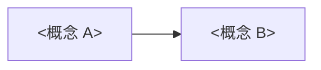

# <标题>

> **类型**:Explanation(解释)
> **状态**:未实测(YYYY-MM-DD)
> **版本基线**:<软件/版本>
> **适用**:<读者要理解什么>
> **不覆盖**:<不展开的操作/字段>

## 一、一句话结论

用一句话说明最重要的结论;再用 3-5 条要点补充。

## 二、心智模型

用一张图或一个类比说明核心概念之间的关系。

## 三、机制与时序

按"输入 → 处理 → 输出"解释它实际怎么运行。需要时序时用 mermaid。

## 四、边界与取舍

| 方案 | 优点 | 代价 | 适用 |
|------|------|------|------|
| <方案 A> | <优点> | <代价> | <场景> |

## 五、常见误解

| 误解 | 实际 |
|------|------|
| <说法> | <事实> |

## 六、延伸阅读

- [相关 canonical 文档](...)
- [外部资料](...)
