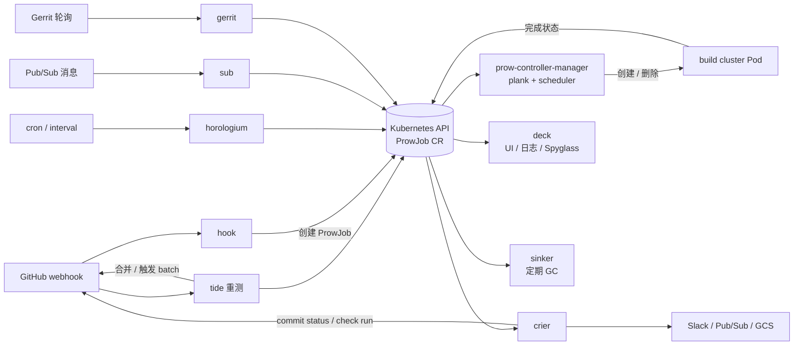
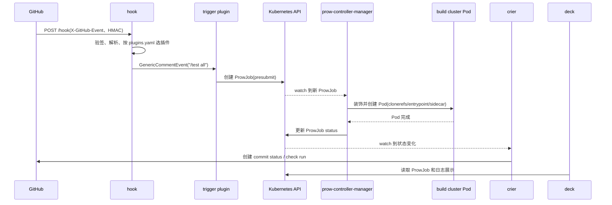

# Prow 概念与架构:它解决什么问题,组件如何协作

> **类型**:Explanation(解释)
> **状态**:未实测(2026-11-27)
> **版本基线**:kubernetes-sigs/prow `main` @ `6dceccd02`(2026-11-26)
> **适用**:想理解 Kubernetes CI 机器人 Prow 的定位、组件分工,以及一次 job 从事件到结果的完整链路
> **不覆盖**:部署与运维步骤、plugin 开发细节、GitHub 认证与限流治理(见同目录后续文档)

## 一、结论先行

- Prow 是跑在 Kubernetes 上的**事件驱动 CI/CD 系统 + GitHub 机器人**:把 GitHub webhook、定时器、Pub/Sub 消息转成 `ProwJob` 自定义资源,由控制器调度成 Pod 执行,再把结果写回 GitHub。
- 它解决的不只是"跑测试",而是围绕 PR 的整套协作:命令触发、标签审批、自动合并、状态上报、多仓库/多组织统一管理。
- 架构分两层:**无状态 HTTP 服务**(hook、deck、ghproxy)和**控制器**(prow-controller-manager、tide、crier、horologium、sinker);`ProwJob` CR 是全局唯一事实来源。
- 用户代码只在 build cluster 的 job Pod 里执行;Prow 组件本身不执行仓库里的构建脚本,只负责编排、装饰 Pod 和回收结果。
- 理解 Prow 的关键是把"事件 → ProwJob → Pod → 状态回报"这条链,与每个组件各自的触发方式分开看。

## 二、心智模型

### 2.1 一张图:事件源、编排、执行、回报

图里有两个方向要分清:

- **写入方向**:只有事件源和控制器会创建/修改 `ProwJob`;deck 的"重跑/中止"是受 OAuth 保护的特例。
- **读取方向**:deck 读 `ProwJob`、Pod 日志和对象存储;crier 读 `ProwJob` 状态后向外回报。

### 2.2 组件按触发方式分三类

| 组件 | 触发方式 | 主要职责 | 关键外部依赖 |
|------|---------|---------|-------------|
| `hook` | GitHub webhook | 验签、解析事件、分发 plugin、创建 ProwJob | GitHub API、Kubernetes API |
| `horologium` | 定时 | 按 cron/interval 创建 periodic job | Kubernetes API |
| `sub` | Pub/Sub 订阅 | 把消息转换成 ProwJob | Pub/Sub、Kubernetes API |
| `gerrit` | 轮询 Gerrit | 为 Gerrit 变更触发 presubmit/postsubmit | Gerrit、Kubernetes API |
| `prow-controller-manager` | watch ProwJob | plank 建 Pod;scheduler 选 build cluster | Kubernetes API、build cluster |
| `crier` | watch ProwJob | 把结果上报 GitHub/Gerrit/Slack/GCS 等 | 各上报目标 |
| `tide` | 周期同步 | 维护 PR 池、触发重测/batch、自动合并 | GitHub REST/GraphQL |
| `deck` | HTTP 请求 | 展示 job、日志、Spyglass;受保护的重跑/中止 | ProwJob、对象存储、GitHub OAuth |
| `sinker` | 周期 | 清理过期 ProwJob 和 Pod | Kubernetes API |
| `ghproxy` | HTTP 代理 | 缓存 GitHub API 响应,省 token、抗限流 | GitHub API |
| `status-reconciler` | 配置变化 | 增删/迁移 GitHub required status contexts | GitHub API |

`branchprotector`、`peribolos`、`checkconfig` 属于一次性或定时任务:分别同步分支保护、组织成员、配置校验,不是常驻控制器。

> **注意**:`plank` 已经不是独立二进制。它在 2021 年被移除,现在以 controller 形式运行在 `prow-controller-manager` 里;部分旧文档仍写"plank 调度 Pod"。

### 2.3 两个集群:service cluster 与 build cluster

Prow 把"控制面"和"执行面"分开:

| 平面 | 放什么 | 典型组件 |
|------|--------|---------|
| service cluster | Prow 组件和 `ProwJob` CR | hook、deck、tide、crier、PCM |
| build cluster | 真正跑测试的 Pod | job Pod、pod utilities 注入的容器 |

小规模部署可以把两者放在同一个集群(本地开发通常如此);生产上分离的好处是:构建负载不会影响控制面,多个 build cluster 可以按成本/隔离要求扩展。`ProwJobNamespace` 和 `PodNamespace` 是两个独立的配置项,描述的就是这条边界。

## 三、机制与时序

### 3.1 一次 `/test all` 的完整链路

把这条链拆开看,每一步的责任边界很清楚:

1. GitHub 把事件 POST 到 hook 的 `/hook` 路径,hook 校验 HMAC 后解析 `X-GitHub-Event`。
2. hook 按 `plugins.yaml` 找出该仓库启用的 plugin,把事件分发给对应的 handler。
3. `trigger` plugin 解析 `/test all`,过滤出匹配的 presubmit,构造并创建 `ProwJob`。
4. prow-controller-manager 里的 plank controller 发现 `TriggeredState` 的 ProwJob,把 Pod spec 装饰好,在选定的 build cluster 创建 Pod。
5. Pod 跑完,plank 把 ProwJob 置为 `success`/`failure`/`error`。
6. crier 发现状态变化,检查 `status.prev_report_states` 防止重复上报,然后创建 GitHub status 或 check run。
7. deck 从缓存和对象存储读取 `ProwJob`、日志、artifacts,提供 UI 和 Spyglass 视图;超期资源最终由 sinker 清理。

### 3.2 ProwJob:唯一的编排对象

`ProwJob`(`prow.k8s.io/v1`)是 Prow 的核心 CRD,job 的类型、状态和 agent 都在这里表达:

| 概念 | 取值 | 说明 |
|------|------|------|
| 类型 | `presubmit` / `postsubmit` / `periodic` / `batch` | PR 前测试、合并后任务、定时任务、批量测试 |
| 状态 | `scheduling` / `triggered` / `pending` / `success` / `failure` / `aborted` / `error` | 从创建到终态的生命周期 |
| agent | `kubernetes` / `jenkins` / `tekton` | 谁来执行;默认是 Kubernetes Pod |

这个对象同时被多个组件读写,所以 Prow 的很多行为都可以用"谁在什么条件下修改了 ProwJob 的哪个字段"来解释。排障时先看 ProwJob 的 `status.state`、`status.pod_name`、`status.build_id` 和 conditions,通常比翻组件日志更快。

### 3.3 可靠性不是"每个组件都多副本"

Prow 的 HA 策略因组件而异:

- hook、deck 是无状态 HTTP 服务,可以多副本;
- prow-controller-manager、sinker 使用 leader election,同一时刻只有一个实例真正工作;
- tide 明确关闭了 manager 的 leader election,依赖自身同步逻辑;
- crier 不配置 leader election,靠 `prev_report_states` 去重,避免重复上报。

> **坑**:不要把"部署了多个副本"当成"所有组件都高可用"。判断某个组件能否安全多副本,要看它是否有 leader election 或幂等去重。

## 四、边界与取舍

### 4.1 Prow 适合什么

| 场景 | 适合度 | 原因 |
|------|--------|------|
| 多仓库、多组织的统一 CI | 高 | 一个 hook + 一份 job/plugin 配置可以覆盖大量仓库 |
| 需要 chat-ops(`/test`、`/lgtm`、`/approve`) | 高 | plugin 体系就是为评论命令和标签流转设计的 |
| 基于 OWNERS 的审批和自动合并 | 高 | approve/lgtm/OWNERS/tide 形成完整链路 |
| 自托管、需要深度定制执行环境 | 高 | job 就是 Pod,镜像、资源、sidecar 都可控 |
| 只想要一个简单流水线 | 低 | 组件多、需要 K8s 和 GitHub 集成,维护成本高于托管 CI |

### 4.2 主要代价

- **依赖 Kubernetes**:控制面和执行面都是 K8s 对象,没有 K8s 就没有 Prow。
- **组件多、概念多**:hook/plugin/ProwJob/PCM/tide/crier 各自有配置和排障入口。
- **GitHub 耦合深**:核心的 hook、plugin、tide 围绕 GitHub 设计;Gerrit 有独立的 `gerrit` 组件,但能力不完全对等。
- **文档有漂移**:官方文档里仍有 2021 年的时序图和已移除组件的描述,读文档时要对照当前代码。

> **未实测**:本文结论来自源码和官方文档,没有在本机部署一套 Prow 验证;涉及运行时行为的细节以实际部署为准。

## 五、常见误解

| 误解 | 实际 |
|------|------|
| Prow 是测试框架 | Prow 只编排;测试命令在 job 镜像里执行,结果通过退出码和标记文件回传 |
| plank 是一个独立进程 | plank 已并入 prow-controller-manager,作为 controller 运行 |
| hook 会执行 job | hook 只验签、分发 plugin、创建 ProwJob;执行由 PCM 和 build cluster 完成 |
| 一套 Prow 只能管一个 GitHub 组织 | 一个 hook 和一份配置可以服务多个 org/repo,按仓库粒度启用 plugin 和 job |
| Tide 只是"自动点合并" | Tide 维护 PR 池,触发重测和 batch,按 required contexts、标签和合并方式决策 |
| deck 完全只读 | deck 主要是只读 UI;重跑和中止是经过 GitHub OAuth 校验的特例写操作 |

## 六、延伸阅读

- [Plugin 机制:注册、分发、配置与外部插件](01-Plugin机制.md)
- [Plugin 开发与扩展:从启用到写一个自己的插件](02-Plugin开发与扩展.md)
- [GitHub 集成:事件、认证与流量治理](03-GitHub事件与认证.md)
- [PR 自动化与仓库治理:Tide、OWNERS 与组织级工具](04-PR自动化与仓库治理.md)
- [Prow 官方架构文档](https://docs.prow.k8s.io/docs/overview/architecture/)(访问于 2026-11-27)

## 参考

- [Prow 官方 Overview](https://docs.prow.k8s.io/docs/overview/)
- [Prow 官方 Architecture](https://docs.prow.k8s.io/docs/overview/architecture/)
- [Life of a Prow Job](https://docs.prow.k8s.io/docs/life-of-a-prow-job/)(注意:页面基于 2021 年代码,部分组件描述已过时)
- [kubernetes-sigs/prow 仓库](https://github.com/kubernetes-sigs/prow)
