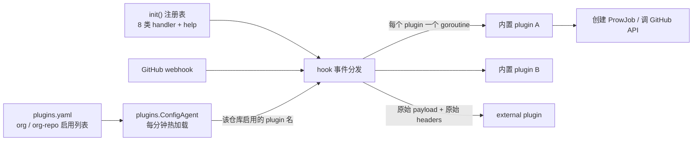

# Plugin 机制:注册、分发、配置与外部插件

> **类型**:Explanation(解释)
> **状态**:未实测(2026-11-27)
> **版本基线**:kubernetes-sigs/prow `main` @ `6dceccd02`(2026-11-26)
> **适用**:想理解 Prow plugin 如何被编译、启用、分发事件,以及内置 plugin 与 external plugin 的边界
> **不覆盖**:从零写一个 plugin 的完整步骤(见 [02-Plugin开发与扩展](02-Plugin开发与扩展.md))

## 一、结论先行

- Prow plugin **不是动态加载的独立进程**,而是编译进 hook 二进制的 Go 包:每个包在 `init()` 里把 handler 注册到全局 map。
- 一个 plugin 可以同时注册多种事件 handler(评论、PR、review、push、status);同一个 plugin 名对应同一个 help provider。
- 事件是否到达某个 plugin,由两层决定:**`plugins.yaml` 决定某仓库启用哪些 plugin 名**,**注册表决定这个 plugin 名有没有对应事件的 handler**。
- 命令解析不在 hook 里统一做,每个 plugin 自己用正则匹配评论正文;hook 只负责把事件归一化成 `GenericCommentEvent` 并发给各 plugin。
- 扩展方式有两种:改 hook 源码加内置 plugin,或部署独立的 HTTP 服务作为 external plugin,由 hook 转发原始 webhook。

## 二、心智模型:三层



三层各自回答一个问题:

| 层 | 回答的问题 | 代码位置 |
|----|-----------|---------|
| 配置层 | 这个仓库启用了哪些 plugin? | `pkg/plugins/config.go`、`plugins.ConfigAgent` |
| 注册层 | 这个 plugin 名有哪些 handler? | `pkg/plugins/plugins.go` 的全局 map |
| 分发层 | 这个事件该调用哪些 handler? | `pkg/hook/events.go` |

三者是"名字"对齐的:配置里的名字必须等于 `Register*` 时传的 name,否则启用也不会生效。`checkconfig` 会拒绝未注册的 plugin 名,hook 自己不会。

## 三、机制与实现

### 3.1 注册表:8 类事件 + 1 份帮助

`pkg/plugins/plugins.go` 维护了 8 个 handler map 和一个 help map:

| 注册函数 | handler 签名 | 触发事件 |
|----------|-------------|---------|
| `RegisterIssueHandler` | `func(Agent, github.IssueEvent) error` | `issues` |
| `RegisterIssueCommentHandler` | `func(Agent, github.IssueCommentEvent) error` | `issue_comment` |
| `RegisterPullRequestHandler` | `func(Agent, github.PullRequestEvent) error` | `pull_request` |
| `RegisterReviewEventHandler` | `func(Agent, github.ReviewEvent) error` | `pull_request_review` |
| `RegisterReviewCommentEventHandler` | `func(Agent, github.ReviewCommentEvent) error` | `pull_request_review_comment` |
| `RegisterPushEventHandler` | `func(Agent, github.PushEvent) error` | `push` |
| `RegisterStatusEventHandler` | `func(Agent, github.StatusEvent) error` | `status` |
| `RegisterGenericCommentHandler` | `func(Agent, github.GenericCommentEvent) error` | 由多种事件归一化而来 |

每次注册都会同时写 handler map 和 `pluginHelp[name]`,所以 help 不会和 handler 脱节。一个 plugin 注册多次是常态,例如 lgtm 同时注册 GenericComment、PullRequest、ReviewEvent。

`Agent` 是 plugin 能拿到的全部依赖:

| 字段 | 用途 |
|------|------|
| `GitHubClient` | GitHub REST + GraphQL(带 org 注入包装) |
| `ProwJobClient` | 创建/查询 ProwJob |
| `KubernetesClient` | 访问集群资源 |
| `BuildClusterCoreV1Clients` | 访问各 build cluster |
| `GitClient` | clone 仓库、读文件 |
| `OwnersClient` | 解析 OWNERS |
| `SlackClient` / `JiraClient` / `BugzillaClient` | 外部通知与工单 |
| `Config` / `PluginConfig` | Prow 配置与 plugin 配置 |
| `Logger` / `Metrics` | 带 plugin 字段的日志和指标 |

`NewAgent` 会给每个 client 加上 plugin 名和 org 的字段,所以 plugin 日志天然带上下文。

### 3.2 分发:从 webhook 到 goroutine

hook 的处理顺序:

1. `ServeHTTP` 验签,拿到 `eventType`、`eventGUID` 和原始 payload;
2. `demuxEvent` 按事件类型反序列化,给事件填上 GUID;
3. 检查 `RepoEnabled`,然后为每类事件启动 `handle*Event` goroutine;
4. `handle*Event` 调 `ConfigAgent` 的 `XHandlers(org, repo)`,拿到该仓库启用的 plugin -> handler 映射;
5. 每个 handler 在独立 goroutine 中执行,panic 会被捕获并记录,不会拖垮 hook。

几个容易忽略的细节:

- PR、review、review comment 事件用 **base repo** 查 plugin 配置,所以来自 fork 的 PR 用的是目标仓库的配置;
- issue、PR、review、review comment 会被 `GeneralizeComment` 归一化成 `GenericCommentEvent`,但只对带文本的动作(created/opened/submitted、edited、deleted/dismissed)生效;
- 已关闭的 issue/PR 不会被归一化,避免误触发命令。

### 3.3 配置:org 与 repo 的合并规则

`plugins.yaml` 的顶层 `plugins` 是 `org -> {plugins, excluded_repos}` 的映射,同时兼容旧格式 `org: [plugin]`。

合并规则:

- org 级 plugin 应用于该 org 下所有仓库,但 `excluded_repos` 里的仓库除外;
- repo 级 plugin 总是追加;
- 同一个 plugin 不能同时出现在 org 级和 repo 级,除非该 repo 在 `excluded_repos` 里。

```yaml
plugins:
  org:
    plugins:
    - lgtm
    - approve
    excluded_repos:
    - legacy-repo
  org/special-repo:
    plugins:
    - trigger
```

配置加载由 `plugins.ConfigAgent` 负责:

- 主文件 + 补充目录(`*_pluginconfig.yaml`)合并;
- 补充文件只允许合并白名单字段(Plugins、ExternalPlugins、Approve、Lgtm、Triggers、Welcome、MilestoneApplier 等);
- 启动时加载一次,之后**每分钟**重新加载;加载失败只记日志,继续用旧配置;
- `Validate` 会做默认值填充、正则编译、重复项检查、互斥 plugin 检查等。

> **注意**:改 `plugins.yaml` 通常不需要重启 hook,但最多有约一分钟延迟;如果配置校验失败,新配置不会生效,日志里能看到错误。

### 3.4 命令解析:每个 plugin 自己的事

hook 不分发"命令",只分发"事件"。`/lgtm`、`/approve`、`/test` 的识别完全由 plugin 自己完成:

```go
var LGTMRe = regexp.MustCompile(`(?mi)^/lgtm(?: no-issue)?\s*$`)
```

典型 plugin 会在 handler 里依次检查:

1. 事件动作是不是 `Created`(避免编辑评论重复触发);
2. 是不是 PR、状态是不是 open;
3. 评论正文是否匹配自己的正则;
4. 调用者有没有权限。

这种设计的代价是每个 plugin 都要重复写守卫逻辑;好处是 plugin 之间完全解耦,新增命令不需要改 hook。

### 3.5 帮助信息:运行时生成,不是静态文档

每个 plugin 注册时提供 `HelpProvider`,按当前配置和启用的仓库生成 `PluginHelp`:

- `Description`:插件做什么;
- `Config`:按仓库展示的配置说明;
- `Snippet`:带注释的 YAML 示例;
- `Commands`:命令用法、示例、谁能用。

这些信息由 hook 的 `/plugin-help` 提供,deck 的 `/command-help`、`/plugins` 展示。YAML 注释片段来自一个巧妙的设计:`pkg/plugins/config.go` 被 `go:embed` 进二进制,`genyaml` 从源码里提取字段注释生成 YAML。

> **坑**:这个机制只在 `version.Name == "hook"` 时初始化。直接 `go build ./cmd/hook` 或改了二进制名,`CommentMap` 为空,help 里的 YAML 片段会退化成无注释版本。

### 3.6 External plugin:HTTP 契约

external plugin 的配置在 `plugins.yaml` 的 `external_plugins`:

```yaml
external_plugins:
  org/repo:
  - name: needs-rebase
    endpoint: http://needs-rebase
    events:
    - pull_request
    - issue_comment
```

匹配与投递:

- key 可以是 `org/repo` 或 `org`;
- `events` 为空表示所有事件;否则只转发列出的 `X-GitHub-Event`;
- 没有 `endpoint` 时默认 `http://<name>`;
- hook 把**原始 payload** 和**原始 headers**(包括 `X-Hub-Signature-256`)POST 到 endpoint,并设置 `User-Agent: ProwHook`;
- 响应必须是 2xx;传输错误会重试 5 次,间隔从 100ms 指数退避;
- HTTP client 没有设置单请求超时,external plugin 自己要把处理时间控制住。

因为签名头被原样转发,external plugin 应该用同一个 HMAC secret 再验一次签,不能假设"来自 hook 的请求一定可信"。

> **注意**:external plugin 的配置校验只检查重名,不校验 endpoint URL 和事件名;写错了要到运行时才会暴露。

## 四、边界与取舍

| 维度 | 内置 plugin | external plugin |
|------|-------------|-----------------|
| 部署 | 跟 hook 一起编译、发布 | 独立服务、独立镜像 |
| 事件来源 | hook 已解析的结构化事件 | 原始 webhook payload,自己解析 |
| 依赖 | 直接拿 Agent 的全部 client | 自己创建 GitHub client、git client |
| 隔离性 | 与 hook 同进程,panic 被捕获但共享资源 | 进程隔离,可单独扩缩容 |
| 适用 | 通用、轻量、需要 Prow 内部对象的逻辑 | 慢操作、特殊依赖、需要隔离权限或执行 PR 代码 |
| 开发成本 | 要改 Prow 源码并重新构建 hook | 独立开发部署,只需遵守 HTTP 契约 |

判断标准:如果逻辑需要频繁访问 ProwJob/Owners/Config,优先内置;如果逻辑慢、依赖重、或需要不同权限边界,优先 external。

## 五、常见误解

| 误解 | 实际 |
|------|------|
| plugin 是运行时插件,可以动态加载 | 编译期通过 `init()` 注册,新增内置 plugin 必须重新构建 |
| 在 `plugins.yaml` 里启用就会生效 | 名字必须与 `Register*` 的 name 一致;hook 不校验,`checkconfig` 才校验 |
| hook 负责解析 `/lgtm` 这类命令 | hook 只归一化事件,命令正则在各 plugin 内部 |
| 改了 `plugins.yaml` 必须重启 | `ConfigAgent` 每分钟热加载;失败时保留旧配置 |
| external plugin 只收到自己订阅的事件 | `events` 为空时收到所有事件;未知事件也会被转发 |
| external plugin 不用验签 | 签名头会原样转发,应自行用 HMAC secret 验证 |
| help 是静态文档 | 由各 plugin 的 `HelpProvider` 运行时生成,依赖当前配置 |
| 所有链接 plugin 的二进制都有完整 help | 只有 `version.Name == "hook"` 时 `CommentMap` 才初始化 |

## 六、延伸阅读

- [02-Plugin开发与扩展](02-Plugin开发与扩展.md):按步骤启用、编写、测试一个 plugin
- [03-GitHub事件与认证](03-GitHub事件与认证.md):webhook 验签和事件类型
- [Prow Plugins 文档](https://docs.prow.k8s.io/docs/components/plugins/)(访问于 2026-11-27)

## 参考

- [pkg/plugins GoDoc](https://pkg.go.dev/sigs.k8s.io/prow/pkg/plugins)
- [pkg/pluginhelp GoDoc](https://pkg.go.dev/sigs.k8s.io/prow/pkg/pluginhelp)
- [hook 组件文档](https://docs.prow.k8s.io/docs/components/core/hook/)
