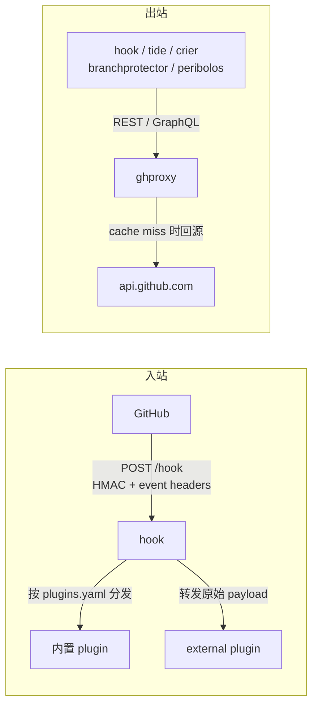

# GitHub 集成:事件、认证与 API 流量治理

> **类型**:Explanation(解释)
> **状态**:未实测(2026-11-27)
> **版本基线**:kubernetes-sigs/prow `main` @ `6dceccd02`(2026-11-26)
> **适用**:需要部署或排障 Prow 与 GitHub 之间的 webhook、认证、限流与 API 调用
> **不覆盖**:Tide 合并决策、OWNERS/approve/lgtm 的完整审批逻辑(见 [04-PR自动化与仓库治理](04-PR自动化与仓库治理.md))

## 一、结论先行

- Prow 与 GitHub 只有两条通道:**入站 webhook**(GitHub → hook,验签后分发 plugin)和**出站 API 调用**(各组件 → GitHub REST/GraphQL)。
- hook 内部只处理 7 类事件:`issues`、`issue_comment`、`pull_request`、`pull_request_review`、`pull_request_review_comment`、`push`、`status`;其他事件内部忽略,但仍可转发给 external plugin。
- 验签只接受 `X-Hub-Signature-256`(HMAC-SHA256)和 JSON body;仓库可以用一个 secret,也可以按 org/repo 配多个 secret,最具体的 scope 优先。
- 生产环境推荐 **GitHub App** 而不是 PAT;ghproxy 缓存的是 API 响应,不是凭据,多组件共享缓存时要让 installation token 的表示一致。
- Prow **没有 webhook 去重**:`X-GitHub-Delivery` 只用于日志和 ProwJob label,重复投递会被重新处理,plugin 必须自己保证幂等。

## 二、心智模型:两条通道



两条通道的失败模式完全不同:

- **入站失败**:GitHub 显示 webhook 投递失败,通常是 HMAC 不匹配、URL/端口不通、content-type 不对。
- **出站失败**:组件日志里出现 401/403/429,ProwJob 可能正常跑完但状态写不回 GitHub,或者 Tide 看不到最新状态。

> **注意**:ghproxy 只代理出站 API 流量。GitHub 的 webhook 必须直接到达 hook,不要经过 ghproxy。

### 2.1 各组件与 GitHub 的关系

| 组件 | 入站 webhook | 出站 API | 典型用途 |
|------|-------------|---------|---------|
| `hook` | 是,唯一入口 | REST | 验签、分发 plugin、创建 ProwJob |
| `tide` | 否 | REST + GraphQL | 查询 PR 池、合并、触发重测 |
| `crier` | 否 | REST | 写 commit status / check run |
| `deck` | 否 | REST + OAuth | 登录鉴权、重跑/中止 |
| `branchprotector` | 否 | REST | 同步分支保护 |
| `peribolos` | 否 | REST | 同步组织、团队、成员 |
| `status-reconciler` | 否 | REST | 增删 required status contexts |
| `ghproxy` | 否 | REST + GraphQL | 缓存和限流 |

## 三、入站:webhook 验签与事件分发

### 3.1 一个合法请求长什么样

```text
POST /hook
X-GitHub-Event: issue_comment
X-GitHub-Delivery: <uuid>
X-Hub-Signature-256: sha256=<hex>
Content-Type: application/json

{ ...GitHub webhook payload... }
```

hook 的校验顺序(`pkg/github/webhooks.go`):

1. 只接受 `POST`;
2. 必须带 `X-GitHub-Event`、`X-GitHub-Delivery`、`X-Hub-Signature-256`;
3. `Content-Type` 必须是 `application/json`;
4. 用 HMAC-SHA256 校验 body,只认 `sha256=` 前缀,不认旧的 `X-Hub-Signature`;
5. 校验通过后按 `X-GitHub-Event` 进入分发。

> **坑**:hook 没有对请求体做大小限制(`http.MaxBytesReader` 没有使用)。生产上应在 Ingress/反向代理层限制 body 大小,否则超大 payload 会直接进入进程内存。

### 3.2 HMAC secret 的两种格式

`--hmac-secret-file` 指向的文件可以是:

- 旧格式:文件内容就是一个 secret;
- 新格式:YAML,按 `org`、`org/repo` 或 `*` 配置一组 `{value, created_at}`。

匹配规则是**最具体优先**:repo 级 > org 级 > `*`。配置了 repo 级 secret 但值不对时,不会回退去试 org 级 secret。

多组织、多 webhook 的场景可以用 `cmd/hmac` 管理:它读取 `managed_webhooks` 配置,负责创建/更新/轮换 GitHub webhook 和对应 secret。`cmd/hmac` 需要 `admin:repo_hook`、`admin:org_hook` 权限。

### 3.3 7 类事件与 plugin 的关系

| `X-GitHub-Event` | 典型用途 | 是否转成 GenericCommentEvent |
|------------------|---------|------------------------------|
| `issues` | issue 打开/编辑/关闭、标签命令 | 是 |
| `issue_comment` | `/lgtm`、`/approve`、`/test` 等评论命令 | 是 |
| `pull_request` | opened/synchronize/labeled、size、welcome 等 | 是 |
| `pull_request_review` | Approve / Request Changes | 是 |
| `pull_request_review_comment` | review 里的行内评论命令 | 是 |
| `push` | push 事件处理 | 否 |
| `status` | 外部 status 事件 | 否 |

`GenericCommentEvent` 是 Prow 的"统一命令事件":issue、PR、review、review comment 都会被归一化成它,这样 `/lgtm` 这类 plugin 只需要写一个 handler。

没有出现在表里的事件(例如 `check_run`、`check_suite`)不会进入内置 plugin;Tide 和 crier 是通过 REST/GraphQL 主动查询 check run 的,不依赖 webhook。

### 3.4 投递语义:至少一次,没有去重

GitHub 的 webhook 是"至少一次"投递,可能重发。Prow 的处理是:

- `X-GitHub-Delivery` 被记录到日志,并作为 ProwJob 的 `event-GUID` label;
- 没有持久化去重表,重发的同一个 GUID 会被重新执行。

因此 plugin 的写操作要幂等:重复加标签、重复评论、重复创建 ProwJob 的后果要能接受,或者用状态检查避免重复动作。

## 四、出站:认证方式与 API 调用

### 4.1 PAT 与 GitHub App

所有需要访问 GitHub 的组件都使用同一组 flag(`pkg/flagutil/github.go`):

```bash
# 方式一:PAT
hook --github-token-path=/etc/github/token

# 方式二:GitHub App
hook --github-app-id=<APP_ID> \
  --github-app-private-key-path=/etc/github/app.pem
```

| 方式 | 凭据 | 适用 | 代价 |
|------|------|------|------|
| PAT | 一个 token 文件 | 本地开发、单仓库、小规模 | 限额按 token 算;权限通常过宽;轮换要改所有组件 |
| GitHub App | App ID + 私钥 | 生产、多组织 | 需要创建并安装 App;按 org 换取 installation token |

GitHub App 的机制(`pkg/github/app_auth_roundtripper.go`):

1. 用私钥签发 RS256 JWT(有效期 9 分钟),用于 `/app*` 和查询 installation;
2. 按 org 查 installation,换 installation token;
3. token 按 `slug + " - " + org` 缓存,过期前 1 分钟刷新;
4. REST 请求从 context 里取 org 选择 installation;GraphQL 必须显式传 org(`QueryWithGitHubAppsSupport`);
5. Git 操作用 `x-access-token` 作为用户名。

> **坑**:GraphQL 不会自动从请求里推断 org。用 App 认证时,调用方必须显式指定 org,否则可能拿到错误的 installation token。

### 4.2 常见写操作

| 操作 | Client 方法 | 说明 |
|------|-------------|------|
| 评论 | `CreateComment` / `DeleteComment` | plugin 的 `/foo` 反馈、Tide 状态评论 |
| 标签 | `AddLabel` / `RemoveLabel` | approve、lgtm、size、lifecycle 等 |
| 状态 | `CreateStatus` | 写 commit status,context 通常是 presubmit 名 |
| 检查 | `ListCheckRuns` | 只读;Tide 把 check run 和 status 合并判断 |
| 合并 | `Merge` | Tide 使用;支持 merge/squash/rebase |
| PR | `GetPullRequest` / `EditPullRequest` | 读取可合并性、修改标题等 |

`CreateStatus` 写入的 context 来自 `Presubmit.Context`;Tide 判断一个 PR 是否通过时,会同时看 commit status 和 check run 的 rollup,要求所有非 optional 的 context 都是 `SUCCESS`。

### 4.3 dry-run 默认是打开的

hook、tide 等组件的 `--dry-run` 默认值通常是 `true`。dry-run 下,非 GET 请求会被拦截(App token 获取除外),表现为"事件收到了、日志也打了,但 GitHub 上没有任何变化"。

> **注意**:部署后第一次验证时,先确认 `--dry-run=false`,否则很容易误判为权限或 webhook 问题。

## 五、ghproxy:缓存、请求合并与限流

### 5.1 它解决什么问题

GitHub API 的限额按 token/installation 计算。Prow 的组件会重复查询同样的 PR、issue、status,ghproxy 通过缓存和请求合并把这些调用压下去:

- 反向代理 `https://api.github.com`,路径原样透传;GraphQL 走 `http://ghproxy/graphql`;
- 缓存支持磁盘、内存、Redis 三种后端;
- 缓存条目必须做条件重验证(conditional revalidation),不是永久缓存;
- 相同请求会合并(coalescing),避免并发打爆上游;
- 内置并发和节流控制,区分 REST 与 GraphQL v4。

```bash
# 示例:磁盘缓存 + 50GB 上限
ghproxy \
  --upstream=https://api.github.com \
  --cache-dir=/var/cache/ghproxy \
  --cache-sizeGB=50 \
  --port=8888
```

> **未实测**:以上为源码中的 flag 组合示例,未在本机部署验证。

### 5.2 它不共享凭据

ghproxy 缓存的是响应,不是 token。多个组件各自带自己的 `Authorization` 头,缓存按 auth 头做分区。

用 GitHub App 时,同一个 installation 在不同组件、不同时间拿到的 token 字符串不同,会导致缓存分区对不上。`pkg/apptokenequalizer` 就是为了解决这个问题:它把 `AppInstallationToken` 的 JSON 规范成相同表示,让不同客户端的 auth 头哈希一致,从而命中同一个缓存分区。ghproxy 内部会使用这个 RoundTripper。

### 5.3 关键观测指标

| 指标 | 含义 |
|------|------|
| `ghcache_responses` | 缓存命中/未命中 |
| `github_token_usage` | token 使用量 |
| `github_token_reset` | 限额重置时间 |
| `concurrent_outbound_requests` | 当前并发出站请求 |
| `pending_outbound_requests` | 等待中的请求 |
| `ghcache_cache_entry_age_seconds` | 缓存条目年龄 |

## 六、边界与常见误解

| 误解 | 实际 |
|------|------|
| ghproxy 可以共享 GitHub token | 它只共享响应缓存;凭据仍由各组件自己持有 |
| `cmd/webhook-server` 是 GitHub webhook 接收器 | 它是 ProwJob 的 Kubernetes admission webhook,做校验和 mutation |
| `gangway` 是 deck 的登录入口 | gangway 是创建/查询 ProwJob 的 gRPC API;deck 登录用的是 `pkg/githuboauth` + GitHub OAuth App |
| GitHub App 和 OAuth App 是一回事 | GitHub App 用于 API 调用;deck 登录需要单独的 OAuth App(client id/secret) |
| `check_run` 事件会走 hook | hook 不处理 check 事件;Tide/crier 通过 REST/GraphQL 读取 |
| webhook 重复投递会被 Prow 去重 | 没有去重;GUID 只用于日志和 label,plugin 必须幂等 |

### 6.1 一套可用的部署组合

1. 创建一个 GitHub App,按需授予 Contents、Pull Requests、Issues、Commit statuses、Checks、Administration、Members、Workflows 等权限;
2. hook 使用 App 凭据 + 独立 HMAC secret,webhook 直接指向 hook;
3. 所有出站组件把 `--github-endpoint` 指向 ghproxy,并保留直连作为 fallback;GraphQL 指向 `/graphql`;
4. deck 单独创建 GitHub OAuth App,用于浏览器登录;
5. 多组织 webhook 用 `cmd/hmac` + `managed_webhooks` 管理;
6. peribolos/branchprotector 只在需要时授予 Admin/Members 写权限,并以 periodic job 形式运行。

> **安全**:HMAC secret、App 私钥、OAuth client secret 都只通过文件或 Secret 挂载,不要写进 `plugins.yaml` 或镜像。

## 七、延伸阅读

- [04-PR自动化与仓库治理](04-PR自动化与仓库治理.md):Tide 如何消费这些 status,approve/lgtm/OWNERS 如何配合
- [01-Plugin机制](01-Plugin机制.md):hook 如何把事件分发给 plugin
- [Prow hook 文档](https://docs.prow.k8s.io/docs/components/core/hook/)(访问于 2026-11-27)

## 参考

- [GitHub API Access](https://docs.prow.k8s.io/docs/github-api-access/)(注意:文中 `--github-search-endpoint` 在当前代码中不存在)
- [ghproxy 文档](https://docs.prow.k8s.io/docs/ghproxy/)
- [ghcache 文档](https://docs.prow.k8s.io/docs/ghproxy/ghcache/)
- [Prow GitHub 部署指南](https://docs.prow.k8s.io/docs/getting-started-deploy/)
