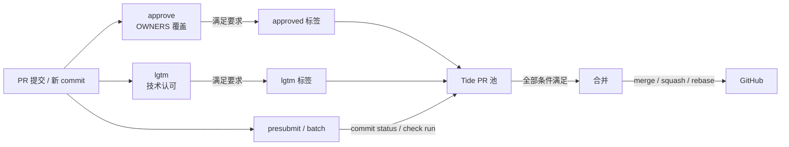

# PR 自动化与仓库治理:Tide、OWNERS 与组织级工具

> **类型**:Explanation(解释)
> **状态**:未实测(2026-11-27)
> **版本基线**:kubernetes-sigs/prow `main` @ `6dceccd02`(2026-11-26)
> **适用**:想理解 PR 从提交到自动合并之间,标签、审批、状态和合并策略如何配合
> **不覆盖**:webhook 验签、GitHub App/PAT 认证、ghproxy(见 [03-GitHub事件与认证](03-GitHub事件与认证.md))

## 一、结论先行

- PR 合并是四类信号的组合:**标签**(lgtm/approved/合并方式)、**审批**(OWNERS 覆盖与 review)、**状态**(required contexts)、**合并策略**(merge/squash/rebase)。
- `approve` plugin 根据 OWNERS 计算文件覆盖,满足要求才加 `approved`;`lgtm` 是独立的技术认可标签,两者通常一起构成合并门槛。
- Tide 周期性构建 PR 池,只有 head SHA 上所有 required contexts 成功、没有冲突、标签和 review 满足、合并方式允许时才合并。
- Tide 自己不跑测试:它触发 presubmit 或 batch,读回 status/check run,再做合并决策。
- 组织、分支保护、webhook、required contexts 也可以 GitOps 化,分别由 peribolos、branchprotector、`cmd/hmac`、status-reconciler 负责。

## 二、心智模型:从 PR 到合并



关键区分:

- **approve 管"谁有权批准改这个目录"**,依据是 OWNERS 文件;
- **lgtm 管"代码是否被技术认可"**,依据是评论或 GitHub review;
- **Tide 管"现在能不能合"**,依据是标签、review、status 和合并策略。

三者可以独立配置:有的仓库只要求 lgtm,有的要求 approved + lgtm,有的还要求 `reviewApprovedRequired`。

### 2.1 四类信号

| 信号 | 产生者 | 存在哪里 | 消费者 |
|------|--------|---------|--------|
| `approved` | approve plugin(也认可人工添加) | GitHub label | Tide、人工 |
| `lgtm` | lgtm plugin | GitHub label | Tide、人工 |
| 文件覆盖 | approve/approvers 内部计算 | 内存 + 评论 | approve 决定是否加标签 |
| required contexts | presubmit + crier | GitHub status / check run | Tide |
| 合并方式 | 配置或 PR 标签 | label | Tide |

## 三、OWNERS 与 approve/lgtm

### 3.1 OWNERS 文件的结构

`OWNERS` / `OWNERS_ALIASES` 由 `pkg/repoowners` 解析,主要字段:

| 字段 | 含义 |
|------|------|
| `approvers` | 有权批准该目录的 GitHub 用户或 alias |
| `reviewers` | 建议的 reviewer |
| `required_reviewers` | 必须出现的 reviewer(按文件/目录匹配) |
| `advisory_approvers` | 只作提示,不阻塞合并 |
| `labels` | 该目录变更时自动添加的标签 |

目录选项还包括 `no_parent_owners`(不继承父目录 OWNERS)和 `auto_approve_unowned_subfolders`(无 OWNERS 的子目录自动视为已批准)。解析结果按分支/SHA 缓存,所以同一个 PR 上多次查询不会反复读文件。

### 3.2 approve 如何计算"够了"

`pkg/plugins/approve` 的核心流程:

1. 收集 issue comment、review comment、review 三种来源的 `/approve`、`/approve cancel` 以及 GitHub 的 Approve/Request Changes;
2. 把 PR 修改的文件映射到 OWNERS,计算每个文件是否被足够的 approver 覆盖;
3. 满足 `required_reviewers` 和仓库配置后,添加 `approved` 标签;不再满足时移除;
4. 人工添加的 `approved` 标签会被尊重,不会因为 bot 计算不满足就删掉。

几个容易踩的配置:

- `require_self_approval`:作者自己的 `/approve` 是否算数;
- `lgtm_acts_as_approve`:lgtm 是否等价于 approve;
- `ignore_review_state`:是否忽略 GitHub review 的 Approve/Request Changes;
- `issue_required`:是否必须有关联 issue。

### 3.3 lgtm 的粘性与失效

`pkg/plugins/lgtm` 处理:

- `/lgtm`、`/lgtm cancel`、`/remove-lgtm`;
- GitHub review 的 Approve/Request Changes(由 `review_acts_as_lgtm` 控制);
- 新 commit 到来时移除 lgtm,除非提交来自 `trusted_team_for_sticky_lgtm` 指定的团队;
- `store_tree_hash`:squash 等操作不改变树哈希时,保留 lgtm。

### 3.4 一个最小配置示例

```yaml
approve:
- repos:
  - org/repo
  require_self_approval: true
  lgtm_acts_as_approve: false
lgtm:
- repos:
  - org/repo
  review_acts_as_lgtm: true
  store_tree_hash: true
```

> **未实测**:字段名来自 `pkg/plugins/config.go`,示例未在真实 Prow 实例上验证;实际部署前用 `checkconfig` 校验。

### 3.5 辅助 plugin

| plugin | 作用 |
|--------|------|
| `owners-label` | 按修改文件匹配 OWNERS 里的 `labels`,自动加标签 |
| `verify-owners` | 校验新改的 OWNERS 条目是否为组织成员/协作者;失败加 `do-not-merge/invalid-owners-file` |
| `approve` | 计算覆盖并维护 `approved` |
| `lgtm` | 维护 `lgtm` |

`verify-owners` 失败时会阻止合并,修复后自动移除标签;也可以用 `/verify-owners` 重新触发。

## 四、Tide:合并决策器

### 4.1 PR 池从哪来

Tide 用配置里的 `TideQuery` 通过 GitHub GraphQL 搜索 PR,基础条件是:

```text
is:pr state:open archived:false
```

再叠加 `labels`、`missingLabels`、`branches`、`milestone`、`author`、`orgs`/`repos`、`reviewApprovedRequired` 等条件。多个 query 并发执行;App 认证下按 org 分片。

```yaml
tide:
  queries:
  - orgs: [org]
    labels: [lgtm, approved]
    missingLabels: [do-not-merge/needs-rebase]
    reviewApprovedRequired: true
```

> **未实测**:示例只保留常用字段,完整字段见 `pkg/config/tide.go` 的 `TideQuery`。

### 4.2 过滤:哪些 PR 不能合

Tide 的 `filterPR` 会排除:

- 有冲突的 PR;
- 使用了仓库不允许的合并方式;
- head SHA 上有失败的 required context;
- 处于 pending 且不是由已配置 presubmit 支撑的 context。

pending 但对应已配置 presubmit 的 context 会被容忍,因为 Tide 自己可以等它完成或触发重测。

### 4.3 合并动作的顺序

`takeAction` 的优先级:

1. 有可合并的 batch,先合并 batch;
2. 否则合并一个所有条件都满足的 PR;
3. 否则为满足条件的 PR 触发 batch;
4. 否则为缺少串行测试的 PR 触发 presubmit。

这个顺序解释了为什么有时 Tide 不立即合并:它在等 batch 或等某个 required context。

### 4.4 合并方式

合并方式按 `org/repo/branch` 层级配置,默认 `merge`;PR 上的 `squash_label`、`rebase_label`、`merge_label` 可以覆盖配置。多个合并方式标签同时存在时,冲突会导致不合并。

Tide 还会检查仓库本身是否允许该方式(GitHub 的 `AllowMergeCommit`、`AllowSquashMerge`、`AllowRebaseMerge`),以及 `mergeStateStatus=BLOCKED` 的处理策略(`ignore`/`permit`/`block`)。

### 4.5 batch 测试

batch 是把多个 PR 的 head SHA 放在一起跑 presubmit:

- 从最老的合格 PR 开始挑选,数量上限由 `batch_size_limit` 控制(`-1` 关闭,`0` 不限制);
- 合并前会重新校验 batch 里的 PR head SHA 是否仍与当时一致;
- batch 的所有 required presubmit 通过后,整批合并。

### 4.6 Tide 自己的 status context

Tide 会写一个名为 `tide` 的 status context,描述 PR 在池中的状态,例如:

- `In merge pool.` — 已进入合并池;
- `Not mergeable. <原因>` — 不满足条件,原因由 `requirementDiff` 计算(缺标签、缺 context、缺 review、GitHub BLOCKED 等)。

排障时先看这个 context,通常能直接定位缺什么。

## 五、组织级治理工具

| 工具 | 作用 | 配置来源 | 运行方式 |
|------|------|---------|---------|
| `peribolos` | 同步组织、团队、成员、仓库协作者 | Prow 配置的 `orgs:` | 一次性/定时,`--confirm` 才真正写 |
| `branchprotector` | 同步分支保护,可从 presubmit 推导 required checks | `branch-protection:` | 推荐 periodic job |
| `status-reconciler` | 阻塞型 presubmit 变化时增删/迁移 status contexts | job 配置 | 常驻控制器 |
| `cmd/hmac` | 创建/轮换 GitHub webhook 和 HMAC secret | `managed_webhooks` | 一次性/定时 |
| `checkconfig` | 校验 Prow 配置 | 全部配置 | presubmit |

这些工具的共同思路是:GitHub 上的组织设置也当成声明式配置管理,变更走 PR 审核,再由工具收敛。

> **安全**:peribolos 和 branchprotector 需要组织和仓库的管理权限,建议只在受控的 periodic job 中运行,并先用 dry-run 或 `--confirm=false` 检查差异。

## 六、边界与常见误解

| 误解 | 实际 |
|------|------|
| lgtm 和 approve 是一回事 | lgtm 是技术认可,approve 是 OWNERS 覆盖;可以分别要求 |
| Tide 会自己跑测试 | Tide 只触发 presubmit/batch,并读取 status/check run |
| CI 全绿就会自动合并 | 还需要标签、review、无冲突、合并方式允许、BLOCKED 策略满足 |
| `approved` 标签只能由 bot 加 | 人工添加的标签会被尊重 |
| batch 一定比单个 PR 快 | batch 要等一组 PR 和一次额外测试,适合高吞吐仓库,不适合紧急单 PR |
| `tide` status 只是展示 | 它是 Tide 判断和排障的主要入口,包含缺失条件 |

## 七、延伸阅读

- [03-GitHub事件与认证](03-GitHub事件与认证.md):status/check 如何写入,App 认证如何影响 Tide 查询
- [00-概念与架构](00-概念与架构.md):ProwJob、crier 与 Tide 在整体链路中的位置
- [Tide 官方文档](https://docs.prow.k8s.io/docs/components/core/tide/)(访问于 2026-11-27)

## 参考

- [Tide 配置参考](https://docs.prow.k8s.io/docs/components/core/tide/config/)
- [approve plugin 文档](https://docs.prow.k8s.io/docs/components/plugins/approve/)(页面为占位,实质内容在 `pkg/plugins/approve`)
- [peribolos 文档](https://docs.prow.k8s.io/docs/components/cli-tools/peribolos/)
- [branchprotector 文档](https://docs.prow.k8s.io/docs/components/optional/branchprotector/)
